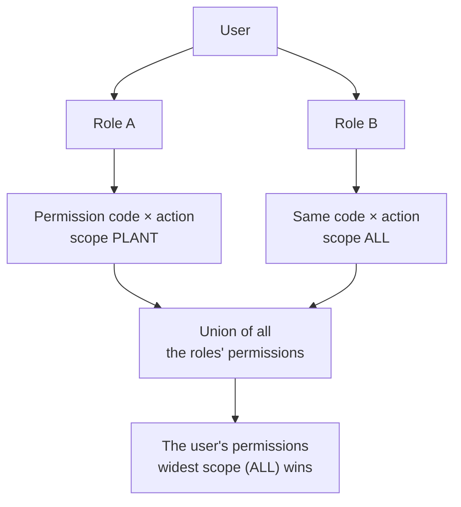
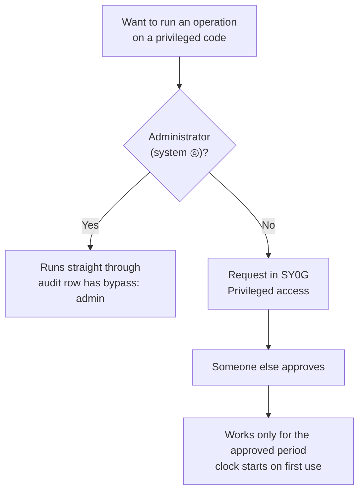

Access in this system is managed through **roles** (bundles of job duties).
Permissions are never granted to a user directly — you assign roles. A user can
hold several roles, in which case their access is the **union** of all of them.

> This page is written by hand (not generated) from the **live data in the dev
> database** as of 2026-11-27. For the latest full
> listing see `_docs/rbac-role-matrix.xlsx`. To check one person's effective
> permissions, open their detail page in **SY01 User management**.

## Three terms

A permission answers "**who** (role) may do **what** (action) to **which area**
(permission code)", optionally limited by "**how far**" (scope).

- **Permission code** — one business area. Not necessarily one app (`master`
  covers all 16 master-data apps; `order_acceptance` covers both SA04 and SA05).
- **Action** — R=read / C=create / U=update / D=delete / E=export / A=approve /
  ◎=ADMIN (every action on that code). **Approving a document is not an action** —
  who can approve is decided solely by approval-group membership in **MS0B
  approval settings**. A appears only for **privileged-access decisions**
  (SY0G), on the five privileged codes (`kiosk_secret`, `kiosk_device`,
  `kiosk_card`, `personal_data`, `user_admin`), `portal_admin` and `api_client`.
- **Scope** — how far the action reaches. Blank means **ALL** (every row).
  - **OWN** — only rows the user created
  - **PLANT** — only rows of the user's assigned plants (set in SY01)
  - **REGION** — only rows in the region of the user's plants

When several roles grant the same code, the **widest scope wins** (PLANT + ALL
= ALL).

How roles turn into effective permissions, as a diagram:



## Roles

| Role | rolename | Purpose |
|---|---|---|
| Administrator | `admin` | Everything (it holds `system` ◎, so even codes it has no row for are allowed). The only role that runs privileged operations without an approval |
| Manager (approver) | `manager` | Read and export across every area + read price-estimate cost (`estimate_cost`) — for cross-department approvers (whether they can approve is decided by MS0B group membership) |
| Sales manager | `sales_manager` | Full control of sales data + read everywhere |
| Sales | `sales` | Create and edit sales data, **own records only** (OWN) |
| Sales assistant | `sales_assistant` | Read-only across sales data. No create, edit or approve |
| Purchasing manager | `purchasing_manager` | Full control of purchasing data + read everywhere |
| Purchasing | `purchasing` | Day-to-day purchase requests, orders, receipts, outsourcing |
| Production manager | `production_manager` | Full control of production data + read everywhere |
| Production | `production` | Work orders, step execution, inventory (**own plants only**) |
| Quality manager | `quality_manager` | Full control of work orders + read everywhere |
| Quality | `quality` | Inspection records and inspection approval (**own plants only**) |
| Shipping manager | `shipping_manager` | Full control of shipping data + read everywhere |
| Shipping | `shipping` | Shipping orders and delivery notes (shipping + inventory are **own plants only**) |
| Accounting manager | `accounting_manager` | Full control of billing + read everywhere |
| Accounting | `accounting` | Invoices, monthly closing, accounting CSV |
| Master data editor | `master_editor` | Master data only. Holds no business-document grants, so pair it with a department role |
| Viewer | `viewer` | Read-only across every area (executives, audit) |
| Staff | `staff` | Transitional catch-all — everything except system, shared devices, the admin manual, privileged codes and cost. **Replace with department roles in production** |

### Privileged roles (assigned separately from business roles)

System-critical operations are not "you hold the grant, so you may". They are
**requested, approved by someone else, and usable only for a bounded time**
(privileged access, SY0G). **Requesting and approving are always separate
roles** — so that even when one person holds both, it is visible in the role
list that they cannot approve their own request.

| Role | rolename | Purpose |
|---|---|---|
| Kiosk operator | `kiosk_operator` | Looks after shared devices and QR cards. Revealing a PIN, enrolling a device, issuing a card must be requested and approved |
| Kiosk approver | `kiosk_approver` | Approves device and card operations. **Cannot perform them** |
| User operator | `user_operator` | Account handling for joiners and leavers. Suspend, restore, change plants or roles go through a change request |
| User approver | `user_approver` | Approves user change requests and personal-data access. **Cannot perform them** |
| Security auditor | `security_auditor` | Investigates login history and the activity log. Detail views and cross-document search need approval |
| Privileged operator | `privileged_operator` | Older role that can request every privileged code at once (partner portal and external API included). Prefer the five role-specific ones above |
| Privileged approver | `privileged_approver` | The same, for approving |

> These are **not granted to business roles** (`manager`, `*_manager`, `viewer`
> and friends). "Someone who approves a department's work" and "someone who may
> decide a PIN can be shown" are different judgements, so approvers are named
> explicitly.

## Permission codes and their apps

| Code | Name | Apps |
|---|---|---|
| `price_list` | Price list | SA01 Price estimate / SA02 Price lists |
| `quote` | Quote | SA03 Quotes |
| `order_acceptance` | Order acceptance / order lines | SA04 Order acceptances / SA05 Order lines |
| `design_request` | Design request | SA06 Design requests |
| `design_file` | Drawing | PD06 Drawings |
| `purchase_order` | Material purchase / purchase request | PU01 Purchase requests / PU02 Material purchase orders |
| `material_receipt` | Material receipt | PU03 Material receipts |
| `outsource_order` | Outsource order | PU04 Outsource orders |
| `work_order` | Work order | PD02 Work orders / PD05 Pending work orders / PD09 Work location board (also the shared device's step execution and WO scan) |
| `approve` | Approval | **No app** (formerly PD03). Only decides whether CM01 Pending list shows the approval-request section (CM01 itself needs no permission) |
| `inventory` | Inventory | The 7 apps of the inventory category — ST01 Inventory / ST02 Stock overview / ST03 Stock / requirements / ST04 Stock movement / ST05 Stocktaking / ST06 Goods movement / ST09 Movement types |
| `delivery_order` | Delivery order | SH01 Delivery orders / SH03 Pending shipments |
| `delivery_note` | Delivery note | SH02 Delivery notes |
| `invoice` | Invoice | BL01 Invoices |
| `billing_closing` | Billing closing | BL02 Billing closing (the accounting CSV export is E) |
| `master` | Master data | All 16 master apps, MS01 and MS04–MS0I |
| `form` | Forms | **The app itself needs no permission** (CM02 opens for anyone). C / U are needed to create or edit a form |
| `internal_page` | Internal documents | CM03 Internal documents |
| `admin_manual` | Admin manual | DC02 Admin manual (this page) |
| `system` | System admin | SY02 Price estimate engine / SY03 Product items / SY04 Product types / SY05 Apps / SY0B Links / SY0C Order intake / SY0E AI provider / SY0F Notification email / SY0J Accounting export |
| `kiosk` | Shared device admin | SY09 Devices / SY0A Shared device settings |
| `kiosk_secret` | Shared device secrets | Revealing the exit PIN, PIN history, device setup code (**privileged**) |
| `kiosk_device` | Granting device access | Enrolling and revoking devices (**privileged**) |
| `kiosk_card` | QR card issue / PIN | SY08 QR cards (**privileged**) |
| `personal_data` | Personal data access | SY07 Activity log / SY0D Login history (**privileged**) |
| `user_admin` | User and permission changes | SY01 Users (**privileged**) |
| `portal_admin` | Partner portal admin | SY0H Partner portal |
| `api_client` | External API client admin | SY0I API clients |
| `estimate_cost` | Price estimate cost | Not an app but part of SA01 Price estimate — creating and viewing cost estimates, and showing total cost and gross profit. Without it, cost estimates do not exist for you |

**Some apps need no permission at all**: CM01 Pending list, CM02 Forms
(the app itself), DC01 Manual, SY06 Files, SY0G Privileged access. They are built
to show only what concerns you, so the door is left open.

## Permission matrix

### Sales and purchasing

| Role | Price list | Quote | Order acceptance | Design request | Drawing | Purchasing | Receipt | Outsourcing |
|---|---|---|---|---|---|---|---|---|
| **Administrator**<br/>`admin` | ◎ | ◎ | ◎ | ◎ | ◎ | ◎ | ◎ | ◎ |
| **Manager (approver)**<br/>`manager` | RE | RE | RE | RE | RE | RE | RE | RE |
| **Sales manager**<br/>`sales_manager` | RCUDE | RCUDE | RCUDE | RCUDE | R | — | — | — |
| **Sales**<br/>`sales` | RCU<br/>OWN | RCU<br/>OWN | RCU<br/>OWN | RCU<br/>OWN | R | — | — | — |
| **Sales assistant**<br/>`sales_assistant` | R | R | R | R | R | — | — | — |
| **Purchasing manager**<br/>`purchasing_manager` | R | R | R | R | R | RCUDE | RCUDE | RCUDE |
| **Purchasing**<br/>`purchasing` | — | — | — | — | R | RCUDE | RCUDE | RCUD |
| **Production manager**<br/>`production_manager` | R | R | R | R | RCU | R | R | RCUDE |
| **Production**<br/>`production` | — | — | RU | RU | RCU | R | R | RU |
| **Quality manager**<br/>`quality_manager` | R | R | R | R | R | R | R | R |
| **Quality**<br/>`quality` | — | — | R | — | R | — | — | — |
| **Shipping manager**<br/>`shipping_manager` | R | R | R | R | R | R | R | R |
| **Shipping**<br/>`shipping` | — | — | R | — | R | — | — | — |
| **Accounting manager**<br/>`accounting_manager` | R | R | R | R | R | R | R | R |
| **Accounting**<br/>`accounting` | R | R | R | — | R | — | — | — |
| **Master data editor**<br/>`master_editor` | — | — | — | — | — | — | — | — |
| **Viewer**<br/>`viewer` | R | R | R | R | R | R | R | R |
| **Staff**<br/>`staff` | RCUDE | RCUDE | RCUDE | RCUDE | RCUDE | RCUDE | RCUDE | RCUDE |

### Production, shipping, billing, shared

| Role | Work order | Approval | Inventory | Delivery order | Delivery note | Invoice | Closing | Master data | Forms | Internal docs | Admin manual |
|---|---|---|---|---|---|---|---|---|---|---|---|
| **Administrator**<br/>`admin` | ◎ | ◎ | ◎ | ◎ | ◎ | ◎ | ◎ | ◎ | ◎ | ◎ | ◎ |
| **Manager (approver)**<br/>`manager` | RE | RE | RE | RE | RE | RE | RE | RE | RE | RE | RE |
| **Sales manager**<br/>`sales_manager` | — | R | — | — | — | — | — | R | — | — | — |
| **Sales**<br/>`sales` | — | — | — | — | — | — | — | R | — | — | — |
| **Sales assistant**<br/>`sales_assistant` | — | — | — | — | — | — | — | R | — | — | — |
| **Purchasing manager**<br/>`purchasing_manager` | R | R | R | R | R | R | R | R | R | R | R |
| **Purchasing**<br/>`purchasing` | R | R | R | — | — | — | — | R | — | — | — |
| **Production manager**<br/>`production_manager` | RCUDE | R | RCUDE | R | R | R | R | R | R | R | R |
| **Production**<br/>`production` | RCUDE<br/>PLANT | R | RCUE<br/>PLANT | R | — | — | — | R | — | — | — |
| **Quality manager**<br/>`quality_manager` | RCUDE | R | R | R | R | R | R | R | R | R | R |
| **Quality**<br/>`quality` | RU<br/>PLANT | R | R | — | — | — | — | R | — | — | — |
| **Shipping manager**<br/>`shipping_manager` | R | R | RCUDE | RCUDE | RCUDE | R | R | R | R | R | R |
| **Shipping**<br/>`shipping` | R | — | RU<br/>PLANT | RCUDE<br/>PLANT | RCUDE | — | — | R | — | — | — |
| **Accounting manager**<br/>`accounting_manager` | R | R | R | R | R | RCUDE | RCUDE | R | R | R | R |
| **Accounting**<br/>`accounting` | — | — | — | R | R | RCUDE | RCUE | R | — | — | — |
| **Master data editor**<br/>`master_editor` | — | — | — | — | — | — | — | RCUD | — | — | — |
| **Viewer**<br/>`viewer` | R | R | R | R | R | R | R | R | R | R | R |
| **Staff**<br/>`staff` | RCUDE | RCUDE | RCUDE | RCUDE | RCUDE | RCUDE | RCUDE | RCUDE | RCUDE | RCUDE | — |

### Privileged and system (never given to business roles)

| Role | System | Shared device | Device secrets | Device access | QR cards | Personal data | User admin | Portal | External API |
|---|---|---|---|---|---|---|---|---|---|
| **Administrator**<br/>`admin` | ◎ | ◎ | ◎ | ◎ | ◎ | ◎ | ◎ | (◎) | (◎) |
| **Kiosk operator**<br/>`kiosk_operator` | — | RU | RU | RCU | RCU | — | — | — | — |
| **Kiosk approver**<br/>`kiosk_approver` | — | — | A | A | A | — | — | — | — |
| **User operator**<br/>`user_operator` | — | — | — | — | — | — | RU | — | — |
| **User approver**<br/>`user_approver` | — | — | — | — | — | A | A | — | — |
| **Security auditor**<br/>`security_auditor` | — | — | — | — | — | R | — | — | — |
| **Privileged operator**<br/>`privileged_operator` | — | R | RU | RCU | RCU | R | RU | RCU | RCU |
| **Privileged approver**<br/>`privileged_approver` | — | — | A | A | A | A | A | A | A |

(◎) — the administrator role has no row for this code, but anyone holding
`system` ◎ has full rights on every code, so it works in practice.

**Price estimate cost (`estimate_cost`)** is not in the tables above. Only the
administrator (◎) and the manager role `manager` (R) hold it; no other role
receives it.

## How to read this

### Approval is managed by approval groups, not a permission action

Who can approve is managed **only in approval settings (MS0B)**. The RBAC
requirement for pressing approve / reject is simply being able to **read (R) or
update (U)** the document — there is no approve-action grant for documents (A survives only for
privileged-access decisions). A user who can open the document and
is a member (or in-period stand-in) of the step's approval group can approve.
This is why assigning a manager role alone does not let someone approve.

### "Allowed to" is not "sees it"

This page describes **what a role may do**, not what appears on the home screen.
Launcher visibility in production is decided separately (SY05 App management /
feature flags), so an app can be hidden in production even for someone with the
permission. In dev everything is shown by default.

### Getting into a screen and being allowed to act are different

The coarse `system` / `kiosk` codes were split into **five privileged codes**
(`kiosk_secret`, `kiosk_device`, `kiosk_card`, `personal_data`, `user_admin`).
Holding one is **not enough to act** — the operation has to be requested in SY0G
Privileged access and approved by someone else, and it only works for a bounded
time (the clock starts on **first use**, not on approval).

- Viewing lists and details, renaming, moving floor-map pins … still just `kiosk`.
- Revealing secrets, enrolling/revoking devices, issuing cards or PINs,
  cross-document history search, suspending a user or changing their roles …
  these need an approval.
- **Administrators (`system` ◎) pass straight through** — the user's call. It is
  also the only anti-lockout path, which is why no self-approval exists. The
  bypass is recorded in the audit row as `bypass:"admin"`, so it stays
  distinguishable from an approved run.

How a privileged operation becomes runnable, as a diagram:



None of this is granted to business roles: `system`, `kiosk`, the five
privileged codes, `portal_admin`, `api_client` and `estimate_cost` are all
excluded from the bulk grants in both seeds.

File management (SY06) **opens for anyone, no permission required**: what is
visible is decided by folder grants (individual) and by the business apps the
user can read (the PDFs those apps generated), so without either it simply shows
up empty.

## Assigning roles

1. Have the person sign in once via SSO (the first login creates their `app.users` row).
2. Assign roles in **SY01 User management**. Assign their plants there too — that
   is what PLANT / REGION scopes resolve against.
3. Approvers must also be added to the relevant **approval group** (MS0B).

## Changing the permissions themselves

In the production and dev databases the role contents (which code gets which
action) are owned by **migrations**. To change permissions, add a new migration
in `shared-db` and merge it into `dev` — merging applies it automatically.
**Never run SQL against the database by hand** (that is how production and dev
drift apart).

- `shared-db/sql/rbac-seed.sql` — the 29 permission codes + `admin` / `staff`
- `shared-db/sql/roles-seed.sql` — the permission matrix for the 16 business roles
  (including `master_editor`). **It builds the throwaway screenshot database**
  and is not run against production or dev
- migrations `20260919090000_privileged_access` / `20260920090000_privileged_roles` —
  the 7 privileged roles (`privileged_operator` / `privileged_approver` and the
  five role-specific ones)
- codes added from 2026-09-03 on (`form` / `internal_page` / `admin_manual` /
  `design_file` / the privileged codes / `portal_admin` / `api_client` /
  `estimate_cost`) and the `master_editor` grants are handed out by their own
  migrations too

> **Adding a code means checking the exclusion lists in both seeds.**
> `roles-seed.sql` grants `manager` / `viewer` / five `*_manager` roles (all but
> the sales manager) with `CROSS JOIN app.permissions`, so a new code goes to all
> of them unless you exclude it (this actually happened once, with `kiosk`).
> Migrations follow the same rule: codes not meant for business roles are
> removed from them explicitly.

Once the change is on dev, rebuild the Excel version:

```bash
cd shared-db
./scripts/remote-db.sh python3 ../tools/rbac-matrix/build_rbac_xlsx.py
```
