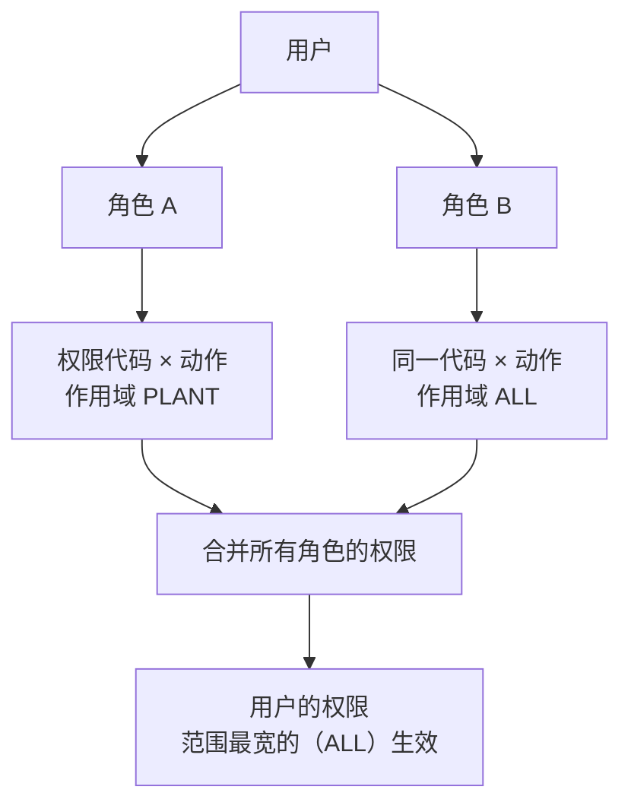
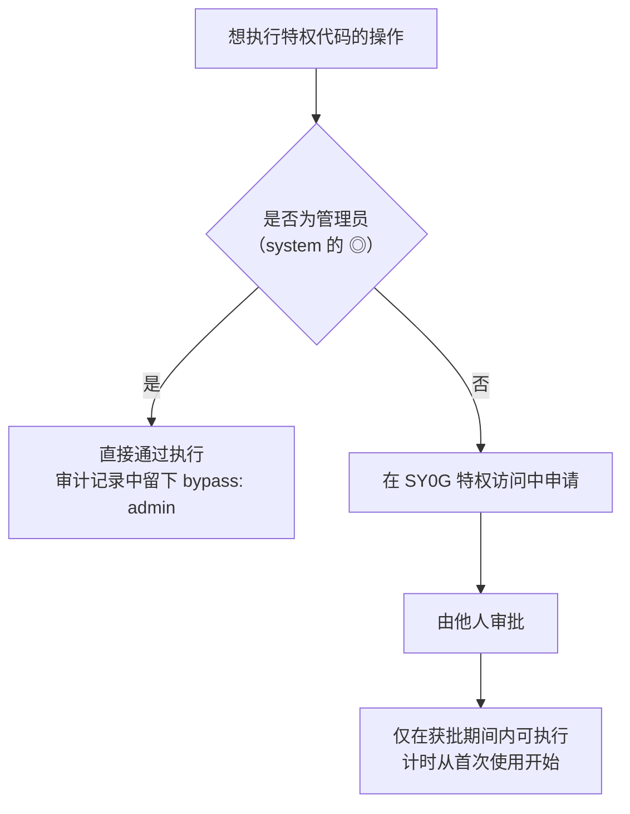

本系统的访问控制以 **角色**（职责集合）为单位管理。权限不会直接授予个人，而是
通过分配角色实现。一个用户可以拥有多个角色，此时其权限为 **所有角色的并集**。

> 本页依据 **dev 数据库中的实际数据**（截至 2026-11-27）手工编写（并非自动生成）。需要最新完整清单时请查看
> `_docs/rbac-role-matrix.xlsx`。查看某位用户的实际权限，请打开
> **SY01 用户管理** 的详情页面。

## 三个概念

权限描述的是「**谁**（角色）对 **哪个领域**（权限代码）能做 **什么操作**（动作）」，
必要时再加上 「**范围**」（作用域）。

- **权限代码** … 一个业务领域，未必等于一个应用（`master` 覆盖 16 个主数据应用，
  `order_acceptance` 同时覆盖 SA04 与 SA05）。
- **动作** … R=查看 / C=新建 / U=修改 / D=删除 / E=导出 / A=审批 /
  ◎=ADMIN（该代码的全部动作）。**单据的审批不是动作** — 谁能审批仅由
  **MS0B 审批设定** 的审批组成员资格决定。带 A 的只有**特权访问（SY0G）的
  决裁**，对象仅限下面的 5 个特权代码（`kiosk_secret` / `kiosk_device` /
  `kiosk_card` / `personal_data` / `user_admin`）与 `portal_admin` / `api_client`。
- **作用域** … 操作可及的范围。留空表示 **ALL（全部数据）**。
  - **OWN** … 仅本人创建的数据
  - **PLANT** … 仅本人所属据点的数据（在 SY01 中设置所属据点）
  - **REGION** … 仅本人所属据点所在地区的数据

同一代码由多个角色授予时，**范围最宽的生效**（同时拥有 PLANT 与 ALL 时为 ALL）。

从角色到有效权限的判定用图表示如下。



## 角色一览

| 角色 | rolename | 用途 |
|---|---|---|
| 管理员 | `admin` | 全部权限（持有 `system` 的 ◎，因此没有记录的代码也全部可用）。唯一无需审批即可执行特权操作的角色 |
| 管理层（审批人） | `manager` | 全业务的查看・导出 + 价格试算成本（`estimate_cost`）的查看，面向跨部门审批者（能否审批由 MS0B 审批组成员资格决定） |
| 销售部长 | `sales_manager` | 销售数据全量完整操作 + 全业务查看 |
| 销售 | `sales` | 销售数据 **仅限本人创建的部分** 新建・修改（OWN） |
| 销售助理 | `sales_assistant` | 销售数据仅查看，不可新建・修改・审批 |
| 采购部长 | `purchasing_manager` | 采购数据全量完整操作 + 全业务查看 |
| 采购 | `purchasing` | 采购申请・材料订购・入库・外协的日常操作 |
| 制造部长 | `production_manager` | 制造数据全量完整操作 + 全业务查看 |
| 制造・生产管理 | `production` | 工单・工序执行・库存（**仅所属据点**） |
| 品质部长 | `quality_manager` | 工单全量完整操作 + 全业务查看 |
| 品质・检查 | `quality` | 检查记录・检查审批（**仅所属据点**） |
| 出货部长 | `shipping_manager` | 出货数据全量完整操作 + 全业务查看 |
| 出货 | `shipping` | 出货单・送货单的日常操作（出货单与库存 **仅所属据点**） |
| 会计部长 | `accounting_manager` | 请款・结算全量完整操作 + 全业务查看 |
| 会计 | `accounting` | 请款单・月度结算・会计对接 CSV |
| 主数据管理 | `master_editor` | 仅主数据的新建与修改。不含业务单据权限，需与部门角色一并分配 |
| 只读 | `viewer` | 全业务仅查看（面向管理层・审计） |
| 通用 | `staff` | 过渡期的临时角色，除系统・共用终端・管理手册・特权代码・成本外均可操作。**生产环境建议改用部门角色** |

### 特权角色（与业务角色分开分配）

系统上重要的操作不是「拥有就能用」，而是**提出申请、由他人审批、并且只在限定
时间内可用**（特权访问 SY0G）。**申请方与审批方必定是不同的角色** — 即使一个人
同时拥有两者，从角色一览也能看出他无法审批自己的申请。

| 角色 | rolename | 用途 |
|---|---|---|
| 终端运维（申请） | `kiosk_operator` | 负责共用终端与二维码卡。公开 PIN、登记终端、发行卡片都需申请并获批 |
| 终端运维（审批） | `kiosk_approver` | 审批终端与卡片的特权操作。**本人无法执行** |
| 用户运维（申请） | `user_operator` | 入职离职相关的账号运维。停用・恢复・变更所属据点或角色需提交变更申请 |
| 用户运维（审批） | `user_approver` | 审批用户变更申请与个人数据查看。**本人无法执行** |
| 审计（历史查看） | `security_auditor` | 调查登录历史与操作历史。详情与跨单据检索需申请并获批 |
| 特权操作（申请） | `privileged_operator` | 可一次性申请全部特权代码（含客户门户・外部 API）的旧角色。推荐使用上面按职责细分的 5 个 |
| 特权操作（审批） | `privileged_approver` | 同上，用于审批 |

> 这些**不会分配给业务角色**（`manager` / `*_manager` / `viewer` 等）。
> 「审批部门业务的人」与「能判断可否公开 PIN 的人」是两回事，因此审批者需要
> 明确地分配这些角色。

## 权限代码与对应应用

| 权限代码 | 名称 | 对应应用 |
|---|---|---|
| `price_list` | 价格表 | SA01 价格试算 / SA02 价格表 |
| `quote` | 报价单 | SA03 报价单 |
| `order_acceptance` | 订单确认书・订单明细 | SA04 订单确认书 / SA05 订单明细 |
| `design_request` | 设计委托 | SA06 设计委托单 |
| `design_file` | 图纸 | PD06 图纸 |
| `purchase_order` | 材料采购・采购申请 | PU01 采购申请 / PU02 材料采购单 |
| `material_receipt` | 材料到货 | PU03 材料到货 |
| `outsource_order` | 外协委托 | PU04 外协委托单 |
| `work_order` | 工单 | PD02 工单 / PD05 未处理工单 / PD09 作业场所一览（共用终端的工序执行・工单扫描也用此代码） |
| `approve` | 审批 | **无对应应用**（原 PD03）。仅用于决定 CM01 未处理列表是否显示审批申请栏（CM01 本身无需权限即可打开） |
| `inventory` | 库存 | 库存类别的 7 个应用 — ST01 库存管理 / ST02 库存总览 / ST03 库存与需求 / ST04 出入库单 / ST05 盘点 / ST06 手动出入库 / ST09 移动类型 |
| `delivery_order` | 出货单 | SH01 出货单 / SH03 未处理出货 |
| `delivery_note` | 送货单 | SH02 送货单 |
| `invoice` | 请款单 | BL01 请款单 |
| `billing_closing` | 结算处理 | BL02 结算处理（会计对接 CSV 导出为 E） |
| `master` | 主数据管理 | MS01・MS04〜MS0I 共 16 个主数据应用 |
| `form` | 表单 | **入口无需权限**（CM02 任何人都能打开）。创建・修改表单需要 C / U |
| `internal_page` | 内部文档 | CM03 内部文档 |
| `admin_manual` | 管理手册 | DC02 管理手册（本页） |
| `system` | 系统管理 | SY02 价格试算计算 / SY03 产品项目 / SY04 产品类别 / SY05 应用管理 / SY0B 链接管理 / SY0C 订单导入 / SY0E AI 服务商 / SY0F 通知邮件 / SY0J 会计对接 |
| `kiosk` | 共用终端管理 | SY09 终端管理 / SY0A 共用终端设置 |
| `kiosk_secret` | 共用终端的机密 | 公开退出 PIN・PIN 历史・终端设置代码（**特权**） |
| `kiosk_device` | 终端访问的授予 | 登记・失效终端（**特权**） |
| `kiosk_card` | 二维码卡发行・PIN | SY08 二维码卡管理（**特权**） |
| `personal_data` | 个人数据的查看 | SY07 操作历史 / SY0D 登录历史（**特权**） |
| `user_admin` | 用户・权限的变更 | SY01 用户管理（**特权**） |
| `portal_admin` | 客户门户的管理 | SY0H 客户门户 |
| `api_client` | 外部 API 客户端的管理 | SY0I API 客户端 |
| `estimate_cost` | 价格试算的成本 | 不是应用，而是 SA01 价格试算中的一部分 — 成本试算的新建・查看，以及成本合计・毛利的显示。没有此权限的人看不到成本试算本身 |

**也有无需权限的应用**：CM01 未处理列表 / CM02 表单（入口） / DC01 操作手册 /
SY06 文件管理 / SY0G 特权访问。它们的内容本身只显示与本人相关的部分，因此入口
是开放的。

## 权限矩阵

### 销售・采购

| 角色 | 价格表 | 报价单 | 订单确认书 | 设计委托 | 图纸 | 采购 | 到货 | 外协 |
|---|---|---|---|---|---|---|---|---|
| **管理员**<br/>`admin` | ◎ | ◎ | ◎ | ◎ | ◎ | ◎ | ◎ | ◎ |
| **管理层（审批人）**<br/>`manager` | RE | RE | RE | RE | RE | RE | RE | RE |
| **销售部长**<br/>`sales_manager` | RCUDE | RCUDE | RCUDE | RCUDE | R | — | — | — |
| **销售**<br/>`sales` | RCU<br/>OWN | RCU<br/>OWN | RCU<br/>OWN | RCU<br/>OWN | R | — | — | — |
| **销售助理**<br/>`sales_assistant` | R | R | R | R | R | — | — | — |
| **采购部长**<br/>`purchasing_manager` | R | R | R | R | R | RCUDE | RCUDE | RCUDE |
| **采购**<br/>`purchasing` | — | — | — | — | R | RCUDE | RCUDE | RCUD |
| **制造部长**<br/>`production_manager` | R | R | R | R | RCU | R | R | RCUDE |
| **制造・生产管理**<br/>`production` | — | — | RU | RU | RCU | R | R | RU |
| **品质部长**<br/>`quality_manager` | R | R | R | R | R | R | R | R |
| **品质・检查**<br/>`quality` | — | — | R | — | R | — | — | — |
| **出货部长**<br/>`shipping_manager` | R | R | R | R | R | R | R | R |
| **出货**<br/>`shipping` | — | — | R | — | R | — | — | — |
| **会计部长**<br/>`accounting_manager` | R | R | R | R | R | R | R | R |
| **会计**<br/>`accounting` | R | R | R | — | R | — | — | — |
| **主数据管理**<br/>`master_editor` | — | — | — | — | — | — | — | — |
| **只读**<br/>`viewer` | R | R | R | R | R | R | R | R |
| **通用**<br/>`staff` | RCUDE | RCUDE | RCUDE | RCUDE | RCUDE | RCUDE | RCUDE | RCUDE |

### 生产・出货・请款・公共

| 角色 | 工单 | 审批 | 库存 | 出货单 | 送货单 | 请款单 | 结算 | 主数据 | 表单 | 内部文档 | 管理手册 |
|---|---|---|---|---|---|---|---|---|---|---|---|
| **管理员**<br/>`admin` | ◎ | ◎ | ◎ | ◎ | ◎ | ◎ | ◎ | ◎ | ◎ | ◎ | ◎ |
| **管理层（审批人）**<br/>`manager` | RE | RE | RE | RE | RE | RE | RE | RE | RE | RE | RE |
| **销售部长**<br/>`sales_manager` | — | R | — | — | — | — | — | R | — | — | — |
| **销售**<br/>`sales` | — | — | — | — | — | — | — | R | — | — | — |
| **销售助理**<br/>`sales_assistant` | — | — | — | — | — | — | — | R | — | — | — |
| **采购部长**<br/>`purchasing_manager` | R | R | R | R | R | R | R | R | R | R | R |
| **采购**<br/>`purchasing` | R | R | R | — | — | — | — | R | — | — | — |
| **制造部长**<br/>`production_manager` | RCUDE | R | RCUDE | R | R | R | R | R | R | R | R |
| **制造・生产管理**<br/>`production` | RCUDE<br/>PLANT | R | RCUE<br/>PLANT | R | — | — | — | R | — | — | — |
| **品质部长**<br/>`quality_manager` | RCUDE | R | R | R | R | R | R | R | R | R | R |
| **品质・检查**<br/>`quality` | RU<br/>PLANT | R | R | — | — | — | — | R | — | — | — |
| **出货部长**<br/>`shipping_manager` | R | R | RCUDE | RCUDE | RCUDE | R | R | R | R | R | R |
| **出货**<br/>`shipping` | R | — | RU<br/>PLANT | RCUDE<br/>PLANT | RCUDE | — | — | R | — | — | — |
| **会计部长**<br/>`accounting_manager` | R | R | R | R | R | RCUDE | RCUDE | R | R | R | R |
| **会计**<br/>`accounting` | — | — | — | R | R | RCUDE | RCUE | R | — | — | — |
| **主数据管理**<br/>`master_editor` | — | — | — | — | — | — | — | RCUD | — | — | — |
| **只读**<br/>`viewer` | R | R | R | R | R | R | R | R | R | R | R |
| **通用**<br/>`staff` | RCUDE | RCUDE | RCUDE | RCUDE | RCUDE | RCUDE | RCUDE | RCUDE | RCUDE | RCUDE | — |

### 特权・系统（不发给业务角色）

| 角色 | 系统 | 共用终端 | 终端机密 | 终端访问 | 二维码卡 | 个人数据 | 用户权限 | 门户 | 外部 API |
|---|---|---|---|---|---|---|---|---|---|
| **管理员**<br/>`admin` | ◎ | ◎ | ◎ | ◎ | ◎ | ◎ | ◎ | （◎） | （◎） |
| **终端运维（申请）**<br/>`kiosk_operator` | — | RU | RU | RCU | RCU | — | — | — | — |
| **终端运维（审批）**<br/>`kiosk_approver` | — | — | A | A | A | — | — | — | — |
| **用户运维（申请）**<br/>`user_operator` | — | — | — | — | — | — | RU | — | — |
| **用户运维（审批）**<br/>`user_approver` | — | — | — | — | — | A | A | — | — |
| **审计（历史查看）**<br/>`security_auditor` | — | — | — | — | — | R | — | — | — |
| **特权操作（申请）**<br/>`privileged_operator` | — | R | RU | RCU | RCU | R | RU | RCU | RCU |
| **特权操作（审批）**<br/>`privileged_approver` | — | — | A | A | A | A | A | A | A |

（◎）… 管理员角色没有该代码的记录，但持有 `system` 的 ◎ 的人对所有代码都拥有
全部权限，因此实际上可以使用。

**价格试算的成本（`estimate_cost`）** 未列入上表。只有管理员（◎）与管理层
`manager`（R）持有，不分配给其他角色。

## 阅读时的注意事项

### 审批由审批组管理，而不是权限动作

谁能审批**仅在审批设定（MS0B）中管理**。按下审批・驳回所需的权限只是能
**查看（R）或修改（U）**该单据 — 不存在「审批」这一动作的授权（单据的审批不使用 A，
A 只保留给特权访问的决裁）。能打开单据、且是该层级审批组的成员（或期间内的代理人）即可审批。
只分配部长角色并不能审批，原因就在这里。

### 「能做」与「能看到」是两回事

本页说明的是 **能做什么**，而不是主页会显示哪些应用。生产环境（main）的启动器
显示由另一套机制（SY05 应用管理 / feature flags）决定，即使有权限，未发布的应用
在生产环境也不会出现。dev 环境默认全部显示。

### 「能进入画面」与「能执行操作」是两回事

原本粗放的 `system` / `kiosk` 已按重要操作拆成 **5 个特权代码**
（`kiosk_secret` / `kiosk_device` / `kiosk_card` / `personal_data` /
`user_admin`）。**仅仅持有这些代码还不能执行** — 需要在 SY0G 特权访问中提出
申请、由他人审批，并且只在限定时间内有效（计时从**首次使用**开始，而不是从
审批开始）。

- 查看一览与详情、修改名称、拖动平面图上的标记 … 仍然只需 `kiosk`。
- 公开机密、登记/失效终端、发行卡片或 PIN、跨单据检索历史、停用用户或变更其
  角色 … 都需要审批。
- **管理员（`system` 的 ◎）直接通过**（由使用方决定）。这也是唯一的防锁死通道，
  因此不必再开自我审批的口子。直接通过会在审计记录中留下 `bypass:"admin"`，
  与经过审批的执行可以区分。

特权操作可以执行之前的流程用图表示如下。



以上都不会分配给业务角色：`system`、`kiosk`、5 个特权代码以及 `portal_admin` /
`api_client` / `estimate_cost`，都已从两个种子文件的批量授予中排除。

另外文件管理（SY06）**无需权限，任何人都能打开** — 可见范围由文件夹权限
（单独授予）与业务应用的查看权限（该应用生成的 PDF）决定，没有权限时只会
显示为空。

## 为用户分配角色

1. 请对方先通过 SSO 登录一次（首次登录会在 `app.users` 中创建记录）。
2. 在 **SY01 用户管理** 中分配角色，并在同一画面设置所属据点
   （PLANT / REGION 作用域以此为准）。
3. 需要审批的人还要加入相应的 **审批组**（MS0B）。

## 修改权限本身

在生产与 dev 数据库中，角色的内容（哪个代码授予哪些动作）由**迁移**负责。
修改权限时，在 `shared-db` 中新增迁移并合并到 `dev` — 合并后会自动应用。
**不要手动对数据库执行 SQL**（这会导致生产与 dev 不一致）。

- `shared-db/sql/rbac-seed.sql` … 29 个权限代码 + `admin` / `staff`
- `shared-db/sql/roles-seed.sql` … 16 个业务角色（含 `master_editor`）的权限矩阵。
  **用于构建截图用的一次性数据库**，不会对生产・dev 执行
- 迁移 `20260919090000_privileged_access` / `20260920090000_privileged_roles` …
  7 个特权角色（`privileged_operator` / `privileged_approver` 与按职责细分的 5 个）
- 2026-09-03 之后新增的代码（`form` / `internal_page` / `admin_manual` /
  `design_file` / 特权代码 / `portal_admin` / `api_client` / `estimate_cost`）以及
  `master_editor` 的权限，也都由各自的迁移授予

> **新增代码时，必须同时检查两个种子文件的排除列表。**
> `roles-seed.sql` 通过 `CROSS JOIN app.permissions` 向 `manager` / `viewer` /
> 5 个 `*_manager`（销售部长除外）授予权限，不排除的话新代码会发给所有人
> （`kiosk` 就曾实际发生过）。迁移也遵循同样的规则：不应分配给业务角色的代码会被
> 明确排除。

变更进入 dev 后，重新生成 Excel 版：

```bash
cd shared-db
./scripts/remote-db.sh python3 ../tools/rbac-matrix/build_rbac_xlsx.py
```
