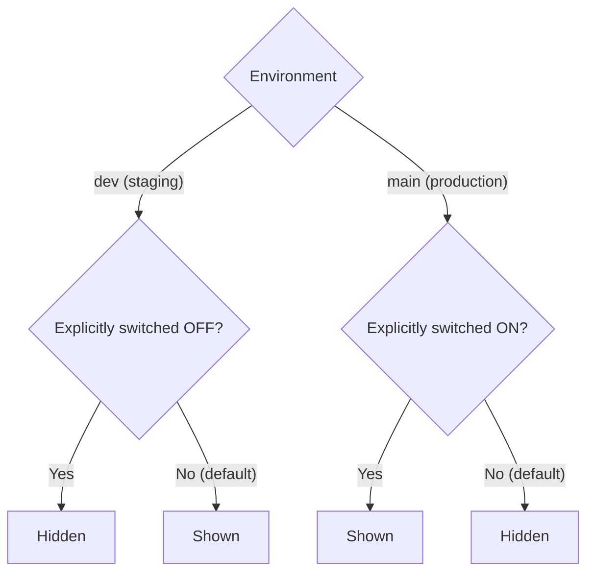

Operation code **SY05**. Turns each app's visibility ON/OFF per environment (**dev** = staging / **main** = production). A single switch publishes or hides an app.

> This app requires **system permission** (update permission for toggling). Changes take effect immediately for every user.

## What you can do here

- Review the full list of registered apps, with category and operation code.
- Toggle each app's **dev (staging)** and **main (production)** switches independently.
- Search by app name or operation code, and filter by category.

## Opening it

- Home (System) → **アプリ管理 (App Management)**, or type `SY05` in the search box.

## How the environments work

dev and main have **separate databases**. Visibility is stored with the environment in the key (`app:<app>:<env>`), and each environment reads **only its own environment's rows in its own database**. So **the main (production) switch takes effect in production only when you flip it on the production screen (`app.ckk-tool.co.jp`)**. Flipping the main switch on the dev screen just leaves a row in the dev database and does not reach production. The default behavior differs by environment.

- **dev (staging)** — shown **by default**. Only apps explicitly switched OFF are hidden.
- **main (production)** — hidden **by default**. Only apps explicitly switched ON are shown. This keeps the production launcher limited to released apps.

How it is decided whether an app is shown, as a diagram:

In other words, **turning the main switch ON is the production release itself**. Before flipping it, make sure the app has been verified on dev.

## What happens when an app is OFF

- The app disappears from the launcher, the home screen, and the operation-code search.
- Direct URL access is also blocked (screen guard).
- No data is deleted. Switch it back ON and everything works as before.

## Reading the list

- **Category** — a badge: General / Sales / Purchasing / Production / Inventory / Shipping / Billing / Master data / Documents / System.
- **App** — the app name.
- **Operation code** — the jump code such as `SA02` (monospace).
- **dev (staging)** / **main (production)** — the per-environment visibility switches.

Toggling shows an "Enabled / Disabled" notification and takes effect right away. On failure the switch reverts and an error is shown.

## Change records

Every ON/OFF operation is written to the audit log. In the [Activity Log](/admin-manual/en/system/activity-log) (target "アプリ管理 / App Management") you can see who toggled which app, in which environment, and when.

## FAQ

- **Release a new app to production** — once it is verified on dev, turn its **main (production)** switch ON **on the production screen**.
- **Temporarily hide an app for maintenance** — switch it OFF in the relevant environment. Data is kept; switch it back ON to resume.
- **Add an app to the list** — the list is generated from the app registry built into the system; adding one requires a development change.
- Per-user permissions can be reviewed in [User Management](/admin-manual/en/system/user-management).
