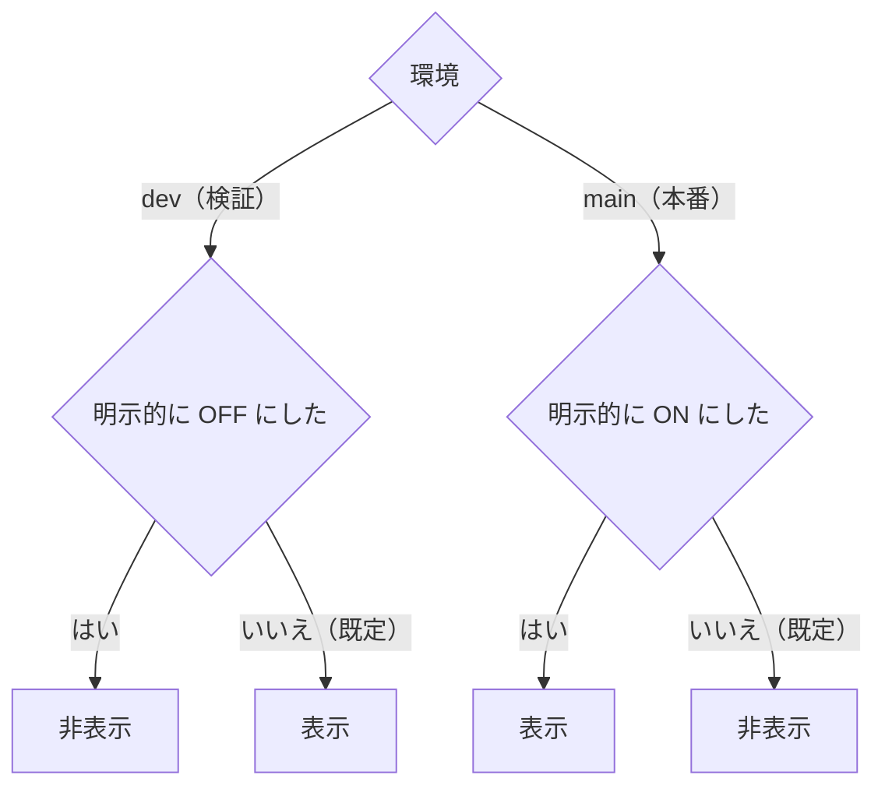

操作コード **SY05**。各アプリを環境（**dev** = 検証 / **main** = 本番）ごとに表示 ON/OFF するアプリです。スイッチひとつでアプリの公開・非公開を切り替えられます。

> このアプリは **システム権限** が必要です（切り替えには更新権限）。切り替えは全ユーザーの画面に即時反映されます。

## このアプリでできること

- システムに登録された全アプリの一覧を、カテゴリ・操作コード付きで確認できます。
- アプリごとに **dev（検証）** と **main（本番）** のスイッチを個別に ON/OFF できます。
- アプリ名・操作コードでの検索と、カテゴリでの絞り込みができます。

## 開き方

- ホーム（システム）→ **アプリ管理**、または検索ボックスで `SY05`。

## 環境の考え方

dev と main は**データベースが別々**です。表示 ON/OFF は環境をキーにして記録され（`app:<アプリ>:<環境>`）、それぞれの環境は**自分の DB にある自分の環境の行だけ**を読みます。そのため、**main（本番）のスイッチは本番の画面（`app.ckk-tool.co.jp`）で切り替えたときだけ本番に効きます**。dev の画面で main のスイッチを切り替えても dev の DB に行が残るだけで、本番には反映されません。既定の動きは環境で異なります。

- **dev（検証）** … 既定で **表示**。明示的に OFF にしたアプリだけが非表示になります。
- **main（本番）** … 既定で **非表示**。明示的に ON にしたアプリだけが表示されます。本番のランチャーを「公開済みアプリのみ」に保つための仕組みです。

アプリが表示されるかどうかの決まり方を図にすると次のとおりです。

つまり、**main のスイッチを ON にすることが本番公開そのもの** です。切り替える前に、そのアプリが dev で十分に検証済みか確認してください。

dev の画面では、**dev の DB にある main の行**が OFF（行なしを含む）のアプリに、ホーム画面のカードでオレンジの「**DEV**」バッジが付きます（未公開の目印）。dev の画面の main スイッチは、このバッジの有無だけを決めます。

**開発中機能（`src/config/dev-features.json`）に属するアプリは、スイッチより優先して非表示**になります。現在は「取引先ポータル」（SY0H）と「API クライアント」（SY0I）が dev のみ — main のスイッチを ON にしても本番には出ません（本番で開くには PR とデプロイが要ります）。

## OFF にするとどうなるか

- そのアプリはランチャー・ホーム画面・操作コード検索から消えます。
- URL を直接入力してもアクセスできなくなります（画面ガード）。
- データは削除されません。再度 ON にすれば元どおり使えます。

## 一覧の見方

- **カテゴリ** … 一般 / 販売 / 購買 / 生産 / 在庫 / 出荷 / 請求 / マスタ / ドキュメント / システム のバッジ。
- **アプリ** … アプリ名。
- **操作コード** … `SA02` などのジャンプコード（等幅表示）。
- **dev（検証）** / **main（本番）** … 環境ごとの表示スイッチ。

切り替えると「有効化しました / 無効化しました」の通知が表示され、すぐに反映されます。失敗した場合はスイッチが元に戻り、エラーが表示されます。

## 切り替えの記録

すべての ON/OFF 操作は監査ログに記録され、[操作履歴](/admin-manual/ja/system/activity-log)（対象「アプリ管理」）で「誰が・いつ・どのアプリを・どちらの環境で」切り替えたかを確認できます。

## よくある質問

- **本番に新しいアプリを公開したい** … dev で検証が済んだら、**本番の画面で**そのアプリの **main（本番）** スイッチを ON にします。
- **アプリをメンテナンスで一時的に隠したい** … 該当環境のスイッチを OFF にします。データはそのまま残り、ON に戻せば再開できます。
- **一覧にアプリを追加したい** … 一覧はシステムに組み込まれたアプリの登録簿から生成されます。追加は開発側の対応が必要です。
- ユーザーごとの権限は [ユーザー管理](/admin-manual/ja/system/user-management) で確認できます。
