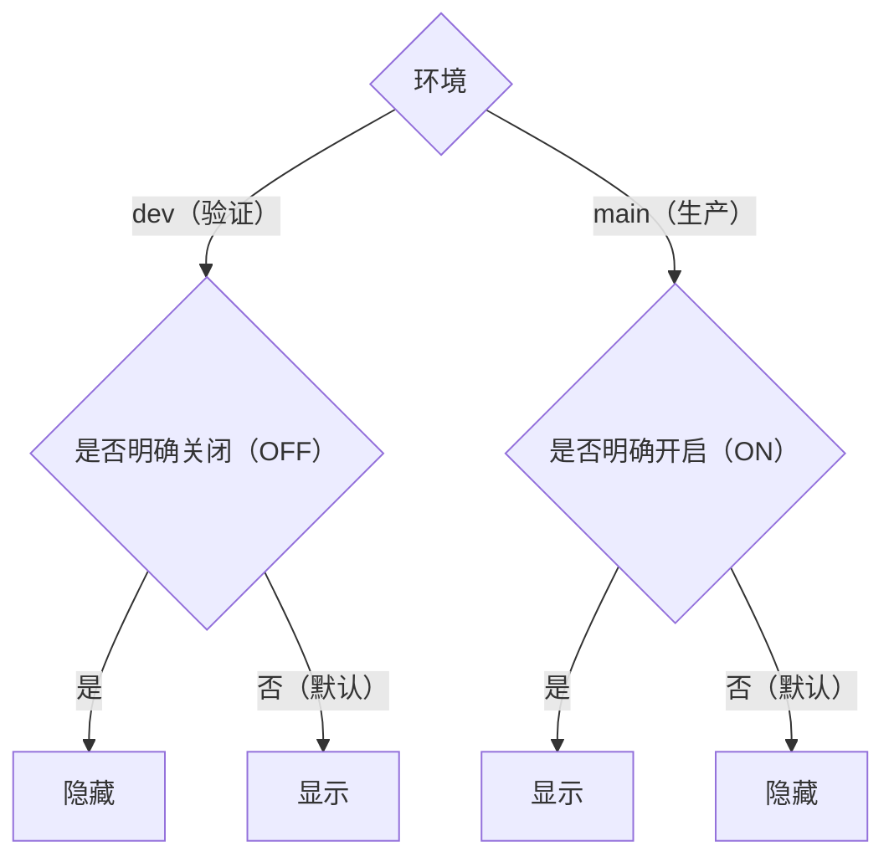

操作代码 **SY05**。按环境（**dev** = 验证 / **main** = 生产）分别控制各应用的显示开关。一个开关即可发布或隐藏一个应用。

> 本应用需要 **系统权限**（切换需更新权限）。切换会立即对所有用户生效。

## 本应用能做什么

- 查看系统中注册的全部应用列表，含分类和操作代码。
- 对每个应用分别切换 **dev（验证）** 和 **main（生产）** 开关。
- 按应用名或操作代码搜索，按分类筛选。

## 打开方式

- 主页（系统）→ **アプリ管理（应用管理）**，或在搜索框输入 `SY05`。

## 环境的概念

dev 和 main 的**数据库是分开的**。显示开关以环境作为键的一部分记录（`app:<应用>:<环境>`），各环境**只读取自己数据库中属于自己环境的行**。因此，**main（生产）的开关只有在生产环境的画面（`app.ckk-tool.co.jp`）上切换时才会对生产环境生效**。在 dev 的画面上切换 main 开关，只会在 dev 的数据库中留下一行，不会反映到生产环境。默认行为因环境而异。

- **dev（验证）** … 默认 **显示**。只有明确关闭（OFF）的应用才会隐藏。
- **main（生产）** … 默认 **隐藏**。只有明确开启（ON）的应用才会显示。这样可以让生产环境的启动器只显示已发布的应用。

应用是否显示的判定用图表示如下。

也就是说，**打开 main 开关就等于正式发布**。切换前请确认该应用已在 dev 环境充分验证。

## 关闭（OFF）后会怎样

- 该应用会从启动器、主页和操作代码搜索中消失。
- 直接输入 URL 也无法访问（界面拦截）。
- 数据不会被删除。重新开启后即可照常使用。

## 列表说明

- **分类** … 通用 / 销售 / 采购 / 生产 / 库存 / 出货 / 请款 / 主数据 / 文档 / 系统 徽章。
- **应用** … 应用名称。
- **操作代码** … `SA02` 等跳转代码（等宽字体）。
- **dev（验证）** / **main（生产）** … 各环境的显示开关。

切换后会显示"已启用 / 已停用"的通知并立即生效。失败时开关会恢复原状并显示错误。

## 切换记录

所有开关操作都会写入审计日志，可在[操作历史](/admin-manual/zh/system/activity-log)（对象"アプリ管理/应用管理"）中查看"谁在何时、在哪个环境、切换了哪个应用"。

## 常见问题

- **想向生产环境发布新应用** … 在 dev 验证完成后，**在生产环境的画面上**打开该应用的 **main（生产）** 开关。
- **想在维护期间临时隐藏应用** … 关闭对应环境的开关。数据保持不变，重新开启即可恢复。
- **想在列表中新增应用** … 列表由系统内置的应用注册表生成，新增需要开发侧支持。
- 各用户的权限可在[用户管理](/admin-manual/zh/system/user-management)中查看。
