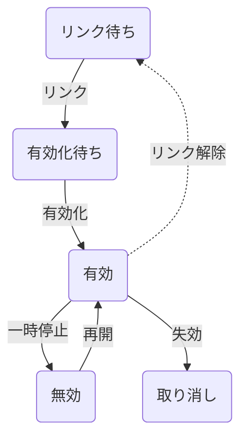

**端末管理（SY09）の「ディスプレイ」タブ**です。現場のテレビに何を映すかを決めます。

共有端末（タブレット）と同じ画面にあるのは、どちらも「拠点に据える機器」で、
登録の手順も同じだからです（作る → リンク → 有効化）。

> このアプリは現在 **検証環境（dev）のみ** で公開されています。本番公開までに
> 画面や手順が変わる場合があります。

> このアプリの利用には **共有端末管理の権限** が必要です。**リンク**・**有効化**
> （特権操作「ディスプレイの登録」）と、**リンク解除**・**失効**・**削除**（「ディスプレイの失効」）は
> ほかの人の承認を経た期間だけ実行できます（特権アクセス SY0G）。作成・設定の変更・
> 一時停止 / 再開は承認なしで行えます。すべての操作は監査ログに記録されます。

## このアプリでできること

- 現場のテレビを一覧で見られます（どこに何台あって、いま点いているか）
- それぞれのテレビに映すものを決められます
- 映すものをあとから切り替えられます（テレビには触りません）
- 使わなくなった画面を止めたり、取り消したりできます

## 用語（このページで出てくる言葉）

- **ディスプレイ** … 現場に置いたテレビ 1 枚のことです。
- **映す画面** … そのテレビに何を映すかです。**ディスプレイ 1 枚ごとに決めます。**
- **リンクコード** … テレビの画面に出る 12 文字です。共有端末（タブレット）が
  出すものと同じ形式なので、読み取り方も同じです。

## はじめる前に

- テレビ側の準備（Raspberry Pi の設置）は
  [ディスプレイの設置（Raspberry Pi）](/admin-manual/ja/system/display-setup)
  を先に行ってください。
- 映すものを先に用意しておく必要はありません。新しいディスプレイには
  **「生産状況」が最初から入ります**。あとから詳細画面で変えられます。

## 画面の状態

| 状態 | 意味 |
|---|---|
| リンク待ち | 作っただけで、まだテレビと結びついていません |
| 有効化待ち | テレビと結びつきました。「有効化」を押すと表示を開始します |
| 有効 | 通常の状態です |
| 無効 | こちらから止めています。テレビには「この画面は一時停止されています。」と出ます（リンクコードは出ないので、現地では登録し直せません） |
| 取り消し | 登録を取り消しました。もう一度使うには登録し直します |

オンライン / オフラインは状態とは別で、いま通信できているか
（直近 5 分以内に応答があったか）を表します。

状態の移り変わりを図にすると次のとおりです（操作は下の各節を参照）。

## ディスプレイを登録する（3 段）

共有端末（タブレット）とまったく同じ手順です。

1. **作る** — 「ディスプレイを追加」で名前・設置場所・拠点・映す画面を決めます。
   この時点ではまだテレビと結びついていません（リンク待ち）。
2. **リンク** — 一覧の行の「…」から「ディスプレイをリンク」を選び、テレビに出ている QR を
   **「ディスプレイのQRをスキャン」で読み取ります**（12 文字を手で入力しても
   かまいません）。共有端末とまったく同じ読み取り方です。
3. **有効化** — 行の「…」（または詳細画面）の「有効化」を押すと、テレビが表示を開始します。

手順 1 はテレビを用意する前にやっておけます。先に作っておくと、現地では
リンクと有効化だけで済みます。

> ⚠️ リンクコードは **10 分**で使えなくなります。過ぎたときは、テレビの画面の
> 「新しいコードを発行」を押して新しいコードを出してください。

## 画面の大きさに合わせる（表示倍率）

テレビの大きさと、どのくらい離れて見るかで、読みやすい大きさは変わります。
43 型を手元で見るのと、65 型を 10m 先から見るのとでは別物です。

1. 一覧から対象のディスプレイを押します。
2. 「設定」タブの「編集」を押します。
3. 「表示倍率」で、「小さめ / 標準 / 大きめ」を押すか、
   スライダーで細かく合わせます（50〜200%）。
4. 「保存」を押します。

同じ「設定」タブで、名前・設置場所・拠点と「**この画面の表示言語**」（盤面とリンクコード画面の
言語。未設定は日本語）も変えられます。

テレビの表示がその場で変わります。**壁を見ながら合わせてください** —
「何 % が正解」というものはありません。

> 💡 倍率を上げると 1 件が大きくなるので、1 画面に入る件数は減ります。
> あふれた分は自動でページ送りになるので、消えることはありません。

## 映すものを変える

映すものは **ディスプレイ 1 枚ごと** に決めます。

1. 一覧から対象のディスプレイを押します。
2. 「表示内容」タブの「編集」を押します。
3. 「映すもの」で「**アプリの画面**」か「**画像**」を選びます。
4. アプリの画面なら、映したい画面を選びます。**それぞれに小さな見本が出る**ので、名前だけで
   迷わずに選べます。続けてその画面の設定（拠点・件数など）を決めます。
5. 「保存」を押します。

テレビの表示がその場で切り替わります。**現地に行く必要はありません。**

選べる画面と、それぞれの設定:

| 画面 | 何が出るか | 選べる設定 |
|---|---|---|
| 生産状況 | 進行中の指示書・いまの工程・担当者 | 拠点 / 件数 / 着手前も出すか |
| 未処理・手配待ち | まだ指示書が出ていない注文明細（納期順） | 拠点 / 件数 / 何日先まで / 納期超過だけ |
| 出荷予定 | これから出す出荷書 | 拠点 / 件数 / 何日先まで |
| 品質・不良 | 直近の不良を種類ごとに集計 | 拠点 / 件数 / 何日前まで |
| お知らせ | 決めた文章を大きく表示 | 本文 / 見た目（通常・注意・警告）/ 時計 |

設定はすべて選ぶだけです。難しい書式を入力する必要はありません。

「更新間隔」は、映しているものを自動で読み直す間隔です（アプリの画面のときだけの設定です）。
`0` にすると自動では読み直さず、こちらで変更したときだけ切り替わります。

**画像**を選ぶと、画像 1 枚（掲示・お知らせのポスターなど）を映せます。PNG / JPG / WEBP / GIF、
10MB まで。映し方は「全体を表示」「画面を埋める」「引き伸ばす」から選びます。

> 💡 見本に出ている数字は**説明用の作り話**です。実際の受注や指示書ではありません。

### 集計ダッシュボードを映すとき

集計ダッシュボード（Metabase の埋め込み）は、**いまはこの画面から選べません**（選べるのは
アプリの画面と画像だけです）。将来選べるようになったときは、集計ツール側でダッシュボードごとに
「埋め込み」を有効にし、**拠点やラインの絞り込みを「ロック」に設定してください。** ロックしないと、
現場の画面から他の拠点のデータが見えてしまう状態になります。

## 止める・取り消す

| やりたいこと | 操作 | あとで戻せるか |
|---|---|---|
| 一時的に止める | 詳細画面の「一時停止」 | 「再開」で戻せます |
| 別の機械に付け替える | 詳細画面の「リンク解除」 | 名前・映す画面は残ります |
| 使うのをやめる | 詳細画面の「失効」 | 登録し直しが必要です |
| 記録ごと消す | 失効（またはリンク解除）してから「削除」 | 戻せません |

**失効させると、そのテレビは次の読み込みで登録画面に戻ります。** 別の場所へ
持って行って使い直せます。故障や紛失のときも、この操作でその画面からは
何も見えなくなります。

## よくある質問

**Q. 一覧でずっとオフラインのままです**
A. 現地でテレビと Raspberry Pi の電源、LAN ケーブルを確認してください。
通信が戻れば自動でオンラインに戻ります。

**Q. リンクしようとすると「リンクコードが見つからないか、有効期限が切れています」と出ます**
A. コードの期限（10 分）が切れたか、そのコードで既にリンクが済んでいます。
テレビの画面に出ている新しいコードを読み取ってください。

**Q. 同じ内容を複数のテレビに映せますか**
A. できます。それぞれのディスプレイで同じ画面と同じ設定を選んでください。
設定はディスプレイごとに持つので、**片方だけ拠点を変える**こともできます。
