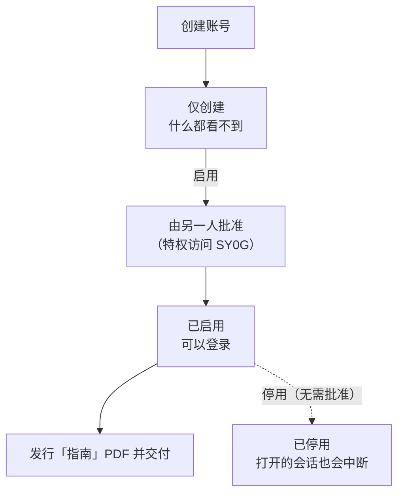

外部人员可通过 `/portal` 查看发给自己的单据。登录方式为**向事先登记的邮箱发送验证码**
（没有密码）。

> **目前仅在测试环境（dev）运行。** 要在生产环境开放，需要修改代码并部署，
> 无法通过设置界面开启。由于这是面向公司外部的入口，我们特意做成
> 「不会因误操作而发布到生产环境」。

## 能看到什么

| 可见内容 | 范围 |
|---|---|
| 报价单、订单确认书、送货单、请款单 | 仅限以该业务伙伴为收件方的单据 |
| 订单进度 | 已受订 / 制造中 / 待发货 / 已发货 / 已送达 |
| 表单回答 | 仅限已共享的范围 |

**刻意不显示的内容：**

- 工单号、工序内容、**外协厂商**
- 发货单（属于公司内部单据）
- 内部备注、AI 提取的原始数据、负责据点、销售负责人
- 草稿状态的单据（仅显示已确定・已签发的）

进度只说明「进行到哪一步」，不显示由哪台设备、何时、何人作业。

## 创建账号

在**系统 → 客户门户**（操作代码 `SY0H`）中创建。

1. 点「新建」，输入业务伙伴、联系人姓名、邮箱地址
2. 选择是否包含分公司的单据
   - **分公司不会向上追溯到总公司。** 分公司的联系人看不到总公司或其他分公司的单据
3. 「包含作为最终用户・收货方的单据」**默认关闭**。
   这可能让最终用户看到批发价格，请仅在确有需要时开启

仅创建账号**什么都看不到**。必须「启用」后才能登录。

> **启用需要批准**（特权访问 `SY0G`）。授予外部人员持续登录权限，需由另一人决策。
> **停用则无需批准** —— 想停止访问时还要等待签字，就本末倒置了。
> 停用时，该人员当前打开的会话也会立即中断。

从创建到对方开始使用的过程用图表示如下。

## 交付使用指南

启用账号后，请在**客户门户（`SY0H`）发行"指南" PDF** 并交给联系人。一页上
汇总了二维码、步骤、可查看的范围与销售负责人，凭这一页即可开始使用。

- **一位联系人 = 一页。** 列表行的"指南"打印该联系人一页，账号详情页的
  "该客户全部联系人"打印该客户的全部联系人
- **二维码中包含该联系人的登录地址。** 扫码后登录页的地址栏已自动填好，
  无需在手机上输入冗长的地址
- **启用之前无法发行** —— 避免交付了对方却无法登录的指南
- 该页面以**客户的语言**（业务伙伴主数据的语言设置）打印，不随查看员工的
  显示设置变化

> **备用码不会印在这页上。** 备用码仅凭持有即可登录，请与指南分开直接交付。

指南上记载的共享范围与销售负责人**是发行时的快照**。共享范围变更后请重新
发行并交付。

## 无法接收邮件时

### 备用码

在**系统 → 客户门户**的「备用码」中签发 10 张，每张仅可使用一次。

- **仅在签发后的画面显示一次。** 请打印或抄写下来
- **请勿通过邮件发送。** 这正是为邮件不可用时准备的手段，应由销售负责人当面交付
- 重新签发后，之前交付的所有未使用代码将全部失效
- 签发需要批准

### 单据链接

这是仅显示该单据的 URL。**共有两种。**

> **能从画面上签发的有 2 处。**
> - 报价单、订单确认书、送货单、请款单明细画面的「门户共享」（「ポータル共有」）
>   标签页。只有在门户于该环境中启用、查看者拥有 `客户门户管理` 的新建权限、
>   单据处于可向公司外部展示的状态（报价单为已发行且未过期，订单确认书为
>   已批准 / 已确定 / 已归档，送货单为已发行 / 已交货，请款单为已发行 /
>   已寄送 / 已付款）这 3 项都满足时才显示。
> - 发行报价单时勾选「発行後に顧客へメール送付する」（发行后通过邮件发送给客户）。
>   会生成与收件地址绑定的**需验证**链接，并通过邮件送达（有效期到报价单的
>   有效期限当天为止，最长 180 天）。

| | 打开方式 | 被转发时 |
|---|---|---|
| **需验证**（推荐） | URL + 发送至登记邮箱的验证码 | 转发对象**无法**打开 |
| **仅链接** | 只要知道 URL 即可打开 | 转发对象**也能**打开 |

「需验证」的验证码**只发送到该链接所绑定的邮箱**。即使打开链接的人输入其他邮箱，
也不会向该邮箱发送。这正是「即使被转发，本人以外也无法打开」的依据。

「仅链接」**需要批准**（特权访问 `SY0G`）。

两者都**必须设置有效期**（默认 30 天，最长 180 天）。**所有**已发放的链接都可以在 SY0H 列表下方的「单据链接」（「書類リンク」，最近 100 条）中作废，包括不与账号绑定的链接（在「门户共享」中只指定收件地址发放的、通过报价单邮件发放的）。也可以在单据的「门户共享」标签页和账号明细的「已发放的链接」中作废。

## 谁可以管理

仅限持有`客户门户管理`权限的人员。**未分配给业务角色**（部门主管、查看者等），
因为该权限可读取外部个人数据、并将单据发送至公司外部。需由管理员单独授予。

## 记录

- **外部人员何时查看了什么全部留存记录**（保留 400 天），
  可在**系统 → 客户门户**中按账号查看
- 登录的成功与失败显示在**登录历史**（`SY0D`）中，可将「应用」筛选为**客户门户**
- 公司内部的操作（创建、启用、停用、链接的签发与失效）留在操作历史中。
  **验证码、备用码、链接 URL 不会留在记录中**（它们本身就是钥匙）

## 遇到问题时

**对方反馈「收不到验证码」**

无论何种情况，界面都显示相同文案（以免从外部判断出某邮箱是否已登记）。
公司内部可从两处确认：

1. 在**系统 → 客户门户**中确认该账号是否为「启用」
2. 在**登录历史**（`SY0D`）中查看该时刻的记录与原因

若邮件完全无法发出，监控告警 `portal_otp_mail_failed` 会触发。

**测试环境收不到验证码**

测试环境仅向白名单中的邮箱发送邮件。因为 dev 中含有真实的业务伙伴数据，
不希望测试过程中把验证码发给真实客户。请将自己的邮箱加入白名单
（`PORTAL_MAIL_ALLOWLIST`）。
