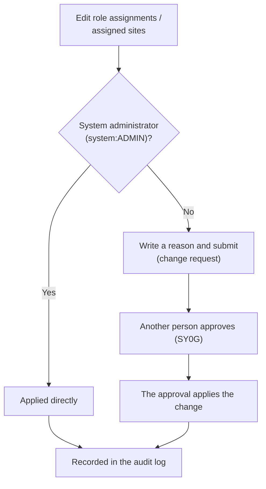

Operation code **SY01**. Lists every user registered in the system, shows each user's role assignments, effective permissions and assigned sites, and lets you change **role assignments** and **assigned sites**.

> Viewing requires **system permission** (`system:READ`). Users cannot be created or deleted here, and names and e-mail addresses cannot be edited (they come in through AD sync).
>
> Changing **role assignments** and **assigned sites** is a privileged operation that needs the permission code **`user_admin`** (UPDATE). It goes through a "change request" (method B): only system administrators (`system:ADMIN`) pass straight through and apply the change directly. Everyone else writes a reason and submits a request, and **another person's approval applies the change** ([Privileged access](/manual/en/operations/system/privileged-access/user), SY0G). Either way it is recorded in the audit log.

How a change gets applied, as a diagram:

## What you can do here

- Browse all users in a list, with search and filters.
- Open a user's detail page to see their assigned roles (including history).
- Check the user's **effective permissions** (permission code × action × scope) — what they can actually do.
- Change **role assignments** (`user_admin`; with approval).
- Review and change the **assigned sites** (what PLANT / REGION scopes apply to) (`user_admin`; with approval).

## Opening it

- Home (System) → **ユーザー管理 (User Management)**, or type `SY01` in the search box.

## List and search

The list shows the following columns.

- **Username** — the login ID (monospace).
- **Display name** — the name shown on screen.
- **Email** — the registered email address ("—" when none).
- **Group** — a **System** / **Employee** / **Guest** badge.
- **Roles** — badges for the currently active roles (multiple allowed).
- **Status** — **Active** / **Inactive**.
- **Last login** — when the user last logged in.

The search box matches username, display name, email, and role name. The **group** and **status** selects narrow the list, and **Reset** clears every filter. Click a row to open the detail page.

## User detail

The detail page has four blocks.

- **Summary** — username, group, email, login method (**password + SSO** or **SSO only**), last login, and employee ID.
- **Role assignments** — the assignment history: role name, rolename (internal system name), status (active/inactive), assigned date, and deactivation time. Past, deactivated assignments are also shown. People holding `user_admin` see an "編集" (Edit) button (`updateUserRoles`). **A removed role is not deleted — its row is set to `is_active = false` + `deactivate_at`**, so the history shows when it was removed.
- **Assigned sites** — the sites that "site" / "region"-scoped permissions apply to. People holding `user_admin` see an "編集" (Edit) button (`updateUserPlants`). Users without the permission see badges only.
- **Effective permissions** — what this user can do right now. **One row per permission code** (e.g. `quote`, `master`, `system`), with the actions (READ / CREATE / UPDATE, …) as badges inside it and the **widest scope** shown (`groupPermissionsByCode` — `@ckk/authz-core`). Scopes are written per action only when they differ between actions.

## How to read effective permissions

- Permissions belong to roles, and a user can hold several roles.
- The `user_permissions` view itself returns **every grant row (role × permission × action)**, but **the screen folds them into one row per permission code**. The folding has two stages: first each (code × action) is reduced to its widest scope (`highestScopeRows` — with both PLANT and ALL the result is ALL; at the same width the `scope_values` are added together), then the rows are grouped by code with the actions listed (`groupPermissionsByCode`).
- **ADMIN contains every action on the same code** (`matchingRows` in `decide` treats it that way), so when ADMIN is present, actions with the same or a narrower scope are dropped from the display. Actions wider than ADMIN are kept (if ADMIN is PLANT and READ is ALL, READ really does reach the whole company).
- **The folding is display only.** Actual access is still resolved by `decide()` as the **union** of all rows.
- The scope is the range the action covers (ALL = everything, PLANT = assigned sites, OWN = own data, and so on). The sites that PLANT / REGION resolve against are set in the "Assigned sites" block.

## FAQ

- **I want to add or edit a user** — not possible on this screen. User records are managed by synchronization with the company directory (AD). Ask a system administrator.
- **I want to change roles** — "Role assignments" → "編集" (Edit) on the detail page. It needs `user_admin` (UPDATE); anyone other than a system administrator writes a reason and submits a request, and the change is applied on approval. **You cannot change your own roles** (it would defeat the point of having a different person request and approve).
- **admin cannot be removed from the last administrator** — by design. A database with no administrator cannot be recovered from this screen either (changing roles needs `user_admin`, and `user_admin` is not given to any business role), leaving psql as the only way. Create another administrator first.
- **I saved the roles but the permissions did not change** — changes by anyone other than a system administrator are not applied until they are approved. Check SY0G for a pending request.
- **Permissions look wrong** — check "Effective permissions" on the detail page. All grant rows from every role are listed, and actual access is their union. If someone has a "site" / "region"-scoped permission but sees no data, also check that their "Assigned sites" is not empty.
- **I want to change someone else's language or date display** — not possible from this screen. Language, date/time format and time zone are personal settings that **only the user themselves** can change, from **Display Settings** in the avatar menu (web) or the kiosk launcher (tablet). The language setting is shared between the web app and the kiosk.
- To see who changed what and when, use the [Activity Log](/admin-manual/en/system/activity-log).
- For app visibility ON/OFF, see [App Management](/admin-manual/en/system/app-management).
