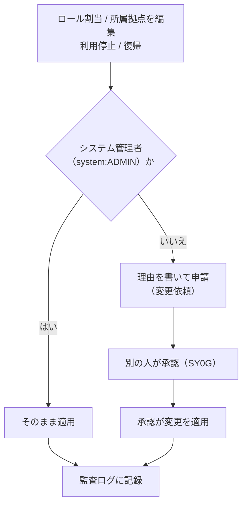

操作コード **SY01**。システムに登録されている全ユーザーの一覧と、各ユーザーのロール割当・実効権限・所属拠点を確認し、**ロール割当**と**所属拠点**を変更できるアプリです。

> 入口（閲覧）は **`user_admin`**（READ）です（`system:READ` ではありません）。ユーザーの作成・削除や氏名・メールの編集はこの画面からはできません（AD 同期で入ります）。
>
> **ロール割当**・**所属拠点**の変更と**利用停止・復帰**は特権操作で、権限コード **`user_admin`**（UPDATE）が要ります。方式 B の「変更依頼」を通り、システム管理者（`system:ADMIN`）だけが素通しで直接適用できます。それ以外は理由を書いて申請し、**別の人の承認が変更を適用します**（[特権アクセス](/manual/ja/operations/system/privileged-access/user) SY0G）。どちらの経路でも監査ログに記録されます。

変更が適用されるまでの流れを図にすると次のとおりです。

## このアプリでできること

- 全ユーザーを一覧で確認し、検索・絞り込みができます。
- ユーザーごとの詳細画面で、割り当てられたロール（履歴を含む）を確認できます。
- そのユーザーが実際に持つ **実効権限**（権限コード × アクション × スコープ）を確認できます。
- **ロール割当**を変更できます（`user_admin`。承認つき）。
- **所属拠点**（PLANT / REGION スコープの適用対象）を確認・変更できます（`user_admin`。承認つき）。
- ユーザーを**利用停止**（一時 / 無期限）にし、**復帰**させられます（`user_admin`。承認つき）。停止の実体は `is_active = false` で、一時停止は期限が来ると pg_cron が戻します（最大 1 分の遅れ）。承認されるまで、停止対象の人はそのままログインできます。

## 開き方

- ホーム（システム）→ **ユーザー管理**、または検索ボックスで `SY01`。

## 一覧・検索

一覧には次の列が表示されます。

- **ユーザー名** … ログインに使う ID（等幅表示）。
- **表示名** … 画面に表示される氏名。
- **メール** … 登録メールアドレス（無い場合は「—」）。
- **区分** … **システム** / **社員** / **ゲスト** のバッジ。
- **ロール** … 現在有効なロールのバッジ（複数可）。
- **状態** … **有効** / **無効**。
- **最終ログイン** … 最後にログインした日時。

検索ボックスはユーザー名・表示名・メール・ロール名を横断して検索します。**区分** と **状態** のセレクトで絞り込み、**リセット** で条件を全部クリアできます。行をクリックすると詳細へ移動します。

## ユーザー詳細

詳細画面は次のブロックで構成されます（上から順）。

- **概要** … ユーザー名・区分・メール・ログイン方式（**パスワード + SSO** か **SSO のみ** か）・最終ログイン・社員 ID。
- **ロール割当** … 割り当ての履歴一覧。ロール名・rolename（システム内部名）・状態（有効/無効）・割当日・解除日時。過去に解除された割当も表示されます。`user_admin` を持つ人には「編集」ボタンが出ます（`updateUserRoles`）。**外したロールは行ごと消さず `is_active = false` + `deactivate_at` に倒す**ので、いつ外れたのかが履歴に残ります。
- **所属拠点** … 「拠点」「地域」スコープの権限が適用される対象拠点。`user_admin` を持つ人には「編集」ボタンが出ます（`updateUserPlants`）。権限が無いユーザーにはバッジ表示のみです。
- **実効権限** … 「いまこのユーザーができること」の一覧。**権限コードごとに 1 行**で、表示名（`permission-labels.ts`）を主に、コード（例: `quote`、`master`、`system`）をその下に小さく出し、その中にアクション（READ / CREATE / UPDATE など）をバッジで並べ、**最も広いスコープ**を表示します（`groupPermissionsByCode` — `@ckk/authz-core`）。スコープがアクションによって違うときだけ、アクションごとに書き分けます。
- **ログイン履歴（直近 30 日）** … この人の認証イベント（成功・失敗の両方、最大 30 件）。結果・方式・失敗理由・日時・送信元 IP。
- **登録端末（Web）** … `user_devices`（成功ログインで upsert される端末台帳）。ラベル・シグネチャ先頭・UA・ログイン回数・最終利用・最終 IP・所有区分バッジ。端末の同定ではなく「いつもの端末か」の目安です。
- **利用停止** … 一時停止（解除予定日時が必須）/ 無期限停止。管理者は理由任意、それ以外は理由必須で変更依頼になります。確認モーダルを経て実行します。**自分自身と最後の管理者は停止できません**（`canSuspend` — `lib/user-suspension-core.ts`）。

> **ログイン履歴と登録端末は特権操作を通りません。** SY0D の詳細（IP・端末シグネチャ）は `personal_data.login_history_detail` の承認が要りますが、SY01 の詳細では `user_admin`（READ）だけで同種の情報（IP・シグネチャ先頭・所有区分）が見えます。

### 初期管理者（`admin`）

新規 DB に作られるローカルの初期管理者 `admin` の詳細を開いたときだけ、最上部に専用カードが出ます（判定は `lib/bootstrap-admin-core.ts`）。このアカウントには利用停止の欄は出ません。

- 既定パスワードのままなら「**既定パスワードのままです**」と強く警告します。
- 他に有効な管理者（`system:ADMIN`）が居なければ「**先に実ユーザーへ管理者権限を割り当ててください**」となり、無効化できません（無効化すると管理者が居なくなり psql でしか戻せないため）。
- 他に管理者が居れば「**初期管理者を無効化できます**」となり、`system:ADMIN` を持つ人が「**初期管理者を無効化**」を押して無効化できます（推奨）。
- 無効化後は「**初期管理者は無効化済み**」と出ます。

## 実効権限の読み方

- 権限はロールに紐づいており、ユーザーは複数ロールを持てます。
- `user_permissions` ビュー自体は **grant（ロール × 権限 × アクション）単位の全行** を返しますが、**画面は権限コードごとに 1 行へ畳んで**表示します。畳み方は 2 段: まず (コード × アクション) を最も広いスコープへ（`highestScopeRows`。PLANT と ALL の両方があれば ALL、同じ広さなら `scope_values` を足す）、次にコードでまとめてアクションを並べる（`groupPermissionsByCode`）。
- **ADMIN は同じコードの全アクションを内包する**（`decide` の `matchingRows` がそう扱う）ので、ADMIN があるときそれ以下の広さのアクションは表示から落とします。ただし ADMIN より広いアクションは残します（ADMIN が PLANT で READ が ALL なら READ は本当に全社に届くため）。
- **畳むのは表示だけ** です。実際のアクセス可否は従来どおり `decide()` が全行の**和集合**で解決します。
- スコープはその操作が及ぶ範囲です（ALL = 全体、PLANT = 所属拠点、OWN = 自分のデータ など）。PLANT / REGION の基準になる拠点は「所属拠点」ブロックで設定します。

## よくある質問

- **ユーザーを追加・編集したい** … この画面ではできません。ユーザー情報は社内の認証基盤（AD）との同期などで管理されます。システム管理者に依頼してください。
- **ロールを変更したい** … 詳細画面の「ロール割当」→「編集」。`user_admin`（UPDATE）が要り、システム管理者以外は理由を書いて申請 → 承認で適用されます。**自分のロールは変えられません**（申請と承認を別の人にする意味が消えるため）。
- **最後の管理者から admin を外せない** … 仕様です。管理者ゼロの DB はこの画面からも復旧できない（ロールを変えるには `user_admin` が要り、`user_admin` はどの業務ロールにも配っていない）ため、psql しか手が残りません。他の管理者を先に作ってください。
- **ロールを保存したのに権限が変わらない** … システム管理者以外の変更は承認されるまで適用されません。SY0G で承認依頼中でないか確認してください。
- **権限が想定と違う** … 詳細画面の「実効権限」を確認してください。複数ロール分の grant 行は**権限コードごとに 1 行へ畳んで**表示されます（`groupPermissionsByCode`。同じコードが複数ロールから来ていれば最も広いスコープ）。実際のアクセスは全 grant 行の和集合です（`decide()`）。行単位の内訳が必要なときは `app.user_permission_summary` / `user_permissions` ビューを読んでください。「拠点」「地域」スコープの権限があるのにデータが見えないときは、「所属拠点」が空でないかも確認してください。
- **他の人の言語や日時の表示を変えたい** … この画面からは変更できません。言語・日付/時刻の形式・タイムゾーンは **本人だけ** が変えられる個人設定で、アバターメニューの「表示設定」（Web）またはキオスクのランチャー（タブレット）から本人が切り替えます。言語は Web とキオスクで同じ設定を共有します。
- 誰がいつ何を変更したかは [操作履歴](/admin-manual/ja/system/activity-log) で確認できます。
- アプリの表示 ON/OFF は [アプリ管理](/admin-manual/ja/system/app-management) を参照してください。
