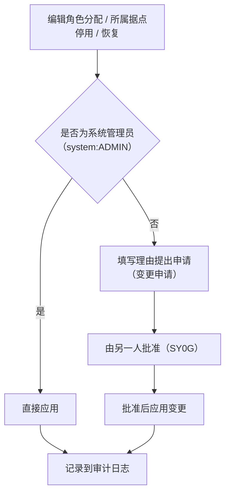

操作代码 **SY01**。查看系统中注册的全部用户，以及每个用户的角色分配、有效权限与所属据点，并可变更**角色分配**与**所属据点**。

> 入口（查看）权限为 **`user_admin`**（READ），不是 `system:READ`。在此界面上不能创建、删除用户，也不能编辑姓名、邮箱（这些通过 AD 同步写入）。
>
> 变更**角色分配**与**所属据点**、以及**停用・恢复**用户属于特权操作，需要权限代码 **`user_admin`**（UPDATE）。变更走方式 B 的「变更申请」：只有系统管理员（`system:ADMIN`）可以不经审批直接应用。其他人需填写理由提出申请，**由另一人的批准来应用变更**（[特权访问](/manual/zh/operations/system/privileged-access/user) SY0G）。无论哪种途径都会记录到审计日志。

变更被应用的流程用图表示如下。

## 本应用能做什么

- 以列表方式浏览全部用户，支持搜索和筛选。
- 打开用户详情，查看其角色分配（含历史记录）。
- 查看该用户实际拥有的 **有效权限**（权限代码 × 操作 × 范围）。
- 变更**角色分配**（`user_admin`，需审批）。
- 查看・变更**所属据点**（PLANT / REGION 范围权限的适用对象）（`user_admin`，需审批）。
- 可将用户**停用**（临时 / 无限期）并使其**恢复**（`user_admin`，需审批）。停用的实质是 `is_active = false`，临时停用到期后由 pg_cron 恢复（最多延迟 1 分钟）。在获得批准之前，被停用对象仍可照常登录。

## 打开方式

- 主页（系统）→ **ユーザー管理（用户管理）**，或在搜索框输入 `SY01`。

## 列表与搜索

列表显示以下各列。

- **用户名** … 登录用 ID（等宽字体）。
- **显示名** … 界面上显示的姓名。
- **邮箱** … 注册的邮箱地址（无则显示"—"）。
- **类别** … **系统** / **员工** / **访客** 徽章。
- **角色** … 当前生效角色的徽章（可有多个）。
- **状态** … **有效** / **无效**。
- **最后登录** … 最后一次登录的时间。

搜索框可同时匹配用户名、显示名、邮箱和角色名。可用 **类别** 和 **状态** 下拉框筛选，点 **重置** 清除全部条件。点击行进入详情页。

## 用户详情

详情页由以下区块组成（从上到下）。

- **概要** … 用户名、类别、邮箱、登录方式（**密码 + SSO** 或 **仅 SSO**）、最后登录、员工 ID。
- **角色分配** … 分配历史列表：角色名、rolename（系统内部名）、状态（有效/无效）、分配日期、解除时间。已解除的历史分配也会显示。持有 `user_admin` 的人会看到「編集」（编辑）按钮（`updateUserRoles`）。**被移除的角色不会整行删除，而是置为 `is_active = false` + `deactivate_at`**，因此何时被移除会留在历史中。
- **所属据点** … 「据点」「地区」范围的权限所适用的据点。持有 `user_admin` 的人会看到「編集」（编辑）按钮（`updateUserPlants`）。没有该权限的用户只显示徽章。
- **有效权限** … "该用户当前能做什么"的清单。**每个权限代码 1 行**，以显示名称（`permission-labels.ts`）为主，其下以小字显示代码（如 `quote`、`master`、`system`），行内以徽章排列操作（READ / CREATE / UPDATE 等），并显示**最宽的范围**（`groupPermissionsByCode` — `@ckk/authz-core`）。只有当范围因操作而异时，才按操作分别标注。
- **ログイン履歴（直近 30 日）**（登录历史，最近 30 天）… 该用户的认证事件（成功・失败两者，最多 30 条）。结果・方式・失败理由・日期时间・来源 IP。
- **登録端末（Web）**（已登记终端，Web）… `user_devices`（成功登录时 upsert 的终端台账）。标识・指纹开头・UA・登录次数・最后使用・最后 IP・归属徽章。这是「是否为平时使用的终端」的参考，并非终端识别。
- **利用停止**（停用）… 临时停用（必须填写预定解除时间）/ 无期限停用。管理员可不填理由，其他人必须填写理由，并成为变更申请。经确认对话框后执行。**无法停用自己和最后一位管理员**（`canSuspend` — `lib/user-suspension-core.ts`）。

> **登录历史与已登记终端不经过特权操作。** SY0D 的详情（IP・终端指纹）需要 `personal_data.login_history_detail` 的审批，但在 SY01 的详情中只需 `user_admin`（READ）即可看到同类信息（IP・指纹开头・归属）。

### 初始管理员（`admin`）

只有打开新 DB 中创建的本地初始管理员 `admin` 的详情时，最上方才会出现专用卡片（判定在 `lib/bootstrap-admin-core.ts`）。该账号不显示停用栏。

- 若仍为默认密码，会强烈警告「**既定パスワードのままです**」（仍为默认密码）。
- 若没有其他有效管理员（`system:ADMIN`），显示「**先に実ユーザーへ管理者権限を割り当ててください**」（请先为实际用户分配管理员权限），无法停用（停用后将没有管理员，只能通过 psql 恢复）。
- 若有其他管理员，显示「**初期管理者を無効化できます**」（可以停用初始管理员），持有 `system:ADMIN` 的人可点击「**初期管理者を無効化**」（停用初始管理员）——推荐。
- 停用后显示「**初期管理者は無効化済み**」（初始管理员已停用）。

## 如何理解有效权限

- 权限属于角色，一个用户可以拥有多个角色。
- `user_permissions` 视图本身返回 **以 grant（角色 × 权限 × 操作）为单位的全部行**，但**界面会按权限代码折叠为 1 行**显示。折叠分两步：先把（代码 × 操作）归并为最宽的范围（`highestScopeRows`。同时有 PLANT 和 ALL 时为 ALL，范围同宽时合并 `scope_values`），再按代码汇总并排列操作（`groupPermissionsByCode`）。
- **ADMIN 包含同一代码的全部操作**（`decide` 的 `matchingRows` 如此处理），因此存在 ADMIN 时，范围不超过它的操作会从显示中省略。但范围比 ADMIN 更宽的操作会保留（ADMIN 为 PLANT 而 READ 为 ALL 时，READ 确实覆盖全公司）。
- **折叠只是显示上的处理。** 实际能否访问仍由 `decide()` 按全部行的**并集**判定。
- 范围指该操作的覆盖面（ALL = 全部、PLANT = 所属据点、OWN = 本人数据 等）。PLANT / REGION 判定所依据的据点在「所属据点」区块中设置。

## 常见问题

- **想添加或编辑用户** … 此界面上无法操作。用户信息通过与公司认证目录（AD）同步等方式管理，请联系系统管理员。
- **想变更角色** … 详情页的「角色分配」→「編集」（编辑）。需要 `user_admin`（UPDATE）；系统管理员以外的人需填写理由提出申请 → 批准后应用。**不能变更自己的角色**（否则申请人与审批人分开就失去了意义）。
- **无法从最后一位管理员身上移除 admin** … 这是设计如此。没有管理员的数据库从本界面也无法恢复（变更角色需要 `user_admin`，而 `user_admin` 不分配给任何业务角色），只剩下 psql 一条路。请先创建其他管理员。
- **保存了角色但权限没有变化** … 系统管理员以外的人所做的变更，在获批之前不会应用。请在 SY0G 确认是否仍在审批中。
- **权限与预期不符** … 请查看详情页的"有效权限"。多个角色的 grant 行会**按权限代码折叠为 1 行**显示（`groupPermissionsByCode`；同一代码来自多个角色时显示最宽的范围）。实际访问是全部 grant 行的并集（`decide()`）。需要逐行明细时，请查看 `app.user_permission_summary` / `user_permissions` 视图。有「据点」「地区」范围的权限却看不到数据时，也请确认「所属据点」是否为空。
- **想更改他人的语言或日期时间显示** … 无法从本画面更改。语言、日期/时间格式与时区属于**仅本人可更改**的个人设置，由本人从头像菜单的"显示设置"（网页端）或 kiosk 启动器（平板）切换。语言设置在网页端与 kiosk 之间共用。
- 想查看谁在何时改了什么，请使用[操作历史](/admin-manual/zh/system/activity-log)。
- 应用的显示开关请参见[应用管理](/admin-manual/zh/system/app-management)。
