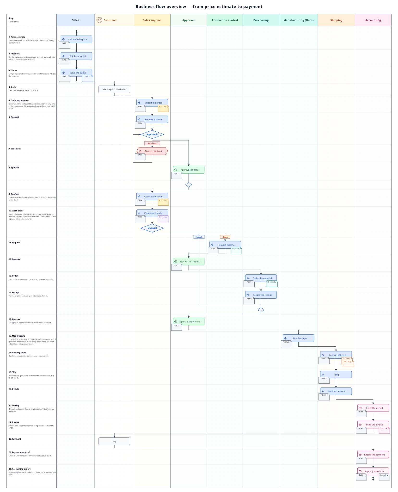
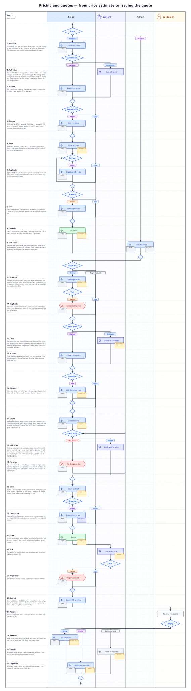
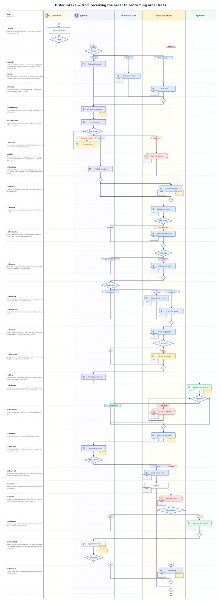
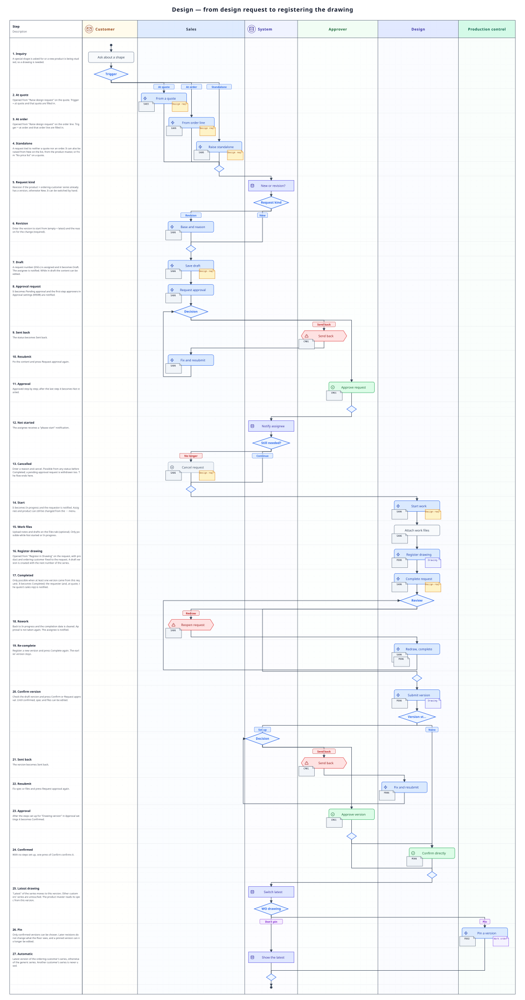
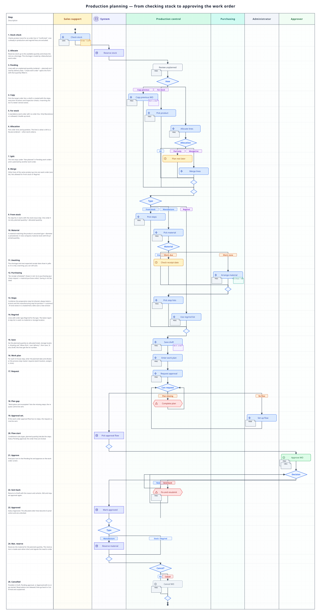
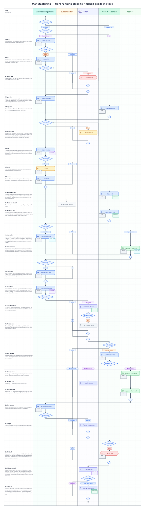
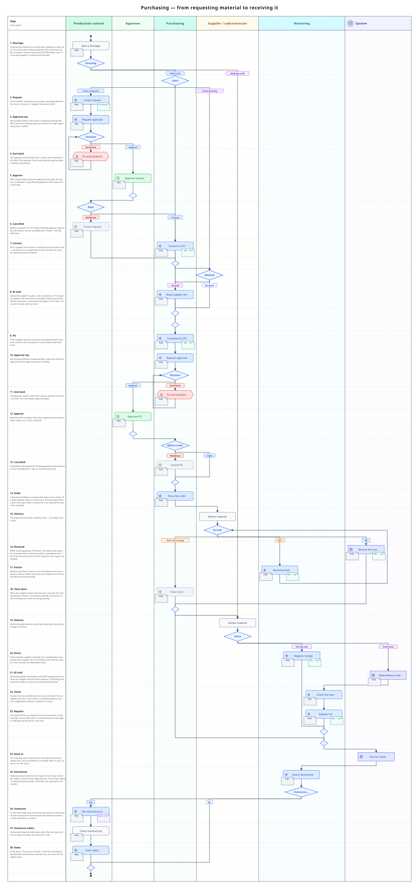
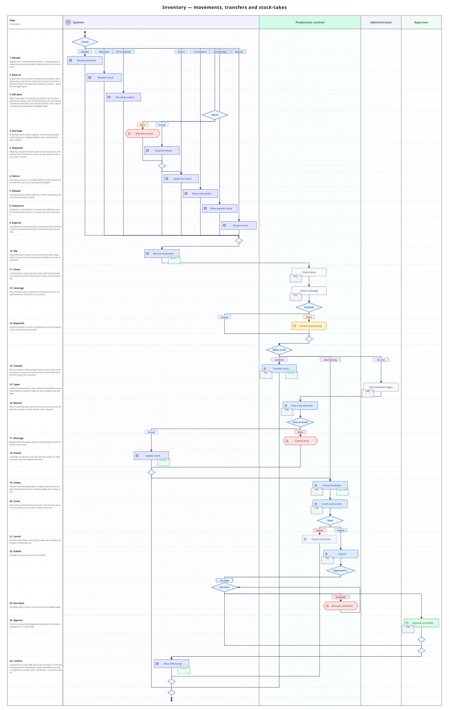
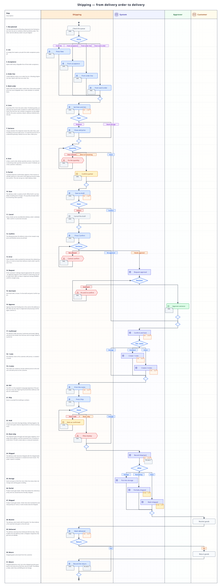
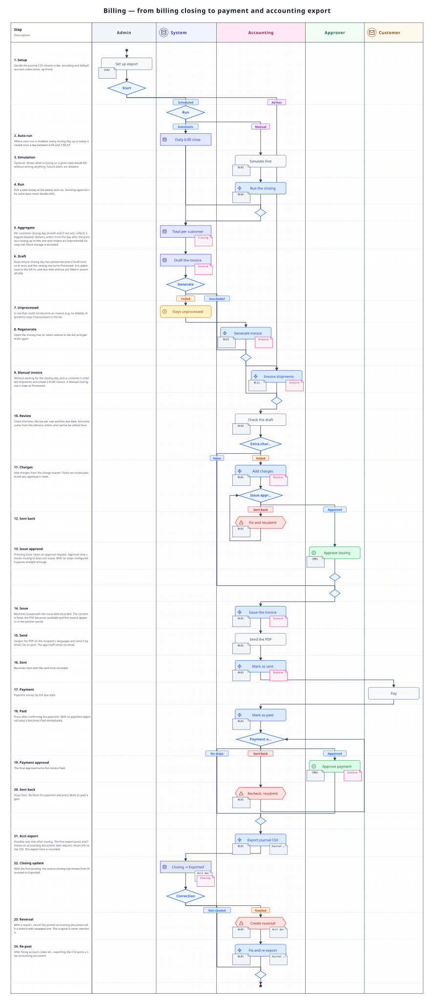

This page splits the business into **nine processes** and shows each one's steps **pattern by pattern (every branch)** in a diagram and a table. Every step in the diagrams carries the **operation code of the app** used for it (e.g. `SA04`).

Start with **0. The whole flow** to get the big picture, then open the section for the process you work in. For detailed screen operations, follow the app name in the table to its user manual.

| # | Process | Covers |
|---|---------|------|
| 0 | [The whole flow](#overview) | From price estimate to payment and the accounting export |
| 1 | [Pricing and quotes](#pricing) | Price estimate → price list → quote |
| 2 | [Order intake](#order) | Importing the order → approval → confirming order lines |
| 3 | [Design](#design) | Design request → registering the drawing |
| 4 | [Production planning](#planning) | Stock check → work order → approval |
| 5 | [Manufacturing](#production) | Running the steps → finished goods into stock |
| 6 | [Purchasing](#purchasing) | Purchase request → order → receipt |
| 7 | [Inventory](#inventory) | Automatic postings, transfers, stock-takes |
| 8 | [Shipping](#shipping) | Delivery order → shipment → delivery note |
| 9 | [Billing](#billing) | Billing closing → invoice → payment and accounting export |

## How to read the diagrams [#legend]

- Each **column (lane)** is who does it; the **left column** is the step number and description. The number matches **#** in the table below each diagram.
- The **tag at the bottom left of a box** is the **operation code of the app** used for that step (`Tablet` = the shared tablet on the floor). A box without one is something **the system does automatically**.
- The **tag at the bottom right** is the **document** that step creates or changes.
- **Diamonds** are decisions; the text on each branch is the condition. Line colours: red = send back / reject, orange = exception / shortage, blue = normal alternative, purple = the user chooses. A line going back up is a "fix and try again" loop.
- Box colours: blue = action, green = approval, red = send-back / error, yellow = waiting, grey = end (cancelled etc.), indigo = automatic system processing.
- Click a diagram to open it full-screen and zoom in.

## 0. The whole flow [#overview]

The order in which an ordinary order moves from price estimate to payment and the accounting export. Only two decisions are shown here (send-back and material shortage); every other pattern is in sections 1–9.

| # | Step | Who | App | Details |
|---|------|------|--------|---------|
| 1–3 | Price estimate → price list → issue the quote | Sales | `SA01` / `SA02` / `SA03` | [1. Pricing and quotes](#pricing) |
| 4 | The purchase order arrives | Customer | — | [2. Order intake](#order) |
| 5–8 | Import the order → request approval → (send back) → approve | Sales support / Approver | `SA04` / `CM01` | [2. Order intake](#order) |
| 9 | Confirm the order (order lines are created) | Sales support | `SA04` | [2. Order intake](#order) |
| 10 | Create the work order | Sales support | `PD02` | [4. Production planning](#planning) |
| 11–14 | If material is short: purchase request → approval → order → receipt | Production control / Approver / Purchasing | `PU01` / `CM01` / `PU02` / `PU03` | [6. Purchasing](#purchasing) |
| 15 | Approve the work order (material is reserved) | Approver | `CM01` | [4. Production planning](#planning) |
| 16 | Run the steps (finished goods into product stock) | Manufacturing (floor) | `Tablet` | [5. Manufacturing](#production) |
| 17–19 | Confirm the delivery order (delivery note created) → ship → delivered | Shipping | `SH01` / `SH02` | [8. Shipping](#shipping) |
| 20–21 | Billing closing → send the invoice | Accounting | `BL02` / `BL01` | [9. Billing](#billing) |
| 22–23 | Payment → record the payment (Paid) | Customer → Accounting | `BL01` | [9. Billing](#billing) |
| 24 | Hand over to the accounting software (journal CSV) | Accounting | `BL01` | [9. Billing](#billing) |

Automatic stock increases and decreases, transfers and stock-takes are in [7. Inventory](#inventory). For a product without a drawing, [3. Design](#design) runs in parallel.

## 1. Pricing and quotes — from price estimate to issuing the quote [#pricing]

This process sets the unit price of what we sell, registers it in a per-customer price list, and issues a quote at that price to the customer. Products start from a price estimate, regrinding from the regrind item's standard price; when the customer places an order, it hands over to [Order](#order). For a product without a drawing, a [design request](#design) is raised in parallel with the quote.

### Steps and apps

| # | Step | Who | App | Branches / patterns |
|---|------|-----|-----|---------------------|
| 1 | Create estimate | Sales | [Price estimate](/manual/en/operations/sales/trial-estimate/user) (`SA01`) | Only when selling a product; regrinding goes to 9 / the inputs depend on the tool type (round bar, cylinder, OH, or types added by an admin) |
| 2 | Get reference price | System | (automatic) | Purchase history exists → calculated per settings (latest / highest / average × look-back months) / no history → material type default price (or the global default), "Default price" badge |
| 3 | Enter bar price | Sales | [Price estimate](/manual/en/operations/sales/trial-estimate/user) (`SA01`) | For the cylinder tool type the reference price is not used; the material price (¥/pc) is entered by hand |
| 4 | Edit reference price | Sales | [Price estimate](/manual/en/operations/sales/trial-estimate/user) (`SA01`) | Optional. Re-entering the reference price adds a "Custom" badge / "Back to policy value" restores automatic / a price can also be picked from the material price history chart |
| 5 | Save as draft | Sales | [Price estimate](/manual/en/operations/sales/trial-estimate/user) (`SA01`) | Cannot be saved without a name / cannot be edited after saving (use 6 to change it) |
| 6 | Duplicate & redo | Sales | [Price estimate](/manual/en/operations/sales/trial-estimate/user) (`SA01`) | Possible from any status. "(redo)" is added to the name and it becomes a draft with a new number |
| 7 | Link a product | Sales | [Price estimate](/manual/en/operations/sales/trial-estimate/user) (`SA01`) | Only when no product is set / can be changed or removed while Draft or Confirmed / a Registered estimate's link cannot change |
| 8 | Confirm | Sales | [Price estimate](/manual/en/operations/sales/trial-estimate/user) (`SA01`) | Only a Draft can be confirmed. It is recalculated with the settings at that moment and recorded |
| 9 | Set standard price | Admin | [Regrind items](/manual/en/operations/masters/regrind-item/user) (`MS0H`) | When selling regrinding (the regrind service). The standard price cannot be changed from the price list screen |
| 10 | Create price list | Sales | [Price list](/manual/en/operations/sales/price-list/user) (`SA02`) | Skipped for regrinding if the standard price is enough / products take Production, Test, Sample, Other; regrind items only Regrind (a wrong pair is rejected on save) / Test and Sample need an end date |
| 11 | Edit existing price list | Sales | [Price list](/manual/en/operations/sales/price-list/user) (`SA02`) | Same customer × item already exists → cannot be saved; edit the existing price list and add the order type |
| 12 | Lock the estimate | System | (automatic) | When an estimate is chosen as the base price. Only confirmed or registered estimates of the same product can be chosen. An estimate used for the first time becomes "Registered" and is locked |
| 13 | Enter base price | Sales | [Price list](/manual/en/operations/sales/price-list/user) (`SA02`) | "Use custom price" to enter the base price by hand (source shows "Manual") / custom prices per tier row are also possible |
| 14 | Add discount rule | Sales | [Price list](/manual/en/operations/sales/price-list/user) (`SA02`) | Optional. Rate (%) or amount (¥/pc) × quantity × period / the largest discount wins if several match / a discount never exceeds the line amount |
| 15 | Create quote | Sales | [Quote](/manual/en/operations/sales/quote/user) (`SA03`) | Three entry points: New / "Create quote" on a price list / duplicating a quote. Unit price, discount and amount cannot be entered by hand |
| 16 | Look up the price | System | (automatic) | Active price list × active order type × today within the valid period × tier matching the quantity → unit price (base price × multiplier, or custom) and discount / a regrind item with no matching price list uses its standard price |
| 17 | Fix the price list | Sales | [Price list](/manual/en/operations/sales/price-list/user) (`SA02`) | Product with no price list, or one that is inactive or out of period → cannot be saved (prepare estimate and price list) / price list exists but no tier for the quantity → cannot be saved (add a tier; regrinding does not fall back to the standard price either) |
| 18 | Save as draft | Sales | [Quote](/manual/en/operations/sales/quote/user) (`SA03`) | Unit price, discount and tax are frozen at save time / a draft can be edited, and saving again re-reads the current price list |
| 19 | Raise design request | Sales | [Design request](/manual/en/operations/sales/design-request/user) (`SA06`) | When there is no drawing. Raising it from the quote menu carries the quote over / not possible from an expired quote / continues in the [design request](#design) flow |
| 20 | Issue | Sales | [Quote](/manual/en/operations/sales/quote/user) (`SA03`) | Valid-until date required, today or later / after issue it can be neither edited nor un-issued |
| 21 | Generate PDF | System | (automatic) | Only issued quotes have a PDF (it cannot be opened for a draft) |
| 22 | Regenerate PDF | Sales | [Quote](/manual/en/operations/sales/quote/user) (`SA03`) | When PDF generation failed. The quote is already issued |
| 23 | Send PDF to customer | Sales | [Quote](/manual/en/operations/sales/quote/user) (`SA03`) | Download from the PDF tab and send it / the "email to customer" checkbox in the issue dialog does not send anything automatically |
| 24 | Receive the quote | Customer | — | There is no operation to record the reply on the quote |
| 25 | Go to order acceptance | Sales | [Order acceptance](/manual/en/operations/sales/order-acceptance/user) (`SA04`) | When an order comes. Naming this quote on the order acceptance lists it under "To" on the quote. Continues in [Order](#order) |
| 26 | Show as expired | System | (automatic) | Declined, or no reply until the valid-until date passes. Not stored as a status; only the display changes from that day |
| 27 | Duplicate and reissue | Sales | [Quote](/manual/en/operations/sales/quote/user) (`SA03`) | When the content must change. An issued quote cannot be changed, so duplicate it and restart from 15 |

### Patterns to keep in mind
- A price list's **valid period and active flag do affect quote prices**. An out-of-period or inactive price list counts as "none": product lines cannot be saved (regrind items fall back to the standard price).
- Changing a price list **does not change the amounts of issued quotes**. A draft quote re-reads the current price list when it is opened and saved again.
- "**Change valid period**" on a price list moves only the period and keeps the prices. Test and Sample still need an end date afterwards.
- "**Copy to another customer / product**" copies the same price settings to another pair. The link to the price estimate is dropped and it counts as manual entry.
- Price lists can be **enabled / disabled / bulk deleted** by selecting several rows in the list. Deletion cannot be undone.
- A price estimate records its result twice — on save and on confirm — with the pricing settings (SY02) of that moment. Changing those settings later does not move recorded estimates.
- A draft quote can be edited freely, but an issued quote can be **neither edited nor un-issued**. If one was issued by mistake, duplicate it and send the correct one; the wrong one expires on its valid-until date.
- Choosing a regrind item on a quote line prices it at the standard price even without a customer price list. The customer's own tool (an external product) is not something we sell, so it never appears in price lists or as a quote item.

## 2. Order intake — from receiving the order to confirming order lines [#order]

This process imports a customer's order as an order acceptance, checks its content and prices, takes it through approval and confirms it into order lines. It follows [Pricing and quotes](#pricing); the confirmed order lines are handed to [Production planning](#planning).

### Steps and apps

| # | Step | Who | App | Branches / patterns |
|---|------|-----|-----|---------------------|
| 1 | Send the order | Customer | — | Entry is a file (email / folder / priority intake) or by hand. A fax is scanned on the copier into a file |
| 2 | Receive the email | System | (automatic) | Attachments (PDF, PNG, JPG, WEBP) sent to order-intake@ckk-tool.co.jp go into the intake folder. One attachment = one order acceptance. Production only. A failed email is not retried automatically |
| 3 | Drop into folder | Administrator | [Order intake](/manual/en/operations/system/order-intake/user) (`SY0C`) | Automatic scan (default every 60 s) or Scan now. A failed file can be re-imported; it keeps its number and only extraction is redone |
| 4 | Pick files | Sales assistant | [Order acceptance](/manual/en/operations/sales/order-acceptance/user) (`SA04`) | Priority intake takes several files. They skip the folder; extraction is queued |
| 5 | Number and import | System | (automatic) | An order acceptance with an `ORD-` number is created in status Importing |
| 6 | AI extracts | System | (automatic) | Temporary failure → 7 / permanent failure or 3 failures → 8 / success → 9 |
| 7 | Auto retry | System | (automatic) | Up to 3 times (orange Retrying). If it still fails → 8 |
| 8 | Retry or type in | Sales assistant | [Order acceptance](/manual/en/operations/sales/order-acceptance/user) (`SA04`) | Re-extract → back to 6 / Switch to manual entry → Draft, keeping whatever was already extracted |
| 9 | Match masters | System | (automatic) | Only a single hit is filled in; ambiguous ones stay empty. Status becomes Draft and the intake group (first approval group) is notified |
| 10 | Create by hand | Sales assistant | [Order acceptance](/manual/en/operations/sales/order-acceptance/user) (`SA04`) | Create by hand → create the draft. Customer is required |
| 11 | Check the content | Sales assistant | [Order acceptance](/manual/en/operations/sales/order-acceptance/user) (`SA04`) | Opens read-only; Edit to change. Only a Draft can be edited |
| 12 | Pick customer/item | Sales assistant | [Order acceptance](/manual/en/operations/sales/order-acceptance/user) (`SA04`) | When the customer or item is not identified. Saving learns the spelling, so the next import matches automatically |
| 13 | Pick regrind tool | Sales assistant | [Order acceptance](/manual/en/operations/sales/order-acceptance/user) (`SA04`) | Regrind lines only. Item = regrind item, tool = product (external products allowed). Without a tool the line cannot be submitted or confirmed |
| 14 | Override the price | Sales assistant | [Order acceptance](/manual/en/operations/sales/order-acceptance/user) (`SA04`) | Lines on the price list cannot be edited. Turn on Override the unit price only to sell at a different price |
| 15 | Enter the price | Sales assistant | [Order acceptance](/manual/en/operations/sales/order-acceptance/user) (`SA04`) | Lines with No price list take any price |
| 16 | Request approval | Sales assistant | [Order acceptance](/manual/en/operations/sales/order-acceptance/user) (`SA04`) | Disabled until customer, at least one line, every item and price (end user for direct delivery, tool for regrind) are set |
| 17 | Accept & submit | Sales assistant | [Order acceptance](/manual/en/operations/sales/order-acceptance/user) (`SA04`) | Only when a line has a price mismatch (differs from the list without override) or no quantity tier. Overridden lines do not stop the request |
| 18 | Pick approval flow | System | (automatic) | Picks the conditional flow (total, delivery method, site). No approval steps configured → the request is refused |
| 19 | Approve each step | Approver | [Pending list](/manual/en/operations/general/my-tasks/user) (`CM01`) / `SA04` | Any one member / all members. Next step → repeat 19 / all approved → Approved |
| 20 | Fix and resubmit | Sales assistant | [Order acceptance](/manual/en/operations/sales/order-acceptance/user) (`SA04`) | Send back (reason required) returns it to Draft; start again from 11 |
| 21 | Confirm the order | Sales assistant | [Order acceptance](/manual/en/operations/sales/order-acceptance/user) (`SA04`) | Confirm → Expand. Approved → Confirmed |
| 22 | Create order lines | System | (automatic) | Each line gets `ORD-…-01` …, its amount is frozen and the order line is Confirmed |
| 23 | Check order lines | Sales assistant | [Order line](/manual/en/operations/sales/order-line/user) (`SA05`) | Work orders and delivery orders start here ([Production planning](#planning)). Quantity, price and item can no longer change |
| 24 | Archive | Sales assistant | [Order acceptance](/manual/en/operations/sales/order-acceptance/user) (`SA04`) | Optional. Confirmed → Archived. No more edits or cancellation |
| 25 | Request cancel | Sales assistant | [Order acceptance](/manual/en/operations/sales/order-acceptance/user) (`SA04`) | Whole confirmed order acceptance, reason required. Not possible once any line is shipped. Only one open request at a time |
| 26 | Approve the cancel | Approver | [Pending list](/manual/en/operations/general/my-tasks/user) (`CM01`) / `SA04` | Only when the order acceptance cancellation flow has steps. Send back → nothing changes and the request closes |
| 27 | Apply the cancel | System | (automatic) | Immediately when there are no steps, otherwise on final approval. Lines and acceptance become Cancelled, reservations are released, open work orders are cancelled |
| 28 | Recreate it | Sales assistant | [Order acceptance](/manual/en/operations/sales/order-acceptance/user) (`SA04`) | Optional. A new Draft carrying over the content (regrind tools, overridden prices, delivery too), linked to the original |

### Patterns to know

- Switch to manual entry also works while extraction is still running. The late extraction result is discarded and never overwrites what you typed.
- Failures that cannot heal (broken or oversized file) stop at Extraction failed without automatic retries. A manual Re-extract starts counting attempts from 1 again.
- Folder intake moves successful files to processed and failed ones to failed. The number is burnt into the file name, so re-importing never numbers it twice.
- If the container restarts and the queue is lost, rows still in Importing are picked up again at start-up.
- Saving with a different customer re-resolves prices from the new customer's price list and fills in that customer's primary sales rep.
- Saving with Override turned off replaces the typed price with the price-list price. Overridden lines are shown to approvers as "N price overrides".
- The flow conditions (total, delivery method, site) are evaluated per line: if any one line matches, that flow applies.
- Confirming re-checks the same conditions as the request. If something is missing it cannot be confirmed; have it sent back and fix it.
- If the premise changes while a cancellation is pending (e.g. a line is shipped), final approval does not apply it and the request is kept as failed.
- Work orders that survive a cancellation: completed ones, and combined lots that also serve other active order lines.
- Order line statuses in this process are only Confirmed and Cancelled. In production follows from work order approval; Partially shipped / Shipped follow from shipping.
- No single order line can be cancelled or edited. To change a confirmed order, cancel the whole order acceptance and recreate it.

## 3. Design — from design request to registering the drawing [#design]

Covers raising a design request when a drawing is needed, through approval, start of work, registering the drawing and completion, to confirming the drawing version and a work order using it. It runs alongside quoting and [order intake](#order); confirmed drawings are read by work orders in the next section, [planning](#planning).

### Steps and apps

| # | Step | Who | App | Branches / patterns |
|---|------|-----|-----|---------------------|
| 1 | Ask about a shape | Customer | — | A special shape, a new product study or an in-house improvement — whatever makes a drawing necessary |
| 2 | From a quote | Sales | [Quote](/manual/en/operations/sales/quote/user) (`SA03`) | Trigger = at quote. ⋯ → "Raise design request" on the quote fills in that quote |
| 3 | From order line | Sales | [Order line](/manual/en/operations/sales/order-line/user) (`SA05`) | Trigger = at order. ⋯ → "Raise design request" on the order line fills in that line |
| 4 | Raise standalone | Sales | [Design request](/manual/en/operations/sales/design-request/user) (`SA06`) | Trigger = standalone, no source document. Coming from the product master or "No price list" on a quote opens it with the product filled in |
| 5 | New or revision? | System | (automatic) | Revision if the product × ordering-customer series has a version, otherwise New. Switching by hand shows "set manually". The kind is stored as it was at creation |
| 6 | Base and reason | Sales | [Design request](/manual/en/operations/sales/design-request/user) (`SA06`) | Revision only. Base drawing empty = latest version; reason for change is required |
| 7 | Save draft | Sales | [Design request](/manual/en/operations/sales/design-request/user) (`SA06`) | Product and assignee are required. Gets a `DSG-` number and becomes Draft. The assignee is notified. Trigger and source document cannot be changed later |
| 8 | Request approval | Sales | [Design request](/manual/en/operations/sales/design-request/user) (`SA06`) | Draft / Sent back → Pending approval. Refused if Approval settings has no steps for "Design request" |
| 9 | Send back | Approver | [Pending list](/manual/en/operations/general/my-tasks/user) (`CM01`) | Reason required. Pending approval → Sent back |
| 10 | Fix and resubmit | Sales | [Design request](/manual/en/operations/sales/design-request/user) (`SA06`) | Content can be edited while Sent back. Request approval again → back to 8 |
| 11 | Approve request | Approver | [Pending list](/manual/en/operations/general/my-tasks/user) (`CM01`) | Step by step. Intermediate steps stay Pending approval; the last step makes it Not started |
| 12 | Notify assignee | System | (automatic) | The assignee receives a "please start" notification |
| 13 | Cancel request | Sales | [Design request](/manual/en/operations/sales/design-request/user) (`SA06`) | When no longer needed. Reason required. Possible from any status before Completed (a pending approval request is withdrawn). After completion, reopen first |
| 14 | Start work | Design | [Design request](/manual/en/operations/sales/design-request/user) (`SA06`) | Not started → In progress. The requester is notified. Not possible before approval |
| 15 | Attach work files | Design | [Design request](/manual/en/operations/sales/design-request/user) (`SA06`) | Optional, on the Files tab. Only while Not started or In progress (any format, up to 20 MB each) |
| 16 | Register drawing | Design | [Drawing](/manual/en/operations/production/design-file/user) (`PD06`) | Product and ordering customer are fixed to the request. A draft version with the series' next number. Refused if the series already has an unconfirmed version |
| 17 | Complete request | Design | [Design request](/manual/en/operations/sales/design-request/user) (`SA06`) | Needs at least one version from this request (a draft counts). In progress → Completed. The requester (and, at quote, the quote's sales rep) is notified |
| 18 | Reopen request | Sales | [Design request](/manual/en/operations/sales/design-request/user) (`SA06`) | When a redraw is needed. Completed → In progress, completion date cleared. Approval is not taken again |
| 19 | Redraw, complete | Design | [Drawing](/manual/en/operations/production/design-file/user) (`PD06`), [Design request](/manual/en/operations/sales/design-request/user) (`SA06`) | Register a new version and complete again. The earlier version stays |
| 20 | Submit version | Design | [Drawing](/manual/en/operations/production/design-file/user) (`PD06`) | Draft or Sent-back versions only. Until confirmed, spec and files can be edited and the version can be deleted |
| 21 | Send back | Approver | [Pending list](/manual/en/operations/general/my-tasks/user) (`CM01`) | Only when Approval settings has steps for "Drawing version". Reason required. The version becomes Sent back |
| 22 | Fix and resubmit | Design | [Drawing](/manual/en/operations/production/design-file/user) (`PD06`) | Fix and request approval again |
| 23 | Approve version | Approver | [Pending list](/manual/en/operations/general/my-tasks/user) (`CM01`) | After the last step it becomes Confirmed |
| 24 | Confirm directly | Design | [Drawing](/manual/en/operations/production/design-file/user) (`PD06`) | When no steps are set up: one press of Confirm (not set up = passes straight through) |
| 25 | Switch latest | System | (automatic) | Only that series' "latest" moves to this version; other customers' series stay. The product's spec is read from here |
| 26 | Pin a version | Production control | [Work order](/manual/en/operations/production/work-order/user) (`PD02`) | Optional. Only confirmed versions. A pinned version can no longer be edited or deleted |
| 27 | Show the latest | System | (automatic) | When not pinned: latest of the ordering customer's series, otherwise latest generic. Another customer's series is never used. A work order mixing customers uses generic |

### Patterns to know
- Approval settings has no steps for "Design request" → Request approval is refused and the request stays in Draft (unlike drawing versions, it does not pass straight through).
- Sending back while Pending approval (approval axis) differs from reopening after completion (work axis) → the first goes to Sent back and needs approval again; the second just returns to In progress and leaves approval records alone.
- While Not started or In progress, only assignee and product can be changed from ⋯ → the request content was approved as is; to change it, cancel and raise a new request.
- Completing the request and confirming the version are separate → a request can complete with a draft version, and confirming (20–24) may happen before or after completion. Work orders and the product master read confirmed versions only.
- Another revision is confirmed first while a revision request is open → completion is not blocked, but the request history records that its base drawing is no longer the latest.
- Drawings can be registered without a request (manual versions) → when the drawing already exists or is being imported; the list shows source "Manual".
- Only one unconfirmed version per series → a series with a Draft, Pending approval or Sent back version cannot get a new one. Confirm it or delete the draft first.
- A series with no ordering customer is "generic" → used by work orders of customers without their own drawing. New / revision is judged per series (a version for customer A does not make customer B a revision).
- The PDF form opens only after approval (Not started, In progress, Completed) → an internal document handed to manufacturing on paper.

## 4. Production planning — from checking stock to approving the work order [#planning]

Covers checking product stock for confirmed order lines, turning what must be made (or issued from stock) into work orders, and taking them through approval. The step before is [Design](#design); running the steps of an approved work order on the floor is the next section, [Production](#production). When material is short, the flow branches to [Purchasing](#purchasing).

### Steps and apps

| # | Step | Who | App | Branches and patterns |
|---|------|-----|-----|-----------------------|
| 1 | Check stock | Sales support | [Order line](/manual/en/operations/sales/order-line/user) (`SA05`) | Only lines in Confirmed (or Draft). Once in production the work order manages quantities, so the button is disabled. Regrind lines never reserve own stock |
| 2 | Reserve stock | System | (automatic) | All in stock → the whole quantity is reserved / partly or none → only the available quantity is reserved and the rest is shown as a shortage |
| 3 | Review unplanned | Production control | [Pending work orders](/manual/en/operations/production/pending-work-order/user) (`PD05`) | Unplanned = ordered − planned. "Create work order" opens the form with the unplanned quantity. The "Next step" card on the order line detail leads to the same form |
| 4 | Copy previous WO | Production control | [Work order](/manual/en/operations/production/work-order/user) (`PD02`) | How = copy previous. A draft is created with the steps, execution locations, lot input and inspection sheets (branch series and cancelled steps are not copied). Copying a From stock work order requires an order line |
| 5 | Pick product | Production control | [Work order](/manual/en/operations/production/work-order/user) (`PD02`) | How = for stock. A standalone work order with no order line; type is Manufacture only |
| 6 | Allocate lines | Production control | [Work order](/manual/en/operations/production/work-order/user) (`PD02`) | How = new (usual). Allocatable = ordered − other work orders' allocations (cancelled ones excluded). Only lines in Confirmed, In production or Partially shipped can be allocated |
| 7 | Plan the rest later | Production control | (waiting) | Allocation = part only (split). The rest stays under "Not planned" in `PD05` |
| 8 | Merge lines | Production control | [Work order](/manual/en/operations/production/work-order/user) (`PD02`) | Allocation = merged lot. Lines of another product cannot be added. From stock and Regrind take one line only |
| 9 | Pick steps | Production control | [Work order](/manual/en/operations/production/work-order/user) (`PD02`) | Type = From stock. No step list; it starts with the stock-issue step, and which other steps are allowed is set by "work order types" in the process step master. Planned quantity = allocated quantity |
| 10 | Pick material | Production control | [Work order](/manual/en/operations/production/work-order/user) (`PD02`) | Type = Manufacture. A note compares material stock with the planned quantity: enough (green) / short, receipt scheduled (yellow) / short, no receipt scheduled (red). Saving is never blocked |
| 11 | Check receipt date | Production control | (waiting) | Material = short, receipt scheduled. The shortage and next receipt date are shown |
| 12 | Arrange material | Purchasing | [Purchase request](/manual/en/operations/purchasing/purchase-request/user) (`PU01`) | Material = short, no receipt scheduled. "Consider ordering material" → [Purchasing](#purchasing) |
| 13 | Pick step lists | Production control | [Work order](/manual/en/operations/production/work-order/user) (`PD02`) | The preparation step list is always the latest version (auto-selected if there is only one). The manufacturing step list is auto-selected customer-specific → generic → first, and a version can be chosen. If none exists it is created here; changing the steps saves a new version. Combinations missing a prerequisite step cannot be saved |
| 14 | Use regrind list | Production control | [Work order](/manual/en/operations/production/work-order/user) (`PD02`) | Type = Regrind. Lines with order type Regrind fix the type, and regrind lines can only go to a regrind work order. No material or storage location |
| 15 | Save draft | Production control | [Work order](/manual/en/operations/production/work-order/user) (`PD02`) | Planned quantity ≥ allocated total (extra for defects is allowed). "Allow short / over delivery" lets this lot ship with a quantity variance. Status Draft; the allocated lines get the lot number |
| 16 | Enter work plan | Production control | [Work order](/manual/en/operations/production/work-order/user) (`PD02`) | On the create form or later in each step's plan panel. Assignee and time are needed only where the process step master requires them |
| 17 | Request approval | Production control | [Work order](/manual/en/operations/production/work-order/user) (`PD02`) | Only in Draft. Branches into one of 18–20 below |
| 18 | Complete plan | Production control | [Work order](/manual/en/operations/production/work-order/user) (`PD02`) | Can request = plan missing. Every in-house step needs at least one plan row with a date and its required fields (outsourced and cancelled steps are exempt) → fill in and request again |
| 19 | Set up flow | Administrator | [Approval settings](/manual/en/operations/masters/approval-setting/user) (`MS0B`) | Can request = no flow. Without any step in the work order approval flow, no request can be sent |
| 20 | Pick approval flow | System | (automatic) | Conditional rules (type, planned quantity) can change the steps. Status Pending approval; the allocated lines are locked |
| 21 | Approve WO | Approver | [Pending list](/manual/en/operations/general/my-tasks/user) (`CM01`) → [Work order](/manual/en/operations/production/work-order/user) (`PD02`) | Only members of the step's approval group and their delegates. An "All members" step closes when everyone has approved |
| 22 | Fix and resubmit | Production control | [Work order](/manual/en/operations/production/work-order/user) (`PD02`) | Decision = send back (reason required). Back to Draft and unlocked → edit and request approval again |
| 23 | Mark approved | System | (automatic) | Decision = final approval. With another step left, it goes to the next step's approvers. On the final step: status Approved, allocated lines In production |
| 24 | Reserve material | System | (automatic) | Only for Manufacture with a material. From stock and Regrind reserve nothing. The reservation is made even when material is short |
| 25 | Cancel WO | Production control | [Work order](/manual/en/operations/production/work-order/user) (`PD02`) | Only in Draft, Pending approval, or Approved with no step started. Reservations are released; lines with no other live work order go back to Confirmed and become unplanned. Once a step has started it cannot be cancelled |

### Patterns to keep in mind
- The stock check never runs by itself. A line you did not check has no reservation, so check before creating a From stock work order. Creating a From stock work order does not reserve stock (it consumes the reservation from the check when the work order completes).
- To split between stock and manufacturing, create one From stock and one Manufacture work order from the same line (split). From stock takes one line and planned quantity = allocated quantity.
- A work order can be edited only in Draft. To change it while Pending approval, have it sent back, or cancel and recreate it.
- While Pending approval the allocated lines are locked and cannot be edited on the order acceptance. Approval, send-back and cancellation all unlock them.
- Cancelling a work order returns its quantity to "Not planned" in `PD05`. Quantity missing after a completed work order with defects also returns there.
- When a whole order acceptance is cancelled (an [Order](#order) operation) and approved, work orders not yet completed are cancelled in a chain — except merged lots that also make other lines.
- A "preceding work order" (start from another work order's finished goods) can be linked on the work order detail before or after approval; it takes effect in [Production](#production).

## 5. Manufacturing — from running steps to finished goods in stock [#production]

How the steps of an approved work order are started and completed on the shop-floor shared device (or on the work order screen on a PC), with quantities, defects and inspections recorded, until completion of every step puts the product into stock. It follows [Planning](#planning) (creating and approving the work order); when material is short, go to [Purchasing](#purchasing).

### Steps and apps

| # | Step | Who | App | Branches / patterns |
|---|------|-----|-----|---------------------|
| 1 | Scan QR card | Manufacturing (floor) | [Shop-floor Tablet — Getting Started](/manual/en/operations/kiosk/start/user) (Tablet) | For in-house steps recorded on the shared device. Unregistered devices and suspended or unassigned cards are refused |
| 2 | Enter PIN | Manufacturing (floor) | [Shop-floor Tablet — Getting Started](/manual/en/operations/kiosk/start/user) (Tablet) | First use of that device / 48 hours unused / 2 weeks since the last PIN → PIN is asked. Otherwise the card alone logs in |
| 3 | Lock the card | System | (automatic) | 5 wrong PINs in a row → 15-minute lock. Try again later, or an admin resets the PIN |
| 4 | Open the step | Manufacturing (floor) | [Shop-floor Tablet — Recording Work](/manual/en/operations/kiosk/steps/user) (Tablet) | "Steps" (steps planned for you) or "Work order scan" (every step from the work order's QR or number) |
| 5 | Open step view | Production control | [Work order](/manual/en/operations/production/work-order/user) (`PD02`) | When recording on a PC. View-only before approval and after completion |
| 6 | Block the start | System | (automatic) | Not approved / previous step, branch source or preceding work order not completed / required lot/slip code empty / another user holds the session / work location not allowed → cannot start. Once met, go on to start |
| 7 | Start the step | Manufacturing (floor) | [Shop-floor Tablet — Recording Work](/manual/en/operations/kiosk/steps/user) (Tablet) | The step becomes In progress; the first step also puts the work order In progress |
| 8 | Pause | Manufacturing (floor) | [Shop-floor Tablet — Recording Work](/manual/en/operations/kiosk/steps/user) (Tablet) | Only when interrupting. The lock is released so someone else can take over |
| 9 | Resume | Manufacturing (floor) | [Shop-floor Tablet — Recording Work](/manual/en/operations/kiosk/steps/user) (Tablet) | Time is added as a new work segment |
| 10 | Send out | Production control | [Work order](/manual/en/operations/production/work-order/user) (`PD02`); list in [Outsource order](/manual/en/operations/purchasing/outsource-order/user) (`PU04`) | Outsourced steps. The requested date moves the quantity to stock held by the subcontractor (stock movement "Issued to subcontractor") |
| 11 | Process and return | Subcontractor | — | — |
| 12 | Log received date | Production control | [Work order](/manual/en/operations/production/work-order/user) (`PD02`) | The received date returns the held stock (stock movement "Returned from subcontractor") |
| 13 | Enter inspection | Manufacturing (floor) | [Shop-floor Tablet — Recording Work](/manual/en/operations/kiosk/steps/user) (Tablet) | Inspection steps. Pass/fail is automatic; items that cannot be judged are set by hand. Sampling shows the sample size |
| 14 | Approve inspection | Approver | [Shop-floor Tablet — Recording Work](/manual/en/operations/kiosk/steps/user) (Tablet) / [Work order](/manual/en/operations/production/work-order/user) (`PD02`) | Inspection approval steps. Passed records only; only the sheet's approval group / approvers if set |
| 15 | Record final insp. | Manufacturing (floor) | [Shop-floor Tablet — Recording Work](/manual/en/operations/kiosk/steps/user) (Tablet) | Only on the step marked as final inspection step (pre-shipment inspection by default). One per work order |
| 16 | Complete the step | Manufacturing (floor) | [Shop-floor Tablet — Recording Work](/manual/en/operations/kiosk/steps/user) (Tablet) | Defects one row each by type (semi-finished / scrapped / process branch). Unsaved inspection sheet, missing defect type or details, or defects above the received quantity → cannot complete |
| 17 | Customer stock in | System | (automatic) | Only when the regrind step "Tool receipt (regrind)" completes |
| 18 | Cancel later steps | System | (automatic) | Everything "Returned as-is (not regrindable)" → not-started later steps are cancelled and the work order completes at once |
| 19 | Add branch series | Production control | [Work order](/manual/en/operations/production/work-order/user) (`PD02`) | When there is a process-branch quantity. How it ends (merge into main line / to stock) is required |
| 20 | Approve the change | Approver | [Work order](/manual/en/operations/production/work-order/user) (`PD02`) / [Pending list](/manual/en/operations/general/my-tasks/user) (`CM01`) | Flow change on an approved or in-progress work order with pre-approval. Held until approved; sending back closes it unapplied |
| 21 | Apply at once | System | (automatic) | With post-approval. With no approval steps set, applied without approval |
| 22 | Approve afterwards | Approver | [Work order](/manual/en/operations/production/work-order/user) (`PD02`) / [Pending list](/manual/en/operations/general/my-tasks/user) (`CM01`) | Sent back → the steps are not reverted; check the red notice and "Mark as checked" |
| 23 | Run branch steps | Manufacturing (floor) | [Shop-floor Tablet — Recording Work](/manual/en/operations/kiosk/steps/user) (Tablet) | Can start once the branch source is completed |
| 24 | Flow to merge step | System | (automatic) | Merge → becomes the received quantity of the merge step / To stock → semi-finished or product stock when the work order completes |
| 25 | Reset step | Production control | [Work order](/manual/en/operations/production/work-order/user) (`PD02`) | In progress → abort, completed → roll back (reason required). Not possible once a later step started or stock was posted |
| 26 | Complete WO | System | (automatic) | While steps remain, repeat 4–25. The last step's completion makes the work order Completed |
| 27 | Post product stock | System | (automatic); check in [Stock movement](/manual/en/operations/inventory/inventory-movements/user) (`ST04`) | Manufacture / From stock. Regrind adds nothing to our stock and removes the returned quantity from customer-owned stock |

### Patterns to know
- Pause and resume exist only on the shared device. The PC step screen has none; its "Abort" returns an in-progress step to not started and keeps no half-entered quantities.
- On the shared device, a step planned for someone else (even when opened by work order scan) can only be operated by that person. Steps with no assignee are open to anyone.
- The shared device list can start, pause or complete several steps in the same state at once. A batch completion records every received piece as good, so complete steps with defects one by one. Resuming from pause cannot be batched.
- Start and completion are recorded conditionally, so if two people press at the same time only one succeeds ("Another user is in session" / "This step is already completed").
- Steps that do not track quantities complete without asking, passing the received quantity on. Inspection approval steps do not ask for quantities either.
- A newly set PIN has 6 digits and may not be a repeated digit or a sequence like 123456 (existing 4-digit PINs keep working).
- For a work order made from semi-finished stock, the semi-finished pieces used leave stock when the work order completes.
- In regrind, the semi-finished type cannot be used and "scrapped" means "Returned as-is (not regrindable)". The reground quantity goes back to the customer on a delivery order in [Shipping](#shipping).
- A completed work order, or a completed "Tool receipt (regrind)" step, has already posted stock and cannot be rolled back. Correct differences with manual goods movements or stocktaking in [Inventory](#inventory).

## 6. Purchasing — from requesting material to receiving it [#purchasing]

Covers everything from finding that material is short to ordering it, receiving it and getting it into material stock. The shortage is usually found in [production planning](#planning), when material is chosen on a work order. Received material becomes usable quantity in [inventory](#inventory) and is consumed by the steps in [production](#production). The progress of outsourced steps (outsource orders) is also checked here.

### Steps and apps

| # | Step | Who | App | Branches and patterns |
|---|------|-----|-----|-----------------------|
| 1 | Spot a shortage | Production control | [Work order](/manual/en/operations/production/work-order/user) (`PD02`) / [Stock & requirements](/manual/en/operations/inventory/stock-requirements/user) (`ST03`) | With a PO → 2–18 / without a PO → 19–23 |
| 2 | Create a purchase request | Production control | [Purchase request](/manual/en/operations/purchasing/purchase-request/user) (`PU01`) | Start: from a request → 2 / create the PO directly → 8 or 9 |
| 3 | Request approval | Production control | [Purchase request](/manual/en/operations/purchasing/purchase-request/user) (`PU01`) | No approval flow configured → the request cannot be sent |
| 4 | Fix and resubmit (sent back) | Production control | [Purchase request](/manual/en/operations/purchasing/purchase-request/user) (`PU01`) | Sent back → fix it in Sent back and go back to 3 |
| 5 | Approve the request | Approver | [Pending list](/manual/en/operations/general/my-tasks/user) (`CM01`) / `PU01` | Several steps → Approved only after all of them |
| 6 | Cancel the request | Production control | [Purchase request](/manual/en/operations/purchasing/purchase-request/user) (`PU01`) | Any time before conversion (reason required) → ends |
| 7 | Convert to a PO | Purchasing | [Purchase request](/manual/en/operations/purchasing/purchase-request/user) (`PU01`) | Pick a supplier → material purchase order (Draft, unit prices 0) + request becomes Ordered |
| 8 | Read the supplier document (AI read) | Purchasing | [Material purchase order](/manual/en/operations/purchasing/purchase-order/user) (`PU02`) | Only when creating directly. AI read / by hand. Unresolved lines are applied empty and stopped by the form's validation |
| 9 | Complete the PO | Purchasing | [Material purchase order](/manual/en/operations/purchasing/purchase-order/user) (`PU02`) | After conversion, enter the unit prices. Editable only while Draft |
| 10 | Request approval | Purchasing | [Material purchase order](/manual/en/operations/purchasing/purchase-order/user) (`PU02`) | No approval flow configured → the request cannot be sent |
| 11 | Fix and resubmit (sent back) | Purchasing | [Material purchase order](/manual/en/operations/purchasing/purchase-order/user) (`PU02`) | Sent back → returns to Draft, continue from 9 |
| 12 | Approve the PO | Approver | [Pending list](/manual/en/operations/general/my-tasks/user) (`CM01`) / `PU02` | From Approved on, supporting documents can be attached |
| 13 | Cancel the PO | Purchasing | [Material purchase order](/manual/en/operations/purchasing/purchase-order/user) (`PU02`) | Only in Draft, Pending approval or Approved (reason required) → ends |
| 14 | Place the order | Purchasing | [Material purchase order](/manual/en/operations/purchasing/purchase-order/user) (`PU02`) | Ordered. An empty order date becomes today. No cancelling afterwards |
| 15 | Deliver material | Supplier / subcontractor | — | Arrival: all → 16 / part → 17 / rest not coming → 18 |
| 16 | Receive the rest (Received) | Receiving (processed by the system) | [Material purchase order](/manual/en/operations/purchasing/purchase-order/user) (`PU02`) | A material receipt per line, PO becomes Received; requester and creator are notified |
| 17 | Record a partial receipt | Receiving | [Material purchase order](/manual/en/operations/purchasing/purchase-order/user) (`PU02`) | Repeat for each arrival. More than ordered is refused. Received automatically once complete |
| 18 | Close without receiving | Purchasing | [Material purchase order](/manual/en/operations/purchasing/purchase-order/user) (`PU02`) | When the rest will not come (reason required). The missing quantity stays out of stock and out of incoming |
| 19 | Deliver material (no PO) | Supplier / subcontractor | — | Entry: one by one → 20 / from the delivery note → 21–23 |
| 20 | Register the receipt (direct purchase) | Receiving | [Material receipt](/manual/en/operations/purchasing/material-receipt/user) (`PU03`) | The unit is fixed to the material master's unit. Cannot be edited afterwards |
| 21 | Read the delivery note | System | [Material receipt](/manual/en/operations/purchasing/material-receipt/user) (`PU03`) | Material code matches → settled / names → matched step by step / unreadable → cause and next step are shown |
| 22 | Check the lines | Receiving | [Material receipt](/manual/en/operations/purchasing/material-receipt/user) (`PU03`) | Exclude with "Do not register this line". A line without a material cannot be registered |
| 23 | Register all | Receiving | [Material receipt](/manual/en/operations/purchasing/material-receipt/user) (`PU03`) | One transaction — if one line fails, all are rolled back |
| 24 | Put into material stock | System | (automatic) | No receiving site → "no site" stock |
| 25 | Attach documents | Receiving | [Material receipt](/manual/en/operations/purchasing/material-receipt/user) (`PU03`) / `PU02` | Optional. On a PO only from Approved on. The AI-read original is attached automatically (a failure does not undo the registration) |
| 26 | Set the subcontractor | Production control | [Work order](/manual/en/operations/production/work-order/user) (`PD02`) | No outsourced step → 26–28 do not occur |
| 27 | Check outsourcing | Production control | [Outsource order](/manual/en/operations/purchasing/outsource-order/user) (`PU04`) | View only. Filter by subcontractor and status |
| 28 | Enter outsource dates | Production control | [Work order](/manual/en/operations/production/work-order/user) (`PD02`) | "Outsource schedule" on the step screen: requested, expected and received dates, cost |

### Patterns to keep in mind
- A sent-back purchase request stays in Sent back and can be fixed and resubmitted; a sent-back material purchase order returns to Draft — the two documents go back to different places.
- Without an approval flow (Approval settings `MS0B`), neither a purchase request nor a material purchase order can be sent for approval at all (it is not waved through).
- Once Ordered, the open quantity (ordered − received) shows as incoming in Stock & requirements (`ST03`) and in the work order's material hint. Approved alone does not.
- When only part of an ordered material arrives, record it with "Partial receipt" on the material purchase order. New entries and delivery-note intake in Material receipt (`PU03`) are direct purchases not linked to the PO, so the PO's open quantity does not fall, and pressing "Received" later puts the material into stock twice.
- An Ordered PO left open instead of using "Close without receiving" keeps the missing quantity as incoming and inflates the stock outlook.
- A material receipt is a final record and cannot be edited or deleted. Fix wrong quantities or sites on the stock side (manual goods movement or stocktake in [inventory](#inventory)).
- An outsource order (`PU04`) has no document of its own. It is a list of work order steps whose execution location is Outsourced; nothing can be created there.

## 7. Inventory — movements, transfers and stock-takes [#inventory]

Stock is not typed in by people: it goes up and down automatically when the surrounding work moves — receipts, work orders, shipments — and each movement leaves one stock movement slip. This section collects every automatic posting and the three ways people correct stock by hand (stock transfer, manual stock movement, stocktaking). Material replenishment continues in [Purchasing](#purchasing), product shipment in [Shipping](#shipping).

### Steps and apps

| # | Step | Who | App | Branches / patterns |
|---|------|-----|-----|---------------------|
| 1 | Receive material | System | (automatic) | Cause = receipt. Registering (or AI-importing) a [Material receipt](/manual/en/operations/purchasing/material-receipt/user) (`PU03`), or a receipt on a [Material purchase order](/manual/en/operations/purchasing/purchase-order/user) (`PU02`), adds material stock at the receiving site |
| 2 | Reserve stock | System | (automatic) | Cause = allocation. A stock check on an [Order line](/manual/en/operations/sales/order-line/user) (`SA05`) reserves free product stock; approving a manufacture [Work order](/manual/en/operations/production/work-order/user) (`PD02`) reserves its material. Material may be reserved beyond what is on hand |
| 3 | Put away output | System | (automatic) | Cause = work order completed. When the last step is completed (on the web or on the [shared device](/manual/en/operations/kiosk/steps/user)), good and semi-finished pieces go into stock, material reservations are released and the used material is issued |
| 4 | Ship into minus | System | (automatic) | Cause = shipment, stock short. Shipping a [Delivery order](/manual/en/operations/shipping/delivery-order/user) (`SH01`) is not blocked; the shortfall is issued as "shipped without stock" and stock goes negative |
| 5 | Issue & release | System | (automatic) | Cause = shipment, stock enough. A dispatch delivery order issues stock and releases reservations; a stock-storage delivery order puts stock in |
| 6 | Book the return | System | (automatic) | Cause = return. Recording a return on a shipped (dispatch) [Delivery order](/manual/en/operations/shipping/delivery-order/user) (`SH01`) puts stock back; never more than was shipped |
| 7 | Drop reservation | System | (automatic) | Cause = cancellation. Cancelling a work order (only before it starts), an order line or an order acceptance releases its reservations |
| 8 | Move partner stock | System | (automatic) | Cause = outsourcing. Entering the request date on an outsourced step of a [Work order](/manual/en/operations/production/work-order/user) (`PD02`) issues to the subcontractor; entering the received date returns it |
| 9 | Receive tools | System | (automatic) | Cause = regrind. Completing the regrind product receipt step books the customer's tools as customer-owned stock; own stock does not change |
| 10 | Record movement | System | (automatic) | Whichever of 1–9 happened, each movement creates one [Stock movement](/manual/en/operations/inventory/inventory-movements/user) (`ST04`) slip. There is no create, edit or cancel |
| 11 | Check stock | Production control | [Stock overview](/manual/en/operations/inventory/stock-overview/user) (`ST02`) | By place in `ST02`; items, WIP, reservations and ATP in [Inventory](/manual/en/operations/inventory/inventory-management/user) (`ST01`); what moved in [Stock movement](/manual/en/operations/inventory/inventory-movements/user) (`ST04`) |
| 12 | Check coverage | Production control | [Stock requirements](/manual/en/operations/inventory/stock-requirements/user) (`ST03`) | Outlook short → 13 / enough → next |
| 13 | Hand to purchasing | Production control | [Purchase request](/manual/en/operations/purchasing/purchase-request/user) (`PU01`) | Continues in the [Purchasing](#purchasing) flow |
| 14 | Transfer stock | Production control | [Inventory](/manual/en/operations/inventory/inventory-management/user) (`ST01`) | What to fix = location. Unreserved stock only; across shelves, storage locations and sites |
| 15 | Set movement types | Administrator | [Movement type](/manual/en/operations/inventory/movement-types/user) (`ST09`) | What to fix = in / out. Skip if the choices already fit. Out / transfer types must require a source, in / transfer types a target |
| 16 | Post manual move | Production control | [Manual stock movement](/manual/en/operations/inventory/goods-movement/user) (`ST06`) | Source stock short → 17 / enough → 18 |
| 17 | Cannot post | Production control | [Manual stock movement](/manual/en/operations/inventory/goods-movement/user) (`ST06`) | Fix the quantity or the source and register again |
| 18 | Update stock | System | (automatic) | Slip with cause "Manual". A transfer records the issue first, then the receipt |
| 19 | Create stocktake | Production control | [Stocktaking](/manual/en/operations/inventory/stock-takes/user) (`ST05`) | What to fix = count wrong. Cannot be created if the site holds no stock at all. Status: Draft |
| 20 | Count and record | Production control | [Stocktaking](/manual/en/operations/inventory/stock-takes/user) (`ST05`) | The first save moves it to Counting; save as often as needed |
| 21 | Cancel stocktake | Production control | [Stocktaking](/manual/en/operations/inventory/stock-takes/user) (`ST05`) | Only while Draft or Counting (incl. pending approval). A pending request is withdrawn too. Status: Cancelled |
| 22 | Submit | Production control | [Stocktaking](/manual/en/operations/inventory/stock-takes/user) (`ST05`) | Needs at least one counted line. The "Stocktaking" flow in approval settings (`MS0B`) has steps → decision / no steps → straight to 25 |
| 23 | Recount, resubmit | Production control | [Stocktaking](/manual/en/operations/inventory/stock-takes/user) (`ST05`) | Sent back (reason required). Counts become editable again; start over from 22 |
| 24 | Approve stocktake | Approver | [Stocktaking](/manual/en/operations/inventory/stock-takes/user) (`ST05`) | The request appears in the [Pending list](/manual/en/operations/general/my-tasks/user) (`CM01`). Once every step approves → 25 |
| 25 | Post differences | System | (automatic) | Compared with stock at confirmation; an "Adjustment" slip for differing lines only, no slip if nothing differs. Status: Confirmed |

### Patterns to keep in mind
- A stock check reserves only free own stock and leaves the rest as a shortage. Unconfirmed order lines and regrind lines cannot be stock-checked.
- Material may be reserved beyond what is on hand. A negative "available" on the ATP timeline in Inventory (`ST01`) or in Stock requirements (`ST03`) is the signal to order.
- When a work order completes and the material ledger holds less than the reservation, only what the ledger holds is issued; completion is not blocked (the material ledger catches up later).
- Items that went negative at shipment show "shipped without stock" on the slip line. Bring them back with Stocktaking (`ST05`) or Manual stock movement (`ST06`).
- A return only puts stock back; it does not change the delivery order status or billing. Returns of regrind lines go back to the customer-owned stock.
- Stock held by a partner (at a subcontractor) and customer-owned stock are never counted as own stock and never allocated by a stock check. The only way to correct a wrong regrind receipt quantity is Manual stock movement (`ST06`) with the owner selected.
- Stock transfer (`ST01`) is a dedicated entry that needs no movement type; its cause is "Stock transfer". Receipts and issues themselves can only be recorded in Manual stock movement (`ST06`), which cannot be edited afterwards — post the opposite direction to undo.
- A stocktake difference is decided by stock at confirmation, not at counting. Uncounted lines and places whose stock disappeared meanwhile are left out. Lines cannot be added after creation.
- A confirmed stocktake cannot be undone; create a new stocktake that counts it back.
- Movement types cannot be deleted and their code cannot change. Disabling one removes it from the Manual stock movement choices.

## 8. Shipping — from delivery order to delivery [#shipping]

This process puts finished products on a delivery order, ships them, and delivers the automatically created delivery notes until they are marked Delivered. Finishing products and stock belong to [Inventory](#inventory); closing and invoicing the delivered dispatches belongs to the next process, [Billing](#billing).

### Steps and apps

| # | Step | Who | App | Branches and patterns |
|---|------|-----|-----|-----------------------|
| 1 | Check the queue | Shipping | [Pending shipments](/manual/en/operations/shipping/pending-shipment/user) (`SH03`) | Not planned = order lines with finished minus planned quantity left (by delivery date) / the other tab = Draft and Confirmed delivery orders |
| 2 | Press New | Shipping | [Delivery order](/manual/en/operations/shipping/delivery-order/user) (`SH01`) | Entry 1: empty form; pick the order acceptance yourself |
| 3 | Create from the order acceptance | Shipping | [Order acceptance](/manual/en/operations/sales/order-acceptance/user) (`SA04`) | Entry 2: every shippable line of that acceptance is filled in |
| 4 | Create from the order line | Shipping | [Order line](/manual/en/operations/sales/order-line/user) (`SA05`) | Entry 3: that one order line is filled in. The button on a Pending shipments row does the same |
| 5 | Create from the work order | Shipping | [Work order](/manual/en/operations/production/work-order/user) (`PD02`) | Entry 4: that work order's order lines are filled in. If the same acceptance has more shippable lines, it asks whether to combine them |
| 6 | Set lines and lots | Shipping | [Delivery order](/manual/en/operations/shipping/delivery-order/user) (`SH01`) | Quantities fill in from the finished quantity, lot by lot, within stock on hand / another acceptance can be added only for the same customer, ship-to, delivery method and end user |
| 7 | Choose closing and billing price | Shipping | [Delivery order](/manual/en/operations/shipping/delivery-order/user) (`SH01`) | Type Dispatch only; Stock storage → no such step / billing unit price = order price (default) or re-read the price list for the delivered quantity |
| 8 | Fix the quantity | Shipping | [Delivery order](/manual/en/operations/shipping/delivery-order/user) (`SH01`) | Over the remaining quantity → cannot be saved unless a work order allows variance (then up to the customer's tolerance) |
| 9 | Confirm a partial shipment | Shipping | [Delivery order](/manual/en/operations/shipping/delivery-order/user) (`SH01`) | Short of the remaining quantity → partial-shipment confirmation; outside tolerance it also warns that approval may be needed / exact → no confirmation |
| 10 | Save as draft | Shipping | [Delivery order](/manual/en/operations/shipping/delivery-order/user) (`SH01`) | The delivery order is Draft; its quantity already holds the remaining order quantity |
| 11 | Cancel the draft | Shipping | [Delivery order](/manual/en/operations/shipping/delivery-order/user) (`SH01`) | Drop it → cancel (the delivery order is deleted). Draft only |
| 12 | Press Confirm | Shipping | [Delivery order](/manual/en/operations/shipping/delivery-order/user) (`SH01`) | The dialog previews the delivery notes' recipients and whether prices are printed |
| 13 | Cannot confirm | Shipping | [Delivery order](/manual/en/operations/shipping/delivery-order/user) (`SH01`) | Over the ordered quantity, or closing short, without permission → error. Fix and press again |
| 14 | Request approval | System | (automatic) | The customer's settings require approval for the variance → an approval request instead of confirming; the order stays Draft / no approval → skip 15–16 to 17 |
| 15 | Fix and re-confirm | Shipping | [Delivery order](/manual/en/operations/shipping/delivery-order/user) (`SH01`) | Sent back (with a reason) → fix the draft and confirm again → a new approval request |
| 16 | Approve the variance | Approver | [Pending list](/manual/en/operations/general/my-tasks/user) (`CM01`) | Also from the card on the delivery order. After the last step it is Approved → press Confirm again |
| 17 | Confirm and lock prices | System | (automatic) | The delivery order is Confirmed (no more editing). Billing unit prices are written into the lines |
| 18 | Create 1 delivery note | System | (automatic) | Standard delivery → one note to the customer with prices (Issued) / Stock storage → no delivery note |
| 19 | Create 2 delivery notes | System | (automatic) | Direct to end user → without prices to the end user + with prices to the customer (both Issued) |
| 20 | Print the delivery notes | Shipping | [Delivery note](/manual/en/operations/shipping/delivery-note/user) (`SH02`) | PDF in the recipient's language (Japanese if unset). Opening the priced direct-delivery note asks for confirmation |
| 21 | Press Ship | Shipping | [Delivery order](/manual/en/operations/shipping/delivery-order/user) (`SH01`) | Stock is counted first (nothing written) |
| 22 | Wait as confirmed | Shipping | [Stock & requirements](/manual/en/operations/inventory/stock-requirements/user) (`ST03`) | Stock short → Cancel; nothing happens. Each row's link shows incoming stock |
| 23 | Ship anyway | Shipping | [Delivery order](/manual/en/operations/shipping/delivery-order/user) (`SH01`) | Stock short but the shipment goes through → negative stock, orange notice / enough stock → straight to 24 |
| 24 | Record the shipment | System | (automatic) | The delivery order is Shipped (shipped date). One inventory movement. The order's owner is notified |
| 25 | Put into storage | System | (automatic) | Stock storage → stock increases at the from site. Order lines and billing do not change |
| 26 | Mark partially shipped | System | (automatic) | Dispatch, total below the ordered quantity, not closed → order line Partially shipped. Product stock goes down |
| 27 | Mark shipped | System | (automatic) | Dispatch, total at or above the ordered quantity, or closed → order line Shipped. Product stock goes down |
| 28 | Receive the goods | Customer | — | The delivery note travels with the goods; for direct delivery the unpriced one goes to the end user |
| 29 | Mark delivered | Shipping | [Delivery note](/manual/en/operations/shipping/delivery-note/user) (`SH02`) | Issued → Delivered. Only once the delivery order is Shipped. From here on to [Billing](#billing) |
| 30 | Return the goods | Customer | — | Return → 31 / none → end |
| 31 | Record the return | Shipping | [Delivery order](/manual/en/operations/shipping/delivery-order/user) (`SH01`) | Shipped dispatches only. Stock goes back to the same lot (no shelf). The delivery order, order lines and billing do not change |

### Patterns to know
- A delivery order has only three statuses — Draft → Confirmed → Shipped. While an approval is pending or after a send-back it stays Draft (the approval status is kept separately).
- Shipping with a quantity variance needs **both** the work order's "may ship with a variance" and the customer's tolerance. Whether approval is needed is set by the customer separately inside and outside the tolerance; the default is inside = no, outside = yes. With no steps in Approval settings (MS0B) it confirms without approval.
- Shipping short without "close" leaves the order line Partially shipped, and the rest can go on a later delivery order. A line shipped over the ordered quantity becomes Shipped regardless of "close".
- With "re-read the price list", if no price can be found it falls back to the order price. Changing the price list after confirm does not change delivery notes or invoices.
- A Confirmed delivery order cannot be removed. If it is confirmed after another delivery order already shipped the rest, it can be neither shipped nor cancelled (ask an administrator).
- Extra charges (shipping fees etc.) are copied from the work order and can be changed only while the delivery order is Draft. The delivery order's amount is what gets invoiced.
- A delivery note is Issued as soon as it exists and cannot be edited. To change recipients or price printing, fix the delivery method / end user on the order acceptance before confirming.
- When creating or editing a delivery order, a shortage on the chosen lot shows a notice but does not block saving. Lines without a lot are allocated from the oldest lot.
- Fix negative stock with a [Stock take](/manual/en/operations/inventory/stock-takes/user) (`ST05`) or a [Manual goods movement](/manual/en/operations/inventory/goods-movement/user) (`ST06`).

## 9. Billing — from billing closing to payment and accounting export [#billing]

Covers closing the Shipped dispatch deliveries on each customer's closing day, issuing and sending the invoice, recording the payment, and exporting the journal CSV for the accounting software. It follows [Shipping](#shipping) and is the last process in the flow.

### Steps and apps

| # | Step | Who | App | Branches and patterns |
|---|------|-----|-----|-----------------------|
| 1 | Set up the export | Admin | [Accounting export](/manual/en/operations/system/accounting/user) (`SY0J`) | Journal CSV column order, encoding and default account codes. Once, up front |
| 2 | Close daily at 6:00 | System | (automatic) | Only for a scheduled closing where auto-run is enabled. Once a day between 6:00 and 7:00 JST |
| 3 | Simulate first | Accounting | [Billing closing](/manual/en/operations/billing/billing-closing/user) (`BL02`) | Optional. Writes nothing. Future dates allowed |
| 4 | Run the closing | Accounting | [Billing closing](/manual/en/operations/billing/billing-closing/user) (`BL02`) | When closing by hand. Date is today at the latest. Running again never double-bills |
| 5 | Total per customer | System | (automatic) | Closing day per customer (month-end if not set). Only unbilled Shipped × Dispatch delivery orders (stock storage excluded). Closing row is Unprocessed |
| 6 | Draft the invoice | System | (automatic) | Rows past their closing day become a Draft invoice at once; the closing row turns Processed. Addressed to the bill-to; due date and tax are automatic |
| 7 | Stays unprocessed | System | (automatic) | Only rows whose generation failed (e.g. no billable shipments) |
| 8 | Generate invoice | Accounting | [Billing closing](/manual/en/operations/billing/billing-closing/user) (`BL02`) | Regenerate Unprocessed rows one by one or several at once from the list |
| 9 | Invoice shipments | Accounting | [Invoice](/manual/en/operations/billing/invoice/user) (`BL11`) | Ad hoc billing. Without waiting for the closing day, pick unbilled shipments and create a draft. A Manual closing row is kept as Processed |
| 10 | Check the draft | Accounting | [Invoice](/manual/en/operations/billing/invoice/user) (`BL01`) | Amounts come from the delivery orders and cannot be edited directly |
| 11 | Add charges | Accounting | [Invoice](/manual/en/operations/billing/invoice/user) (`BL01`) | Only when extra charges are added. Totals are recalculated and the approval resets |
| 12 | Fix and resubmit | Accounting | [Invoice](/manual/en/operations/billing/invoice/user) (`BL01`) | Issue approval sent back → fix and press Issue again to resubmit |
| 13 | Approve issuing | Approver | [Pending list](/manual/en/operations/general/my-tasks/user) (`CM01`) | Approval only unlocks issuing (it does not issue). No steps configured → passes straight through |
| 14 | Issue the invoice | Accounting | [Invoice](/manual/en/operations/billing/invoice/user) (`BL01`) | Draft → Issued. Content is fixed; PDF and partner portal become available |
| 15 | Send the PDF | Accounting | [Invoice](/manual/en/operations/billing/invoice/user) (`BL01`) | PDF in the recipient's language. Sent by email, fax or post (the app sends nothing) |
| 16 | Mark as sent | Accounting | [Invoice](/manual/en/operations/billing/invoice/user) (`BL01`) | Issued → Sent |
| 17 | Pay | Customer | — | Payment by the due date |
| 18 | Mark as paid | Accounting | [Invoice](/manual/en/operations/billing/invoice/user) (`BL01`) | With no payment-approval steps it becomes Paid immediately |
| 19 | Approve payment | Approver | [Pending list](/manual/en/operations/general/my-tasks/user) (`CM01`) | The final approval turns it Paid |
| 20 | Recheck, resubmit | Accounting | [Invoice](/manual/en/operations/billing/invoice/user) (`BL01`) | Payment approval sent back → stays Sent; press Mark as paid again |
| 21 | Export journal CSV | Accounting | [Invoice](/manual/en/operations/billing/invoice/user) (`BL01`) | Any time from Issued on (not for drafts). The first export posts and freezes an accounting document; later exports return the same CSV |
| 22 | Closing → Exported | System | (automatic) | With the first posting the source closing row moves Processed → Exported |
| 23 | Create reversal | Accounting | [Invoice](/manual/en/operations/billing/invoice/user) (`BL01`) | Only when a correction is needed. A reason is required. The original accounting document is not rewritten but cancelled by a debit/credit-swapped one |
| 24 | Fix and re-export | Accounting | [Invoice](/manual/en/operations/billing/invoice/user) (`BL01`) | After fixing masters or settings, exporting posts a new accounting document |

### Patterns to know

- The closing can only be run up to today; future dates cannot be run. Use Simulate to see what the next closing will bill (it counts only shipments that are unbilled right now).
- The period is not a calendar month but "day after the previous closing day to this closing day". Shipments after the closing day go into the next closing and are never added to an invoice already closed.
- Running the closing again for the same date skips Processed and Exported rows and only updates Unprocessed amounts. A scheduled closing is one row per customer per closing day.
- If the business partner has a separate bill-to company, the invoice is addressed to it.
- The due date is the first payment day on or after "closing day + payment terms" when a payment day is set; otherwise "closing day + payment terms (30 days if not set)".
- Tax is decided per line by the tax category (the customer's category wins; if not set, the product's) and the rate on the order date, and is calculated per rate. An invoice with mixed rates shows a breakdown by tax rate.
- Issue approval is only needed for invoices with extra charges added from the charge master. Invoices made only of delivery-order lines issue without approval.
- Both issue approval and payment approval pass straight through when the approval settings have no steps.
- In the invoice list you can issue and mark as paid in bulk (same rules as one by one; where approval is needed only the request is raised).
- The journal CSV is exported per invoice. The closing row becomes Exported only on that invoice's first posting; re-exporting after a reversal does not change it.
- If tax categories with different account codes share one tax rate, the journal cannot be fixed and no CSV is produced. Align the account codes on the tax categories first.
- There is no way to delete an invoice or return a closing row to Unprocessed. Trace mistakes back through the delivery orders.

## Related pages [#related]

- Follow the screens step by step … [Standard Flow](/manual/en/process/default-flow)
- How documents connect (splitting and merging) … [Document Creation, Splitting, Merging and Relations](/manual/en/process/document-relations)
- Explanations by area and the list of document statuses … [Sales flow](/manual/en/process/sales) / [Purchasing flow](/manual/en/process/purchasing) / [Production flow](/manual/en/process/production) / [Shipping flow](/manual/en/process/shipping) / [Billing flow](/manual/en/process/billing)
