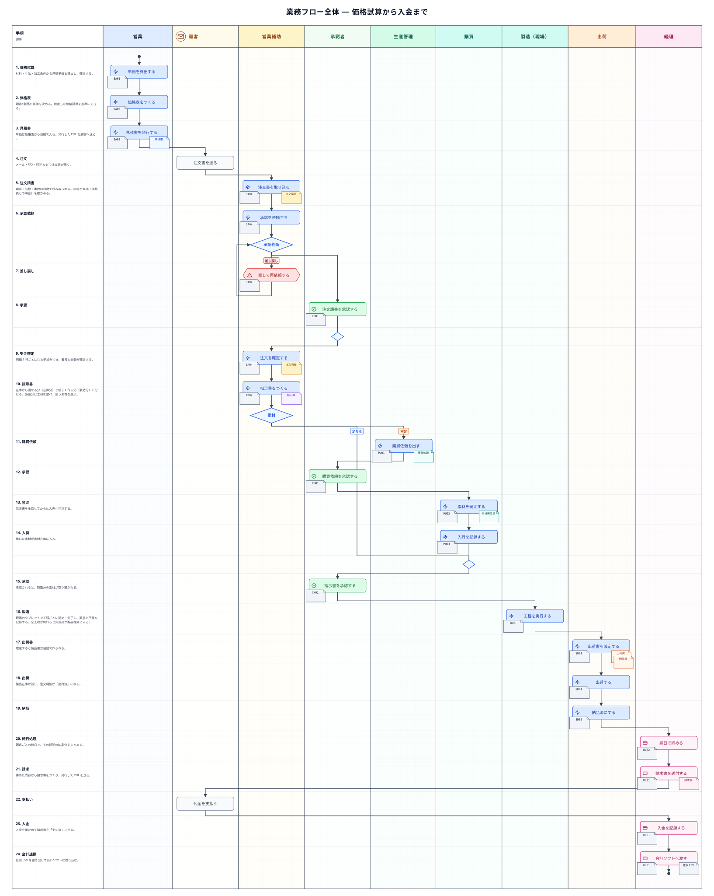
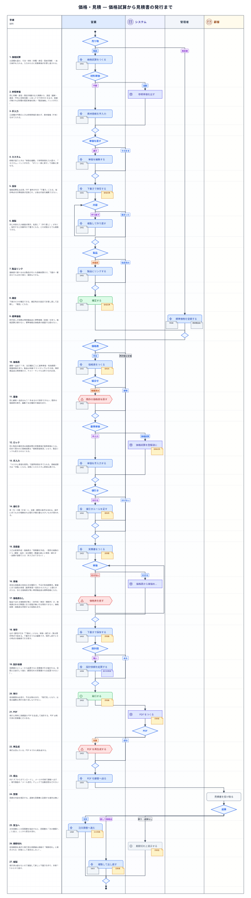
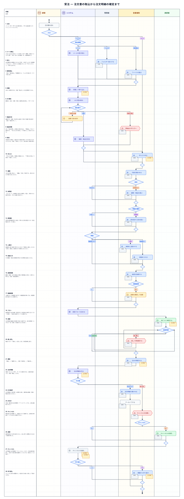
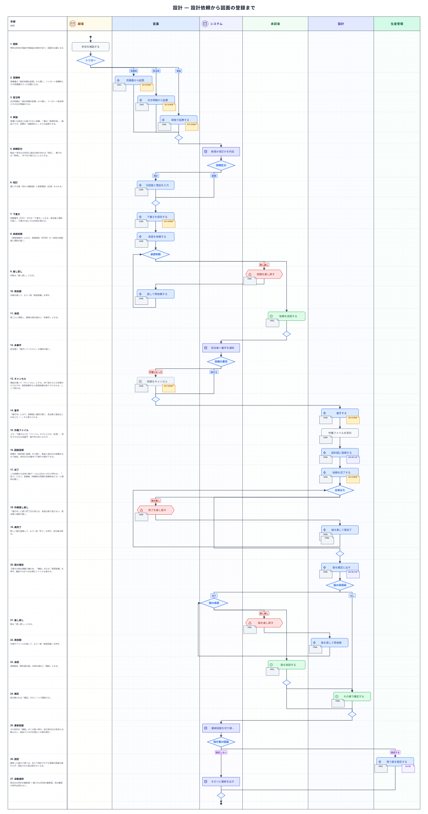
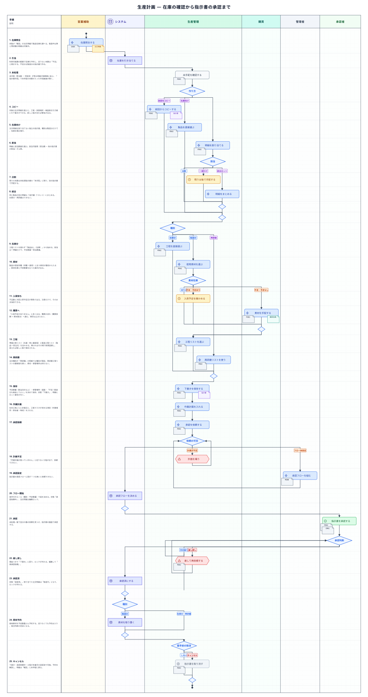
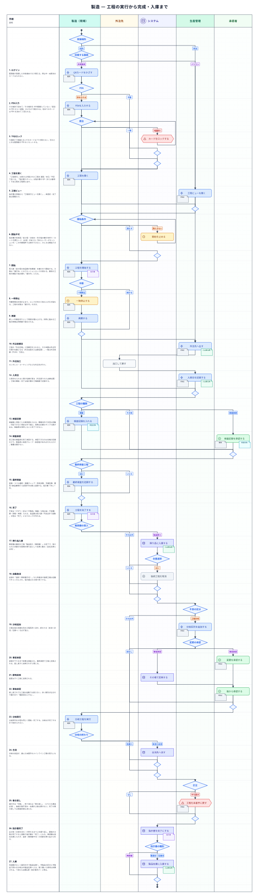
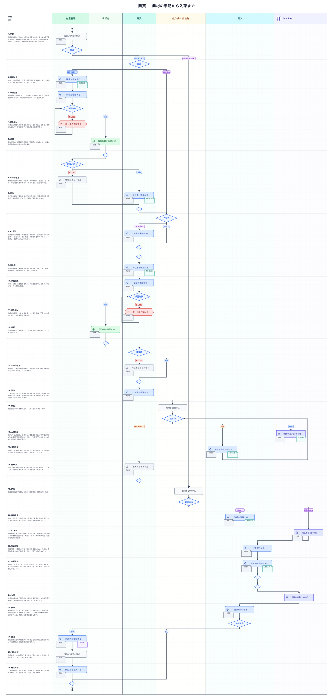
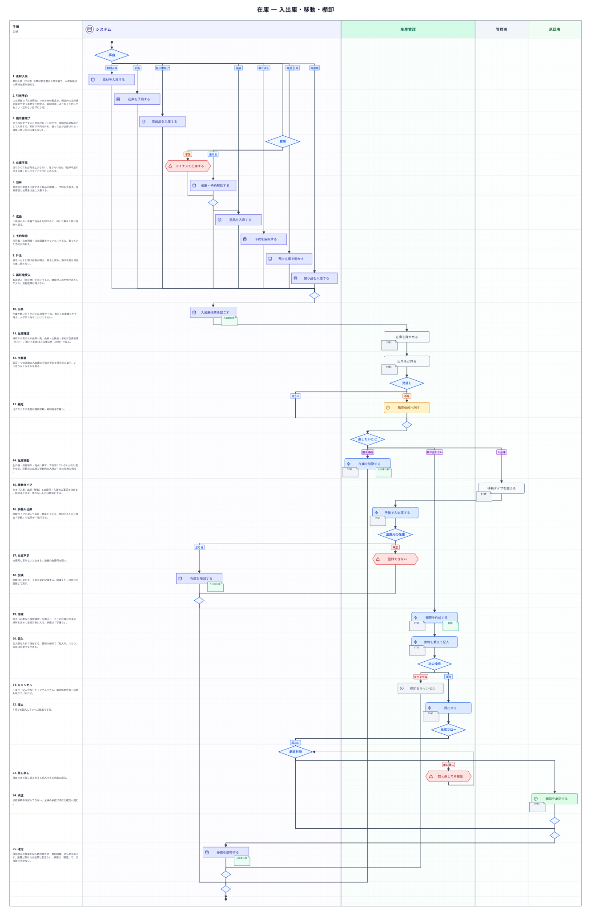
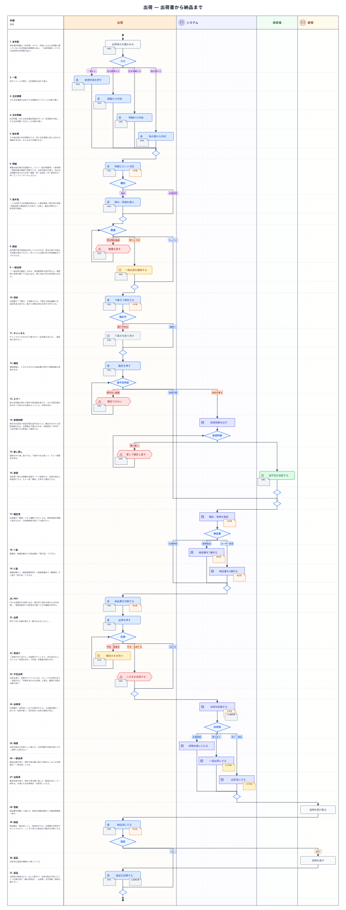
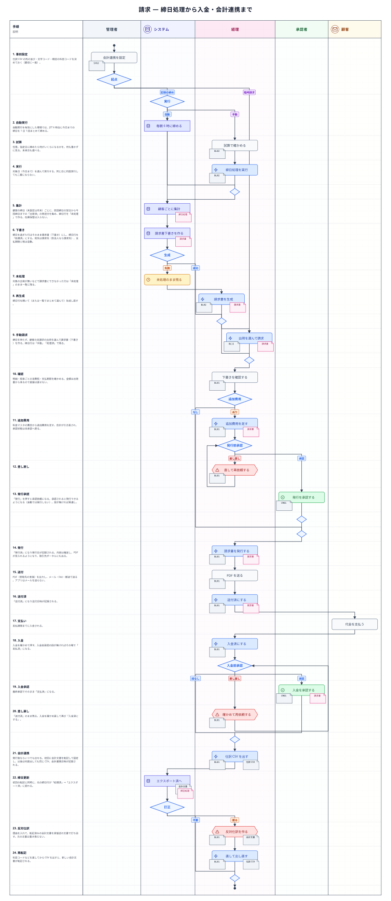

業務を **9 つのプロセス**に分け、それぞれの手順を **分かれ道（パターン）ごと** に図と表で示すページである。図の各手順には、その手順で使う **アプリの操作コード**（例: `SA04`）が付いている。

最初に **0. 全体の流れ** で全体をつかみ、自分の担当するプロセスの節を開いて使う。各画面の細かな操作は、表のアプリ名から操作マニュアルへ進む。

| # | プロセス | 範囲 |
|---|---------|------|
| 0 | [全体の流れ](#overview) | 価格試算から入金・会計連携まで |
| 1 | [価格・見積](#pricing) | 価格試算 → 価格表 → 見積書 |
| 2 | [受注](#order) | 注文書の取込 → 承認 → 注文明細の確定 |
| 3 | [設計](#design) | 設計依頼 → 図面（設計図）の登録 |
| 4 | [生産計画](#planning) | 在庫照合 → 指示書 → 承認 |
| 5 | [製造](#production) | 工程の実行 → 完成・入庫 |
| 6 | [購買](#purchasing) | 購買依頼 → 発注 → 入荷 |
| 7 | [在庫](#inventory) | 自動の入出庫・在庫移動・棚卸 |
| 8 | [出荷](#shipping) | 出荷書 → 出荷 → 納品書 |
| 9 | [請求](#billing) | 締日処理 → 請求書 → 入金・会計連携 |

## 図の読みかた [#legend]

- **列（レーン）** が担当、**左の欄** が手順の番号と説明である。番号は図の下の表の **#** と同じ。
- **箱の左下の札** は、その手順で使う **アプリの操作コード**（`端末` は現場の共有タブレット）。札の無い箱は **システムが自動でおこなうこと** である。
- **箱の右下の札** は、その手順でできる・変わる **書類**。
- **ひし形** が分かれ道。枝に書いてあるのがその条件で、線の色は 赤 = 差し戻し・却下、橙 = 例外・不足、青 = ふつうの選択肢、紫 = 利用者が選ぶもの。上へ戻る線は「直してもう一度」のくり返し。
- 箱の色: 青 = 操作、緑 = 承認、赤 = 差し戻し・エラー、黄 = 待ち、灰 = 終わり（キャンセルなど）、紺 = システムの自動処理。
- 図は押すと全画面で拡大できる。

## 0. 全体の流れ [#overview]

ふつうの注文が、価格試算から入金・会計連携まで進む順番である。分かれ道はここでは 2 つだけ（差し戻しと素材の不足）に絞り、細かなパターンは 1〜9 の各節が持つ。

| # | 手順 | 担当 | アプリ | 詳しい節 |
|---|------|------|--------|---------|
| 1〜3 | 価格試算 → 価格表 → 見積書の発行 | 営業 | `SA01` / `SA02` / `SA03` | [1. 価格・見積](#pricing) |
| 4 | 注文書が届く | 顧客 | — | [2. 受注](#order) |
| 5〜8 | 注文書の取込 → 承認依頼 →（差し戻し）→ 承認 | 営業補助 / 承認者 | `SA04` / `CM01` | [2. 受注](#order) |
| 9 | 注文の確定（注文明細ができる） | 営業補助 | `SA04` | [2. 受注](#order) |
| 10 | 指示書をつくる | 営業補助 | `PD02` | [4. 生産計画](#planning) |
| 11〜14 | 素材が足りなければ 購買依頼 → 承認 → 発注 → 入荷 | 生産管理 / 承認者 / 購買 | `PU01` / `CM01` / `PU02` / `PU03` | [6. 購買](#purchasing) |
| 15 | 指示書の承認（素材を取り置く） | 承認者 | `CM01` | [4. 生産計画](#planning) |
| 16 | 工程の実行（完成品が製品在庫へ） | 製造（現場） | `端末` | [5. 製造](#production) |
| 17〜19 | 出荷書の確定（納品書ができる）→ 出荷 → 納品済 | 出荷 | `SH01` / `SH02` | [8. 出荷](#shipping) |
| 20〜21 | 締日処理 → 請求書の送付 | 経理 | `BL02` / `BL01` | [9. 請求](#billing) |
| 22〜23 | 支払い → 入金の記録（支払済） | 顧客 → 経理 | `BL01` | [9. 請求](#billing) |
| 24 | 会計ソフトへ渡す（仕訳 CSV） | 経理 | `BL01` | [9. 請求](#billing) |

在庫の自動の増減と、在庫移動・棚卸は [7. 在庫](#inventory) にまとめている。設計図が無い製品は [3. 設計](#design) と並行して進む。

## 1. 価格・見積 — 価格試算から見積書の発行まで [#pricing]

売り物の単価を決め、顧客ごとの価格表に登録し、その単価で見積書を発行して顧客へ出すまでの流れである。製品は価格試算から、再研磨は再研磨品目の標準価格から始まり、顧客から注文が来たところで次の[受注](#order)へ渡る。設計図が無い製品では、見積と並行して[設計依頼](#design)を起票する。

### 手順とアプリ

| # | 手順 | 担当 | アプリ | 分かれ道・パターン |
|---|------|------|--------|--------------------|
| 1 | 価格試算をつくる | 営業 | [価格試算](/manual/ja/operations/sales/trial-estimate/user)（`SA01`） | 売り物が製品のときだけ。再研磨は 9 へ / 工具種（丸棒・円筒・OH付・管理者が足した区分）で入力項目が変わる |
| 2 | 参照単価を出す | システム | （自動） | 仕入実績あり → 設定（最新・最高・平均 × 参照月数）で算出 / 実績なし → 材種の既定単価（無ければ設定の既定値）、「既定価格」バッジ |
| 3 | 素材価格を手入力 | 営業 | [価格試算](/manual/ja/operations/sales/trial-estimate/user)（`SA01`） | 工具種が円筒のときは参照単価を使わず、素材価格（¥/本）を手で入れる |
| 4 | 単価を編集する | 営業 | [価格試算](/manual/ja/operations/sales/trial-estimate/user)（`SA01`） | 任意。参照単価を入れ直すと「カスタム」バッジ / 「ポリシー値に戻す」で自動に戻る / 素材価格推移のグラフから日付の値段を選ぶこともできる |
| 5 | 下書きで保存する | 営業 | [価格試算](/manual/ja/operations/sales/trial-estimate/user)（`SA01`） | 価格試算名が無いと保存できない / 保存後は編集できない（直すなら 6） |
| 6 | 複製して作り直す | 営業 | [価格試算](/manual/ja/operations/sales/trial-estimate/user)（`SA01`） | どの状態からでもできる。名前に「（作り直し）」が付き、別番号の下書きになる |
| 7 | 製品にリンクする | 営業 | [価格試算](/manual/ja/operations/sales/trial-estimate/user)（`SA01`） | 製品が未指定のときだけ / 下書き・確定のうちは付け替え・解除できる / 価格表登録済はリンクを変えられない |
| 8 | 確定する | 営業 | [価格試算](/manual/ja/operations/sales/trial-estimate/user)（`SA01`） | 下書きだけが確定できる（確定済み・登録済みは「下書きの価格試算のみ確定できます」）。確定時点の設定で計算し直して記録する |
| 9 | 標準価格を登録する | 管理者 | [再研磨品目](/manual/ja/operations/masters/regrind-item/user)（`MS0H`） | 売り物が再研磨（研ぎ直しの役務）のとき。標準価格は価格表の画面では直せない |
| 10 | 価格表をつくる | 営業 | [価格表](/manual/ja/operations/sales/price-list/user)（`SA02`） | 再研磨で標準価格のままでよければ作らない / 製品は本番・テスト・サンプル・その他、再研磨品目は再研磨だけ（組み合わせ違いは保存時にエラー） / テスト・サンプルは有効終了日が必須 |
| 11 | 既存の価格表を直す | 営業 | [価格表](/manual/ja/operations/sales/price-list/user)（`SA02`） | 同じ顧客 × 品目がもうある → 保存できないので、既存の価格表を編集して注文種別を足す |
| 12 | 価格試算を登録済にする | システム | （自動） | 基準単価に価格試算を選んだとき。選べるのは同じ製品の確定・登録済みの価格試算だけ。初めて使われた価格試算は「価格表登録済」でロックされる |
| 13 | 単価を手入力する | 営業 | [価格表](/manual/ja/operations/sales/price-list/user)（`SA02`） | 「カスタム単価を使用」で基準単価を手入力（価格試算元は「手動」） / 数量段階の行ごとのカスタム単価も可 |
| 14 | 値引きルールを足す | 営業 | [価格表](/manual/ja/operations/sales/price-list/user)（`SA02`） | 任意。率（%）か額（¥/本）× 本数 × 期間 / 複数当たれば値引き額の最大のもの / 値引きは明細金額を超えない |
| 15 | 見積書をつくる | 営業 | [見積書](/manual/ja/operations/sales/quote/user)（`SA03`） | 入口は 新規作成 / 価格表の「見積書を作成」 / 既存の見積書の複製 の 3 つ。単価・値引き・金額は手入力できない |
| 16 | 価格表から単価を引く | システム | （自動） | 有効な価格表 × 有効な注文種別 × 今日が有効期間内 × 数量に合う段階 → 単価（基準単価 × 倍率、またはカスタム）と値引き / 再研磨品目で当たる価格表が無ければ標準価格 |
| 17 | 価格表を直す | 営業 | [価格表](/manual/ja/operations/sales/price-list/user)（`SA02`） | 製品で価格表が無い・無効・期間外 → 保存できない（価格試算と価格表を用意） / 価格表はあるが数量の段階が無い → 保存できない（段階を足す。再研磨でも標準価格に落ちない） |
| 18 | 下書きで保存する | 営業 | [見積書](/manual/ja/operations/sales/quote/user)（`SA03`） | 単価・値引き・税は保存時点で固まる / 下書きのうちは編集でき、保存し直すとその時点の価格表で引き直す |
| 19 | 設計依頼を起票する | 営業 | [設計依頼書](/manual/ja/operations/sales/design-request/user)（`SA06`） | 設計図が無いとき。見積書のメニューから起票すると見積書が引き継がれる / 期限切れの見積書からは起票できない / 以後は[設計依頼](#design)の流れ |
| 20 | 発行する | 営業 | [見積書](/manual/ja/operations/sales/quote/user)（`SA03`） | 有効期限は必須で今日以降 / 発行後は編集も取り消しもできない |
| 21 | PDF をつくる | システム | （自動） | PDF は発行済の見積書にだけある（下書きでは開けない） |
| 22 | PDF を再生成する | 営業 | [見積書](/manual/ja/operations/sales/quote/user)（`SA03`） | PDF の生成に失敗したとき。発行は済んでいる |
| 23 | PDF を顧客へ送る | 営業 | [見積書](/manual/ja/operations/sales/quote/user)（`SA03`） | PDF タブからダウンロードして送る / 発行画面の「メール送付」チェックで自動送信はされない |
| 24 | 見積書を受け取る | 顧客 | — | 返事を見積書に記録する操作は無い |
| 25 | 注文請書へ進む | 営業 | [注文請書](/manual/ja/operations/sales/order-acceptance/user)（`SA04`） | 注文が来たとき。注文請書にこの見積書を指定すると見積書の「次の書類へ」に並ぶ。以後は[受注](#order) |
| 26 | 期限切れと表示する | システム | （自動） | 断られた・返事が無いまま有効期限を過ぎたとき。状態として保存はせず、その日から表示だけが変わる |
| 27 | 複製して出し直す | 営業 | [見積書](/manual/ja/operations/sales/quote/user)（`SA03`） | 内容を直して出し直すとき。発行済は直せないので複製して 15 から |

### 押さえておくパターン
- 価格表の**有効期間と有効/無効は見積書の単価に効く**。期間外・無効の価格表は「無い」扱いになり、製品の行は保存できない（再研磨品目なら標準価格に落ちる）。
- 価格表を直しても、**発行済の見積書の金額は変わらない**。下書きの見積書は、開いて保存し直すとその時点の価格表で引き直される。
- 価格表の「**有効期間を変更**」は値段はそのままで期間だけを付け替える。テスト・サンプルは変更後も終了日が要る。
- 価格表の「**別の顧客・製品へコピー**」は同じ値段の設定を別の組み合わせへ写す。価格試算とのつながりは外れ、手入力扱いになる。
- 価格表は一覧で複数選んで**有効化 / 無効化 / 一括削除**できる。削除は取り消せない。
- 価格試算は保存時と確定時の 2 回、そのときの計算設定（SY02）で結果を記録する。あとで計算設定を変えても、記録済みの価格試算の単価は動かない。
- 見積書の下書きは自由に編集できるが、発行した見積書は**編集も発行の取り消しもできない**。間違えて発行したときは複製して正しいものを出し、間違えたほうは有効期限で期限切れになる。
- 見積書の明細に再研磨品目を選ぶと、顧客の価格表が無くても標準価格で見積もれる。お客様から預かる工具そのもの（他社製品）は売り物ではないので、価格表にも見積書の品目にも出てこない。
- 書類を出す会社（自社法人）が 2 つ以上あるとき、価格試算・価格表・見積書は作成時に「**発行会社**」を決める（選べる人にだけ欄が出る）。価格表は会社ごとに別々で、見積書の単価は発行会社の価格表だけから入る。書類番号は会社ごと・会計年度ごとの連番になる。
- 見積書の PDF には、値引きのある明細の下に値引きの注意書きが、明細の備考がある明細の下にその内容が印字される。見積書全体の備考も PDF に印字される。
- 原価だけを見積もる「**原価試算**」は、権限「価格試算の原価」を持つ人だけが作れて見られる。価格表の基準単価にはできず、売価が要るときは「売価試算を作成」で写す。

## 2. 受注 — 注文書の取込から注文明細の確定まで [#order]

顧客から届いた注文書を注文請書として取り込み、内容と単価を確かめて承認を通し、確定して注文明細をつくるまでの流れである。前は[価格・見積](#pricing)、確定した注文明細は[生産の手配](#planning)へ引き継がれる。

### 手順とアプリ

| # | 手順 | 担当 | アプリ | 分かれ道・パターン |
|---|------|------|--------|--------------------|
| 1 | 注文書を送る | 顧客 | — | 入口はファイル（メール / フォルダ / 優先取込）か手入力。FAX は複合機でスキャンしてファイルにする |
| 2 | メールを受け取る | システム | （自動） | order-intake@ckk-tool.co.jp 宛の添付（PDF・PNG・JPG・WEBP）を取込フォルダへ置く。添付 1 通 = 1 件。本番環境だけ。失敗したメールは自動で再送しない |
| 3 | フォルダへ投入する | 管理者 | [注文書取込](/manual/ja/operations/system/order-intake/user)（`SY0C`） | 自動スキャン（既定 60 秒）か「今すぐスキャン」。失敗したファイルは「再取込」で同じ番号のまま抽出だけやり直す |
| 4 | ファイルを選ぶ | 営業補助 | [注文請書](/manual/ja/operations/sales/order-acceptance/user)（`SA04`） | 「優先取込」で複数選べる。フォルダを通らず、抽出は待ち行列に積まれる |
| 5 | 採番して取り込む | システム | （自動） | `ORD-` 番号の注文請書が「取込中」でできる |
| 6 | AI が読み取る | システム | （自動） | 一時的な失敗 → 7 / 直らない失敗・3 回失敗 → 8 / 成功 → 9 |
| 7 | 自動で読み直す | システム | （自動） | 最大 3 回（橙の「再試行中」）。それでも失敗すると 8 |
| 8 | 再抽出か手入力へ | 営業補助 | [注文請書](/manual/ja/operations/sales/order-acceptance/user)（`SA04`） | 「再抽出」→ 6 へ戻る / 「手入力に切り替え」→ 抽出済みの値を残して「下書き」 |
| 9 | 顧客・製品を突合 | システム | （自動） | 1 件に絞れたものだけ入れ、候補止まりは空のまま。「下書き」になり受付担当（1 段目の承認グループ）へ通知 |
| 10 | 手入力で作る | 営業補助 | [注文請書](/manual/ja/operations/sales/order-acceptance/user)（`SA04`） | 「手入力で新規」→「下書きを作成」。顧客は必須 |
| 11 | 内容を確かめる | 営業補助 | [注文請書](/manual/ja/operations/sales/order-acceptance/user)（`SA04`） | 閲覧で開き「編集」で直す。直せるのは「下書き」のあいだだけ |
| 12 | 顧客・製品を選ぶ | 営業補助 | [注文請書](/manual/ja/operations/sales/order-acceptance/user)（`SA04`） | 「未特定」「製品未特定」のとき。保存すると表記を学習し、次の取込から自動で結び付く |
| 13 | 研ぎ直す工具を選ぶ | 営業補助 | [注文請書](/manual/ja/operations/sales/order-acceptance/user)（`SA04`） | 種別「再研磨」の行だけ。品目は再研磨品目、工具は製品（他社製品も可）。工具が空だと依頼も確定もできない |
| 14 | 単価を上書きする | 営業補助 | [注文請書](/manual/ja/operations/sales/order-acceptance/user)（`SA04`） | 価格表どおりの行は単価を直せない。違う値段で受けるときだけ「単価を上書き」 |
| 15 | 単価を入れる | 営業補助 | [注文請書](/manual/ja/operations/sales/order-acceptance/user)（`SA04`） | 「価格表なし」の行は自由入力 |
| 16 | 承認を依頼する | 営業補助 | [注文請書](/manual/ja/operations/sales/order-acceptance/user)（`SA04`） | 顧客・明細 1 行以上・全行の製品と単価（直送はエンドユーザー、再研磨は工具も）が揃うまで押せない |
| 17 | 差異を確認して依頼 | 営業補助 | [注文請書](/manual/ja/operations/sales/order-acceptance/user)（`SA04`） | 価格差異（上書きなしで価格表と違う）または数量段階が無い行があるときだけ。上書きの行は止めない |
| 18 | 承認フローを決める | システム | （自動） | 条件付きフロー（合計金額・配送方法・担当拠点）を選ぶ。フローに段が無いと依頼できない |
| 19 | 段ごとに承認する | 承認者 | [未処理一覧](/manual/ja/operations/general/my-tasks/user)（`CM01`）/ `SA04` | いずれか 1 名 / 全員。次の段あり → 19 を繰り返す / 全段承認 →「承認済」 |
| 20 | 直して再依頼する | 営業補助 | [注文請書](/manual/ja/operations/sales/order-acceptance/user)（`SA04`） | 差し戻し（理由必須）で「下書き」へ戻り、11 からやり直す |
| 21 | 注文を確定する | 営業補助 | [注文請書](/manual/ja/operations/sales/order-acceptance/user)（`SA04`） | 「確定」→「展開する」。「承認済」→「確定」 |
| 22 | 注文明細を作る | システム | （自動） | 明細ごとに `ORD-…-01` … の枝番、金額を固定、注文明細は「確定」 |
| 23 | 注文明細を確かめる | 営業補助 | [注文明細](/manual/ja/operations/sales/order-line/user)（`SA05`） | ここから指示書・出荷書へ（[生産の手配](#planning)）。確定後は数量・単価・製品を変えられない |
| 24 | アーカイブする | 営業補助 | [注文請書](/manual/ja/operations/sales/order-acceptance/user)（`SA04`） | 任意。「確定」→「アーカイブ」。以後は編集もキャンセルもできない |
| 25 | キャンセルを依頼する | 営業補助 | [注文請書](/manual/ja/operations/sales/order-acceptance/user)（`SA04`） | 確定した請書ごと・理由必須。出荷済の明細が 1 つでもあると不可。進行中の依頼は 1 件だけ |
| 26 | キャンセルを承認する | 承認者 | [未処理一覧](/manual/ja/operations/general/my-tasks/user)（`CM01`）/ `SA04` | 「注文請書キャンセル」フローに段があるときだけ。差し戻し → 何も変わらず依頼が閉じる |
| 27 | キャンセルを適用する | システム | （自動） | 段が無ければ依頼と同時、あれば最終承認で。明細と請書が「キャンセル」、引当解放、未完了の指示書を連鎖キャンセル |
| 28 | 請書から作り直す | 営業補助 | [注文請書](/manual/ja/operations/sales/order-acceptance/user)（`SA04`） | 任意。内容（再研磨の工具・上書き単価・配送も）を引き継いだ新しい「下書き」ができ、元の請書と紐付く |

### 押さえておくパターン

- 抽出中でも「手入力に切り替え」で引き取れる。裏で終わった抽出の結果は捨てられ、目の前の入力は上書きされない。
- 原稿が壊れている・大きすぎるなど直らない失敗は、自動の再試行をせずすぐ「抽出失敗」で止まる。人の「再抽出」は回数を 1 から数え直す。
- フォルダ取込は成功したファイルを processed、失敗を failed へ動かす。ファイル名に番号を焼き込むので、再取込しても二重に採番しない。
- コンテナが入れ替わって待ち行列が消えても、起動時に「取込中」のまま残った行を拾い直す。
- 顧客を変えて保存すると、新しい顧客の価格表で単価が引き直され、営業担当にその顧客の主担当が入る。
- 「上書き」を外したまま保存すると、入れていた値段は価格表の単価に置き換わる。上書きした行は承認者の画面にも「単価の上書き N 件」として出る。
- 承認フローの選び方（合計金額・配送方法・担当拠点）は明細ごとの値で判定し、どれか 1 行でも条件に合えばそのフローになる。
- 承認依頼中に前提が崩れても、確定の直前に依頼時と同じ条件をもう一度確かめる。足りなければ確定できず、差し戻して直す。
- キャンセルの承認中に出荷が進むなどして前提が崩れると、最終承認しても適用されず「失敗」として残る。
- キャンセルで残る指示書: 完了済みのもの、ほかの有効な注文明細もまとめて作っている統合ロット。
- 注文明細の状態は、ここでは「確定」と「キャンセル」まで。「製造中」は指示書の承認で、「一部出荷」「出荷済」は出荷で自動的に変わる。
- 注文明細を 1 行だけキャンセル・修正する操作は無い。直したいときは請書ごとキャンセルして作り直す。
- 確定のとき、注文明細ごとに**印字番号**（製品に刻む通し番号。`A200000` から始まる）も自動で付く。ロット番号・書類番号とは別の連番で、年度が替わっても戻らない。
- 書類を出す会社（自社法人）が 2 つ以上あるとき、注文請書 1 件は**法人 1 つ**のもの。取り込んだ注文書は注文書取込（`SY0C`）の「取込口の自社法人」で会社が決まり、作ったあとは変えられない。明細の担当拠点に別の会社の拠点は混ぜられない。

## 3. 設計 — 設計依頼から図面の登録まで [#design]

図面が要るときに設計依頼書を起票し、承認・着手・図面の登録・完了を経て、設計図の版を確定し、指示書がその版を使うまでを扱う。見積や[受注](#order)と並行して走る流れで、確定した図面は次の[生産計画](#planning)で指示書が読む。

### 手順とアプリ

| # | 手順 | 担当 | アプリ | 分かれ道・パターン |
|---|------|------|--------|--------------------|
| 1 | 形状を相談する | 顧客 | — | 特別な形状の相談・新製品の検討・社内改善など、図面が要るきっかけ |
| 2 | 見積書から起票 | 営業 | [見積書](/manual/ja/operations/sales/quote/user)（`SA03`） | トリガー = 見積時。見積書の「…」→「設計依頼を起票」でその見積書が入る |
| 3 | 注文明細から起票 | 営業 | [注文明細](/manual/ja/operations/sales/order-line/user)（`SA05`） | トリガー = 受注時。注文明細の「…」→「設計依頼を起票」でその注文明細が入る |
| 4 | 単独で起票する | 営業 | [設計依頼書](/manual/ja/operations/sales/design-request/user)（`SA06`） | トリガー = 単独。参照元は持たない。製品マスタ・見積の「価格表なし」から来ると製品が入った状態で開く |
| 5 | 新規か改訂かを判定 | システム | （自動） | 製品 × 受注元の系列に版があれば改訂、無ければ新規。手で切り替えると「手動指定」。区分は作成時の値のまま保存される |
| 6 | 元図面と理由を入力 | 営業 | [設計依頼書](/manual/ja/operations/sales/design-request/user)（`SA06`） | 改訂のときだけ。元図面は空なら最新版、変更理由は必須 |
| 7 | 下書きを保存する | 営業 | [設計依頼書](/manual/ja/operations/sales/design-request/user)（`SA06`） | 製品・担当者は必須。依頼番号 `DSG-` が付き「下書き」。担当者に通知。トリガーと参照元はあとから変えられない |
| 8 | 承認を依頼する | 営業 | [設計依頼書](/manual/ja/operations/sales/design-request/user)（`SA06`） | 下書き・差し戻し → 承認依頼中。承認設定に「設計依頼書」の段が無いと依頼できない |
| 9 | 依頼を差し戻す | 承認者 | [未処理一覧](/manual/ja/operations/general/my-tasks/user)（`CM01`） | 理由は必須。承認依頼中 → 差し戻し |
| 10 | 直して再依頼する | 営業 | [設計依頼書](/manual/ja/operations/sales/design-request/user)（`SA06`） | 差し戻しの間は内容を直せる。もう一度「承認依頼」で 8 へ戻る |
| 11 | 依頼を承認する | 承認者 | [未処理一覧](/manual/ja/operations/general/my-tasks/user)（`CM01`） | 段ごとに承認。途中の段は承認依頼中のまま、最後の段で「未着手」 |
| 12 | 担当者へ着手を通知 | システム | （自動） | 担当者に「着手してください」の通知 |
| 13 | 依頼をキャンセル | 営業 | [設計依頼書](/manual/ja/operations/sales/design-request/user)（`SA06`） | 要らなくなったとき。理由は必須。完了前ならどの状態からでも可（承認依頼中なら承認依頼も取り下げ）。完了後は先に差し戻す |
| 14 | 着手する | 設計 | [設計依頼書](/manual/ja/operations/sales/design-request/user)（`SA06`） | 未着手 → 進行中。依頼者に通知。承認前は着手できない |
| 15 | 作業ファイルを添付 | 設計 | [設計依頼書](/manual/ja/operations/sales/design-request/user)（`SA06`） | 任意。「ファイル」タブ。未着手・進行中のあいだだけ（形式は自由・1 件 20MB まで） |
| 16 | 設計図に登録する | 設計 | [設計図](/manual/ja/operations/production/design-file/user)（`PD06`） | 製品と受注元は依頼のもので固定。系列の次の番号で下書きの版。系列に確定前の版があると登録できない |
| 17 | 依頼を完了する | 設計 | [設計依頼書](/manual/ja/operations/sales/design-request/user)（`SA06`） | この依頼から出来た版が 1 つ以上（下書きでも可）ないと完了できない。進行中 → 完了。依頼者（見積時は見積の営業担当にも）に通知 |
| 18 | 完了を差し戻す | 営業 | [設計依頼書](/manual/ja/operations/sales/design-request/user)（`SA06`） | 描き直しが要るとき。完了 → 進行中、完了日は消える。承認は取り直さない |
| 19 | 描き直して再完了 | 設計 | [設計図](/manual/ja/operations/production/design-file/user)（`PD06`）・[設計依頼書](/manual/ja/operations/sales/design-request/user)（`SA06`） | 新しい版を登録してもう一度「完了」。前の版は残る |
| 20 | 版を確定に出す | 設計 | [設計図](/manual/ja/operations/production/design-file/user)（`PD06`） | 下書き・差し戻しの版だけ。確定するまでは仕様・ファイルを直せ、版ごと削除もできる |
| 21 | 版を差し戻す | 承認者 | [未処理一覧](/manual/ja/operations/general/my-tasks/user)（`CM01`） | 承認設定「設計図の版」に段があるときだけ。理由は必須。版は「差し戻し」 |
| 22 | 版を直して再依頼 | 設計 | [設計図](/manual/ja/operations/production/design-file/user)（`PD06`） | 直してもう一度「承認依頼」 |
| 23 | 版を承認する | 承認者 | [未処理一覧](/manual/ja/operations/general/my-tasks/user)（`CM01`） | 最後の段を通ると「確定」 |
| 24 | その場で確定する | 設計 | [設計図](/manual/ja/operations/production/design-file/user)（`PD06`） | 段が無いとき。「確定」1 つで確定（未設定 = 素通し） |
| 25 | 最新図面を切り替える | システム | （自動） | その系列の「最新」だけがこの版へ移る。他の受注元の系列は動かない。製品の仕様もここから読む |
| 26 | 使う版を固定する | 生産管理 | [指示書](/manual/ja/operations/production/work-order/user)（`PD02`） | 任意。確定した版だけ選べる。固定した版は編集・削除できなくなる |
| 27 | そのつど最新を出す | システム | （自動） | 固定しないとき。受注元の系列の最新 → 無ければ汎用の最新。他の顧客の系列は使わない。顧客が混ざる指示書は汎用 |

### 押さえておくパターン
- 承認設定に「設計依頼書」の段が 1 つも無い → 「承認依頼」は止まり、依頼は下書きのまま残る（設計図の版と違い、素通しにはならない）。
- 承認依頼中の差し戻し（承認軸）と、完了後の差し戻し（作業軸）は別物 → 前者は「差し戻し」へ落ちて承認を取り直し、後者は「進行中」へ戻るだけで承認記録には触らない。
- 未着手・進行中のあいだは「…」から担当者と製品だけ変えられる → 依頼内容は承認を受けた中身なので変えられず、変えたいときはキャンセルして作り直す。
- 依頼の完了と版の確定は別の手続き → 下書きの版でも依頼は完了でき、版の確定（20〜24）は完了の前でも後でもよい。指示書と製品マスタが読むのは確定した版だけ。
- 改訂の依頼中に別の改訂が先に確定した → 完了は止めないが、元図面がもう最新ではないことが依頼の履歴に残る。
- 設計図は依頼を経ずにも登録できる（手動の版） → 図面だけ先にある・既存図面を取り込む場合で、一覧の「出どころ」が「手動」になる。
- 系列ごとに確定前の版は 1 つだけ → 下書き・承認依頼中・差し戻しの版がある系列には次の版を作れない。先に確定するか、下書きを削除する。
- 受注元を空にした系列は「汎用」 → 専用の図面を持たない顧客の指示書から使われる。新規 / 改訂の判定もその系列だけを見る（A 社に版があっても B 社に無ければ新規）。
- 帳票（PDF）は承認後（未着手・進行中・完了）だけ開ける → 製造へ紙で渡す社内文書。
- 加工プログラム（設計図の版に登録するもの）の追加・修正・新しい版・削除・廃止は、承認設定に「加工プログラムの変更」の段があれば承認を経て当たる。段が 1 つも無ければ申請と同時に当たる（未設定 = 素通し）。

## 4. 生産計画 — 在庫の確認から指示書の承認まで [#planning]

確定した注文明細の製品在庫を照合し、足りない分・作る分を指示書にして、承認を通すまでを扱う。前の工程は [設計](#design)、承認された指示書の工程を現場で進めるのは次の [生産](#production) である。素材が足りないときは [購買](#purchasing) へ分かれる。

### 手順とアプリ

| # | 手順 | 担当 | アプリ | 分かれ道・パターン |
|---|------|------|--------|--------------------|
| 1 | 在庫照合する | 営業補助 | [注文明細](/manual/ja/operations/sales/order-line/user)（`SA05`） | 状態が「確定」（または下書き）の明細だけ。製造中以降は指示書側で管理するので押せない。再研磨の明細は自社在庫を引き当てない |
| 2 | 在庫を引き当てる | システム | （自動） | 全数ある → 全数を予約 / 一部・無い → 使える分だけ予約し、残りを「不足」として表示 |
| 3 | 未手配を確認する | 生産管理 | [未処理指示書](/manual/ja/operations/production/pending-work-order/user)（`PD05`） | 未手配 = 受注数 − 手配済。「指示書作成」で未手配の本数が入った作成画面が開く。注文明細の詳細の「次のステップ」からも同じ画面へ行ける |
| 4 | 前回からコピーする | 生産管理 | [指示書](/manual/ja/operations/production/work-order/user)（`PD02`） | 作り方 = 前回をコピー。工程・実施場所・ロット入力・検査表を引き継いだ下書きができる（分岐系列・キャンセル済みの工程は引き継がない）。在庫分のコピーは注文明細が必須 |
| 5 | 製品を直接選ぶ | 生産管理 | [指示書](/manual/ja/operations/production/work-order/user)（`PD02`） | 作り方 = 在庫向け。注文明細を割り当てない独立の指示書で、種別は製造分だけ |
| 6 | 明細を割り当てる | 生産管理 | [指示書](/manual/ja/operations/production/work-order/user)（`PD02`） | 作り方 = 新規（ふつう）。割当可能残 = 受注数 − 他の指示書の割当（キャンセル分を除く）。割り当てられるのは確定・製造中・一部出荷の明細だけ |
| 7 | 残りは後で手配する | 生産管理 | （待ち） | 割当 = 一部だけ（分割）。残りは `PD05` の「未手配」に残る |
| 8 | 明細をまとめる | 生産管理 | [指示書](/manual/ja/operations/production/work-order/user)（`PD02`） | 割当 = 統合ロット。製品が違う明細は入れられない。在庫分・再研磨は明細 1 件だけ |
| 9 | 工程を直接選ぶ | 生産管理 | [指示書](/manual/ja/operations/production/work-order/user)（`PD02`） | 種別 = 在庫分。工程リストを使わず「製品出し（在庫）」から始め、ほかに選べる工程は工程マスタの「使える指示書種別」で決まる。予定数量 = 割当数量 |
| 10 | 使用素材を選ぶ | 生産管理 | [指示書](/manual/ja/operations/production/work-order/user)（`PD02`） | 種別 = 製造分。素材在庫と予定数量を比べた案内が出る: 足りる（緑）/ 不足・入荷予定あり（黄）/ 不足・入荷予定なし（赤）。どれでも保存は止まらない |
| 11 | 入荷予定を確かめる | 生産管理 | （待ち） | 素材在庫 = 不足・入荷予定あり。不足数と次回入荷予定日が出る |
| 12 | 素材を手配する | 購買 | [購買依頼](/manual/ja/operations/purchasing/purchase-request/user)（`PU01`） | 素材在庫 = 不足・入荷予定なし。「素材発注を検討してください」→ [購買](#purchasing) へ |
| 13 | 工程リストを選ぶ | 生産管理 | [指示書](/manual/ja/operations/production/work-order/user)（`PD02`） | 準備工程リストは常に最新版（1 本だけなら自動選択）。製造工程リストは 顧客専用 → 汎用 → 先頭 の順で自動選択、版も選べる。未登録ならその場で新規登録、工程を変えると新しい版で保存。前提工程が足りない組み合わせは保存できない |
| 14 | 再研磨リストを使う | 生産管理 | [指示書](/manual/ja/operations/production/work-order/user)（`PD02`） | 種別 = 再研磨。注文種別が「再研磨」の明細では種別が固定され、逆に再研磨の明細は再研磨の指示書にしか割り当てられない。素材・保管場所は無い |
| 15 | 下書きを保存する | 生産管理 | [指示書](/manual/ja/operations/production/work-order/user)（`PD02`） | 予定数量は割当合計以上（不良予備の上乗せ可）。「不足 / 超過分も納品してよい」で過不足出荷を許すロットにできる。状態「下書き」、割当明細にロット番号が付く |
| 16 | 作業計画を入れる | 生産管理 | [指示書](/manual/ja/operations/production/work-order/user)（`PD02`） | 作成画面か、作成後の工程ごとの計画パネルで入れる。担当者・時刻は工程マスタで必須にした工程だけ |
| 17 | 承認を依頼する | 生産管理 | [指示書](/manual/ja/operations/production/work-order/user)（`PD02`） | 下書きのときだけ。下の 18〜20 のどれかに分かれる |
| 18 | 計画を補う | 生産管理 | [指示書](/manual/ja/operations/production/work-order/user)（`PD02`） | 依頼の可否 = 計画が不足。社内工程ごとに 計画日 + 必須項目 の計画が 1 行以上要る（外注・キャンセル済みの工程は対象外）→ 補って依頼し直す |
| 19 | 承認フローを組む | 管理者 | [承認設定](/manual/ja/operations/masters/approval-setting/user)（`MS0B`） | 依頼の可否 = フロー未設定。指示書の承認フローに段が無いと依頼できない |
| 20 | 承認フローを決める | システム | （自動） | 条件付きルール（種別・予定数量）があれば段の構成が変わる。状態「承認依頼中」、割当明細は編集ロック |
| 21 | 指示書を承認する | 承認者 | [未処理一覧](/manual/ja/operations/general/my-tasks/user)（`CM01`）→ [指示書](/manual/ja/operations/production/work-order/user)（`PD02`） | 承認できるのは段の承認グループのメンバーと代理だけ。「全員」の段は全員がそろって閉じる |
| 22 | 直して再依頼する | 生産管理 | [指示書](/manual/ja/operations/production/work-order/user)（`PD02`） | 承認判断 = 差し戻し（理由必須）。「下書き」に戻りロックが外れる → 編集して「再承認依頼」 |
| 23 | 承認済にする | システム | （自動） | 承認判断 = 最終承認。次の段があれば次の段の承認者へ回る。最終で状態「承認済」、割当明細は「製造中」 |
| 24 | 素材を取り置く | システム | （自動） | 種別 = 製造分で使用素材があるときだけ。在庫分・再研磨は取り置かない。素材が足りなくても予約は入る |
| 25 | 指示書を取り消す | 生産管理 | [指示書](/manual/ja/operations/production/work-order/user)（`PD02`） | 下書き・承認依頼中・承認済（工程が 1 つも始まっていない）のときだけ。予約を解放し、他に生きた指示書が無い明細は「確定」に戻って未手配に入る。工程を始めたあとはキャンセルできない |

### 押さえておくパターン
- 在庫照合は自動では走らない。押さなかった明細は引当が無いので、在庫分の指示書を作る前に照合しておく。在庫分の指示書は作成時に在庫を引き当てない（照合で取った引当を、指示書の完了時に消費する）。
- 在庫と製造に分けるときは、同じ明細から在庫分と製造分の指示書を 1 枚ずつ作る（分割）。在庫分は明細 1 件・予定数量 = 割当数量。
- 指示書の編集は「下書き」のときだけ。承認依頼中に直したいときは差し戻してもらうか、キャンセルして作り直す。
- 承認依頼中は割当明細がロックされ、注文請書側で明細を直せない。承認・差し戻し・キャンセルのいずれでもロックは外れる。
- 指示書をキャンセルすると、その本数は `PD05` の「未手配」に戻る。完了したが不良で本数が足りなかった分も未手配に戻る。
- 注文請書ごとキャンセル（[受注](#order) 側の操作）が承認されると、まだ終わっていない指示書は連鎖してキャンセルされる。ただし他の明細もまとめて作っている統合ロットは残る。
- 別の指示書の完成品を受け取って始める「先行指示書」のつなぎ込みは、指示書の詳細で承認前後に設定できる（[生産](#production) で効く）。
- 途中まで加工して在庫に置いた品（**仕掛品**）があれば、指示書の作成画面の「使える仕掛品」から選んで続きから作れる。済んでいる工程は行わず、素材も使わない。加工状態の違う仕掛品は 1 枚の指示書に混ぜられない。選んだ仕掛品は承認のときに予約される。
- 工程ごとの締切（**工程納期**）は指示書の作成・編集の画面で入れ、承認後は工程の画面で直す。お客様への納期（予定納期）とは別に持つ。

## 5. 製造 — 工程の実行から完成・入庫まで [#production]

承認済みの指示書の工程を、現場の共有端末（またはパソコンの指示書画面）で開始・完了し、数量・不良・検査を記録して、全工程の完了で製品在庫に入れるまでの流れである。前は[計画](#planning)（指示書の作成と承認）、素材が足りないときは[購買](#purchasing)へ進む。

### 手順とアプリ

| # | 手順 | 担当 | アプリ | 分かれ道・パターン |
|---|------|------|--------|--------------------|
| 1 | QRカードをかざす | 製造（現場） | [現場タブレット — はじめかた](/manual/ja/operations/kiosk/start/user)（端末） | 実施場所が社内で、共有端末で記録するとき。未登録の端末・停止中や未割当のカードは入れない |
| 2 | PINを入力する | 製造（現場） | [現場タブレット — はじめかた](/manual/ja/operations/kiosk/start/user)（端末） | その端末で初めて／48 時間未使用／前回の PIN から 2 週間 → PIN を求められる。どれにも当たらなければカードだけで入る |
| 3 | カードをロックする | システム | （自動） | 5 回続けて誤り → 15 分ロック。時間をおいて再入力するか、管理者が PIN をリセットする |
| 4 | 工程を開く | 製造（現場） | [現場タブレット — 工程の記録](/manual/ja/operations/kiosk/steps/user)（端末） | 「工程実行」（自分に計画された工程）／「指示書スキャン」（指示書の QR・番号から全工程）のどちらか |
| 5 | 工程ビューを開く | 生産管理 | [指示書](/manual/ja/operations/production/work-order/user)（`PD02`） | パソコンで記録するとき。承認前・完了後は閲覧だけ |
| 6 | 開始を止める | システム | （自動） | 未承認／前工程・分岐元・先行指示書が未完了／ロット/伝票コード必須で未入力／別のユーザーがセッション中／作業場所が不可 → 開始できない。条件が揃えば開始へ |
| 7 | 工程を開始する | 製造（現場） | [現場タブレット — 工程の記録](/manual/ja/operations/kiosk/steps/user)（端末） | 工程は「進行中」、最初の工程なら指示書も「進行中」 |
| 8 | 一時停止する | 製造（現場） | [現場タブレット — 工程の記録](/manual/ja/operations/kiosk/steps/user)（端末） | 中断するときだけ。ロックが外れ、他の人が引き取れる |
| 9 | 再開する | 製造（現場） | [現場タブレット — 工程の記録](/manual/ja/operations/kiosk/steps/user)（端末） | 新しい作業区切りとして時間を積み上げる |
| 10 | 外注先へ出す | 生産管理 | [指示書](/manual/ja/operations/production/work-order/user)（`PD02`）／一覧は[外注依頼](/manual/ja/operations/purchasing/outsource-order/user)（`PU04`） | 実施場所が外注の工程。依頼日で外注先の預け在庫になる（外注支給の入出庫伝票） |
| 11 | 加工して戻す | 外注先 | — | — |
| 12 | 入荷日を記録する | 生産管理 | [指示書](/manual/ja/operations/production/work-order/user)（`PD02`） | 入荷日で預け在庫が戻る（外注戻りの入出庫伝票） |
| 13 | 検査記録を入れる | 製造（現場） | [現場タブレット — 工程の記録](/manual/ja/operations/kiosk/steps/user)（端末） | 検査工程のとき。合否は自動、判定できない項目は手で選ぶ。抜取はサンプル数が出る |
| 14 | 検査記録を承認する | 承認者 | [現場タブレット — 工程の記録](/manual/ja/operations/kiosk/steps/user)（端末）／[指示書](/manual/ja/operations/production/work-order/user)（`PD02`） | 検査承認工程のとき。合格の記録だけ、承認グループ・承認者の指定があればその人だけ |
| 15 | 最終検査を記録する | 製造（現場） | [現場タブレット — 工程の記録](/manual/ja/operations/kiosk/steps/user)（端末） | 最終検査工程の印がある工程（既定は出荷前検査）だけ。指示書 1 件に 1 件 |
| 16 | 工程を完了する | 製造（現場） | [現場タブレット — 工程の記録](/manual/ja/operations/kiosk/steps/user)（端末） | 不良は区分（半製品／廃棄／工程分岐）ごとに 1 行ずつ。検査表が未保存・不良の種類か詳細が空・不良が受入数超過 → 完了できない |
| 17 | 預り品に入庫する | システム | （自動） | 再研磨の「製品受入（再研磨）」工程の完了時だけ |
| 18 | 後続工程を取消 | システム | （自動） | 全量が「返却（再研磨不可）」→ 未着手の後続工程を自動キャンセル、指示書はその場で完了 |
| 19 | 分岐系列を追加する | 生産管理 | [指示書](/manual/ja/operations/production/work-order/user)（`PD02`） | 工程分岐の本数があるとき。終わり方（本流へ合流／在庫へ）は必須 |
| 20 | 変更を承認する | 承認者 | [指示書](/manual/ja/operations/production/work-order/user)（`PD02`）／[未処理一覧](/manual/ja/operations/general/my-tasks/user)（`CM01`） | 承認済み・進行中の指示書で「工程フロー変更」が事前承認のとき。承認まで保留、差し戻しで反映されずに閉じる |
| 21 | その場で反映する | システム | （自動） | 事後承認のとき。段が無いときは承認なしで反映 |
| 22 | 後から承認する | 承認者 | [指示書](/manual/ja/operations/production/work-order/user)（`PD02`）／[未処理一覧](/manual/ja/operations/general/my-tasks/user)（`CM01`） | 差し戻されても工程は戻らない → 赤い案内を確かめて「確認済みにする」 |
| 23 | 分岐工程を実行 | 製造（現場） | [現場タブレット — 工程の記録](/manual/ja/operations/kiosk/steps/user)（端末） | 分岐元が完了してから開始できる |
| 24 | 合流先へ流す | システム | （自動） | 本流へ合流 → 合流先の受入になる／在庫へ → 指示書の完了時に半製品か完成品の在庫へ |
| 25 | 工程を未着手に戻す | 生産管理 | [指示書](/manual/ja/operations/production/work-order/user)（`PD02`） | 進行中 → 中断、完了 → 巻き戻し（理由必須）。後続が着手済み・在庫計上後は不可 |
| 26 | 指示書を完了にする | システム | （自動） | 残りの工程があれば 4〜25 を繰り返す。最後の工程の完了で指示書は「完了」 |
| 27 | 製品在庫に入庫する | システム | （自動）／確認は[入出庫伝票](/manual/ja/operations/inventory/inventory-movements/user)（`ST04`） | 製造分・在庫分のとき。再研磨は自社在庫に入れず、返却分を預り品から外す |

### 押さえておくパターン
- 一時停止・再開は共有端末だけにある。パソコンの工程画面には無く、「中断」は進行中の工程を未着手に戻す操作で、入力途中の数量は残らない。
- 共有端末では、指示書スキャンで開いた工程のうち、他の人に計画された工程はその人しか操作できない。担当者の決まっていない工程は誰でも操作できる。
- 共有端末の一覧で、同じ状態の工程をまとめて開始・一時停止・完了できる。まとめて完了すると受入数がすべて良品になるので、不良が出た工程は個別に完了する。一時停止からの再開はまとめられない。
- 開始・完了は条件付きで記録されるので、2 人が同時に押しても片方しか通らない（「別のユーザーがセッション中です」／「この工程は既に完了しています」）。
- 数量を記録しない工程は数量を聞かずに完了し、受入数がそのまま次へ渡る。検査承認の工程も数量を聞かない。
- 新しく決める PIN は 6 桁で、同じ数字の連続や 123456 のような並びは使えない（既存の 4 桁 PIN はそのまま使える）。
- 在庫の仕掛品から始めた指示書では、投入した仕掛品が指示書の完了時に在庫から落ちる。
- 再研磨では「半製品」の区分は使えず、「廃棄」が「返却（再研磨不可）」の意味になる。研ぎ直した本数は[出荷](#shipping)で出荷書によりお客様へ返す。
- 完了した指示書・製品受入（再研磨）を完了した工程は、在庫に計上済みなので巻き戻せない。ずれは[在庫](#inventory)の手動入出庫や棚卸で直す。
- 不良の区分で「半製品」にした分は**仕掛品**として在庫に入る。どこまで加工したか（加工状態）と仕上がり寸法ごとに分かれるので、工程の完了時に仕上がり径・仕上がり長を入れる（形を変える工程が済んでいれば必須）。
- 進行中の製造分の指示書を途中で止めるときは「**打ち切り**」。途中の良品は仕掛品として在庫へ戻り、戻さない分は廃棄になる。理由は必須で、承認設定に「指示書の打ち切り」の段があれば承認を経て適用される。承認待ちのあいだに工程が進むと適用されない。
- 工程ごとの締切（**工程納期**）を過ぎて終わっていない工程は、工程カード・フロー図・作業場所一覧（`PD09`）・共有端末で赤く出る。
- 共有端末では、紙の指示書が無くても「**指示書一覧**」から承認済み・進行中の指示書を選んで工程を開ける。開いたあとに操作できる工程は、指示書スキャンと同じ。
- 工程の画面には、その工程を受け持つ**加工プログラム**（設計図の版に登録したもの）と**印字番号**が出る。
- 1 つの注文明細を何本かの指示書に分けて作ったときは、印字番号に指示書ごとの分割番号が付く（`A2000001-001` 〜）。現場はその指示書の範囲だけを刻む。

## 6. 購買 — 素材の手配から入荷まで [#purchasing]

素材が足りないと分かってから、発注して受け取り、素材在庫に入るまでを扱う。不足は[生産計画](#planning)で指示書に素材を選ぶときに見つかることが多い。入荷した素材は[在庫](#inventory)で使える数になり、[製造](#production)の工程で使われる。外注に出す工程の進み具合（外注依頼）もここで見る。

### 手順とアプリ

| # | 手順 | 担当 | アプリ | 分かれ道・パターン |
|---|------|------|--------|--------------------|
| 1 | 素材の不足を知る | 生産管理 | [指示書](/manual/ja/operations/production/work-order/user)（`PD02`）/ [在庫・所要量](/manual/ja/operations/inventory/stock-requirements/user)（`ST03`） | 発注書で買う → 2〜18 / 発注書なしで買う → 19〜23 |
| 2 | 購買依頼を作る | 生産管理 | [購買依頼](/manual/ja/operations/purchasing/purchase-request/user)（`PU01`） | 起点：購買依頼から → 2 / 発注書を直接作る → 8 または 9 |
| 3 | 承認を依頼する | 生産管理 | [購買依頼](/manual/ja/operations/purchasing/purchase-request/user)（`PU01`） | 承認フロー未設定 → 依頼できない |
| 4 | 直して再依頼する（差し戻し） | 生産管理 | [購買依頼](/manual/ja/operations/purchasing/purchase-request/user)（`PU01`） | 差し戻し → 「差し戻し」から直して 3 へ戻る |
| 5 | 購買依頼を承認する | 承認者 | [未処理一覧](/manual/ja/operations/general/my-tasks/user)（`CM01`）/ `PU01` | 段が複数 → 全段の承認で「承認済」 |
| 6 | 依頼をキャンセルする | 生産管理 | [購買依頼](/manual/ja/operations/purchasing/purchase-request/user)（`PU01`） | 発注書へ変換する前ならいつでも（理由必須）→ 終了 |
| 7 | 発注書へ変換する | 購買 | [購買依頼](/manual/ja/operations/purchasing/purchase-request/user)（`PU01`） | 仕入先を選ぶ → 素材発注書（下書き・単価 0 円）+ 依頼は「発注済」 |
| 8 | 仕入先の書類を読む（AI 読取） | 購買 | [素材発注書](/manual/ja/operations/purchasing/purchase-order/user)（`PU02`） | 直接作るときだけ。AI で読む / 手入力。未特定の行は空のまま反映され、保存時の検証で止まる |
| 9 | 発注書を仕上げる | 購買 | [素材発注書](/manual/ja/operations/purchasing/purchase-order/user)（`PU02`） | 変換から来たときは単価を入れる。編集は「下書き」の間だけ |
| 10 | 承認を依頼する | 購買 | [素材発注書](/manual/ja/operations/purchasing/purchase-order/user)（`PU02`） | 承認フロー未設定 → 依頼できない |
| 11 | 直して再依頼する（差し戻し） | 購買 | [素材発注書](/manual/ja/operations/purchasing/purchase-order/user)（`PU02`） | 差し戻し → 「下書き」に戻り 9 から |
| 12 | 発注書を承認する | 承認者 | [未処理一覧](/manual/ja/operations/general/my-tasks/user)（`CM01`）/ `PU02` | 承認済から証憑を添付できる |
| 13 | 発注書をキャンセルする | 購買 | [素材発注書](/manual/ja/operations/purchasing/purchase-order/user)（`PU02`） | 下書き・承認依頼中・承認済のときだけ（理由必須）→ 終了 |
| 14 | 仕入先へ発注する | 購買 | [素材発注書](/manual/ja/operations/purchasing/purchase-order/user)（`PU02`） | 「発注済」。発注日が空なら当日。以後キャンセル不可 |
| 15 | 素材を納品する | 仕入先・外注先 | — | 届き方：全量 → 16 / 一部 → 17 / 残りが来ない → 18 |
| 16 | 残数をまとめて入荷する（入荷完了） | 受入（システムが処理） | [素材発注書](/manual/ja/operations/purchasing/purchase-order/user)（`PU02`） | 明細ごとに素材入荷の記録ができ「入荷完了」。依頼者・作成者へ通知 |
| 17 | 分割入荷を記録する | 受入 | [素材発注書](/manual/ja/operations/purchasing/purchase-order/user)（`PU02`） | 届くたびにくり返す。発注数超えは不可。累計が揃えば自動で「入荷完了」 |
| 18 | 未入荷のまま完了する | 購買 | [素材発注書](/manual/ja/operations/purchasing/purchase-order/user)（`PU02`） | 欠品で残りが来ないとき（理由必須）。未入荷分は在庫にも入荷予定にも残らない |
| 19 | 素材を納品する（発注書なし） | 仕入先・外注先 | — | 登録方法：1 件ずつ → 20 / 納品書から → 21〜23 |
| 20 | 入荷を登録する（直接調達） | 受入 | [素材入荷](/manual/ja/operations/purchasing/material-receipt/user)（`PU03`） | 単位は素材マスタの単位で固定。登録後は直せない |
| 21 | 納品書を読み取る | システム | [素材入荷](/manual/ja/operations/purchasing/material-receipt/user)（`PU03`） | 素材コード一致 → 確定 / 名前 → 段階的に照合 / 読めない → 原因と次の手が出る |
| 22 | 行を確かめる | 受入 | [素材入荷](/manual/ja/operations/purchasing/material-receipt/user)（`PU03`） | 「この行を登録しない」で外せる。素材が決まらない行は登録できない |
| 23 | まとめて登録する | 受入 | [素材入荷](/manual/ja/operations/purchasing/material-receipt/user)（`PU03`） | 1 トランザクション — 1 行でも失敗すれば全行が戻る |
| 24 | 素材在庫に入れる | システム | （自動） | 入荷先拠点が空 → 「拠点なし」の在庫 |
| 25 | 証憑を添付する | 受入 | [素材入荷](/manual/ja/operations/purchasing/material-receipt/user)（`PU03`）/ `PU02` | 任意。発注書への添付は承認済以降。AI 読取の原本は自動添付（失敗しても登録は戻らない） |
| 26 | 外注先を指定する | 生産管理 | [指示書](/manual/ja/operations/production/work-order/user)（`PD02`） | 外注工程が無ければ 26〜28 は無い |
| 27 | 外注の状況を見る | 生産管理 | [外注依頼](/manual/ja/operations/purchasing/outsource-order/user)（`PU04`） | 見るだけ。外注先・状態で絞り込む |
| 28 | 外注日程を入れる | 生産管理 | [指示書](/manual/ja/operations/production/work-order/user)（`PD02`） | 工程の画面の「外注日程」。依頼日・入荷予定日・入荷日・外注費 |

### 押さえておくパターン
- 購買依頼の差し戻しは「差し戻し」という状態になり、そのまま直して再依頼できる。素材発注書の差し戻しは「下書き」に戻る — 2 つの書類で戻り先が違う。
- 承認フロー（承認設定 `MS0B`）が組まれていないと、購買依頼も素材発注書も承認依頼そのものが出せない（素通しにはならない）。
- 発注済になると、残数量（発注数 − 入荷済）が入荷予定として在庫・所要量（`ST03`）と指示書の素材案内に出る。承認済の段階ではまだ出ない。
- 発注書で注文した素材が一部だけ届いたときは、素材発注書の「分割入荷」で記録する。素材入荷（`PU03`）の新規登録・納品書取込は発注書に紐づかない直接調達として入るので、発注書の残数量は減らず、あとで「入荷完了」を押すと二重に在庫へ入る。
- 「未入荷のまま完了」を使わずに放置した発注済の発注書は、届かない残数量を入荷予定として持ち続け、在庫の見込みを水増しする。
- 素材入荷の記録は確定記録で、編集・削除はできない。数量や拠点の誤りは在庫側（[在庫](#inventory)の手動入出庫・棚卸）で直す。
- 外注依頼（`PU04`）に伝票は無い。指示書の工程で実施場所を「外注」にした工程がそのまま並ぶ一覧で、新規作成もできない。

## 7. 在庫 — 入出庫・移動・棚卸 [#inventory]

在庫は人が数を打ち込むものではなく、入荷・指示書・出荷など前後の業務が動いたときに自動で増減し、そのたびに入出庫伝票が 1 枚残る。この節は、その自動計上の全パターンと、人が手で直す 3 つの入口（在庫移動・手動入出庫・棚卸）をまとめる。素材の補充は[購買](#purchasing)、製品の出荷は[出荷](#shipping)へ続く。

### 手順とアプリ

| # | 手順 | 担当 | アプリ | 分かれ道・パターン |
|---|------|------|--------|--------------------|
| 1 | 素材を入庫する | システム | （自動） | 事由＝素材入荷。[素材入荷](/manual/ja/operations/purchasing/material-receipt/user)（`PU03`）の登録・AI 取込、または[素材発注書](/manual/ja/operations/purchasing/purchase-order/user)（`PU02`）の入荷登録で、入荷先拠点の素材在庫が増える |
| 2 | 在庫を予約する | システム | （自動） | 事由＝引当。[注文明細](/manual/ja/operations/sales/order-line/user)（`SA05`）の「在庫照合」で空いている製品を、製造分の[指示書](/manual/ja/operations/production/work-order/user)（`PD02`）の承認で素材を予約する。素材は手元より多く予約できる |
| 3 | 完成品を入庫する | システム | （自動） | 事由＝指示書完了。最後の工程を完了した時点（Web でも[共有端末](/manual/ja/operations/kiosk/steps/user)でも）で良品・半製品が入庫し、素材の予約が外れて使用分が出庫する |
| 4 | マイナスで出庫する | システム | （自動） | 事由＝出荷・在庫が足りない。[出荷書](/manual/ja/operations/shipping/delivery-order/user)（`SH01`）の出荷は止まらず、不足分は「在庫不足のまま出庫」としてマイナスで計上される |
| 5 | 出庫・予約解除する | システム | （自動） | 事由＝出荷・在庫が足りる。発送の出荷書は出庫＋予約解除、在庫保管の出荷書は入庫 |
| 6 | 返品を入庫する | システム | （自動） | 事由＝返品。出荷済み（発送）の[出荷書](/manual/ja/operations/shipping/delivery-order/user)（`SH01`）で返品を記録すると在庫に戻る。出した数を超えては戻せない |
| 7 | 予約を解除する | システム | （自動） | 事由＝取り消し。指示書（着手前のみ）・注文明細・注文請書のキャンセルで、取っていた予約が外れる |
| 8 | 預け在庫を動かす | システム | （自動） | 事由＝外注。[指示書](/manual/ja/operations/production/work-order/user)（`PD02`）の外注工程に依頼日を入れると外注支給、入荷日を入れると外注戻り |
| 9 | 預り品を入庫する | システム | （自動） | 事由＝再研磨。製品受入（再研磨）工程の完了で顧客の工具が預り品として入る。自社在庫は増えない |
| 10 | 入出庫伝票を起こす | システム | （自動） | 1〜9 のどれでも、動いた 1 回ごとに[入出庫伝票](/manual/ja/operations/inventory/inventory-movements/user)（`ST04`）が 1 枚できる。新規作成・編集・キャンセルは無い |
| 11 | 在庫を確かめる | 生産管理 | [在庫一覧](/manual/ja/operations/inventory/stock-overview/user)（`ST02`） | 場所から見るなら `ST02`、品目・仕掛品・予約・ATP は[在庫管理](/manual/ja/operations/inventory/inventory-management/user)（`ST01`）、動いた記録は[入出庫伝票](/manual/ja/operations/inventory/inventory-movements/user)（`ST04`） |
| 12 | 足りるか見る | 生産管理 | [在庫・所要量](/manual/ja/operations/inventory/stock-requirements/user)（`ST03`） | 見通しが不足 → 13 / 足りる → 次へ |
| 13 | 購買依頼へ回す | 生産管理 | [購買依頼](/manual/ja/operations/purchasing/purchase-request/user)（`PU01`） | 以降は[購買](#purchasing)の流れ |
| 14 | 在庫を移動する | 生産管理 | [在庫管理](/manual/ja/operations/inventory/inventory-management/user)（`ST01`） | 直したいこと＝置き場所。予約されていない分だけ。棚・保管場所・拠点をまたいで移せる |
| 15 | 移動タイプを整える | 管理者 | [移動タイプ](/manual/ja/operations/inventory/movement-types/user)（`ST09`） | 直したいこと＝入出庫。選択肢が足りているなら省略。向きが出庫・移動なら出庫元要、入庫・移動なら入庫先要を外せない |
| 16 | 手動で入出庫する | 生産管理 | [手動入出庫](/manual/ja/operations/inventory/goods-movement/user)（`ST06`） | 出庫元の在庫が不足 → 17 / 足りる → 18 |
| 17 | 登録できない | 生産管理 | [手動入出庫](/manual/ja/operations/inventory/goods-movement/user)（`ST06`） | 数量か出庫元を直して登録し直す |
| 18 | 在庫を増減する | システム | （自動） | 事由「手動」の伝票。移動は出庫が先・入庫が後 |
| 19 | 棚卸を作成する | 生産管理 | [棚卸](/manual/ja/operations/inventory/stock-takes/user)（`ST05`） | 直したいこと＝数が合わない。その拠点に在庫が 1 つも無ければ作成できない。状態「下書き」 |
| 20 | 実物を数えて記入 | 生産管理 | [棚卸](/manual/ja/operations/inventory/stock-takes/user)（`ST05`） | 最初の保存で「記入中」。何度でも保存できる |
| 21 | 棚卸をキャンセル | 生産管理 | [棚卸](/manual/ja/operations/inventory/stock-takes/user)（`ST05`） | 下書き・記入中（承認依頼中を含む）だけ。承認依頼中なら依頼も取り下げ、状態「キャンセル」 |
| 22 | 提出する | 生産管理 | [棚卸](/manual/ja/operations/inventory/stock-takes/user)（`ST05`） | 1 行以上記入済みが条件。承認設定（`MS0B`）の「棚卸」フローに段あり → 承認判断 / 段なし → 25 へ直行 |
| 23 | 数え直して再提出 | 生産管理 | [棚卸](/manual/ja/operations/inventory/stock-takes/user)（`ST05`） | 差し戻し（理由必須）。記入できる状態に戻り、22 からやり直す |
| 24 | 棚卸を承認する | 承認者 | [棚卸](/manual/ja/operations/inventory/stock-takes/user)（`ST05`） | 依頼は[未処理一覧](/manual/ja/operations/general/my-tasks/user)（`CM01`）に並ぶ。全段の承認が済むと 25 へ |
| 25 | 差異を調整する | システム | （自動） | 確定時点の在庫と比べ、差異のある行だけ「棚卸調整」の伝票。差異が無ければ伝票なし。状態「確定」 |

### 押さえておくパターン
- 在庫照合は空いている自社在庫だけを予約し、足りない分は不足として残す。確定前の明細と再研磨の明細は照合できない。
- 素材の予約は手元の数を超えてもよい。在庫管理（`ST01`）の ATP タイムラインや在庫・所要量（`ST03`）で「利用可能」がマイナスになるのが、発注を考える目印である。
- 指示書の完了時、素材の台帳が予約より少なければ台帳の残りだけを出庫し、完了そのものは止めない（素材台帳はあとで追いつかせる）。
- 出荷で在庫がマイナスになった品目は、伝票の明細に「在庫不足のまま出庫」と出る。棚卸（`ST05`）か手動入出庫（`ST06`）で戻す。
- 返品は在庫を戻すだけで、出荷書の状態や請求は動かさない。再研磨の明細の返品は顧客の預り品に戻る。
- 預け在庫（外注先が持っている分）と預り品（顧客の物）は自社在庫に数えず、在庫照合でも引き当てない。再研磨の受入本数を間違えたときの訂正口は、所有者を選んだ手動入出庫（`ST06`）だけである。
- 在庫移動（`ST01`）は移動タイプを選ばない専用の入口で、事由は「在庫移動」。入庫・出庫そのものは手動入出庫（`ST06`）でしか記録できない。手動入出庫は登録後に直せないので、逆向きを登録して戻す。
- 棚卸の差異は記入時ではなく確定時点の数で決まる。未カウントの行と、途中で在庫が無くなった場所は確定の対象外。作成後に対象の行は追加できない。
- 確定した棚卸は取り消せない。戻すには逆向きに数え直す新しい棚卸を作る。
- 移動タイプは削除できず、番号も変えられない。使わないものは無効にすると手動入出庫の選択肢から消える。

## 8. 出荷 — 出荷書から納品まで [#shipping]

できあがった製品を出荷書にまとめて送り出し、自動でできた納品書を届けて「納品済」にするまでの流れである。製品の完成と在庫は[在庫](#inventory)、納品済になった発送分を締めて請求するのは次の[請求](#billing)が持つ。

### 手順とアプリ

| # | 手順 | 担当 | アプリ | 分かれ道・パターン |
|---|------|------|--------|--------------------|
| 1 | 出荷待ちを確かめる | 出荷 | [未処理出荷書](/manual/ja/operations/shipping/pending-shipment/user)（`SH03`） | 「未手配」= 完成数 − 出荷手配済 が残る注文明細（納期順）/ 「出荷準備中」= 下書き・確定の出荷書 |
| 2 | 新規作成を押す | 出荷 | [出荷書](/manual/ja/operations/shipping/delivery-order/user)（`SH01`） | 入口 1: 空のフォーム。注文請書を自分で選ぶ |
| 3 | 注文請書から作成する | 出荷 | [注文請書](/manual/ja/operations/sales/order-acceptance/user)（`SA04`） | 入口 2: その注文請書の出荷できる明細がすべて入る |
| 4 | 注文明細から作成する | 出荷 | [注文明細](/manual/ja/operations/sales/order-line/user)（`SA05`） | 入口 3: 注文明細 1 件が入る。未処理出荷書の行の「出荷書作成」も同じ |
| 5 | 指示書から作成する | 出荷 | [指示書](/manual/ja/operations/production/work-order/user)（`PD02`） | 入口 4: その指示書の注文明細が入る。同じ注文請書に他にも出せる明細があれば「まとめますか」と聞かれる |
| 6 | 明細とロットを決める | 出荷 | [出荷書](/manual/ja/operations/shipping/delivery-order/user)（`SH01`） | 数量は指示書の完成数からロット順・現物在庫の範囲で自動で入る / 別の注文請書を足せるのは同一顧客・同一出荷先・同一配送方法・同一エンドユーザーのときだけ |
| 7 | 締めと請求単価を選ぶ | 出荷 | [出荷書](/manual/ja/operations/shipping/delivery-order/user)（`SH01`） | 種別「発送」のときだけ。在庫保管 → この手順は無い / 請求単価 = 受注時の単価（既定）か 実納品数で価格表を引き直す |
| 8 | 数量を直す | 出荷 | [出荷書](/manual/ja/operations/shipping/delivery-order/user)（`SH01`） | 受注残を超過 → 指示書の過不足許可が無ければ保存できない（許可があれば取引先の許容範囲まで） |
| 9 | 一部出荷を確認する | 出荷 | [出荷書](/manual/ja/operations/shipping/delivery-order/user)（`SH01`） | 残りに不足 → 「一部出荷の確認」。許容範囲外なら確定時に承認が要りうる旨も出る / ちょうど → 確認なし |
| 10 | 下書きで保存する | 出荷 | [出荷書](/manual/ja/operations/shipping/delivery-order/user)（`SH01`） | 出荷書は下書き。載せた本数はこの時点で受注の残りを押さえる |
| 11 | 下書きを取り消す | 出荷 | [出荷書](/manual/ja/operations/shipping/delivery-order/user)（`SH01`） | 取りやめる → キャンセル（出荷書は消える）。下書きのときだけ |
| 12 | 確定を押す | 出荷 | [出荷書](/manual/ja/operations/shipping/delivery-order/user)（`SH01`） | 確認画面に作られる納品書の宛先・価格記載が予告される |
| 13 | 確定できない | 出荷 | [出荷書](/manual/ja/operations/shipping/delivery-order/user)（`SH01`） | 許可なく受注数を超える / 許可なく不足のまま締める → エラー。直して押し直す |
| 14 | 承認依頼を出す | システム | （自動） | 過不足が取引先の設定で「承認が要る」→ 確定の代わりに承認依頼。出荷書は下書きのまま / 承認不要 → 15・16 を飛ばして 17 へ |
| 15 | 直して確定し直す | 出荷 | [出荷書](/manual/ja/operations/shipping/delivery-order/user)（`SH01`） | 差し戻し（理由付き）→ 下書きを直してもう一度確定 → 再び承認依頼 |
| 16 | 過不足を承認する | 承認者 | [未処理一覧](/manual/ja/operations/general/my-tasks/user)（`CM01`） | 出荷書の承認カードからも可。全段通過で承認済 → もう一度「確定」を押す |
| 17 | 確定・単価を固定する | システム | （自動） | 出荷書は確定（以後編集不可）。請求単価を明細に焼き込む |
| 18 | 納品書を 1 通作る | システム | （自動） | 通常配送 → 顧客宛・価格記載ありの 1 通（発行済）/ 在庫保管 → 納品書を作らない |
| 19 | 納品書を 2 通作る | システム | （自動） | ユーザー直送 → 価格記載なし（最終需要家宛）+ 価格記載あり（顧客宛）の 2 通（発行済） |
| 20 | 納品書を印刷する | 出荷 | [納品書](/manual/ja/operations/shipping/delivery-note/user)（`SH02`） | PDF は受取先の言語（未設定なら日本語）。価格記載ありの直送分は開くときに確認が挟まる |
| 21 | 出荷を押す | 出荷 | [出荷書](/manual/ja/operations/shipping/delivery-order/user)（`SH01`） | 先に在庫を数える（書き込みなし） |
| 22 | 確定のまま待つ | 出荷 | [在庫・所要量](/manual/ja/operations/inventory/stock-requirements/user)（`ST03`） | 在庫不足 → 「キャンセル」で何も起きない。行ごとの「在庫を見る」で入荷予定を確かめる |
| 23 | このまま出荷する | 出荷 | [出荷書](/manual/ja/operations/shipping/delivery-order/user)（`SH01`） | 在庫不足でも出荷は通る → 在庫がマイナス・オレンジの注意 / 在庫が足りる → 確認なしで 24 へ |
| 24 | 出荷を記録する | システム | （自動） | 出荷書は出荷済（出荷日）。入出庫伝票 1 枚。受注担当へ通知 |
| 25 | 保管在庫に入れる | システム | （自動） | 在庫保管 → 出荷元拠点の在庫が増える。注文明細も請求も動かない |
| 26 | 一部出荷にする | システム | （自動） | 発送・累計が受注数未満で締めない → 注文明細は一部出荷。製品在庫が減る |
| 27 | 出荷済にする | システム | （自動） | 発送・累計が受注数以上、または「締める」→ 注文明細は出荷済。製品在庫が減る |
| 28 | 品物を受け取る | 顧客 | — | 納品書を同梱。直送は価格記載なしを最終需要家へ |
| 29 | 納品済にする | 出荷 | [納品書](/manual/ja/operations/shipping/delivery-note/user)（`SH02`） | 発行済 → 納品済。出荷書が出荷済でないとできない。ここから[請求](#billing)へ |
| 30 | 品物を返す | 顧客 | — | 返品あり → 31 / なし → 終わり |
| 31 | 返品を記録する | 出荷 | [出荷書](/manual/ja/operations/shipping/delivery-order/user)（`SH01`） | 出荷済の発送分だけ。同じロットへ在庫を戻す（棚は未割当）。出荷書・注文明細・請求は動かない |

### 押さえておくパターン
- 出荷書の状態は 下書き → 確定 → 出荷済 の 3 つだけで、承認依頼中も差し戻しも出荷書は「下書き」のまま進む（承認の状態は別に持つ）。
- 過不足のまま出せるのは、指示書の「過不足のまま出荷してよい」と取引先の許容範囲が**両方**そろったときだけ。承認の要否は取引先が範囲の内・外で別々に決め、既定は 内 = 不要 / 外 = 必要。承認設定（MS0B）に段が無ければ承認なしで確定する。
- 「締める」を選ばず不足のまま出荷すると注文明細は一部出荷に留まり、残りは後の出荷書で出せる。超過して出荷した明細は「締める」に関係なく出荷済になる。
- 請求単価を「実納品数で価格表を引き直す」にしても、価格表が引けなければ受注時の単価に戻る。確定後に価格表を直しても、納品書・請求書の金額は変わらない。
- 確定した出荷書は消せない。受注の残りを別の出荷書で出し切った後に確定してしまうと、出荷もキャンセルもできないまま残る（管理者に相談）。
- 追加料金（送料など）は指示書から写され、出荷書の下書きのうちだけ直せる。請求されるのは出荷書側の金額である。
- 納品書はできた時点で発行済で、内容を直す操作は無い。宛先・価格記載を変えたいときは、確定前に注文請書の配送方法・エンドユーザーを直す。
- 出荷書を作るとき・直すときも、選んだロットの在庫が足りなければ注意が出るが、保存は止まらない。ロットを選ばなかった行は古いロットから引き当てる。
- マイナス在庫は[棚卸](/manual/ja/operations/inventory/stock-takes/user)（`ST05`）か[手動入出庫](/manual/ja/operations/inventory/goods-movement/user)（`ST06`）で直す。

## 9. 請求 — 締日処理から入金・会計連携まで [#billing]

「出荷済」になった発送分を顧客ごとの締日で締め、請求書を発行・送付し、入金を記録して会計ソフト用の仕訳 CSV を出すまでを扱う。前の工程は [出荷](#shipping) で、この流れが全体の最後である。

### 手順とアプリ

| # | 手順 | 担当 | アプリ | 分かれ道・パターン |
|---|------|------|--------|--------------------|
| 1 | 会計連携を設定する | 管理者 | [会計連携](/manual/ja/operations/system/accounting/user)（`SY0J`） | 仕訳 CSV の列の並び・文字コード・既定の科目コード。最初に一度 |
| 2 | 毎朝 6 時に締める | システム | （自動） | 起点が「定期の締め」で自動実行が有効な環境だけ。JST 6 時台に 1 日 1 回 |
| 3 | 試算で確かめる | 経理 | [締日処理](/manual/ja/operations/billing/billing-closing/user)（`BL02`） | 任意。何も書き込まない。未来日も選べる |
| 4 | 締日処理を実行する | 経理 | [締日処理](/manual/ja/operations/billing/billing-closing/user)（`BL02`） | 手動で締める場合。対象日は今日まで。何度実行しても二重にならない |
| 5 | 顧客ごとに集計する | システム | （自動） | 締日は顧客ごと（未設定は月末）。対象は「出荷済」×「発送」の未請求分のみ（在庫保管は対象外）。締日行は「未処理」 |
| 6 | 請求書の下書きを作る | システム | （自動） | 締日を過ぎた行はそのまま請求書（下書き）になり、締日行は「処理済」。宛先は請求先、支払期限と税は自動 |
| 7 | 未処理のまま残る | システム | （自動） | 生成に失敗した行（対象の出荷が無い等）だけ |
| 8 | 請求書を生成する | 経理 | [締日処理](/manual/ja/operations/billing/billing-closing/user)（`BL02`） | 未処理の行を 1 件ずつ、または一覧でまとめて生成し直す |
| 9 | 出荷を選んで請求する | 経理 | [請求書](/manual/ja/operations/billing/invoice/user)（`BL11`） | 起点が「臨時請求」のとき。締日を待たず未請求の出荷を選んで下書きを作る。締日行は「手動」「処理済」で残る |
| 10 | 下書きを確認する | 経理 | [請求書](/manual/ja/operations/billing/invoice/user)（`BL01`） | 金額は出荷書から来るので直接は直せない |
| 11 | 追加費用を足す | 経理 | [請求書](/manual/ja/operations/billing/invoice/user)（`BL01`） | 追加費用ありのときだけ。合計を引き直し、承認状態は未承認へ戻る |
| 12 | 直して再依頼する | 経理 | [請求書](/manual/ja/operations/billing/invoice/user)（`BL01`） | 発行前承認で差し戻し → 直して再び「発行」で依頼 |
| 13 | 発行を承認する | 承認者 | [未処理一覧](/manual/ja/operations/general/my-tasks/user)（`CM01`） | 承認すると発行できるようになる（自動発行はしない）。段が無ければ素通し |
| 14 | 請求書を発行する | 経理 | [請求書](/manual/ja/operations/billing/invoice/user)（`BL01`） | 下書き → 発行済。内容が確定し、PDF・取引先ポータルに出る |
| 15 | PDF を送る | 経理 | [請求書](/manual/ja/operations/billing/invoice/user)（`BL01`） | PDF は受取先の言語。送るのはメール・FAX・郵送（アプリは送らない） |
| 16 | 送付済にする | 経理 | [請求書](/manual/ja/operations/billing/invoice/user)（`BL01`） | 発行済 → 送付済 |
| 17 | 代金を支払う | 顧客 | — | 支払期限までに入金 |
| 18 | 入金済にする | 経理 | [請求書](/manual/ja/operations/billing/invoice/user)（`BL01`） | 入金前承認の段が無ければその場で支払済 |
| 19 | 入金を承認する | 承認者 | [未処理一覧](/manual/ja/operations/general/my-tasks/user)（`CM01`） | 最終承認でそのまま支払済 |
| 20 | 確かめて再依頼する | 経理 | [請求書](/manual/ja/operations/billing/invoice/user)（`BL01`） | 入金前承認で差し戻し → 送付済のまま。再び「入金済にする」 |
| 21 | 仕訳 CSV を出す | 経理 | [請求書](/manual/ja/operations/billing/invoice/user)（`BL01`） | 発行済以降ならいつでも（下書きは不可）。初回に会計文書を転記して固定し、以後は同じ CSV |
| 22 | 締日をエクスポート済へ | システム | （自動） | 初回の転記で元の締日行が 処理済 → エクスポート済 |
| 23 | 反対仕訳を作る | 経理 | [請求書](/manual/ja/operations/billing/invoice/user)（`BL01`） | 訂正が要るときだけ。理由が必須。元の会計文書は書き換えず、貸借逆の文書で打ち消す |
| 24 | 直して出し直す | 経理 | [請求書](/manual/ja/operations/billing/invoice/user)（`BL01`） | マスタ・設定を直してから出すと新しい会計文書が転記される |

### 押さえておくパターン

- 締日処理の対象日は今日までで、未来日は実行できない。次の締日でいくらになるかは「試算」で見る（試算に入るのは、いま未請求の出荷だけ）。
- 期間は暦月ではなく「前回締日の翌日 〜 今回締日」。締日より後に出荷した分は次の締めに入り、締めた請求書にあとから足されることはない。
- 締日処理を同じ日に何度実行しても、処理済・エクスポート済の行は飛ばされ、未処理の行だけ金額が直る。定期の締めは 1 顧客 1 締日で 1 行に限られる。
- 取引先に請求先（別法人）が設定されていれば、請求書の宛先はその請求先になる。
- 支払期限は、支払日が設定されていれば「締日 + 支払サイト」以降で最初の支払日、無ければ「締日 + 支払サイト（未設定は 30 日）」。
- 消費税は明細ごとに税区分（顧客の区分が優先、未設定なら製品の区分）と注文日の税率で決まり、税率ごとにまとめて計算される。税率が混ざる請求書は税率ごとの内訳を出す。
- 発行前承認が要るのは、料金マスタから追加費用を足した請求書だけ。出荷書由来の明細だけなら承認なしで発行できる。
- 発行前承認・入金前承認とも、承認設定に段が 1 つも無ければ素通しになる。
- 請求書の一覧では、発行と入金済をまとめて選んで一括で行える（それぞれ 1 件ずつと同じ規則で、承認が要るものは依頼だけが立つ）。
- 仕訳 CSV は請求書ごとに出す。締日行が「エクスポート済」になるのは、その請求書の初回の転記のときだけで、反対仕訳後の出し直しでは状態は変わらない。
- 同じ税率に会計コードの違う税区分が混ざっていると、仕訳を確定できず CSV は出ない。税区分の会計コードを揃えてから出す。
- 請求書を消す・締日行を未処理へ戻す操作は無い。間違いは元の出荷書をたどって確かめる。
- 書類を出す会社（自社法人）が 2 つ以上あると、請求書は**会社ごとに別々**に作られる。同じ顧客・同じ締めでも、出荷が複数の会社にまたがれば会社ごとに 1 通ずつになり、発行元欄と社印はその会社のものが刷られる。
- 再研磨の売上を別の科目で計上したいときは、会計連携（`SY0J`）の「注文種別ごとの売上高 科目コード」に入れておく。製品と再研磨が混ざった請求書は、売上の行が科目ごとに分かれる。

## 関連ページ [#related]

- 画面の操作を順に追う … [標準フロー](/manual/ja/process/default-flow)
- 書類どうしのつながり（分割・まとめ） … [書類の作成・分割・統合・関連](/manual/ja/process/document-relations)
- 分野ごとの説明と書類の状態の一覧 … [販売の流れ](/manual/ja/process/sales) / [購買の流れ](/manual/ja/process/purchasing) / [生産の流れ](/manual/ja/process/production) / [出荷の流れ](/manual/ja/process/shipping) / [請求の流れ](/manual/ja/process/billing)
