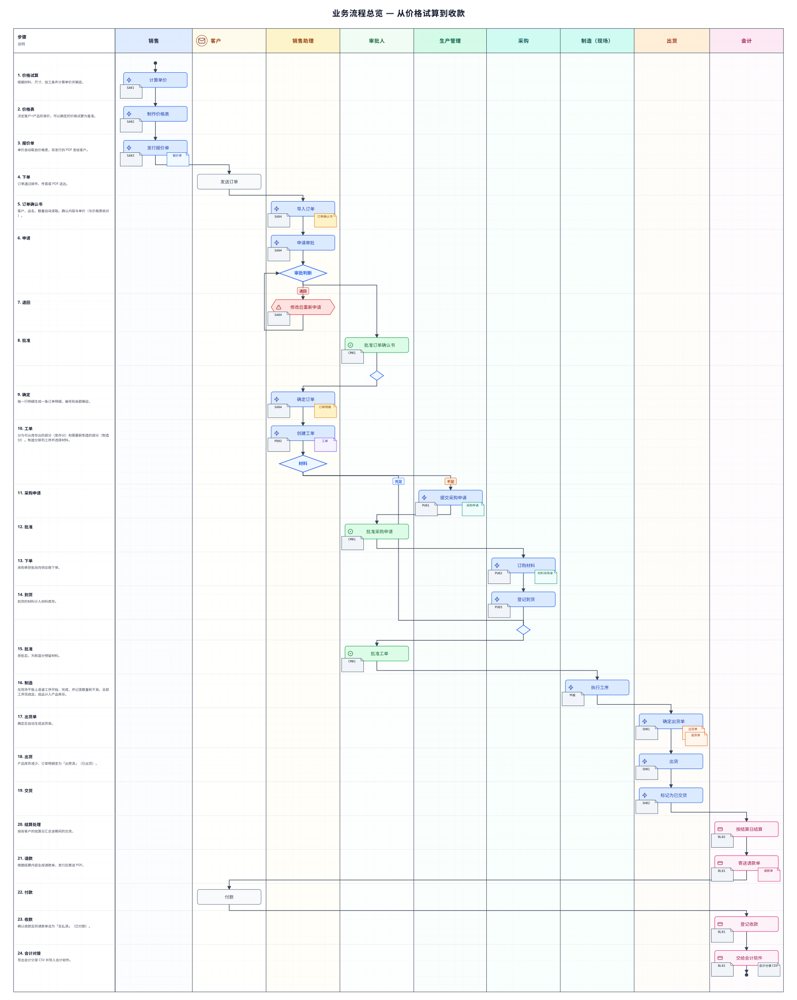
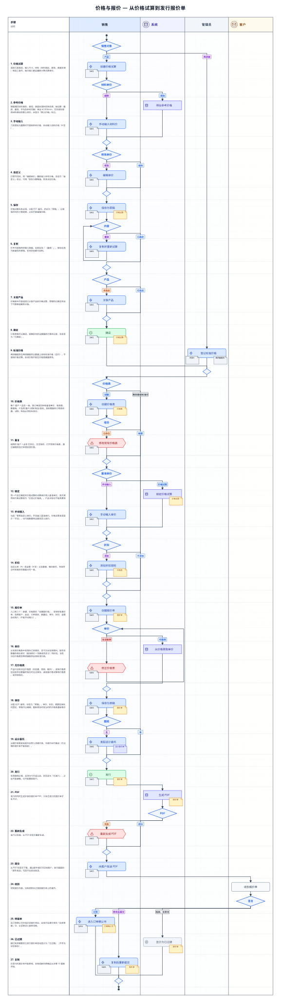
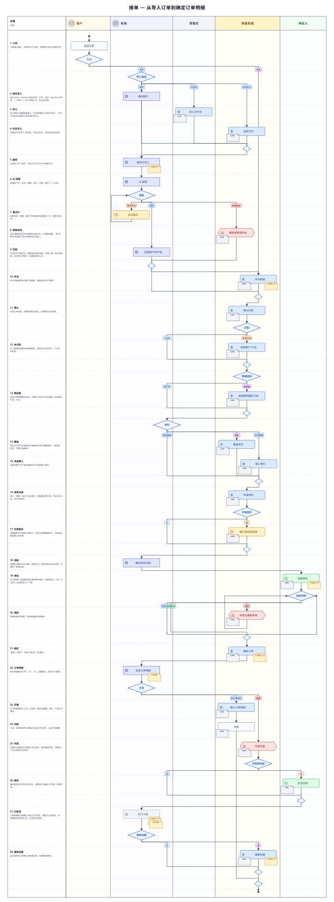
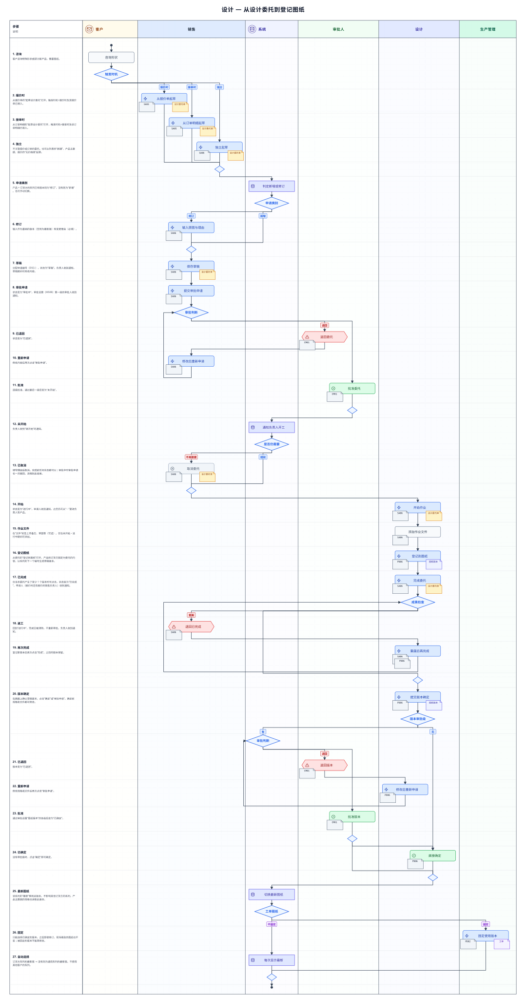
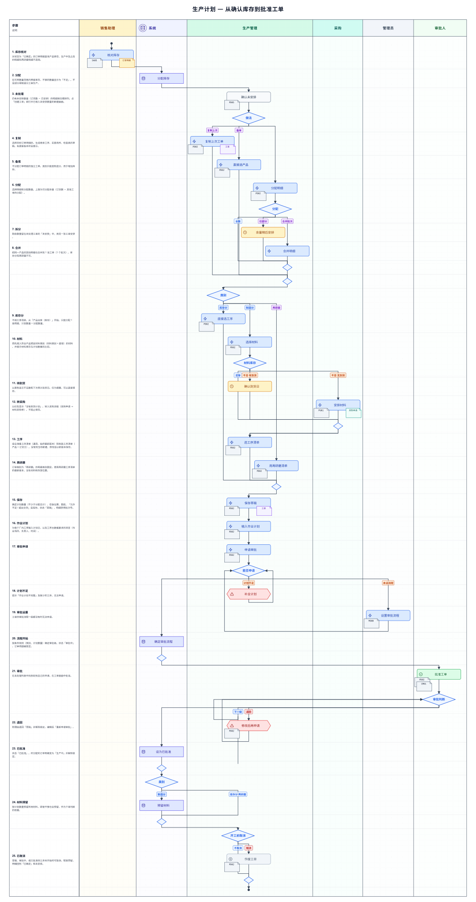
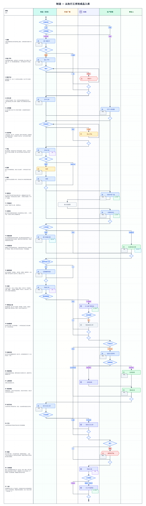
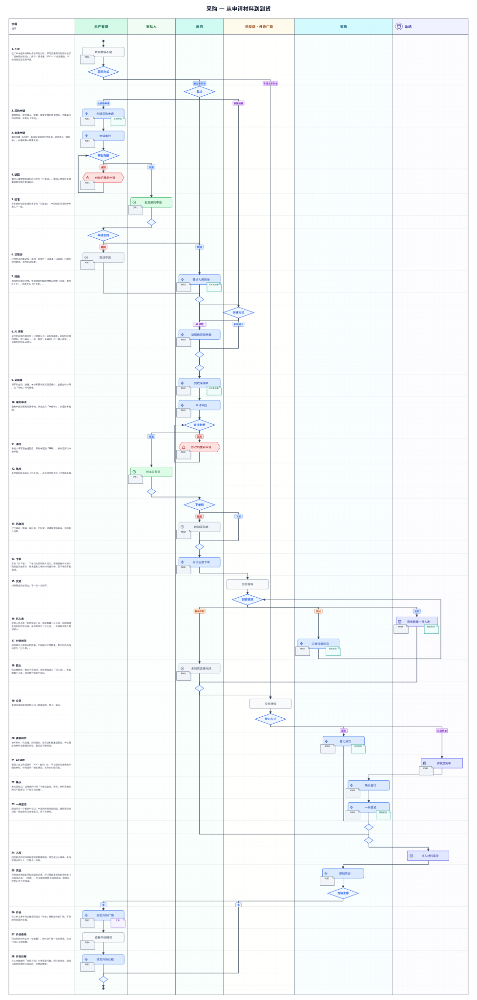
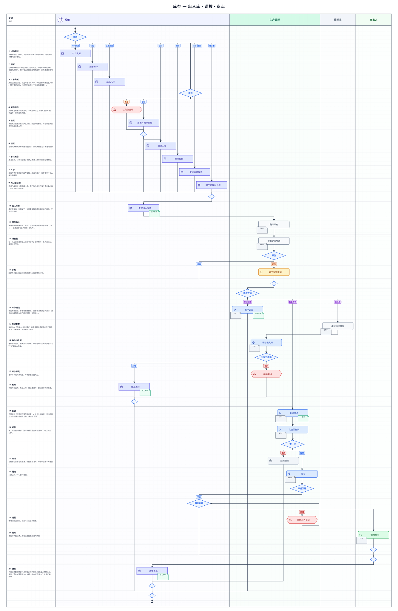
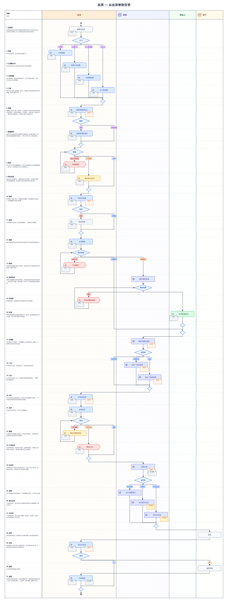
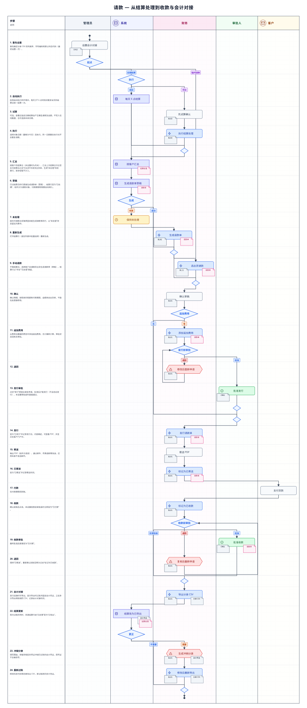

本页将业务划分为 **9 个流程**，用图和表按 **分支（模式）** 逐一说明各流程的步骤。图中的每个步骤都标有所用 **应用的操作代码**（例：`SA04`）。

请先通过 **0. 全流程** 把握整体，再打开自己负责的流程一节。各画面的详细操作，请从表中的应用名称进入操作手册。

| # | 流程 | 范围 |
|---|------|------|
| 0 | [全流程](#overview) | 从价格试算到收款・会计对接 |
| 1 | [价格与报价](#pricing) | 价格试算 → 价格表 → 报价单 |
| 2 | [接单](#order) | 导入订单 → 审批 → 确定订单明细 |
| 3 | [设计](#design) | 设计委托 → 登记图纸 |
| 4 | [生产计划](#planning) | 库存核对 → 工单 → 审批 |
| 5 | [制造](#production) | 执行工序 → 成品入库 |
| 6 | [采购](#purchasing) | 采购申请 → 下单 → 到货 |
| 7 | [库存](#inventory) | 自动出入库・调拨・盘点 |
| 8 | [出货](#shipping) | 出货单 → 出货 → 送货单 |
| 9 | [请款](#billing) | 结算处理 → 请款单 → 收款・会计对接 |

## 图的看法 [#legend]

- **列（泳道）** 表示负责人，**左栏** 是步骤编号与说明。编号与每张图下方表格中的 **#** 一致。
- **方框左下角的标签** 是该步骤使用的 **应用操作代码**（`平板` = 现场的共用平板）。没有标签的方框是 **系统自动进行的处理**。
- **方框右下角的标签** 是该步骤产生或变更的 **单据**。
- **菱形** 表示分支，分支上的文字是条件。线的颜色：红 = 退回・驳回，橙 = 例外・不足，蓝 = 普通选项，紫 = 由用户选择。向上返回的线表示“修改后再来一次”的循环。
- 方框颜色：蓝 = 操作，绿 = 审批，红 = 退回・错误，黄 = 等待，灰 = 结束（取消等），藏青 = 系统自动处理。
- 点击图可全屏放大。

## 0. 全流程 [#overview]

普通订单从价格试算到收款・会计对接的顺序。这里只画出 2 个分支（退回与材料不足），其他模式由第 1〜9 节说明。

| # | 步骤 | 负责人 | 应用 | 详细 |
|---|------|------|--------|---------|
| 1〜3 | 价格试算 → 价格表 → 发行报价单 | 销售 | `SA01` / `SA02` / `SA03` | [1. 价格与报价](#pricing) |
| 4 | 订单送达 | 客户 | — | [2. 接单](#order) |
| 5〜8 | 导入订单 → 申请审批 →（退回）→ 批准 | 销售助理 / 审批人 | `SA04` / `CM01` | [2. 接单](#order) |
| 9 | 确定订单（生成订单明细） | 销售助理 | `SA04` | [2. 接单](#order) |
| 10 | 创建工单 | 销售助理 | `PD02` | [4. 生产计划](#planning) |
| 11〜14 | 材料不足时：采购申请 → 审批 → 下单 → 到货 | 生产管理 / 审批人 / 采购 | `PU01` / `CM01` / `PU02` / `PU03` | [6. 采购](#purchasing) |
| 15 | 批准工单（预留材料） | 审批人 | `CM01` | [4. 生产计划](#planning) |
| 16 | 执行工序（成品计入产品库存） | 制造（现场） | `平板` | [5. 制造](#production) |
| 17〜19 | 确定出货单（生成送货单）→ 出货 → 已交货 | 出货 | `SH01` / `SH02` | [8. 出货](#shipping) |
| 20〜21 | 结算处理 → 寄送请款单 | 会计 | `BL02` / `BL01` | [9. 请款](#billing) |
| 22〜23 | 付款 → 登记收款（已付款） | 客户 → 会计 | `BL01` | [9. 请款](#billing) |
| 24 | 交给会计软件（会计分录 CSV） | 会计 | `BL01` | [9. 请款](#billing) |

库存的自动增减、调拨与盘点汇总在 [7. 库存](#inventory)。没有图纸的产品，与 [3. 设计](#design) 并行推进。

## 1. 价格与报价 — 从价格试算到发行报价单 [#pricing]

本流程决定销售对象的单价，登记到按客户区分的价格表中，再按该单价发行报价单并交给客户。产品从价格试算开始，再研磨从再研磨服务的标准价格开始；客户订货后转入下一个[接单](#order)流程。没有图纸的产品，与报价并行发起[设计委托](#design)。

### 步骤与应用

| # | 步骤 | 负责 | 应用 | 分支・模式 |
|---|------|------|------|------------|
| 1 | 创建价格试算 | 销售 | [价格试算](/manual/zh/operations/sales/trial-estimate/user)（`SA01`） | 仅销售对象为产品时。再研磨转到 9 / 输入项目随刀具类别（圆棒・圆筒・OH・管理员追加的类别）而变 |
| 2 | 得出参考价格 | 系统 | （自动） | 有采购实绩 → 按设置（最新・最高・平均 × 参考月数）计算 / 无实绩 → 材料类别默认单价（没有则用设置的默认值），显示「默认价格」标记 |
| 3 | 手动输入材料价 | 销售 | [价格试算](/manual/zh/operations/sales/trial-estimate/user)（`SA01`） | 刀具类别为圆筒时不用参考价格，手动输入材料价格（¥/支） |
| 4 | 编辑单价 | 销售 | [价格试算](/manual/zh/operations/sales/trial-estimate/user)（`SA01`） | 可选。重新输入参考价格后显示「自定义」标记 / 「恢复为策略值」恢复自动 / 也可从材料价格走势图中选取某日价格 |
| 5 | 保存为草稿 | 销售 | [价格试算](/manual/zh/operations/sales/trial-estimate/user)（`SA01`） | 没有价格试算名称不能保存 / 保存后不能编辑（要修改用 6） |
| 6 | 复制并重新试算 | 销售 | [价格试算](/manual/zh/operations/sales/trial-estimate/user)（`SA01`） | 任何状态都可以。名称后加「（重做）」，成为新编号的草稿 |
| 7 | 关联产品 | 销售 | [价格试算](/manual/zh/operations/sales/trial-estimate/user)（`SA01`） | 仅未指定产品时 / 草稿・已确定状态下可更换或解除 / 已登记价格表的不能更改关联 |
| 8 | 确定 | 销售 | [价格试算](/manual/zh/operations/sales/trial-estimate/user)（`SA01`） | 只有草稿可以确定。按确定时的设置重新计算并记录 |
| 9 | 登记标准价格 | 管理员 | [再研磨服务](/manual/zh/operations/masters/regrind-item/user)（`MS0H`） | 销售对象为再研磨（重新研磨的服务）时。标准价格不能在价格表画面修改 |
| 10 | 创建价格表 | 销售 | [价格表](/manual/zh/operations/sales/price-list/user)（`SA02`） | 再研磨若按标准价格即可则不创建 / 产品用 量产・试制・样品・其他，再研磨服务只用再研磨（组合不对时保存报错） / 试制・样品必须有失效日 |
| 11 | 修改现有价格表 | 销售 | [价格表](/manual/zh/operations/sales/price-list/user)（`SA02`） | 相同 客户 × 品目 已存在 → 无法保存，编辑现有价格表并添加订单类别 |
| 12 | 锁定价格试算 | 系统 | （自动） | 基准单价选用价格试算时。只能选同一产品的已确定・已登记的价格试算。首次使用的价格试算变为「已登记价格表」并被锁定 |
| 13 | 手动输入单价 | 销售 | [价格表](/manual/zh/operations/sales/price-list/user)（`SA02`） | 勾选「使用自定义单价」手动输入基准单价（价格试算来源显示「手动」） / 也可按数量档逐行设自定义单价 |
| 14 | 添加折扣规则 | 销售 | [价格表](/manual/zh/operations/sales/price-list/user)（`SA02`） | 可选。比率（%）或金额（¥/支）× 数量 × 期间 / 多条符合时取折扣额最大者 / 折扣不超过明细金额 |
| 15 | 创建报价单 | 销售 | [报价单](/manual/zh/operations/sales/quote/user)（`SA03`） | 入口有三个：新建 / 价格表的「创建报价单」/ 复制现有报价单。单价・折扣・金额不能手动输入 |
| 16 | 从价格表取单价 | 系统 | （自动） | 有效价格表 × 有效订单类别 × 今天在有效期内 × 符合数量的档位 → 单价（基准单价 × 系数或自定义）和折扣 / 再研磨服务没有对应价格表时采用标准价格 |
| 17 | 修正价格表 | 销售 | [价格表](/manual/zh/operations/sales/price-list/user)（`SA02`） | 产品没有价格表、或价格表停用・期外 → 无法保存（准备价格试算和价格表） / 有价格表但没有符合数量的档位 → 无法保存（添加档位；再研磨也不会退回标准价格） |
| 18 | 保存为草稿 | 销售 | [报价单](/manual/zh/operations/sales/quote/user)（`SA03`） | 单价・折扣・税额在保存时固定 / 草稿可编辑，重新保存时按当时的价格表重新取价 |
| 19 | 发起设计委托 | 销售 | [设计委托单](/manual/zh/operations/sales/design-request/user)（`SA06`） | 没有图纸时。从报价单菜单发起会带入该报价单 / 已过期的报价单不能发起 / 之后进入[设计委托](#design)流程 |
| 20 | 发行 | 销售 | [报价单](/manual/zh/operations/sales/quote/user)（`SA03`） | 有效期限必填且为今天或以后 / 发行后不能编辑，也不能撤销 |
| 21 | 生成 PDF | 系统 | （自动） | 只有已发行的报价单才有 PDF（草稿打不开） |
| 22 | 重新生成 PDF | 销售 | [报价单](/manual/zh/operations/sales/quote/user)（`SA03`） | PDF 生成失败时。发行已经完成 |
| 23 | 向客户发送 PDF | 销售 | [报价单](/manual/zh/operations/sales/quote/user)（`SA03`） | 从 PDF 标签页下载后发送 / 发行画面的「邮件发送」勾选不会自动发送 |
| 24 | 收到报价单 | 客户 | — | 没有把答复记录到报价单上的操作 |
| 25 | 进入订单确认书 | 销售 | [订单确认书](/manual/zh/operations/sales/order-acceptance/user)（`SA04`） | 客户订货时。在订单确认书中指定该报价单后，会显示在报价单的「后续单据」中。之后进入[接单](#order) |
| 26 | 显示为已过期 | 系统 | （自动） | 被拒绝或一直没有答复而超过有效期限时。不作为状态保存，从当天起只是显示改变 |
| 27 | 复制后重新提交 | 销售 | [报价单](/manual/zh/operations/sales/quote/user)（`SA03`） | 需要修改内容时。已发行的不能修改，复制后从 15 重新开始 |

### 需要注意的模式
- 价格表的**有效期和启用/停用会影响报价单单价**。期外或停用的价格表视为「没有」，产品行无法保存（再研磨服务则退回标准价格）。
- 修改价格表**不会改变已发行报价单的金额**。草稿报价单打开后重新保存，会按当时的价格表重新取价。
- 价格表的「**变更有效期**」只更换期间，价格不变。试制・样品变更后仍需失效日。
- 价格表的「**复制到其他客户・产品**」把相同的价格设置复制到另一组合。与价格试算的关联会解除，视为手动输入。
- 价格表可在列表中多选后**批量启用 / 停用 / 删除**。删除无法撤销。
- 价格试算在保存和确定时各按当时的计算设置（SY02）记录一次结果。之后修改计算设置，已记录的价格试算单价也不会变。
- 报价单草稿可以自由编辑，但已发行的报价单**既不能编辑也不能撤销发行**。误发行时复制并交出正确的报价单，错的那张到有效期限后变为已过期。
- 报价单明细选择再研磨服务时，即使没有客户价格表也会按标准价格报价。客户寄存的刀具本身（他社产品）不是销售对象，不会出现在价格表或报价单品目中。
- 开具单据的公司（本公司法人）有 2 家以上时，价格试算・价格表・报价单在创建时决定「**开具公司**」（只对可以选择的人显示该栏）。价格表按公司分别保存，报价单的单价只取自开具公司的价格表。单据编号按公司、按会计年度连续编号。
- 报价单的 PDF 中，有折扣的明细下方印折扣说明，有明细备注的明细下方印其内容。整张报价单的备注也印在 PDF 上。
- 只估算成本的「**成本试算**」，只有拥有「价格试算的成本」权限的人才能创建和查看。它不能作为价格表的基准单价；需要售价时，用「创建售价试算」复制。

## 2. 接单 — 从导入订单到确定订单明细 [#order]

把客户发来的订单导入为订单确认书，核对内容与单价，经过审批后确定并生成订单明细。前一流程为[价格与报价](#pricing)，确定后的订单明细交给[生产安排](#planning)。

### 步骤与应用

| # | 步骤 | 负责 | 应用 | 分支・模式 |
|---|------|------|------|------------|
| 1 | 发送订单 | 客户 | — | 入口为文件（邮件 / 文件夹 / 优先导入）或手动。传真用复合机扫描成文件 |
| 2 | 接收邮件 | 系统 | （自动） | 发往 order-intake@ckk-tool.co.jp 的附件（PDF、PNG、JPG、WEBP）放入导入文件夹。1 个附件 = 1 份。仅正式环境。失败的邮件不会自动重发 |
| 3 | 放入文件夹 | 管理员 | [订单导入](/manual/zh/operations/system/order-intake/user)（`SY0C`） | 自动扫描（默认 60 秒）或“立即扫描”。失败的文件可“重新导入”，沿用原编号只重做提取 |
| 4 | 选择文件 | 销售助理 | [订单确认书](/manual/zh/operations/sales/order-acceptance/user)（`SA04`） | “优先导入”可多选。不经文件夹，提取进入等待队列 |
| 5 | 编号并导入 | 系统 | （自动） | 生成带 `ORD-` 编号、状态“导入中”的订单确认书 |
| 6 | AI 提取 | 系统 | （自动） | 暂时失败 → 7 / 无法恢复的失败或失败 3 次 → 8 / 成功 → 9 |
| 7 | 自动重试 | 系统 | （自动） | 最多 3 次（橙色“重试中”）。仍失败 → 8 |
| 8 | 重新提取或手动 | 销售助理 | [订单确认书](/manual/zh/operations/sales/order-acceptance/user)（`SA04`） | “重新提取”→ 回到 6 / “切换为手动输入”→ 保留已提取的值转为“草稿” |
| 9 | 匹配客户和产品 | 系统 | （自动） | 只填入唯一命中的结果，候选不唯一则留空。变为“草稿”，并通知受理人员（一级审批组） |
| 10 | 手动新建 | 销售助理 | [订单确认书](/manual/zh/operations/sales/order-acceptance/user)（`SA04`） | “手动新建”→ 创建草稿。客户必填 |
| 11 | 确认内容 | 销售助理 | [订单确认书](/manual/zh/operations/sales/order-acceptance/user)（`SA04`） | 以只读打开，“编辑”后修改。仅“草稿”可修改 |
| 12 | 选择客户/产品 | 销售助理 | [订单确认书](/manual/zh/operations/sales/order-acceptance/user)（`SA04`） | 客户或产品未识别时。保存后学习该写法，下次导入自动匹配 |
| 13 | 选择要研磨的刀具 | 销售助理 | [订单确认书](/manual/zh/operations/sales/order-acceptance/user)（`SA04`） | 仅类别“再研磨”的行。品目为再研磨服务，刀具为产品（可选他社产品）。未选刀具则无法申请或确定 |
| 14 | 覆盖单价 | 销售助理 | [订单确认书](/manual/zh/operations/sales/order-acceptance/user)（`SA04`） | 按价格表的行不能改单价。仅以不同价格接单时开启“覆盖单价” |
| 15 | 输入单价 | 销售助理 | [订单确认书](/manual/zh/operations/sales/order-acceptance/user)（`SA04`） | “无价格表”的行可自由输入 |
| 16 | 申请审批 | 销售助理 | [订单确认书](/manual/zh/operations/sales/order-acceptance/user)（`SA04`） | 客户、至少 1 行明细、各行产品与单价（直送需最终用户、再研磨需刀具）齐全前不可点击 |
| 17 | 确认差异后申请 | 销售助理 | [订单确认书](/manual/zh/operations/sales/order-acceptance/user)（`SA04`） | 仅当有价格差异（未覆盖却与价格表不同）或无对应数量档的行时。覆盖的行不会阻止申请 |
| 18 | 确定审批流程 | 系统 | （自动） | 按条件（合计金额、配送方式、据点）选择流程。流程没有审批级则无法申请 |
| 19 | 逐级审批 | 审批人 | [未处理列表](/manual/zh/operations/general/my-tasks/user)（`CM01`）/ `SA04` | 任一人 / 全员。还有下一级 → 重复 19 / 全部批准 →“已批准” |
| 20 | 修改后重新申请 | 销售助理 | [订单确认书](/manual/zh/operations/sales/order-acceptance/user)（`SA04`） | 退回（必填理由）后回到“草稿”，从 11 重新开始 |
| 21 | 确定订单 | 销售助理 | [订单确认书](/manual/zh/operations/sales/order-acceptance/user)（`SA04`） | “确定”→“展开”。“已批准”→“已确定” |
| 22 | 生成订单明细 | 系统 | （自动） | 每行编号 `ORD-…-01` …，金额固定，订单明细为“已确定” |
| 23 | 确认订单明细 | 销售助理 | [订单明细](/manual/zh/operations/sales/order-line/user)（`SA05`） | 由此进入工单、出货单（[生产安排](#planning)）。确定后数量、单价、产品不可更改 |
| 24 | 归档 | 销售助理 | [订单确认书](/manual/zh/operations/sales/order-acceptance/user)（`SA04`） | 可选。“已确定”→“已归档”。之后不可编辑也不可作废 |
| 25 | 申请作废 | 销售助理 | [订单确认书](/manual/zh/operations/sales/order-acceptance/user)（`SA04`） | 以整份已确定的订单确认书为单位，必填理由。有一行已出货则不可。同时只能有 1 个进行中的申请 |
| 26 | 批准作废 | 审批人 | [未处理列表](/manual/zh/operations/general/my-tasks/user)（`CM01`）/ `SA04` | 仅当“订单确认书作废”流程有审批级时。退回 → 不发生变化，申请关闭 |
| 27 | 执行作废 | 系统 | （自动） | 无审批级则申请时立即执行，否则在最终批准时执行。明细与订单确认书变为“已取消”，释放分配，连带取消未完成工单 |
| 28 | 重新创建 | 销售助理 | [订单确认书](/manual/zh/operations/sales/order-acceptance/user)（`SA04`） | 可选。继承内容（再研磨刀具、覆盖单价、配送也包括）生成新的“草稿”，并与原单关联 |

### 需要注意的模式

- 提取进行中也可“切换为手动输入”接手。之后完成的提取结果会被丢弃，不会覆盖已输入的内容。
- 文件损坏、过大等无法恢复的失败不会自动重试，直接停在“提取失败”。人工“重新提取”从第 1 次重新计数。
- 文件夹导入把成功的文件移到 processed，失败的移到 failed。编号写入文件名，重新导入也不会重复编号。
- 容器重启导致队列丢失时，启动时会重新拾取仍处于“导入中”的行。
- 更换客户后保存，会按新客户的价格表重新取单价，并填入该客户的主销售负责人。
- 关闭“覆盖”后保存，已输入的价格会被价格表单价替换。覆盖的行也会以“单价覆盖 N 件”显示给审批人。
- 流程条件（合计金额、配送方式、据点）按明细逐行判断，只要有 1 行符合即采用该流程。
- 确定前会再次检查与申请时相同的条件。不满足则无法确定，需退回后修改。
- 作废审批期间若前提改变（如某行已出货），最终批准也不会执行，申请以“失败”保留。
- 作废后仍保留的工单：已完成的工单，以及同时服务其他有效订单明细的合并批次。
- 本流程中订单明细的状态只到“已确定”和“已取消”。“生产中”由工单批准触发，“部分出货”“已出货”由出货自动变化。
- 不能单独作废或修改某一行订单明细。要修改已确定的订单，需整份作废后重新创建。
- 确定时，还会按订单明细自动分配**打标编号**（刻在产品上的流水号，从 `A200000` 开始）。它与批次号・单据编号是不同的流水号，年度更替时也不会重置。
- 开具单据的公司（本公司法人）有 2 家以上时，1 张订单确认书属于 **1 个法人**。导入的订单由订单导入（`SY0C`）的「导入渠道的本公司法人」决定公司，创建后不能更改。明细的负责据点不能混入其他公司的据点。

## 3. 设计 — 从设计委托到登记图纸 [#design]

涵盖需要图纸时起草设计委托单，经过审批、开始作业、登记图纸、完成，到确定图纸版本并由工单使用该版本为止。此流程与报价及[接单](#order)并行进行，确定的图纸由下一节[生产计划](#planning)中的工单读取。

### 步骤与应用

| # | 步骤 | 负责 | 应用 | 分支・模式 |
|---|------|------|------|------------|
| 1 | 咨询形状 | 客户 | — | 特殊形状的咨询、新产品研讨、内部改善等需要图纸的契机 |
| 2 | 从报价单起草 | 销售 | [报价单](/manual/zh/operations/sales/quote/user)（`SA03`） | 触发时机 = 报价时。报价单的“⋯”→“起草设计委托”会带入该报价单 |
| 3 | 从订单明细起草 | 销售 | [订单明细](/manual/zh/operations/sales/order-line/user)（`SA05`） | 触发时机 = 接单时。订单明细的“⋯”→“起草设计委托”会带入该订单明细 |
| 4 | 独立起草 | 销售 | [设计委托单](/manual/zh/operations/sales/design-request/user)（`SA06`） | 触发时机 = 独立，不关联来源单据。从产品主数据或报价的“无价格表”进入时已带入产品 |
| 5 | 判定新增或修订 | 系统 | （自动） | 产品 × 订货方的系列已有版本则为修订，否则为新增。手动切换时显示“手动指定”。类别按创建时的值保存 |
| 6 | 输入原图与理由 | 销售 | [设计委托单](/manual/zh/operations/sales/design-request/user)（`SA06`） | 仅修订时。原图为空则用最新版，变更理由必填 |
| 7 | 保存草稿 | 销售 | [设计委托单](/manual/zh/operations/sales/design-request/user)（`SA06`） | 产品和负责人必填。分配 `DSG-` 编号，状态为“草稿”。通知负责人。触发时机和来源单据之后不能更改 |
| 8 | 提交审批申请 | 销售 | [设计委托单](/manual/zh/operations/sales/design-request/user)（`SA06`） | 草稿・已退回 → 审批中。审批设置中没有“设计委托单”的审批级时无法提交 |
| 9 | 退回委托 | 审批人 | [未处理列表](/manual/zh/operations/general/my-tasks/user)（`CM01`） | 理由必填。审批中 → 已退回 |
| 10 | 修改后重新申请 | 销售 | [设计委托单](/manual/zh/operations/sales/design-request/user)（`SA06`） | 已退回期间可修改内容。再次“审批申请”回到 8 |
| 11 | 批准委托 | 审批人 | [未处理列表](/manual/zh/operations/general/my-tasks/user)（`CM01`） | 逐级批准。中间级仍为审批中，通过最后一级后变为“未开始” |
| 12 | 通知负责人开工 | 系统 | （自动） | 负责人收到“请开始”的通知 |
| 13 | 取消委托 | 销售 | [设计委托单](/manual/zh/operations/sales/design-request/user)（`SA06`） | 不再需要时。理由必填。完成前任何状态都可以（审批中时一并撤回审批申请）。完成后需先退回 |
| 14 | 开始作业 | 设计 | [设计委托单](/manual/zh/operations/sales/design-request/user)（`SA06`） | 未开始 → 进行中。通知申请人。批准前不能开始 |
| 15 | 添加作业文件 | 设计 | [设计委托单](/manual/zh/operations/sales/design-request/user)（`SA06`） | 可选，在“文件”标签。仅在未开始・进行中期间（格式不限，每个 20MB 以内） |
| 16 | 登记到图纸 | 设计 | [图纸](/manual/zh/operations/production/design-file/user)（`PD06`） | 产品和订货方固定为委托的内容。以系列的下一个编号生成草稿版本。系列中已有未确定版本时无法登记 |
| 17 | 完成委托 | 设计 | [设计委托单](/manual/zh/operations/sales/design-request/user)（`SA06`） | 本委托须至少产生 1 个版本（草稿也可）。进行中 → 已完成。通知申请人（报价时还有报价的销售负责人） |
| 18 | 退回已完成 | 销售 | [设计委托单](/manual/zh/operations/sales/design-request/user)（`SA06`） | 需要重画时。已完成 → 进行中，完成日清除。不重新审批 |
| 19 | 重画后再完成 | 设计 | [图纸](/manual/zh/operations/production/design-file/user)（`PD06`）・[设计委托单](/manual/zh/operations/sales/design-request/user)（`SA06`） | 登记新版本后再次“完成”。之前的版本保留 |
| 20 | 提交版本确定 | 设计 | [图纸](/manual/zh/operations/production/design-file/user)（`PD06`） | 仅限草稿・已退回的版本。确定前可修改规格和文件，也可删除整个版本 |
| 21 | 退回版本 | 审批人 | [未处理列表](/manual/zh/operations/general/my-tasks/user)（`CM01`） | 仅当审批设置“图纸版本”有审批级时。理由必填。版本变为“已退回” |
| 22 | 修改后重新申请 | 设计 | [图纸](/manual/zh/operations/production/design-file/user)（`PD06`） | 修改后再次“审批申请” |
| 23 | 批准版本 | 审批人 | [未处理列表](/manual/zh/operations/general/my-tasks/user)（`CM01`） | 通过最后一级后变为“已确定” |
| 24 | 直接确定 | 设计 | [图纸](/manual/zh/operations/production/design-file/user)（`PD06`） | 没有审批级时，点击“确定”即可（未设置 = 直接通过） |
| 25 | 切换最新图纸 | 系统 | （自动） | 只有该系列的“最新”移到此版本，其他订货方的系列不变。产品规格也从这里读取 |
| 26 | 固定使用版本 | 生产管理 | [工单](/manual/zh/operations/production/work-order/user)（`PD02`） | 可选。只能选已确定的版本。被固定的版本不能再编辑或删除 |
| 27 | 每次显示最新 | 系统 | （自动） | 不固定时：订货方系列的最新 → 没有则为通用的最新。不使用其他客户的系列。客户混合的工单使用通用 |

### 需要注意的模式
- 审批设置中没有“设计委托单”的审批级 → “审批申请”被拒绝，委托仍为草稿（与图纸版本不同，不会直接通过）。
- 审批中的退回（审批轴）与完成后的退回（作业轴）不同 → 前者变为“已退回”需重新审批；后者只是回到“进行中”，不触及审批记录。
- 未开始・进行中期间，只能从“⋯”更改负责人和产品 → 委托内容是经批准的，要更改时取消后重新起草。
- 完成委托与确定版本是两个手续 → 草稿版本也能完成委托，版本确定（20〜24）可在完成之前或之后。工单和产品主数据只读取已确定的版本。
- 修订委托进行中，另一修订先被确定 → 不阻止完成，但委托历史中会记录其原图已不是最新。
- 图纸也可不经委托登记（手动版本） → 图纸已先有或导入现有图纸时，列表的“来源”显示“手动”。
- 每个系列只能有 1 个未确定版本 → 有草稿・审批中・已退回版本的系列不能新建版本。先确定或删除草稿。
- 订货方为空的系列是“通用” → 由没有专用图纸的客户的工单使用。新增 / 修订也只看该系列（A 公司有版本，B 公司没有，则对 B 公司为新增）。
- 单据 PDF 仅在批准后（未开始・进行中・已完成）可打开 → 以纸面交给制造的内部文件。
- 加工程序（登记在图纸版本上）的添加・修改・新版本・删除・废止，如果审批设置中有「加工プログラムの変更」（加工程序变更）的审批级，则经审批后生效。没有审批级时，提交申请即生效（未设置 = 直接通过）。

## 4. 生产计划 — 从确认库存到批准工单 [#planning]

涵盖对已确定的订单明细核对产品库存、把需要生产（或从库存出货）的部分做成工单、并完成审批的过程。前一环节是 [设计](#design)，在现场执行已批准工单的工序属于下一节 [生产](#production)。材料不足时转入 [采购](#purchasing)。

### 步骤与应用

| # | 步骤 | 负责 | 应用 | 分支与模式 |
|---|------|------|------|------------|
| 1 | 核对库存 | 销售助理 | [订单明细](/manual/zh/operations/sales/order-line/user)（`SA05`） | 仅限状态为「已确定」（或草稿）的明细。进入生产后由工单管理数量，按钮不可用。再研磨明细不分配本公司库存 |
| 2 | 分配库存 | 系统 | （自动） | 库存足够 → 全数预留 / 部分或没有 → 只预留可用数量，其余显示为「不足」 |
| 3 | 确认未安排 | 生产管理 | [未处理工单](/manual/zh/operations/production/pending-work-order/user)（`PD05`） | 未安排 = 订货数 − 已安排。点「创建工单」打开已填入未安排数量的新建画面。订单明细详情的「下一步」卡片也可进入同一画面 |
| 4 | 复制上次工单 | 生产管理 | [工单](/manual/zh/operations/production/work-order/user)（`PD02`） | 做法 = 复制上次。生成继承工序、实施场所、批次输入、检查表的草稿（不复制分支序列和已取消的工序）。复制库存分工单时必须指定订单明细 |
| 5 | 直接选产品 | 生产管理 | [工单](/manual/zh/operations/production/work-order/user)（`PD02`） | 做法 = 备库。不分配订单明细的独立工单，类别只能是制造分 |
| 6 | 分配明细 | 生产管理 | [工单](/manual/zh/operations/production/work-order/user)（`PD02`） | 做法 = 新建（通常）。可分配余量 = 订货数 − 其他工单的分配（不含已取消）。只能分配已确定、生产中、部分出货的明细 |
| 7 | 余量稍后安排 | 生产管理 | （等待） | 分配 = 仅部分（拆分）。剩余数量留在 `PD05` 的「未安排」中 |
| 8 | 合并明细 | 生产管理 | [工单](/manual/zh/operations/production/work-order/user)（`PD02`） | 分配 = 合并批次。不能加入其他产品的明细。库存分和再研磨只能有 1 条明细 |
| 9 | 直接选工序 | 生产管理 | [工单](/manual/zh/operations/production/work-order/user)（`PD02`） | 类别 = 库存分。不用工序清单，从「产品出库（库存）」开始，其他可选工序由工序主数据的「可用工单类别」决定。计划数量 = 分配数量 |
| 10 | 选择材料 | 生产管理 | [工单](/manual/zh/operations/production/work-order/user)（`PD02`） | 类别 = 制造分。提示材料库存与计划数量的比较：足够（绿）/ 不足·有到货计划（黄）/ 不足·无到货计划（红）。任何情况都不阻止保存 |
| 11 | 确认到货日 | 生产管理 | （等待） | 材料库存 = 不足·有到货计划。显示不足数和下次预计到货日 |
| 12 | 安排材料 | 采购 | [采购申请](/manual/zh/operations/purchasing/purchase-request/user)（`PU01`） | 材料库存 = 不足·无到货计划。「请考虑材料采购」→ [采购](#purchasing) |
| 13 | 选工序清单 | 生产管理 | [工单](/manual/zh/operations/production/work-order/user)（`PD02`） | 准备工序清单始终用最新版本（只有 1 条时自动选择）。制造工序清单按 客户专用 → 通用 → 第一条 的顺序自动选择，也可选版本。未登记时当场新建，修改工序后以新版本保存。缺少前提工序的组合无法保存 |
| 14 | 用再研磨清单 | 生产管理 | [工单](/manual/zh/operations/production/work-order/user)（`PD02`） | 类别 = 再研磨。订单类别为「再研磨」的明细类别固定，反之再研磨明细只能分配给再研磨工单。没有材料和存放位置 |
| 15 | 保存草稿 | 生产管理 | [工单](/manual/zh/operations/production/work-order/user)（`PD02`） | 计划数量不少于分配合计（可为不良预备多加）。勾选「允许不足 / 超出交货」后，该批次可按数量差异出货。状态「草稿」，所分配明细获得批次号 |
| 16 | 输入作业计划 | 生产管理 | [工单](/manual/zh/operations/production/work-order/user)（`PD02`） | 在新建画面或创建后各工序的计划面板中输入。负责人和时间仅在工序主数据设为必填的工序需要 |
| 17 | 申请审批 | 生产管理 | [工单](/manual/zh/operations/production/work-order/user)（`PD02`） | 仅限草稿。分为下面 18〜20 之一 |
| 18 | 补全计划 | 生产管理 | [工单](/manual/zh/operations/production/work-order/user)（`PD02`） | 能否申请 = 计划不足。每个厂内工序需要至少 1 行含计划日和必填项目的计划（外协、已取消的工序除外）→ 补全后重新申请 |
| 19 | 设置审批流程 | 管理员 | [审批设置](/manual/zh/operations/masters/approval-setting/user)（`MS0B`） | 能否申请 = 未设流程。工单审批流程一级都没有时无法申请 |
| 20 | 确定审批流程 | 系统 | （自动） | 有条件规则（类别、计划数量）时审批级的构成会变化。状态「审批中」，所分配明细被锁定 |
| 21 | 批准工单 | 审批人 | [未处理列表](/manual/zh/operations/general/my-tasks/user)（`CM01`）→ [工单](/manual/zh/operations/production/work-order/user)（`PD02`） | 只有该级审批组的成员和代理人可以批准。「全员」级需全员批准才结束 |
| 22 | 修改后再申请 | 生产管理 | [工单](/manual/zh/operations/production/work-order/user)（`PD02`） | 审批判断 = 退回（必须填写理由）。回到「草稿」并解除锁定 → 编辑后重新申请审批 |
| 23 | 设为已批准 | 系统 | （自动） | 审批判断 = 最终批准。还有下一级时转给下一级审批人。最终级批准后状态「已批准」，所分配明细变为「生产中」 |
| 24 | 预留材料 | 系统 | （自动） | 仅限有材料的制造分。库存分和再研磨不预留。材料不足也会预留 |
| 25 | 作废工单 | 生产管理 | [工单](/manual/zh/operations/production/work-order/user)（`PD02`） | 仅限草稿、审批中、已批准且没有任何工序开始时。释放预留；没有其他有效工单的明细回到「已确定」并变为未安排。工序开始后不能取消 |

### 需要注意的模式
- 库存核对不会自动执行。没有核对的明细就没有预留，创建库存分工单前请先核对。创建库存分工单时不会预留库存（在工单完成时消耗核对时取得的预留）。
- 要在库存和制造之间拆分时，从同一明细分别创建 1 张库存分和 1 张制造分工单（拆分）。库存分只能有 1 条明细，计划数量 = 分配数量。
- 工单只有在草稿时才能编辑。审批中想修改时，请让审批人退回，或作废后重新创建。
- 审批中所分配的明细被锁定，无法在订单确认书中修改。批准、退回、作废都会解除锁定。
- 作废工单后，其数量回到 `PD05` 的「未安排」。工单完成但因不良数量不足的部分也会回到这里。
- 整张订单确认书的取消（[接单](#order) 一侧的操作）获批后，尚未完成的工单会连锁取消——但同时生产其他明细的合并批次会保留。
- 「前置工单」（接收另一张工单的成品后开始）可以在审批前后于工单详情中关联，在 [生产](#production) 中生效。
- 库存中有加工到一半的物品（**在制品**）时，可以在工单创建画面的「可用在制品」中选择，从后续工序接着做。已完成的工序不再进行，也不使用材料。加工状态不同的在制品不能混在 1 张工单中。所选在制品在批准时被预留。
- 各工序的期限（**工序交期**）在工单的创建・编辑画面中填写，批准后在工序画面中修改。它与给客户的交期（预定交期）分开保存。

## 5. 制造 — 从执行工序到成品入库 [#production]

在现场的共用终端（或电脑上的工单画面）开始・完成已批准工单的工序，记录数量・不良・检查，直到全部工序完成后计入产品库存的流程。前一个流程是[计划](#planning)（工单的创建与审批），材料不足时转到[采购](#purchasing)。

### 步骤与应用

| # | 步骤 | 负责 | 应用 | 分支・模式 |
|---|------|------|------|------------|
| 1 | 刷二维码卡 | 制造（现场） | [现场平板 — 使用入门](/manual/zh/operations/kiosk/start/user)（平板） | 实施场所为厂内、在共用终端记录时。未登记的终端、已停用或未分配的卡无法登录 |
| 2 | 输入 PIN | 制造（现场） | [现场平板 — 使用入门](/manual/zh/operations/kiosk/start/user)（平板） | 该终端首次使用／48 小时未使用／距上次 PIN 满 2 周 → 要求输入 PIN。都不符合时只刷卡即可登录 |
| 3 | 锁定卡 | 系统 | （自动） | 连续输错 5 次 → 锁定 15 分钟。稍后重新输入，或由管理员重置 PIN |
| 4 | 打开工序 | 制造（现场） | [现场平板 — 工序记录](/manual/zh/operations/kiosk/steps/user)（平板） | “工序执行”（分配给自己的工序）或“工单扫描”（从工单二维码・编号打开全部工序） |
| 5 | 打开工序视图 | 生产管理 | [工单](/manual/zh/operations/production/work-order/user)（`PD02`） | 在电脑上记录时。批准前和完成后只能查看 |
| 6 | 阻止开始 | 系统 | （自动） | 未批准／前工序・分支来源・前序工单未完成／必填的批次/单据编码未输入／其他用户正在作业／作业场所不允许 → 无法开始。条件满足后进入开始 |
| 7 | 开始工序 | 制造（现场） | [现场平板 — 工序记录](/manual/zh/operations/kiosk/steps/user)（平板） | 工序变为“进行中”；第一道工序开始时工单也变为“进行中” |
| 8 | 暂停 | 制造（现场） | [现场平板 — 工序记录](/manual/zh/operations/kiosk/steps/user)（平板） | 仅在中途停止时。解除锁定，其他人可以接手 |
| 9 | 继续 | 制造（现场） | [现场平板 — 工序记录](/manual/zh/operations/kiosk/steps/user)（平板） | 作为新的作业区段累计时间 |
| 10 | 交给外协厂商 | 生产管理 | [工单](/manual/zh/operations/production/work-order/user)（`PD02`）／列表见[外协委托](/manual/zh/operations/purchasing/outsource-order/user)（`PU04`） | 实施场所为外协的工序。输入委托日后成为外协厂商的寄存库存（外协发出的出入库单） |
| 11 | 加工后送回 | 外协厂商 | — | — |
| 12 | 记录到货日 | 生产管理 | [工单](/manual/zh/operations/production/work-order/user)（`PD02`） | 输入到货日后寄存库存返回（外协返回的出入库单） |
| 13 | 录入检查记录 | 制造（现场） | [现场平板 — 工序记录](/manual/zh/operations/kiosk/steps/user)（平板） | 检查工序。合格与否自动判定，无法判定的项目手动选择。抽检时显示样本数 |
| 14 | 批准检查记录 | 审批人 | [现场平板 — 工序记录](/manual/zh/operations/kiosk/steps/user)（平板）／[工单](/manual/zh/operations/production/work-order/user)（`PD02`） | 检查批准工序。只能批准合格记录；设定了审批组・审批人时只有他们可以批准 |
| 15 | 记录最终检查 | 制造（现场） | [现场平板 — 工序记录](/manual/zh/operations/kiosk/steps/user)（平板） | 仅限标记为最终检查工序的工序（默认为发货前检查）。每张工单一份 |
| 16 | 完成工序 | 制造（现场） | [现场平板 — 工序记录](/manual/zh/operations/kiosk/steps/user)（平板） | 不良按区分（半成品／报废／工序分支）逐行录入。检查表未保存、不良类别或详情为空、不良超过接收数 → 无法完成 |
| 17 | 计入客户寄存品 | 系统 | （自动） | 仅在再研磨的“产品接收（再研磨）”工序完成时 |
| 18 | 取消后续工序 | 系统 | （自动） | 全部为“退回（无法再研磨）”→ 未开始的后续工序自动取消，工单当场完成 |
| 19 | 追加分支序列 | 生产管理 | [工单](/manual/zh/operations/production/work-order/user)（`PD02`） | 有工序分支数量时。必须选择结束方式（汇合到主线／入库） |
| 20 | 批准变更 | 审批人 | [工单](/manual/zh/operations/production/work-order/user)（`PD02`）／[未处理列表](/manual/zh/operations/general/my-tasks/user)（`CM01`） | 已批准・进行中的工单上的“工序流程变更”为事前审批时。批准前挂起，退回则不反映直接关闭 |
| 21 | 当场反映 | 系统 | （自动） | 事后审批时。没有审批级时不经审批直接反映 |
| 22 | 事后批准 | 审批人 | [工单](/manual/zh/operations/production/work-order/user)（`PD02`）／[未处理列表](/manual/zh/operations/general/my-tasks/user)（`CM01`） | 被退回 → 工序不会恢复；确认红色提示后点击“标记为已确认” |
| 23 | 执行分支工序 | 制造（现场） | [现场平板 — 工序记录](/manual/zh/operations/kiosk/steps/user)（平板） | 分支来源完成后才能开始 |
| 24 | 流向汇合工序 | 系统 | （自动） | 汇合主线 → 成为汇合工序的接收数／入库 → 工单完成时计入半成品或产品库存 |
| 25 | 退回未开始 | 生产管理 | [工单](/manual/zh/operations/production/work-order/user)（`PD02`） | 进行中 → 中断，已完成 → 回退（需填写理由）。后续工序已开始或已计入库存后不可 |
| 26 | 完成工单 | 系统 | （自动） | 还有剩余工序时重复 4〜25。最后一道工序完成后工单变为“已完成” |
| 27 | 计入产品库存 | 系统 | （自动）／在[出入库单](/manual/zh/operations/inventory/inventory-movements/user)（`ST04`）中确认 | 制造分・库存分时。再研磨不计入本公司库存，并把退回数量从客户寄存品中扣除 |

### 需要掌握的模式
- 暂停・继续只在共用终端上有。电脑的工序画面没有；其“中断”是把进行中的工序退回未开始，录入到一半的数量不保留。
- 在共用终端上，分配给他人的工序（即使通过工单扫描打开）只有该负责人可以操作。没有负责人的工序任何人都可以操作。
- 共用终端的列表可以对相同状态的多道工序一起开始・暂停・完成。批量完成会把接收数全部记为良品，因此有不良的工序要单独完成。从暂停继续不能批量进行。
- 开始和完成是带条件记录的，两人同时按下时只有一方成功（“其他用户正在作业”／“该工序已完成”）。
- 不记录数量的工序不询问数量直接完成，接收数原样传给下一步。检查批准工序也不询问数量。
- 新设定的 PIN 为 6 位，不能使用相同数字连续或 123456 这样的顺序（已有的 4 位 PIN 仍可使用）。
- 从库存的在制品开始的工单，在工单完成时把投入的在制品从库存中扣除。
- 再研磨不能使用“半成品”区分，“报废”表示“退回（无法再研磨）”。研磨好的数量在[出货](#shipping)中通过出货单退还客户。
- 已完成的工单，以及已完成的“产品接收（再研磨）”工序，已经计入库存，无法回退。差异通过[库存](#inventory)的手动出入库或盘点修正。
- 在不良区分中划为「半成品」的部分作为**在制品**进入库存。按加工到哪一步（加工状态）和成品尺寸分开，所以完成工序时要输入成品直径・成品长度（已完成改变形状的工序时为必填）。
- 需要中途停止进行中的制造分工单时使用「**中止**」。流程中途的良品作为在制品退回库存，不退回的部分报废。理由为必填，审批设置中「工单中止」设有审批级时经批准后生效。等待审批期间工序若有进展，则不会生效。
- 超过工序期限（**工序交期**）仍未完成的工序，会在工序卡片・流程图・作业场所一览（`PD09`）・共用终端上以红色显示。
- 在共用终端上，即使没有纸质工单，也可以从「**工单列表**」中选择已批准・进行中的工单并打开工序。打开后可以操作的工序与工单扫码相同。
- 工序画面上会显示负责该工序的**加工程序**（登记在图纸版本上的）和**打标编号**。
- 一条订单明细分成多张工单制作时，打标编号会带上各工单的分割号（`A2000001-001` 〜）。现场只刻该工单的范围。

## 6. 采购 — 从申请材料到到货 [#purchasing]

涵盖从发现材料不足到下单、到货并计入材料库存的全过程。不足通常在[生产计划](#planning)中为工单选择材料时发现。到货的材料在[库存](#inventory)中成为可用数量，并在[生产](#production)的工序中使用。外协工序的进展（外协委托）也在这里查看。

### 步骤与应用

| # | 步骤 | 负责 | 应用 | 分支・模式 |
|---|------|------|------|------------|
| 1 | 发现材料不足 | 生产管理 | [工单](/manual/zh/operations/production/work-order/user)（`PD02`）/ [库存・需求量](/manual/zh/operations/inventory/stock-requirements/user)（`ST03`） | 通过采购单 → 2〜18 / 不通过采购单 → 19〜23 |
| 2 | 创建采购申请 | 生产管理 | [采购申请](/manual/zh/operations/purchasing/purchase-request/user)（`PU01`） | 起点：从采购申请 → 2 / 直接创建采购单 → 8 或 9 |
| 3 | 申请审批 | 生产管理 | [采购申请](/manual/zh/operations/purchasing/purchase-request/user)（`PU01`） | 未设置审批流程 → 无法申请 |
| 4 | 修改后重新申请（退回） | 生产管理 | [采购申请](/manual/zh/operations/purchasing/purchase-request/user)（`PU01`） | 退回 → 在「已退回」状态下修改后回到 3 |
| 5 | 批准采购申请 | 审批人 | [未处理列表](/manual/zh/operations/general/my-tasks/user)（`CM01`）/ `PU01` | 多级时 → 全部批准后为「已批准」 |
| 6 | 取消申请 | 生产管理 | [采购申请](/manual/zh/operations/purchasing/purchase-request/user)（`PU01`） | 转换为采购单之前随时可取消（需填理由）→ 结束 |
| 7 | 转换为采购单 | 采购 | [采购申请](/manual/zh/operations/purchasing/purchase-request/user)（`PU01`） | 选择供应商 → 材料采购单（草稿・单价 0 日元）+ 申请变为「已下单」 |
| 8 | 读取供应商单据（AI 读取） | 采购 | [材料采购单](/manual/zh/operations/purchasing/purchase-order/user)（`PU02`） | 仅直接创建时。AI 读取 / 手动输入。未确定的行以空白填入，保存时由校验拦下 |
| 9 | 完成采购单 | 采购 | [材料采购单](/manual/zh/operations/purchasing/purchase-order/user)（`PU02`） | 由转换而来时需填写单价。仅「草稿」时可编辑 |
| 10 | 申请审批 | 采购 | [材料采购单](/manual/zh/operations/purchasing/purchase-order/user)（`PU02`） | 未设置审批流程 → 无法申请 |
| 11 | 修改后重新申请（退回） | 采购 | [材料采购单](/manual/zh/operations/purchasing/purchase-order/user)（`PU02`） | 退回 → 回到「草稿」，从 9 继续 |
| 12 | 批准采购单 | 审批人 | [未处理列表](/manual/zh/operations/general/my-tasks/user)（`CM01`）/ `PU02` | 已批准后可添加凭证 |
| 13 | 取消采购单 | 采购 | [材料采购单](/manual/zh/operations/purchasing/purchase-order/user)（`PU02`） | 仅草稿・审批中・已批准时（需填理由）→ 结束 |
| 14 | 向供应商下单 | 采购 | [材料采购单](/manual/zh/operations/purchasing/purchase-order/user)（`PU02`） | 「已下单」。下单日为空则为当天。此后不能取消 |
| 15 | 交付材料 | 供应商・外协厂商 | — | 到货情况：全部 → 16 / 部分 → 17 / 剩余不到 → 18 |
| 16 | 剩余数量一并入库（到货完成） | 收货（由系统处理） | [材料采购单](/manual/zh/operations/purchasing/purchase-order/user)（`PU02`） | 按明细生成材料到货记录，变为「已入库」；通知申请人和创建人 |
| 17 | 记录分批到货 | 收货 | [材料采购单](/manual/zh/operations/purchasing/purchase-order/user)（`PU02`） | 每次到货重复。不能超过下单数量。累计到齐后自动「已入库」 |
| 18 | 未到货直接完成 | 采购 | [材料采购单](/manual/zh/operations/purchasing/purchase-order/user)（`PU02`） | 缺货、剩余不会到时（需填理由）。未到数量既不入库也不留在预计到货中 |
| 19 | 交付材料（无采购单） | 供应商・外协厂商 | — | 登记方式：逐条 → 20 / 从送货单 → 21〜23 |
| 20 | 登记到货（直接采购） | 收货 | [材料到货](/manual/zh/operations/purchasing/material-receipt/user)（`PU03`） | 单位固定为材料主数据的单位。登记后不能修改 |
| 21 | 读取送货单 | 系统 | [材料到货](/manual/zh/operations/purchasing/material-receipt/user)（`PU03`） | 材料编号一致 → 确定 / 名称 → 分级匹配 / 无法读取 → 显示原因和下一步 |
| 22 | 确认各行 | 收货 | [材料到货](/manual/zh/operations/purchasing/material-receipt/user)（`PU03`） | 可用「不登记此行」排除。材料未确定的行不能登记 |
| 23 | 一并登记 | 收货 | [材料到货](/manual/zh/operations/purchasing/material-receipt/user)（`PU03`） | 一个事务 — 任一行失败则全部回滚 |
| 24 | 计入材料库存 | 系统 | （自动） | 未指定到货据点 → 「无据点」库存 |
| 25 | 添加凭证 | 收货 | [材料到货](/manual/zh/operations/purchasing/material-receipt/user)（`PU03`）/ `PU02` | 可选。采购单需已批准之后。AI 读取的原件自动添加（失败也不回滚登记） |
| 26 | 指定外协厂商 | 生产管理 | [工单](/manual/zh/operations/production/work-order/user)（`PD02`） | 没有外协工序则无 26〜28 |
| 27 | 查看外协情况 | 生产管理 | [外协委托单](/manual/zh/operations/purchasing/outsource-order/user)（`PU04`） | 仅查看。按外协厂商・状态筛选 |
| 28 | 填写外协日程 | 生产管理 | [工单](/manual/zh/operations/production/work-order/user)（`PD02`） | 工序画面的「外协日程」：委托日・预计到货日・到货日・外协费用 |

### 需要注意的模式
- 采购申请被退回后状态为「已退回」，可直接修改后重新申请；材料采购单被退回后回到「草稿」——两种单据的退回去向不同。
- 未在审批设置（`MS0B`）中配置审批流程时，采购申请和材料采购单都无法提交审批（不会直接放行）。
- 变为「已下单」后，未到数量（下单数 − 已到货）作为预计到货显示在库存・需求量（`ST03`）和工单的材料提示中；仅「已批准」时不显示。
- 通过采购单订购的材料只到了一部分时，在材料采购单上用「分批到货」记录。材料到货（`PU03`）的新建和送货单导入都作为不关联采购单的直接采购登记，采购单的未到数量不会减少，之后再点「到货完成」会重复入库。
- 不使用「未到货直接完成」而放置的已下单采购单，会一直把不会到的数量算作预计到货，虚增库存预期。
- 材料到货记录是确定记录，不能编辑或删除。数量或据点有误时，在库存一侧（[库存](#inventory)的手动出入库・盘点）修正。
- 外协委托单（`PU04`）没有自己的单据。它是把实施场所设为「外协」的工单工序直接列出的一览，不能在此新建。

## 7. 库存 — 出入库・调拨・盘点 [#inventory]

库存不是由人输入数字，而是在到货、工单、出货等前后业务推进时自动增减，每次变动都会留下一张出入库单。本节汇总全部自动记账的模式，以及人工修正库存的 3 个入口（库存调拨、手动出入库、盘点）。材料补充接[采购](#purchasing)，产品出货接[出货](#shipping)。

### 步骤与应用

| # | 步骤 | 负责 | 应用 | 分支・模式 |
|---|------|------|------|------------|
| 1 | 材料入库 | 系统 | （自动） | 事由＝材料到货。登记（或 AI 导入）[材料到货](/manual/zh/operations/purchasing/material-receipt/user)（`PU03`），或在[材料采购单](/manual/zh/operations/purchasing/purchase-order/user)（`PU02`）上登记到货后，到货据点的材料库存增加 |
| 2 | 预留库存 | 系统 | （自动） | 事由＝分配。[订单明细](/manual/zh/operations/sales/order-line/user)（`SA05`）的“库存核对”预留空闲产品；制造分[工单](/manual/zh/operations/production/work-order/user)（`PD02`）获批时预留材料。材料可以预留超过现有库存 |
| 3 | 成品入库 | 系统 | （自动） | 事由＝工单完成。完成最后一道工序时（网页或[共用终端](/manual/zh/operations/kiosk/steps/user)均可），良品和半成品入库，材料预留解除，已用材料出库 |
| 4 | 以负数出库 | 系统 | （自动） | 事由＝出货、库存不足。[出货单](/manual/zh/operations/shipping/delivery-order/user)（`SH01`）的出货不会被阻止，不足部分作为“库存不足出库”以负数记账 |
| 5 | 出库并解除预留 | 系统 | （自动） | 事由＝出货、库存足够。发货类出货单出库并解除预留，库存保管类出货单入库 |
| 6 | 退货入库 | 系统 | （自动） | 事由＝退货。在已出货（发货类）的[出货单](/manual/zh/operations/shipping/delivery-order/user)（`SH01`）上登记退货后退回库存，不能超过出货数量 |
| 7 | 解除预留 | 系统 | （自动） | 事由＝取消。取消工单（仅限开工前）、订单明细或订单确认书时，其预留被解除 |
| 8 | 变动寄存库存 | 系统 | （自动） | 事由＝外协。在[工单](/manual/zh/operations/production/work-order/user)（`PD02`）的外协工序输入委托日即外协发出，输入到货日即外协返回 |
| 9 | 客户寄存品入库 | 系统 | （自动） | 事由＝再研磨。完成产品接收（再研磨）工序后，客户的刀具作为客户寄存品入库。本公司库存不增加 |
| 10 | 生成出入库单 | 系统 | （自动） | 无论 1〜9 中的哪一种，每变动一次生成一张[出入库单](/manual/zh/operations/inventory/inventory-movements/user)（`ST04`）。没有新建、编辑和取消 |
| 11 | 确认库存 | 生产管理 | [库存一览](/manual/zh/operations/inventory/stock-overview/user)（`ST02`） | 按场所看 `ST02`；品目、在制品、预留和 ATP 看[库存管理](/manual/zh/operations/inventory/inventory-management/user)（`ST01`）；变动记录看[出入库单](/manual/zh/operations/inventory/inventory-movements/user)（`ST04`） |
| 12 | 查看是否够用 | 生产管理 | [库存・所要量](/manual/zh/operations/inventory/stock-requirements/user)（`ST03`） | 预测不足 → 13 / 足够 → 下一步 |
| 13 | 转交采购申请 | 生产管理 | [采购申请](/manual/zh/operations/purchasing/purchase-request/user)（`PU01`） | 之后按[采购](#purchasing)流程进行 |
| 14 | 库存调拨 | 生产管理 | [库存管理](/manual/zh/operations/inventory/inventory-management/user)（`ST01`） | 要修正的＝存放位置。只能移动未预留部分，可跨货架、存放位置和据点 |
| 15 | 维护移动类型 | 管理员 | [移动类型](/manual/zh/operations/inventory/movement-types/user)（`ST09`） | 要修正的＝出入库。选项已够用则省略。方向为出库・调拨时必须要求出库方，入库・调拨时必须要求入库方 |
| 16 | 手动出入库 | 生产管理 | [手动出入库](/manual/zh/operations/inventory/goods-movement/user)（`ST06`） | 出库方库存不足 → 17 / 足够 → 18 |
| 17 | 无法登记 | 生产管理 | [手动出入库](/manual/zh/operations/inventory/goods-movement/user)（`ST06`） | 修改数量或出库方后重新登记 |
| 18 | 增减库存 | 系统 | （自动） | 事由为“手动”的单据。调拨先记出库、后记入库 |
| 19 | 新建盘点 | 生产管理 | [盘点](/manual/zh/operations/inventory/stock-takes/user)（`ST05`） | 要修正的＝数量不符。该据点完全没有库存时无法新建。状态“草稿” |
| 20 | 实盘并记录 | 生产管理 | [盘点](/manual/zh/operations/inventory/stock-takes/user)（`ST05`） | 第一次保存后变为“记录中”，可多次保存 |
| 21 | 取消盘点 | 生产管理 | [盘点](/manual/zh/operations/inventory/stock-takes/user)（`ST05`） | 仅限草稿・记录中（含审批中）。审批中时申请也一并撤回。状态“已取消” |
| 22 | 提交 | 生产管理 | [盘点](/manual/zh/operations/inventory/stock-takes/user)（`ST05`） | 至少记录 1 行。审批设置（`MS0B`）的“盘点”流程有级 → 审批判断 / 无级 → 直接到 25 |
| 23 | 重盘并再提交 | 生产管理 | [盘点](/manual/zh/operations/inventory/stock-takes/user)（`ST05`） | 退回（必须填写理由）。恢复为可记录状态，从 22 重新开始 |
| 24 | 批准盘点 | 审批人 | [盘点](/manual/zh/operations/inventory/stock-takes/user)（`ST05`） | 申请显示在[未处理列表](/manual/zh/operations/general/my-tasks/user)（`CM01`）。所有级批准后 → 25 |
| 25 | 调整差异 | 系统 | （自动） | 与确定时点的库存比较，只对有差异的行生成“盘点调整”单据，没有差异则不生成。状态“已确定” |

### 需要掌握的模式
- 库存核对只预留空闲的本公司库存，不足部分作为缺口保留。未确定的明细和再研磨明细不能核对。
- 材料可以预留超过现有数量。库存管理（`ST01`）的 ATP 时间线或库存・所要量（`ST03`）中“可用”变为负数，就是考虑下单的信号。
- 工单完成时，若材料账面少于预留，只按账面剩余出库，完成本身不受阻（材料账面之后再补齐）。
- 出货时变为负数的品目，在单据明细中显示“库存不足出库”。用盘点（`ST05`）或手动出入库（`ST06`）恢复。
- 退货只退回库存，不改变出货单状态和请款。再研磨明细的退货回到客户寄存品。
- 寄存库存（外协厂商持有的部分）和客户寄存品不计入本公司库存，库存核对也不分配。再研磨接收数量错误时，唯一的修正入口是选择了所有者的手动出入库（`ST06`）。
- 库存调拨（`ST01`）是不需选择移动类型的专用入口，事由为“库存调拨”。入库・出库本身只能在手动出入库（`ST06`）记录；登记后不能修改，需登记反方向来恢复。
- 盘点差异按确定时点而非记录时点的库存决定。未记录的行和途中库存消失的位置不在确定对象内。新建后不能追加行。
- 已确定的盘点不能撤销。要恢复，需新建一次反向盘点。
- 移动类型不能删除，编号也不能修改。设为停用后会从手动出入库的选项中消失。

## 8. 出货 — 从出货单到交货 [#shipping]

本流程把完工的产品列入出货单发出，并把自动生成的送货单送达，直到设为“已交货”。产品完工与库存属于[库存](#inventory)，已交货的发货部分的结算与请款属于下一个流程[请款](#billing)。

### 步骤与应用

| # | 步骤 | 负责 | 应用 | 分支与模式 |
|---|------|------|------|------------|
| 1 | 查看待出货 | 出货 | [未处理出货](/manual/zh/operations/shipping/pending-shipment/user)（`SH03`） | “未安排” = 完工数 − 已安排出货 仍有剩余的订单明细（按交期）/ 另一标签 = 草稿与已确定的出货单 |
| 2 | 点击新建 | 出货 | [出货单](/manual/zh/operations/shipping/delivery-order/user)（`SH01`） | 入口 1：空白表单，自行选择订单确认书 |
| 3 | 从订单确认书创建 | 出货 | [订单确认书](/manual/zh/operations/sales/order-acceptance/user)（`SA04`） | 入口 2：填入该确认书所有可出货的明细 |
| 4 | 从订单明细创建 | 出货 | [订单明细](/manual/zh/operations/sales/order-line/user)（`SA05`） | 入口 3：填入该订单明细 1 条。未处理出货行上的“创建出货单”相同 |
| 5 | 从工单创建 | 出货 | [工单](/manual/zh/operations/production/work-order/user)（`PD02`） | 入口 4：填入该工单的订单明细。同一确认书还有其他可出货明细时，询问是否合并 |
| 6 | 确定明细和批次 | 出货 | [出货单](/manual/zh/operations/shipping/delivery-order/user)（`SH01`） | 数量按完工数逐批次、在现有库存范围内自动填入 / 仅当客户、送货对象、配送方式、最终用户都相同时才能加入其他确认书 |
| 7 | 选择结清和请款单价 | 出货 | [出货单](/manual/zh/operations/shipping/delivery-order/user)（`SH01`） | 仅类别“发货”；库存保管 → 无此步骤 / 请款单价 = 接单时单价（默认）或按实际交货数重新查价格表 |
| 8 | 修改数量 | 出货 | [出货单](/manual/zh/operations/shipping/delivery-order/user)（`SH01`） | 超出订单余量 → 工单未允许数量差异时无法保存（允许时可到客户的允许范围） |
| 9 | 确认部分出货 | 出货 | [出货单](/manual/zh/operations/shipping/delivery-order/user)（`SH01`） | 少于余量 → “部分出货确认”；超出允许范围时还提示确定时可能需要审批 / 正好 → 不确认 |
| 10 | 保存为草稿 | 出货 | [出货单](/manual/zh/operations/shipping/delivery-order/user)（`SH01`） | 出货单为草稿；所列数量此时即占用订单余量 |
| 11 | 取消草稿 | 出货 | [出货单](/manual/zh/operations/shipping/delivery-order/user)（`SH01`） | 放弃 → 取消（出货单被删除）。仅限草稿 |
| 12 | 点击确定 | 出货 | [出货单](/manual/zh/operations/shipping/delivery-order/user)（`SH01`） | 确认画面预告将生成的送货单的收件方与是否记载价格 |
| 13 | 无法确定 | 出货 | [出货单](/manual/zh/operations/shipping/delivery-order/user)（`SH01`） | 未经允许超出订货数，或未经允许在不足时结清 → 错误。修改后再次点击 |
| 14 | 提交审批申请 | 系统 | （自动） | 客户设置要求对该差异审批 → 以审批申请代替确定，出货单仍为草稿 / 无需审批 → 跳过 15・16 到 17 |
| 15 | 修改后重新确定 | 出货 | [出货单](/manual/zh/operations/shipping/delivery-order/user)（`SH01`） | 退回（附理由）→ 修改草稿后再次确定 → 重新提交审批申请 |
| 16 | 批准数量差异 | 审批人 | [未处理列表](/manual/zh/operations/general/my-tasks/user)（`CM01`） | 也可在出货单的审批卡片上操作。全部级别通过后为已批准 → 再次点击“确定” |
| 17 | 确定并固定单价 | 系统 | （自动） | 出货单变为已确定（不可再编辑）。请款单价写入明细 |
| 18 | 生成 1 张送货单 | 系统 | （自动） | 常规配送 → 1 张寄给客户、记载价格（已发行）/ 库存保管 → 不生成送货单 |
| 19 | 生成 2 张送货单 | 系统 | （自动） | 直送最终用户 → 不记载价格（寄给最终用户）+ 记载价格（寄给客户）共 2 张（已发行） |
| 20 | 打印送货单 | 出货 | [送货单](/manual/zh/operations/shipping/delivery-note/user)（`SH02`） | PDF 以收件方语言输出（未设置时为日语）。打开记载价格的直送送货单时会先确认 |
| 21 | 点击出货 | 出货 | [出货单](/manual/zh/operations/shipping/delivery-order/user)（`SH01`） | 先清点库存（不写入数据） |
| 22 | 保持已确定等待 | 出货 | [库存・需求量](/manual/zh/operations/inventory/stock-requirements/user)（`ST03`） | 库存不足 → 点击“取消”，不发生任何变化。可用各行的“查看库存”确认到货计划 |
| 23 | 照样出货 | 出货 | [出货单](/manual/zh/operations/shipping/delivery-order/user)（`SH01`） | 库存不足仍可出货 → 库存为负、出现橙色提示 / 库存足够 → 直接到 24 |
| 24 | 记录出货 | 系统 | （自动） | 出货单变为已出货（出货日）。生成 1 张出入库单。通知接单负责人 |
| 25 | 存入保管库存 | 系统 | （自动） | 库存保管 → 出货据点的库存增加。订单明细与请款不变 |
| 26 | 设为部分出货 | 系统 | （自动） | 发货、累计未达订货数且未结清 → 订单明细为部分出货。产品库存减少 |
| 27 | 设为已出货 | 系统 | （自动） | 发货、累计达到或超过订货数，或已结清 → 订单明细为已出货。产品库存减少 |
| 28 | 收货 | 客户 | — | 送货单随货送达；直送时将不记载价格的一张交给最终用户 |
| 29 | 设为已交货 | 出货 | [送货单](/manual/zh/operations/shipping/delivery-note/user)（`SH02`） | 已发行 → 已交货。出货单必须已出货。之后进入[请款](#billing) |
| 30 | 退回货物 | 客户 | — | 有退货 → 31 / 无 → 结束 |
| 31 | 记录退货 | 出货 | [出货单](/manual/zh/operations/shipping/delivery-order/user)（`SH01`） | 仅限已出货的发货单。库存退回同一批次（货架未分配）。出货单、订单明细、请款均不变 |

### 需要掌握的模式
- 出货单只有 草稿 → 已确定 → 已出货 三种状态。审批中或被退回时，出货单仍为“草稿”（审批状态另行保存）。
- 带数量差异出货，需要工单的“允许带差异出货”与客户的允许范围**两者**齐备。是否需要审批由客户按范围内、范围外分别设定，默认为 范围内 = 不需要 / 范围外 = 需要。审批设置（MS0B）中没有级别时不经审批直接确定。
- 不选“结清”而在不足时出货，订单明细停留在部分出货，剩余部分可之后用其他出货单发出。超出订货数出货的明细不论是否“结清”都变为已出货。
- 选择“按实际交货数重新查价格表”时，若查不到价格则回到接单时单价。确定后修改价格表，送货单与请款单的金额也不会变。
- 已确定的出货单无法删除。若在其他出货单已发完余量后才确定，该出货单将既不能出货也不能取消（请联系管理员）。
- 附加费用（运费等）从工单复制而来，只能在出货单为草稿时修改。请款的是出货单上的金额。
- 送货单一生成即为已发行，没有修改操作。要更改收件方或价格记载，请在确定前修改订单确认书的配送方式・最终用户。
- 创建或修改出货单时，若所选批次库存不足会出现提示，但不阻止保存。未选批次的行从最早的批次开始分配。
- 负库存通过[盘点](/manual/zh/operations/inventory/stock-takes/user)（`ST05`）或[手动出入库](/manual/zh/operations/inventory/goods-movement/user)（`ST06`）修正。

## 9. 请款 — 从结算处理到收款与会计对接 [#billing]

本流程按各客户的结算日对“已出货”的发货部分进行结算，发行并寄送请款单，记录收款，并导出供会计软件使用的分录 CSV。前一流程是 [出货](#shipping)，本流程是整体的最后一环。

### 步骤与应用

| # | 步骤 | 负责 | 应用 | 分支与模式 |
|---|------|------|------|------------|
| 1 | 设置会计对接 | 管理员 | [会计对接](/manual/zh/operations/system/accounting/user)（`SY0J`） | 分录 CSV 的列顺序、字符编码、默认科目代码。最初设置一次 |
| 2 | 每天 6 点结算 | 系统 | （自动） | 仅限起点为“定期结算”且启用了自动执行的环境。每天 JST 6 点时段执行一次 |
| 3 | 先试算确认 | 财务 | [结算处理](/manual/zh/operations/billing/billing-closing/user)（`BL02`） | 可选。不写入任何数据。可选未来日期 |
| 4 | 执行结算处理 | 财务 | [结算处理](/manual/zh/operations/billing/billing-closing/user)（`BL02`） | 手动结算时。对象日期最晚为今天。重复执行也不会重复请款 |
| 5 | 按客户汇总 | 系统 | （自动） | 结算日按客户（未设置时为月末）。仅限未请款的“已出货”ד发货”出货单（库存保管除外）。结算行为“未处理” |
| 6 | 生成请款单草稿 | 系统 | （自动） | 已过结算日的行直接生成请款单（草稿），结算行变为“已处理”。收件方为请款对象，付款期限和税额自动填入 |
| 7 | 保持未处理 | 系统 | （自动） | 仅限生成失败的行（如无可请款出货） |
| 8 | 生成请款单 | 财务 | [结算处理](/manual/zh/operations/billing/billing-closing/user)（`BL02`） | 逐条或在列表中批量重新生成未处理的行 |
| 9 | 选出货请款 | 财务 | [请款单](/manual/zh/operations/billing/invoice/user)（`BL11`） | 起点为“临时请款”时。不等结算日，选择未请款的出货生成草稿。结算行以“手动”“已处理”保留 |
| 10 | 确认草稿 | 财务 | [请款单](/manual/zh/operations/billing/invoice/user)（`BL01`） | 金额来自出货单，不能直接修改 |
| 11 | 添加追加费用 | 财务 | [请款单](/manual/zh/operations/billing/invoice/user)（`BL01`） | 仅在有追加费用时。合计重新计算，审批状态回到未审批 |
| 12 | 修改后重新申请 | 财务 | [请款单](/manual/zh/operations/billing/invoice/user)（`BL01`） | 发行前审批被退回 → 修改后再次点击“发行”申请 |
| 13 | 批准发行 | 审批人 | [未处理列表](/manual/zh/operations/general/my-tasks/user)（`CM01`） | 批准后才能发行（不会自动发行）。未设置审批级时直接通过 |
| 14 | 发行请款单 | 财务 | [请款单](/manual/zh/operations/billing/invoice/user)（`BL01`） | 草稿 → 已发行。内容确定，可查看 PDF，并显示在客户门户中 |
| 15 | 寄送 PDF | 财务 | [请款单](/manual/zh/operations/billing/invoice/user)（`BL01`） | PDF 使用收件方语言。通过邮件、传真或邮寄发送（应用不发送） |
| 16 | 标记为已寄送 | 财务 | [请款单](/manual/zh/operations/billing/invoice/user)（`BL01`） | 已发行 → 已寄送 |
| 17 | 支付货款 | 客户 | — | 在付款期限前到账 |
| 18 | 标记为已收款 | 财务 | [请款单](/manual/zh/operations/billing/invoice/user)（`BL01`） | 未设置收款前审批级时立即变为已付款 |
| 19 | 批准收款 | 审批人 | [未处理列表](/manual/zh/operations/general/my-tasks/user)（`CM01`） | 最终批准后直接变为已付款 |
| 20 | 复核后重新申请 | 财务 | [请款单](/manual/zh/operations/billing/invoice/user)（`BL01`） | 收款前审批被退回 → 保持已寄送，再次点击“标记为已收款” |
| 21 | 导出分录 CSV | 财务 | [请款单](/manual/zh/operations/billing/invoice/user)（`BL01`） | 已发行之后随时可导出（草稿不可）。首次导出时过账并固定会计凭证，之后得到相同 CSV |
| 22 | 结算改为已导出 | 系统 | （自动） | 首次过账时，来源结算行由 已处理 → 已导出 |
| 23 | 生成冲销分录 | 财务 | [请款单](/manual/zh/operations/billing/invoice/user)（`BL01`） | 仅在需要更正时。必须填写理由。原会计凭证不会被改写，而是用借贷相反的凭证冲销 |
| 24 | 修改后重新导出 | 财务 | [请款单](/manual/zh/operations/billing/invoice/user)（`BL01`） | 修改主数据或设置后再导出，即过账新的会计凭证 |

### 需要掌握的模式

- 结算处理的对象日期最晚为今天，不能对未来日期执行。下次结算会请款多少，用“试算”查看（试算只计入当前未请款的出货）。
- 期间不是自然月，而是“上次结算日次日 ～ 本次结算日”。结算日之后的出货计入下次结算，不会追加到已结算的请款单中。
- 同一日期重复执行结算处理时，已处理、已导出的行会被跳过，只更新未处理行的金额。定期结算每个客户每个结算日只有一行。
- 业务伙伴设置了另一法人作为请款对象时，请款单的收件方为该请款对象。
- 设置了付款日时，付款期限为“结算日 + 账期”之后的第一个付款日；未设置时为“结算日 + 账期（未设置为 30 天）”。
- 税额按明细的税种（客户的税种优先，未设置时用产品的税种）和订货日的税率决定，并按税率汇总计算。混合税率的请款单会显示按税率明细。
- 只有从费用主数据添加了追加费用的请款单才需要发行前审批。仅由出货单明细构成的请款单无需审批即可发行。
- 发行前审批和收款前审批，在审批设置中没有任何审批级时都直接通过。
- 在请款单列表中可以批量发行和批量标记为已收款（规则与逐条相同；需要审批的只会提出申请）。
- 分录 CSV 按请款单逐张导出。结算行只在该请款单首次过账时变为“已导出”，冲销后重新导出不会改变其状态。
- 同一税率下混有会计代码不同的税种时，分录无法确定，不会生成 CSV。请先统一税种的会计代码。
- 没有删除请款单或将结算行退回未处理的操作。出错时请追溯到原出货单确认。
- 开具单据的公司（本公司法人）有 2 家以上时，请款单**按公司分别**生成。即使是同一客户・同一次结算，出货跨多家公司时也会按公司各 1 张，开具方栏和公司印章印的是该公司的内容。
- 想把再研磨的销售记入另一个科目时，在会计对接（`SY0J`）的「按订单类别的销售收入科目代码」中填写。产品和再研磨混在一起的请款单，销售行会按科目分开。

## 相关页面 [#related]

- 按顺序查看画面操作 … [标准流程](/manual/zh/process/default-flow)
- 单据之间的关联（拆分・合并） … [单据的制作・拆分・合并・关联](/manual/zh/process/document-relations)
- 各领域的说明与单据状态一览 … [销售流程](/manual/zh/process/sales) / [采购流程](/manual/zh/process/purchasing) / [生产流程](/manual/zh/process/production) / [出货流程](/manual/zh/process/shipping) / [请款流程](/manual/zh/process/billing)
