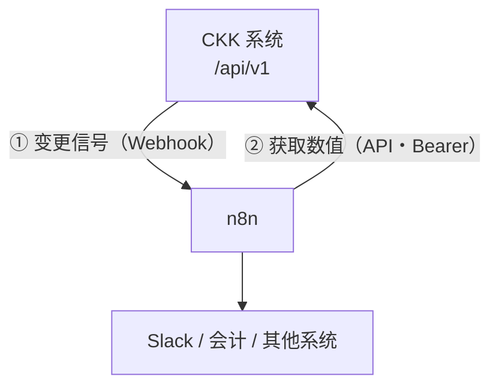

这是与 n8n 等外部系统集成的入口。**连接处理放在 n8n 一侧，本系统只开放两个入口。**

## 两个入口的分工

| 想做的事 | 使用 | 详情 |
| --- | --- | --- |
| **立即**知道发生了变化 | **Webhook**（本系统 → n8n） | [Webhook](/manual/zh/integration/webhooks) |
| 读取业务数据的**数值** | **API**（n8n → 本系统） | [API](/manual/zh/integration/api) |
| 漏收 Webhook 后补上 | **API 增量同步**（`updatedSince`） | [API](/manual/zh/integration/api) |
| 在 n8n 中实际搭建 | n8n 配方 | [与 n8n 配合](/manual/zh/integration/n8n) |

## 设计思路

- **Webhook 是信号，不是内容。** 只发送“订单确认书 `ORD-202609-00042` 的状态从 `DRAFT` 变为 `CONFIRMED`”，**不发送**金额、地址等**数值**。数值由接收方通过 API 重新获取。因此授权、行范围与输出格式只保留在 **API 这一处**，Webhook 不会成为第二个信息泄露口。
- **Webhook 允许丢失。** 无论漏收、乱序还是重复，都可以通过 API 增量同步补上。Webhook 是“尽快察觉的捷径”，API 才是“准确来源”。
- **权限使用 API 客户端的权限。** 每个接收地址绑定一个 API 客户端，**仅发送该客户端有权读取的资源的事件**。移除权限后，即使不删除接收地址，发送也会停止。
- **只发往 n8n 可达的位置。** 接收地址只能是 https，或内部主机（Docker 服务名、私有 IP、`.loc`）的 http。

## 目前可以与不可以

- ✅ 读取 API（`/api/v1`）与出站 Webhook。
- ❌ 尚未开放让 n8n **写入**业务数据的入口（待整理业务规则以便 API 共用后再开放）。从 n8n 投入订单 PDF 另有入口（[订单导入](/manual/zh/operations/system/order-intake/user)）。
- ⚠️ 该功能目前**仅限验证环境（dev）**使用。

## 开始的顺序

1. 在 [API 客户端](/manual/zh/operations/system/external-api/user)（`SY0I`）中为 n8n 创建客户端，分配角色并签发令牌。
2. 在同一画面的“出站 Webhook”中登记 n8n 的 Webhook URL。
3. 按 [与 n8n 配合](/manual/zh/integration/n8n) 的步骤搭建接收端。
