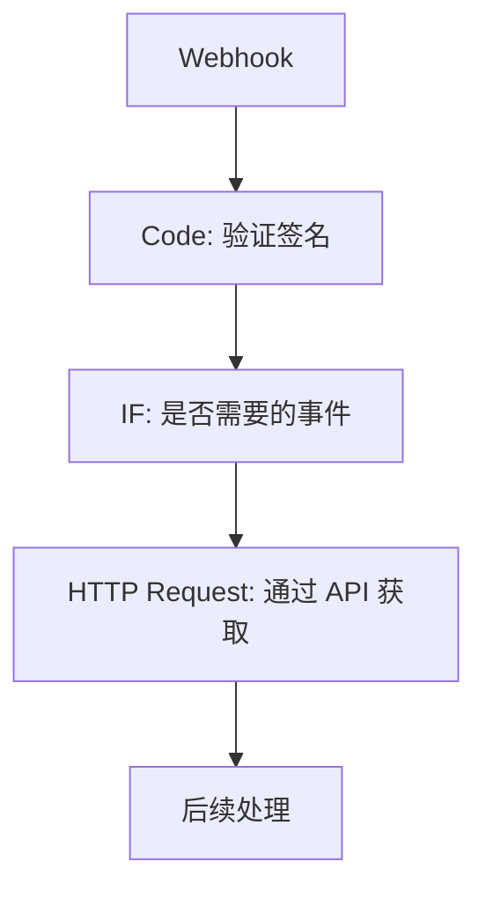
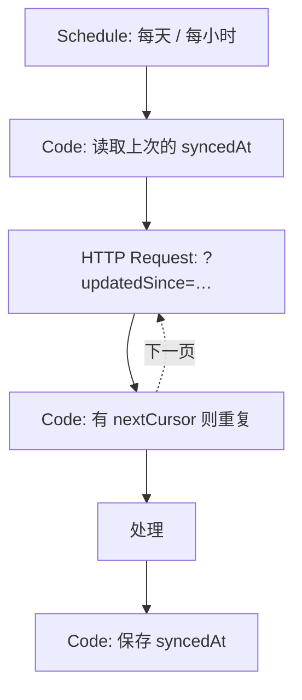

在 n8n 中实际搭建[集成总览](/manual/zh/integration)所述结构的步骤。

## 需要准备的内容

| 准备项 | 位置 |
| --- | --- |
| API 客户端（已分配角色、已启用、已签发令牌） | [API 客户端](/manual/zh/operations/system/external-api/user)（`SY0I`）与用户管理（`SY01`） |
| n8n 的 **Header Auth 凭据**（`Authorization: Bearer <令牌>`） | n8n 的 Credentials |
| 签名密钥（`whsec_…`） | 登记 Webhook 时只显示一次 |

**角色只需按要读取的资源分配**（例如要接收订单确认书的信号，就需要 `order_acceptance:READ`）。未分配的资源的事件不会发送。

## 配方 1 — 接收信号并获取数值



1. **Webhook 节点**：方法 `POST`，路径使用难以猜测的值。在 Options 中开启 **Raw Body**，**Respond** 选“Immediately”（立即返回 200）。把此 **Production URL** 登记到 CKK 的“出站 Webhook”中（与 n8n 在同一 Docker 网络时可使用 `http://n8n:5678/webhook/…`）。
2. **Code 节点**（验证签名）：

```js
// n8n 的 Code 节点（“对所有项目运行一次”）。
// 前提：Webhook 节点 Options → 开启“Raw Body”，并设置环境变量 NODE_FUNCTION_ALLOW_BUILTIN=crypto
const crypto = require("crypto");

const item = $input.first();
const raw = (await this.helpers.getBinaryDataBuffer(0, "data")).toString("utf8");
const h = item.json.headers;
const secret = $env.CKK_WEBHOOK_SECRET; // 将 whsec_… 放入 n8n 的环境变量

const key = Buffer.from(secret.replace(/^whsec_/, ""), "base64");
const expected = crypto
  .createHmac("sha256", key)
  .update(`${h["webhook-id"]}.${h["webhook-timestamp"]}.${raw}`)
  .digest("base64");

const ok = (h["webhook-signature"] ?? "")
  .split(" ")
  .some((s) => s === `v1,${expected}`);
const fresh = Math.abs(Date.now() / 1000 - Number(h["webhook-timestamp"])) < 300;

if (!ok || !fresh) throw new Error("invalid webhook signature");
return [{ json: JSON.parse(raw) }];
```

   > 不同 n8n 版本获取原始请求体的方式不同。若无法运行，请确认 Webhook 节点的输出中是否有二进制数据。**若省略验证，请使 URL 无法猜测，并把 n8n 限制在内网**（不推荐）。
3. **IF 节点**：`{{ $json.type }}` 是否为需要的事件（例如 `order_acceptance.status_changed` 且 `status.to == CONFIRMED`）。
4. **HTTP Request 节点**：认证选 Header Auth，URL 为 `https://app-dev.ckk-tool.co.jp{{ $json.links.list }}`。从响应的 `data` 中选出 `number` 等于 `{{ $json.resource.id }}` 的行。数值到这一步才第一次收到。

需要去重时，把 `{{ $json.id }}` 记录到 n8n 的 Data Store（或数据库）中，已存在则停止。

## 配方 2 — 补回漏掉的内容（定时）

用 API 增量同步补上 Webhook 未到达、或 n8n 停机期间的数据。



- 把 `syncedAt` 保存在工作流的 **Static Data**（`$getWorkflowStaticData('global')`）中。
- 处理要做成**幂等**，会与配方 1 重复收到同样的行。
- 删除记录需另外运行 `GET /api/v1/deletions?sinceEventId=`。

## 关于写入

目前还没有让 n8n **创建或修改**业务数据的入口。如果只是递交订单 PDF 让系统导入，可使用[订单导入](/manual/zh/operations/system/order-intake/user)（`SY0C`）的外部投入口。

## 无法正常工作时

| 现象 | 检查 |
| --- | --- |
| “测试发送”失败 | 画面通知中的原因。若为 `resolved to a blocked address`，说明域名解析到了被禁止的目的地（如回环地址） |
| 什么都收不到 | “发送记录”里有没有记录？没有的话检查**订阅的事件**和 API 客户端的角色（`GET /api/v1/me` 中的权限代码） |
| 签名不一致 | 是否使用了原始请求体（解析后的 JSON 无法匹配）？是否重新签发过签名密钥？时钟是否偏差超过 5 分钟？ |
| 接收地址被停用 | 连续 5 次被放弃会自动停用。修复后重新启用（需批准） |
| 到达稍晚 | 属于设计（数秒到十几秒）。不需要实时的话没有问题 |
