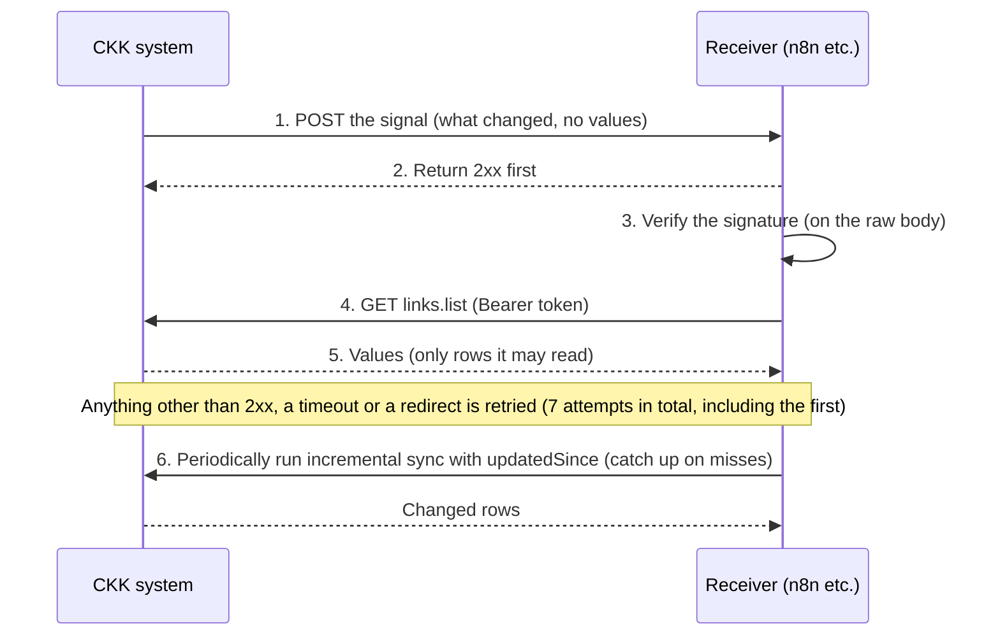

When business data changes, the system POSTs a **signal about what happened** to the URL you registered. The event list and shapes are in the **[reference (Webhooks)](/manual/en/integration/reference/webhooks)** — generated from the code, so it always matches the implementation.

> ⚠️ Currently available **only in the verification environment (dev)**.

The flow from receiving a signal to reading the values, as a diagram:



## Registering

1. Open [API Clients](/manual/en/operations/system/external-api/user) (`SY0I`) and press "New" in the "**Outbound webhooks**" section below.
2. Choose a name, the API client, the endpoint URL and the events you want, then save.
3. **The signing secret (`whsec_…`) is shown exactly once.** Copy it now — it cannot be shown again (if you lose it, use "Rotate signing secret").
4. Press "**Send test**" to check connectivity (one `webhook.ping` is sent).

Adding an endpoint, changing its URL, rotating its secret and enabling it need approval through [Privileged Access](/manual/en/operations/system/privileged-access/user) (`SY0G`), because they open a path for data to leave. Disabling, deleting, test sends and redelivering failures need no approval.

### Endpoint URL rules

- `https://` works for any host. `http://` is allowed only for **internal** hosts (Docker service names, `10.x`, `172.16–31.x`, `192.168.x`, `.loc` / `.local` / `.internal`).
- Loopback and link-local addresses (including the cloud metadata address `169.254.169.254`) are refused. The name is resolved again right before sending and checked there too.
- No `user:pass@` in the URL. **Redirects are not followed** (a 3xx counts as a failure).
- An n8n webhook URL is **itself a secret**, so the list hides its path.

## What arrives

```http
POST /webhook/ckk HTTP/1.1
content-type: application/json
webhook-id: evt_1234_order_acceptance.status_changed
webhook-timestamp: 1789000000
webhook-signature: v1,K5oZfzN95Z9UhFK…=
```

```json
{
  "id": "evt_1234_order_acceptance.status_changed",
  "type": "order_acceptance.status_changed",
  "apiVersion": "v1",
  "occurredAt": "2026-09-10T04:11:52.881Z",
  "resource": {
    "type": "order_acceptance",
    "id": "ORD-2026-00042",
    "key": "CKK/ORD-2026-00042"
  },
  "status": { "from": "DRAFT", "to": "CONFIRMED" },
  "links": {
    "list": "/api/v1/order-acceptances?updatedSince=2026-09-10T04%3A11%3A51.881Z"
  }
}
```

- `id` / `webhook-id` are **identical on every retry** — use them to deduplicate.
- `changedFields` appears only on `.updated` and holds **field names only** (no values). `status` appears only on `.status_changed`.
- `resource.id` is the document number you see on screen. **The same number can exist under another issuing company**, so `resource.key` (`<company code>/<document number>`) is provided too — match on that (see [Document number rules](/manual/en/start#doc-number)).
- To get the row itself, GET `links.list` with the API client's token.

### Event types

`<resource>.created` / `.updated` / `.deleted`, plus `.status_changed` for resources that have a status (it is sent **in addition to** `.updated`). See the reference for the full list. You can also subscribe to `*` (all).

## Verifying the signature

Signatures are [Standard Webhooks](https://www.standardwebhooks.com/)-compatible. Libraries exist for many languages, so **we recommend using one rather than writing your own**.

```python
# pip install standardwebhooks
from standardwebhooks.webhooks import Webhook

wh = Webhook("whsec_…")          # the signing secret shown once on screen
payload = wh.verify(raw_body, headers)   # raises on mismatch
```

If you write it yourself, there are three steps. **Verify against the raw body, before parsing.**

1. Check that `webhook-timestamp` is within 5 minutes.
2. HMAC-SHA256 of `webhook-id` + `.` + `webhook-timestamp` + `.` + raw body, with the key (the part after `whsec_`, Base64-decoded).
3. Base64-encode it and compare with `v1,<value>` (`webhook-signature` may contain several values separated by spaces).

```js
import { createHmac, timingSafeEqual } from "node:crypto";

// rawBody is the **string (bytes) before parsing**. A value re-serialised with JSON.parse → stringify will not match.
export function verifyWebhook(rawBody, headers, secret) {
  const id = headers["webhook-id"];
  const ts = headers["webhook-timestamp"];
  const signatures = (headers["webhook-signature"] ?? "").split(" ");
  if (!id || !ts) return false;

  // Discard anything more than 5 minutes old / in the future as a replay attack
  if (Math.abs(Date.now() / 1000 - Number(ts)) > 300) return false;

  const key = Buffer.from(secret.replace(/^whsec_/, ""), "base64");
  const expected = createHmac("sha256", key)
    .update(`${id}.${ts}.${rawBody}`)
    .digest();

  return signatures.some((s) => {
    const [version, b64] = s.split(",");
    if (version !== "v1" || !b64) return false;
    const got = Buffer.from(b64, "base64");
    return got.length === expected.length && timingSafeEqual(got, expected);
  });
}
```

## Delivery guarantees

- Delivered **at least once** (duplicates happen). Order is **not guaranteed**. Deduplicate on `webhook-id` and do not depend on ordering.
- **Any 2xx is success.** Anything else, a timeout (10 s) or a redirect is a failure and is **retried**: 30 s → 2 min → 10 min → 1 h → 6 h → 24 h (7 attempts in total, including the first).
- **Respond first** and do heavy work afterwards.
- A delivery that fails all 7 attempts stops as "failed" and can be **redelivered** from the "**Deliveries**" panel.
- An endpoint with **5 consecutive exhausted deliveries is disabled automatically**. After fixing it, enable it again from the screen (needs approval).
- Events arrive a **few seconds after** the change (this avoids a window where commit order and id order differ).
- Delivery records are deleted after 30 days.

## Permissions and secrets

- Only events for resources the bound API client holds `…:READ` on are sent. This is **checked at every send**, so removing the permission stops delivery.
- The body names the document but **carries no values**. However, row-level scope (for example "only documents I created") is not applied to events, so the **number and type** of a document you could not otherwise see may appear. For resources where row visibility must be strict, do not subscribe — read them through **API incremental sync only** (the API returns only rows within scope).
- Signing secrets are stored encrypted (`SETTINGS_ENCRYPTION_KEY`) and the screen shows only the last 4 characters. Endpoints cannot be created in an environment without the key.
- If in doubt, "Rotate signing secret". The old secret stops working **immediately**.

## Catching up on misses

Webhooks are a shortcut. Run **API incremental sync** (`updatedSince`) once a day or so to pick up anything you missed ([API](/manual/en/integration/api)).
