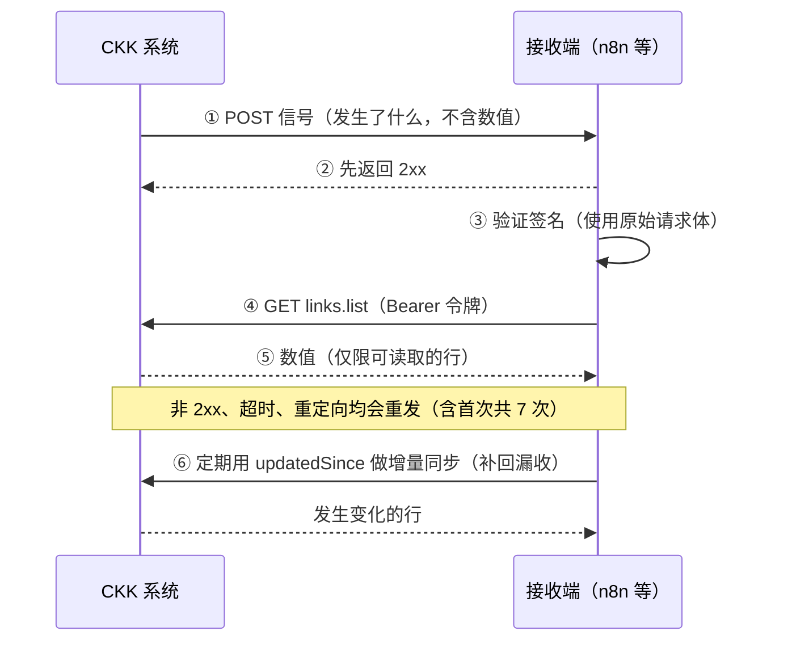

业务数据发生变化时，系统会向已登记的 URL POST 一条**“发生了什么”的信号**。事件列表与格式见 **[参考（Webhooks）](/manual/zh/integration/reference/webhooks)**（由代码自动生成，始终与实现一致）。

> ⚠️ 目前**仅限验证环境（dev）**使用。

从收到信号到读取数值的流程，用图表示如下。



## 登记

1. 打开 [API 客户端](/manual/zh/operations/system/external-api/user)（`SY0I`），在下方“**出站 Webhook**”中点击“新建”。
2. 选择名称、API 客户端、接收地址 URL 和所需事件后保存。
3. **签名密钥（`whsec_…`）只显示一次。** 请务必保存（无法再次显示，丢失后请“重新签发签名密钥”）。
4. 点击“**测试发送**”确认连通（会发送一条 `webhook.ping`）。

添加接收地址、更改 URL、重新签发签名密钥和启用，需要通过 [特权访问](/manual/zh/operations/system/privileged-access/user)（`SY0G`）获得批准，因为这些操作会增加数据外流的通道。停用、删除、测试发送以及重发失败项无需批准。

### 接收地址 URL 的规则

- `https://` 可用于任何主机。`http://` 仅限**内部**（Docker 服务名、`10.x`、`172.16–31.x`、`192.168.x`、`.loc` / `.local` / `.internal`）。
- 禁止回环地址和链路本地地址（包括云元数据地址 `169.254.169.254`）。发送前会再次解析域名并在此检查。
- URL 中不能包含 `user:pass@`。**不跟随重定向**（3xx 视为失败）。
- n8n 的 Webhook URL **本身就是机密**，因此列表中隐藏其路径。

## 收到的内容

```http
POST /webhook/ckk HTTP/1.1
content-type: application/json
webhook-id: evt_1234_order_acceptance.status_changed
webhook-timestamp: 1789000000
webhook-signature: v1,K5oZfzN95Z9UhFK…=
```

```json
{
  "id": "evt_1234_order_acceptance.status_changed",
  "type": "order_acceptance.status_changed",
  "apiVersion": "v1",
  "occurredAt": "2026-09-10T04:11:52.881Z",
  "resource": {
    "type": "order_acceptance",
    "id": "ORD-2026-00042",
    "key": "CKK/ORD-2026-00042"
  },
  "status": { "from": "DRAFT", "to": "CONFIRMED" },
  "links": {
    "list": "/api/v1/order-acceptances?updatedSince=2026-09-10T04%3A11%3A51.881Z"
  }
}
```

- `id` / `webhook-id` 在**重发时保持不变**，用于接收端去重。
- `changedFields` 仅在 `.updated` 时出现，且**只有字段名**（不含数值）。`status` 仅在 `.status_changed` 时出现。
- `resource.id` 是与画面一致的单据编号。**同一编号可能同时存在于另一家开具公司**，因此同时提供带公司代码的 `resource.key`（`<公司代码>/<单据编号>`），匹配时请使用它（编号规则见[单据编号规则](/manual/zh/start#doc-number)）。
- 需要数据本身时，用 API 客户端的令牌 GET `links.list`。

### 事件类型

`<资源>.created` / `.updated` / `.deleted`，带状态的资源还有 `.status_changed`（与 `.updated` **同时**发送）。完整列表见参考。也可以订阅 `*`（全部）。

## 验证签名

签名与 [Standard Webhooks](https://www.standardwebhooks.com/) 兼容。各语言都有验证库，**建议直接使用而不要自己写**。

```python
# pip install standardwebhooks
from standardwebhooks.webhooks import Webhook

wh = Webhook("whsec_…")          # 画面上仅显示一次的签名密钥
payload = wh.verify(raw_body, headers)   # 不一致时抛出异常
```

自己实现时有三个步骤。**验证对象是解析之前的原始请求体。**

1. 确认 `webhook-timestamp` 在 5 分钟以内。
2. 对 `webhook-id` + `.` + `webhook-timestamp` + `.` + 原始请求体，用密钥（去掉 `whsec_` 后做 Base64 解码）计算 HMAC-SHA256。
3. 转为 Base64，与 `v1,<值>` 比较（`webhook-signature` 可能包含多个以空格分隔的值）。

```js
import { createHmac, timingSafeEqual } from "node:crypto";

// rawBody 是**解析之前的字符串（字节序列）**。经 JSON.parse → stringify 重新生成的值无法匹配。
export function verifyWebhook(rawBody, headers, secret) {
  const id = headers["webhook-id"];
  const ts = headers["webhook-timestamp"];
  const signatures = (headers["webhook-signature"] ?? "").split(" ");
  if (!id || !ts) return false;

  // 比当前时间早 / 晚超过 5 分钟的请求视为重放攻击并丢弃
  if (Math.abs(Date.now() / 1000 - Number(ts)) > 300) return false;

  const key = Buffer.from(secret.replace(/^whsec_/, ""), "base64");
  const expected = createHmac("sha256", key)
    .update(`${id}.${ts}.${rawBody}`)
    .digest();

  return signatures.some((s) => {
    const [version, b64] = s.split(",");
    if (version !== "v1" || !b64) return false;
    const got = Buffer.from(b64, "base64");
    return got.length === expected.length && timingSafeEqual(got, expected);
  });
}
```

## 发送保证

- **至少送达一次**（可能重复）。**不保证顺序**。请用 `webhook-id` 去重，并让处理不依赖顺序。
- **返回任意 2xx 即成功。** 其他状态、超时（10 秒）、重定向均视为失败并**重发**：30 秒 → 2 分钟 → 10 分钟 → 1 小时 → 6 小时 → 24 小时（含首次共 7 次）。
- 请**先返回响应**，再做耗时处理。
- 7 次均失败的发送会停在“失败”，可在画面的“**发送记录**”中**重发**。
- **连续 5 次发送被放弃的接收地址会被自动停用。** 修复后在画面中重新启用（需批准）。
- 事件会在变更后**延迟数秒**到达（用于避开提交顺序与编号顺序不一致的时间窗）。
- 发送记录保留 30 天。

## 权限与机密

- 仅发送所绑定的 API 客户端持有 `…:READ` 的资源的事件。**每次发送时都会检查**，因此移除权限即可停止。
- 请求体只指出是哪张单据，**不含数值**。但行级范围（例如“只有自己创建的单据”）不会应用于事件，因此原本看不到的单据的**编号和类型**可能出现在事件中。对必须严格限制行可见性的资源，请不要订阅 Webhook，**只通过 API 增量同步读取**（API 只返回范围内的行）。
- 签名密钥加密保存（`SETTINGS_ENCRYPTION_KEY`），画面只显示末 4 位。没有该密钥的环境无法创建接收地址。
- 有疑虑时请“重新签发签名密钥”。旧密钥**立即**失效。

## 补回漏掉的内容

Webhook 只是捷径。建议每天运行一次左右的 **API 增量同步**（`updatedSince`）来补回漏收的内容（[API](/manual/zh/integration/api)）。
