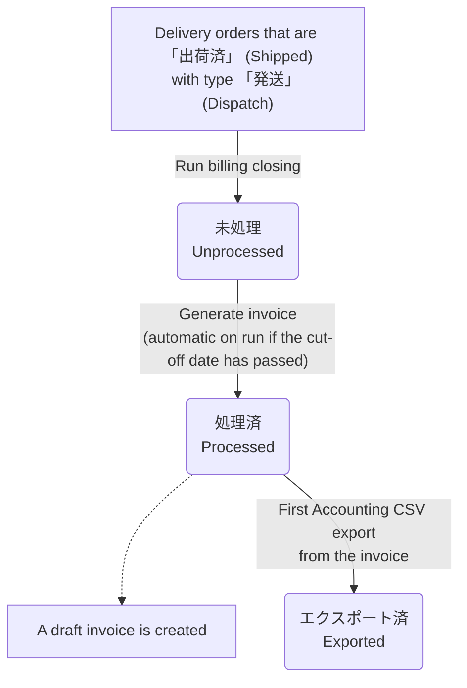
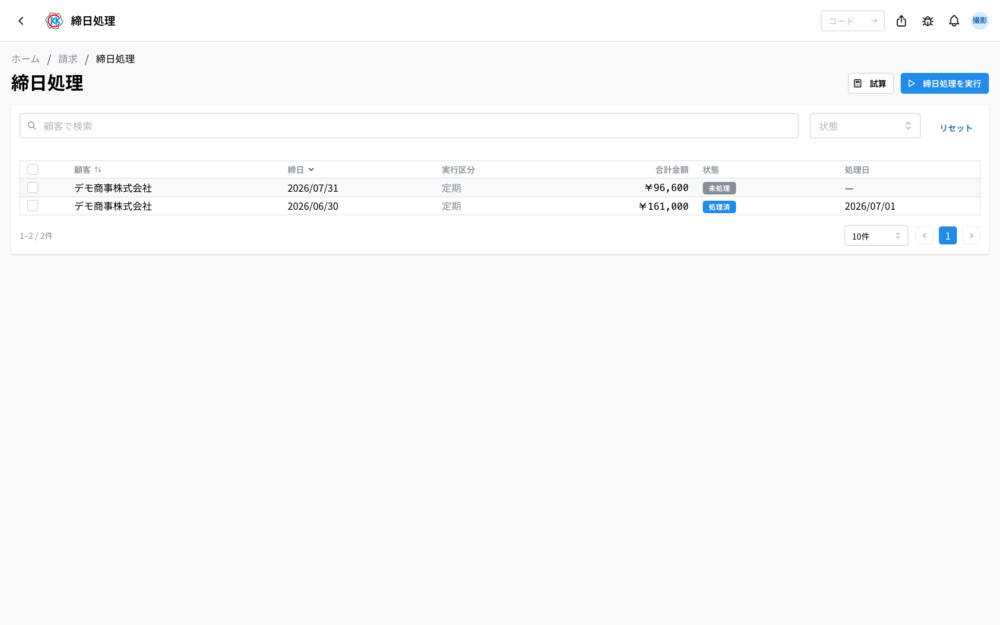
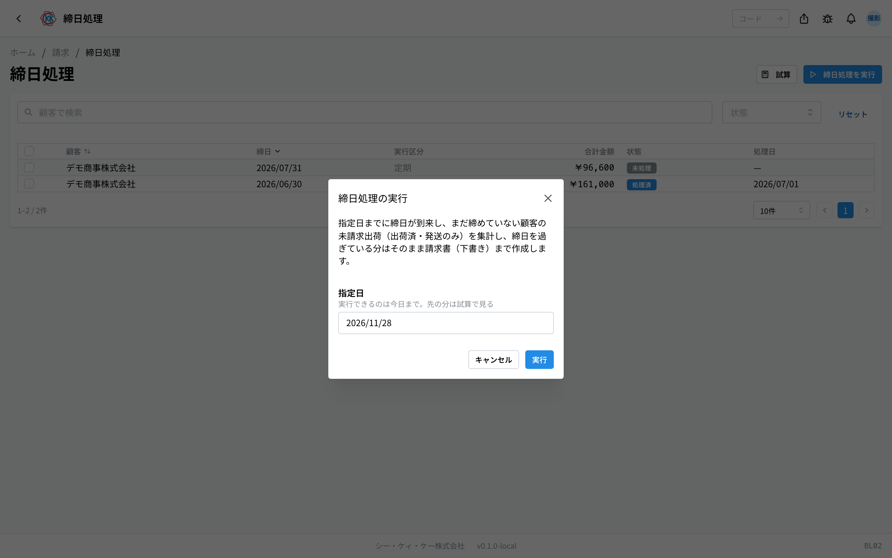
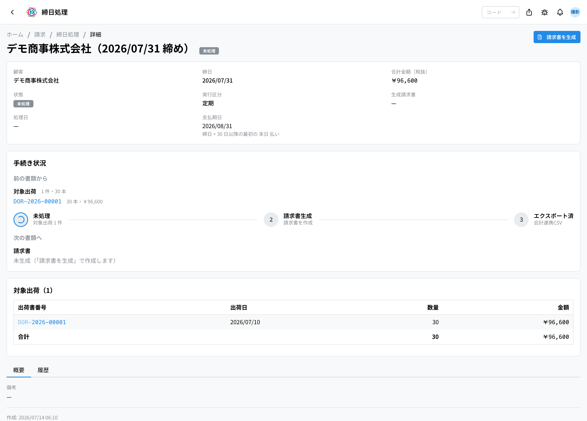
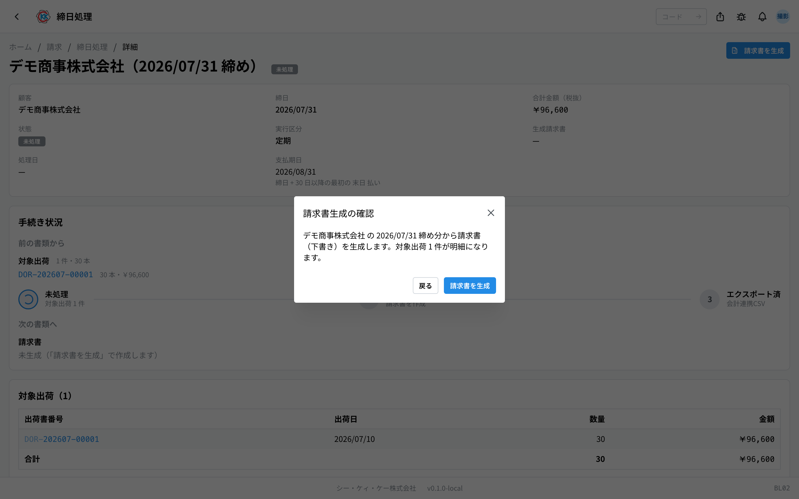
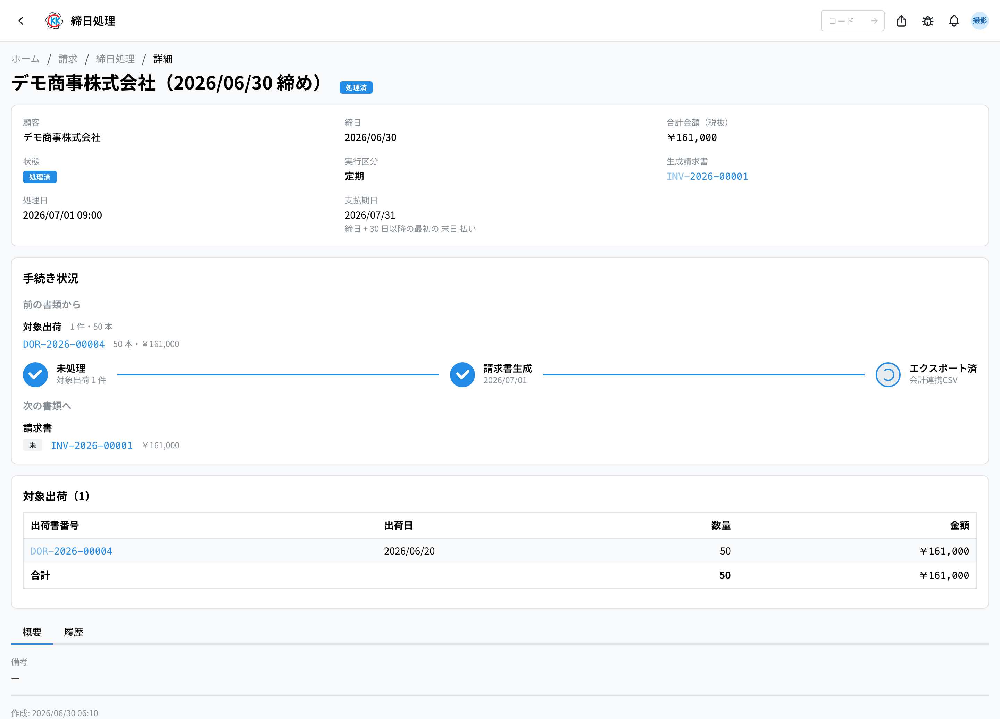

Once a month, this app gathers "everything sent that month" for each customer and prepares the basis for their [invoice](/manual/en/operations/billing/invoice/user). The operation code is `BL02`.

> ⚠️ This app is still being prepared. Screens and steps may change before it is fully released.

> This app belongs to … [Billing flow](/manual/en/process/billing)

## What you can do with this app

- Add up, **grouped by customer**, what was sent by every customer whose cut-off date has come by the date you choose. Where the cut-off date has already passed, a draft [invoice](/manual/en/operations/billing/invoice/user) is made right away.
- Before running it, use 「**試算**」 (Simulate) to see what a run on that date would produce (nothing is saved).
- Check the result (which delivery order was worth how much).
- Turn unprocessed closes into invoices one at a time, or select several and do them together.

Every month, the billing work starts in this app.

As a diagram:

## Words used on this page

- **締日 (cut-off date)** … The monthly cut-off date for billing you agreed on: "everything sent up to this day of the month is billed together". For example, "month-end" means everything up to the last day of that month.
- **締日処理 (monthly billing close)** … The work of adding up what was sent, using the cut-off date as the dividing line.
- **未請求 (not yet billed)** … A shipment that is not yet on any invoice.
- **対象出荷 (shipments included)** … The list of delivery orders gathered into that close.
- **合計金額（税抜） (total before tax)** … The total before consumption tax. The tax is added when the invoice is made.

## Before you start

- Only [delivery orders](/manual/en/operations/shipping/delivery-order/user) that are **「出荷済」 (Shipped) and of type 「発送」 (Dispatch)** are added up. Delivery orders still at 「下書き」 (Draft) or 「確定」 (Confirmed) are not included. Please record the shipment first.
- Each customer's cut-off date comes from the registered details of the [customer](/manual/en/operations/masters/business-partner/user). Customers with nothing set are gathered as **month-end**.
- You need monthly billing close permission to run it. If you cannot use it, please ask your administrator.

> ⚠️ Delivery orders of type 「**在庫保管**」 (Keep in stock) are pieces kept in-house, not sent to the customer, so they are not added up. They are not billed either.

## How to read the screen

When you open the app, you see a list of the closes done so far. One row is "one customer's close for one month".

- **顧客 (Customer)** … Which customer the close is for.
- **締日 (Cut-off date)** … The dividing date for that close.
- **合計金額 (Total)** … The amount gathered into that close.
- **状態 (Status)** … Grey is 「未処理」 (Not processed — no invoice made yet), blue is 「処理済」 (Processed — invoice made), green is 「エクスポート済」 (Exported — the accounting CSV for its invoice has been exported).
- **実行区分 (Run type)** … 「手動」 (Manual) is a close run from the screen; 「定期」 (Scheduled) is one made by the daily automatic run.
- In the search box at the top you can type a customer name to narrow the list.
- If you handle documents of two or more of our companies, a small badge with the company code (for example `TSP`) appears next to the customer name ([company badge](/manual/en/operations/masters/own-company/user#company-badge)).
- Click a row to open the detail screen for that close.

## Running the monthly billing close

1. Press 「**締日処理を実行**」 (Run monthly billing close) at the top right of the list screen.
2. A small window called 「締日処理の実行」 (Run monthly billing close) appears.
3. Choose the 「**指定日**」 (Date). It starts with today's date. **You can pick up to today only** (check later dates with 「試算」 (Simulate)).
4. Press 「**実行**」 (Run).

Every customer whose cut-off date has come by that date and who has not been closed yet is added up. **Where the cut-off date has already passed, a draft invoice is made on the spot** and the row becomes 「**処理済**」 (Processed). A close whose cut-off date is exactly that date stays 「**未処理**」 (Not processed) and can be invoiced from the next day.

When it finishes, 「締日処理の結果」 (Billing closing result) appears. It shows a count such as "作成 2 件 / 更新 1 件" (2 created / 1 updated) and the list of invoices made (customer and amount), which you can open from there. Anything that could not be made is listed with the reason.

> 💡 You can run it as many times as you like for the same date. Rows that already have an invoice stay as they are, and only the remaining rows are updated to the latest amounts. Nobody gets billed twice.

Depending on your company's settings, everything up to that day may already be closed by itself every morning between 6 and 7 (rows whose 「実行区分」 (Run type) is 「定期」 (Scheduled)). Even then, it is fine to run the steps above again.

## Simulating

To find out in advance "how much will be billed at the next cut-off", press 「**試算**」 (Simulate) at the top right of the list screen.

1. Choose the 「**指定日**」 (Date). **Future dates are allowed.**
2. Press 「**試算**」 (Simulate).

You see which customers, shipments and amounts would close if you ran it on that date, and whether an invoice would be made too (「請求書まで作成」 (Invoice created) / 「翌日から生成」 (Generated from the next day)). **A simulation saves nothing.**

> ⚠️ Only shipments that are unbilled right now are counted. Shipments that will be made between now and that date are not included.

## Checking what was gathered

Click a close row in the list to open the detail screen.

- At the top you see the customer, cut-off date, total before tax, status, run type, generated invoice, processed date, bill-to, and payment due date. Once an invoice is made, 「**生成請求書**」 (Generated invoice) becomes a link to it.
- The 「**対象出荷**」 (Shipments included) table lists the gathered delivery orders one per row (delivery order number, shipping date, quantity, amount).
- Click the blue delivery order number to open that [delivery order](/manual/en/operations/shipping/delivery-order/user) and check its contents.
- At the bottom of the table you see the totals for quantity and amount.

If an amount is not what you expected, please check it here before making the invoice.

Below the table there are two tabs. 「**概要**」 (Overview) shows the notes, and 「**履歴**」 (History) shows who moved this close along and when.

## Making the invoice

1. Open the detail screen of the close.
2. Press 「**請求書を生成**」 (Generate invoice) at the top right.
3. 「請求書生成の確認」 (Generate invoice check) appears. Check how many shipments are included.
4. Press 「**請求書を生成**」 (Generate invoice).

A draft invoice is made, and you go straight to the [invoice](/manual/en/operations/billing/invoice/user) screen. The consumption tax and the payment due date are filled in for you from the customer's registered details.

The close row becomes 「**処理済**」 (Processed), and from the 「**生成請求書**」 (Generated invoice) box you can open that invoice at any time.

「請求書を生成」 (Generate invoice) appears only for closes that are **not processed and whose cut-off date has passed** (from the day after the cut-off date).

> 💡 When there are many, tick the rows in the list and press 「**まとめて請求書を生成**」 (Generate invoices in bulk). Rows that are not unprocessed or whose cut-off date has not passed are left out, and their count is shown in the result. If one customer fails, the other customers' invoices are still made.

After this, recording the issue, the sending, and the payment — and making the file for the accounting software — is done in the [invoice](/manual/en/operations/billing/invoice/user) app. When that invoice's accounting CSV is exported for the first time, the close row becomes 「**エクスポート済**」 (Exported).

## Input fields

This screen has no input boxes. What to close and for which dates follows **the closing day set per customer.**

| Action | What happens |
|--------|--------------|
| [Close](#field-process) | Gathers the period's shipments and creates invoices |

### Close [#field-process]

Gathers what was shipped in the period (「発送」 dispatch delivery orders that became 「出荷済」 shipped) and creates **one invoice per customer.** When two or more companies issue documents ([own companies](/manual/en/operations/masters/own-company/user)) and the shipments of the period span more than one of them, the invoices are split into **one per company** (one invoice can print only one issuer).

Before closing, check that every shipment in the period has been recorded. **A shipment added afterwards does not join a closed invoice** — it moves to the next period.

The CSV export for the accounting software (TKC FX4 Cloud) is done **per invoice**, not on this screen. This screen has no export button (the 「エクスポート済」 (Exported) step in the progress panel only shows whether it has been exported). On the screen of an issued [invoice](/manual/en/operations/billing/invoice/user), choose 「**会計連携CSV**」 (Accounting CSV) from the 「**…**」 at the top right. The first export moves that close to 「**エクスポート済**」 (Exported).

## Questions and problems

**Q. I get 「指定日までに未請求の出荷がありません」 (There are no unbilled shipments up to the date).**
A. Customers whose cut-off date has come by that date have no shipment that has not been billed yet. Check that the delivery orders are all 「出荷済」 (Shipped) and that the type is 「発送」 (Dispatch).

**Q. I get 「未来の日付では実行できません」 (Cannot run for a future date).**
A. The monthly billing close can be run up to today only. Check later cut-off dates with 「**試算**」 (Simulate).

**Q. I get 「締日を過ぎるまで処理できません」 (Cannot process until the cut-off date has passed).**
A. Invoices can be made from the day after the cut-off date. Try again then (if the daily automatic run is on, it is made by itself).

**Q. I shipped this month, but it is not in the close.**
A. Anything sent **after** the cut-off date goes into the next close, not this one. Also, a delivery order that is not 「出荷済」 (Shipped) is not added up.

**Q. I get 「請求対象の出荷がありません」 (There are no shipments to bill) and cannot make the invoice.**
A. The shipments included in that close are empty. Please run 「締日処理を実行」 (Run monthly billing close) again and then try once more.

**Q. I get 「未処理の締日のみ請求書を生成できます」 (Invoices can only be generated for closes that are not processed).**
A. An invoice has already been made from that close. Open the invoice from the 「生成請求書」 (Generated invoice) box and check it.

**Q. I made an invoice by mistake.**
A. There is no way to put a close row back to 「未処理」 (Not processed). Please talk to the accounting person in charge about what to do with the invoice that was made.

**Q. The cut-off date looks wrong for one customer only.**
A. Each customer's cut-off date comes from the registered details of the [customer](/manual/en/operations/masters/business-partner/user). Customers with nothing set become month-end. Fix the registered details and then run the monthly billing close again.

<!-- permissions:start -->
## Permissions required

Using this screen requires the **Billing closing** (`billing_closing`) permission.

| What you want to do | Permission needed |
| --- | --- |
| Open the screen, view lists and details | Billing closing — View |
| Add, change or delete | Billing closing — Create / Edit / Delete |

Viewing only needs *View*. Where a screen offers adding, changing or deleting, each of those needs its matching permission.

Permissions come through roles. If something is missing, ask an administrator.

For the whole picture see [Permissions and roles](../../../permissions).
<!-- permissions:end -->
