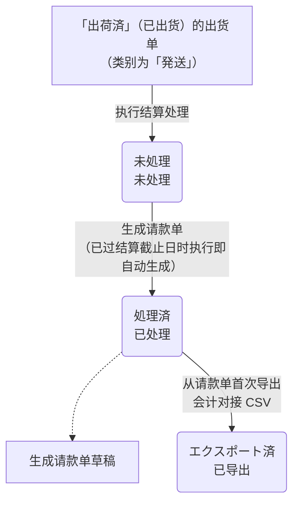
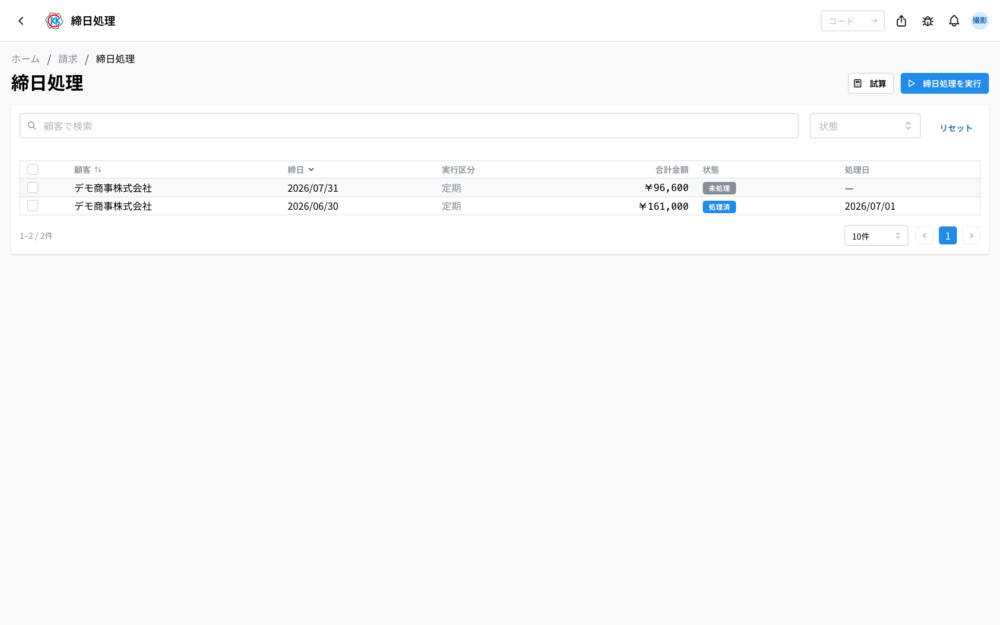
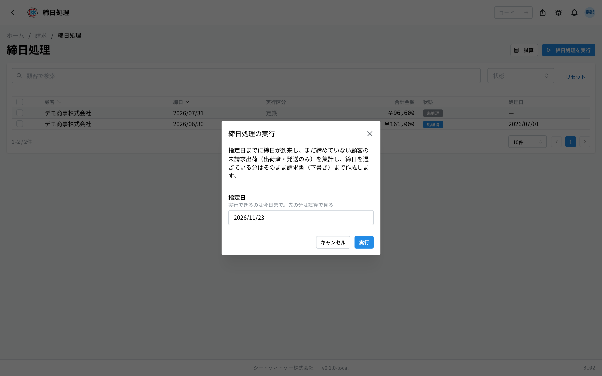
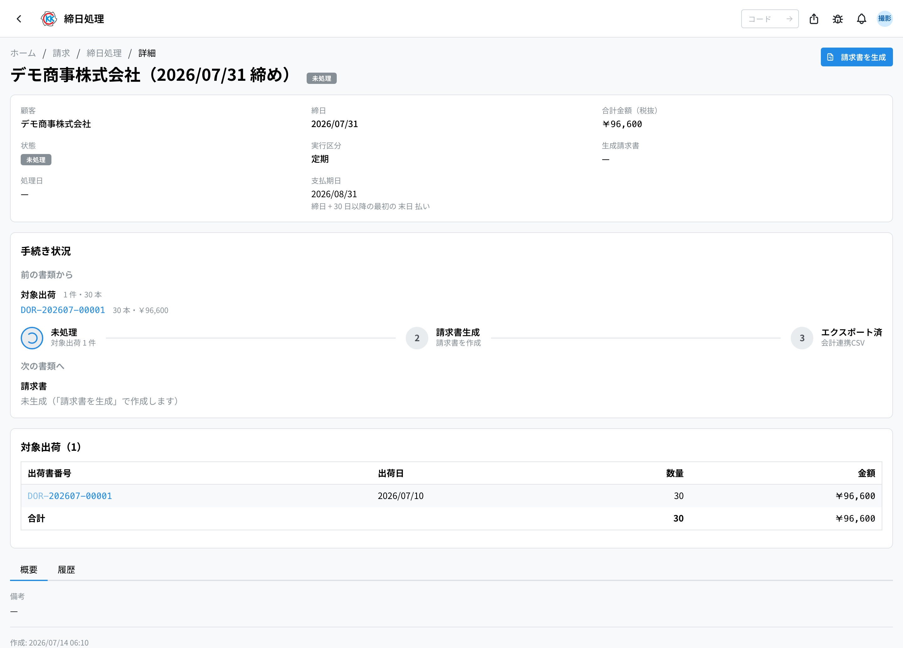
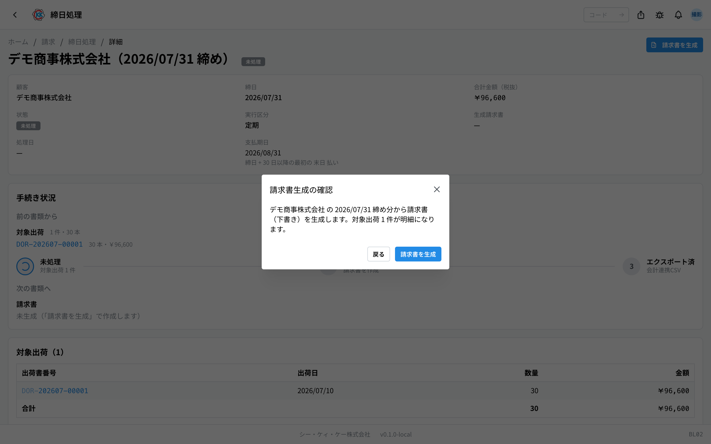
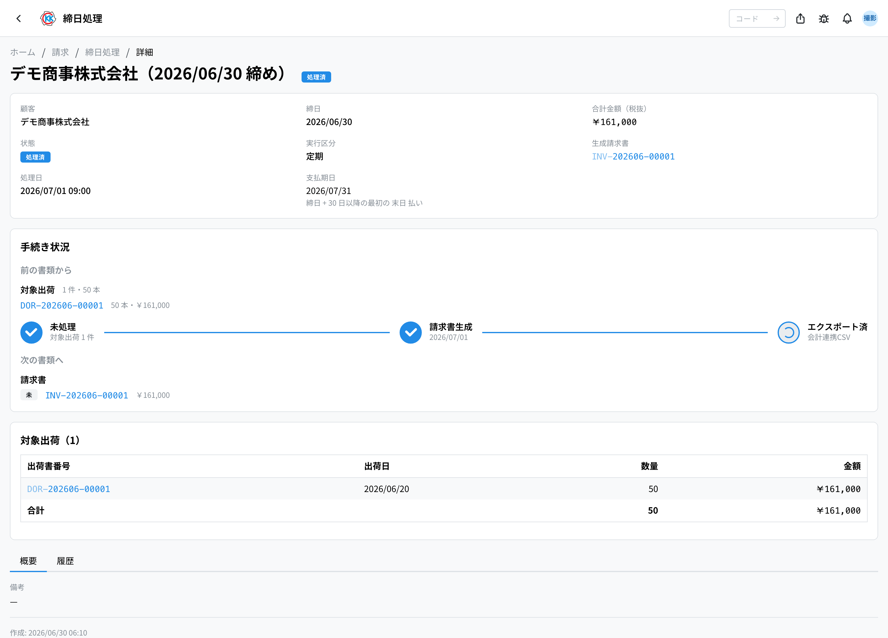

每月一次，按客户把「当月发出的部分」汇总起来，做出[请款单](/manual/zh/operations/billing/invoice/user)基础的应用。操作代码是 `BL02`。

> ⚠️ 本应用还在准备中。正式启用之前，界面和步骤可能会有变化。

> 本应用所属的流程……[请款流程](/manual/zh/process/billing)

## 本应用能做什么

- 可以把到指定日期为止已到结算截止日的客户的发货，**按客户分别汇总**。已过结算截止日的部分，会直接做出[请款单](/manual/zh/operations/billing/invoice/user)的草稿。
- 执行之前，可以用「**試算**」（试算）确认在那一天执行会得到什么结果（什么都不会保存）。
- 可以确认汇总的内容（哪张出货单是多少钱）。
- 未处理的结算可以逐件、或选中多件一起做成请款单。

每个月的请款工作，都从这个应用开始。

用图表示如下。

## 本页出现的词

- **締日（结算截止日）** … 约定好的每月请款分界日：「每月到这一天为止发出的部分合在一起请款」。比如「月末结算」，就是把到当月最后一天为止的部分汇总起来。
- **締日処理（结算处理）** … 以结算截止日为分界，把发出的部分汇总起来的作业。
- **未請求（未请款）** … 还没有进入任何一张请款单的发货。
- **対象出荷（对象出货）** … 这次结算所汇总的出货单一览。
- **合計金額（税抜）（合计金额（不含税））** … 加消费税之前的合计。消费税会在做请款单时加上。

## 开始之前

- 被汇总的，只有 **状态是「出荷済」（已出货）、类别是「発送」（发送）的**[出货单](/manual/zh/operations/shipping/delivery-order/user)。还停在「下書き」（草稿）「確定」（确定）的出货单不会算进去。请先完成发货记录。
- 每个客户的结算截止日，由[客户](/manual/zh/operations/masters/business-partner/user)的登记内容决定。没有设定的客户，按 **月末** 汇总。
- 做结算处理需要相应权限。如果不能用，请联系管理员。

> ⚠️ 类别是「**在庫保管**」（留库保管）的出货单，是没有发给客户、留在公司保管的部分，不会算进汇总，也不会请款。

## 界面怎么看

打开应用后，会看到以往的结算一览。一行就是「某个客户、某个月的结算」。

- **顧客（客户）** … 表示这是哪个客户的结算。
- **締日（结算截止日）** … 这次结算的分界日。
- **合計金額（合计金额）** … 这次结算汇总出的金额。
- **状態（状态）** … 灰色是「未処理」（未处理，还没做请款单），蓝色是「処理済」（已处理，已做请款单），绿色是「エクスポート済」（已导出，已导出该请款单的会计对接 CSV）。
- **実行区分（执行区分）** … 「手動」（手动）是从界面执行的结算，「定期」（定期）是每天早上自动执行做出的结算。
- 上面的搜索框里可以输入客户名称来筛选。
- 点一行就能打开这次结算的详细界面。

## 做结算处理

1. 点一览界面右上角的「**締日処理を実行**」（执行结算处理）。
2. 会弹出一个叫「締日処理の実行」（执行结算处理）的小窗口。
3. 选择「**指定日**」（指定日期）。一开始填的是今天的日期。**只能选到今天为止**（之后的日期请用「試算」（试算）确认）。
4. 点「**実行**」（执行）。

到指定日期为止已到结算截止日、还没结算的客户会全部被汇总。**已过结算截止日的部分，会当场做出请款单（草稿）**，行变成「**処理済**」（已处理）。结算截止日正好是指定日期的部分会以「**未処理**」（未处理）留下，从第二天起可以做成请款单。

结束后会弹出「締日処理の結果」（结算处理结果），显示「作成 2 件 / 更新 1 件」（新建 2 件 / 更新 1 件）这样的件数和做出的请款单一览（客户、金额），可以从那里打开请款单。没能做出的部分也会连同原因一起列出。

> 💡 同一个日期执行多少次都没关系。已经做过请款单的行会原样保留，只有还没做的行会更新成最新金额，不会重复请款。

根据公司的设置，每天早上 6 点多会自动结算到当天为止的部分（一览里「実行区分」（执行区分）是「定期」的行）。即使如此，按上面的步骤重做一遍也没有问题。

## 试算

想事先知道「下一个结算截止日会请款多少」时，点一览界面右上角的「**試算**」（试算）。

1. 选择「**指定日**」（指定日期）。**也可以选将来的日期。**
2. 点「**試算**」（试算）。

会列出在那一天执行时会结算的客户、出货和金额，以及是否会做到请款单（「請求書まで作成」（做到请款单）/「翌日から生成」（次日起生成））。**试算什么都不会保存。**

> ⚠️ 只计算现在还未请款的出货。从现在到指定日期之间新发出的部分不包括在内。

## 确认汇总的内容

从一览里点结算的行，就会打开详细界面。

- 上方会显示客户、结算截止日、合计金额（不含税）、状态。
- 「**対象出荷**」（对象出货）表里逐行列出被汇总的出货单（出货单号、发货日、数量、金额）。
- 点出货单号的蓝色文字，可以打开该[出货单](/manual/zh/operations/shipping/delivery-order/user)确认内容。
- 表格最下面会显示数量和金额的合计。

金额和预想的不一样时，请在做请款单之前先在这里确认。

表格下面有两个标签页。「**概要**」（概要）可以看备注，「**履歴**」（历史）可以看谁在什么时候推进了这次结算。

## 做请款单

1. 打开结算的详细界面。
2. 点右上角的「**請求書を生成**」（生成请款单）。
3. 弹出「請求書生成の確認」（生成请款单确认），确认对象出货有多少件。
4. 点「**請求書を生成**」（生成请款单）。

请款单的草稿会被做出来，并直接跳到[请款单](/manual/zh/operations/billing/invoice/user)界面。消费税和付款期限，会根据客户的登记内容自动填入。

结算的行会变成「**処理済**」（已处理），从「**生成請求書**」（生成的请款单）栏里，随时都能打开那张请款单。

只有**未处理、且已过结算截止日**的结算才会出现「請求書を生成」（生成请款单）（从结算截止日的第二天起）。

> 💡 件数多时，在一览里勾选行，点「**まとめて請求書を生成**」（批量生成请款单）。不是未处理的行和还没到结算截止日的行会被排除，件数显示在结果里。即使某个客户做不出来，其他客户的请款单也会照常做出。

之后的发行、寄送、收款记录，以及做出会计软件用的文件，都在[请款单](/manual/zh/operations/billing/invoice/user)应用里进行。首次导出那张请款单的会计对接 CSV 时，结算的行会变成「**エクスポート済**」（已导出）。

## 输入项

本画面没有输入框。结算对象与日期**根据各客户设定的结算日自动确定。**

| 操作 | 会发生什么 |
|------|-----------|
| [结算](#field-process) | 汇总该期间的发货并生成请求书 |

### 结算 [#field-process]

汇总该期间已出货的部分（已变为「出荷済」的「発送」出货单），**按客户各生成 1 份请求书。**

结算前请确认该期间的发货是否已全部记录。**事后追加的发货不会计入已结算的请求书** — 将顺延至下一期间。

面向会计软件（TKC FX4 Cloud）的 CSV 导出不在本画面，而是**按每张请求书**进行。本画面没有导出按钮（办理状态里的「エクスポート済」一级只显示是否已导出）。请在已发行的[请求书](/manual/zh/operations/billing/invoice/user)画面点右上角的「**…**」并选择「**会計連携CSV**」（会计对接 CSV）。首次导出时，该结算会变成「**エクスポート済**」（已导出）。

## 常见问题与困扰

**Q. 出现「指定日までに未請求の出荷がありません」（到指定日期为止没有未请款的出货）。**
A. 到指定日期为止已到结算截止日的客户，一件还没请款的发货都没有。请确认出货单是不是都已经是「出荷済」（已出货），类别是不是「発送」（发送）。

**Q. 出现「未来の日付では実行できません」（不能用将来的日期执行）。**
A. 结算处理只能执行到今天为止。之后的结算截止日请用「**試算**」（试算）确认。

**Q. 出现「締日を過ぎるまで処理できません」（过了结算截止日才能处理）。**
A. 请款单从结算截止日的第二天起才能做。请到那天以后再试（如果开启了每天早上的自动执行，会自动做出）。

**Q. 这个月发货了，却没进这次结算。**
A. 在结算截止日 **之后** 发出的部分，不算这次，会进入下一次的结算。另外，出货单没有变成「出荷済」（已出货）时也不会被汇总。

**Q. 出现「請求対象の出荷がありません」（没有请款对象的出货），做不了请款单。**
A. 这次结算的对象出货是空的。请再用「締日処理を実行」（执行结算处理）重新汇总一次，然后再试。

**Q. 出现「未処理の締日のみ請求書を生成できます」（只有未处理的结算才能生成请款单）。**
A. 这次结算已经做过请款单了。请从「生成請求書」（生成的请款单）栏里打开做好的请款单确认。

**Q. 不小心把请款单做出来了。**
A. 没有把结算的行退回「未処理」（未处理）的操作。做出来的请款单怎么处理，请联系财务的负责人。

**Q. 只有某个客户的结算截止日不对。**
A. 每个客户的结算截止日，由[客户](/manual/zh/operations/masters/business-partner/user)的登记内容决定。没有设定的客户会按月末处理。请修改登记内容后，再执行一次结算处理。

<!-- permissions:start -->
## 所需权限

使用本画面需要 **结算处理**（`billing_closing`）权限。

| 想做的事 | 所需权限 |
| --- | --- |
| 打开画面、查看列表与明细 | 结算处理 — 查看 |
| 新增・变更・删除 | 结算处理 — 创建 / 更新 / 删除 |

仅查看有「查看」即可。画面中若有新增、变更或删除的操作，则分别需要对应的权限。

权限通过角色授予。若不足，请与管理员联系。

权限的整体说明请参见「[权限与角色](../../../permissions)」。
<!-- permissions:end -->
