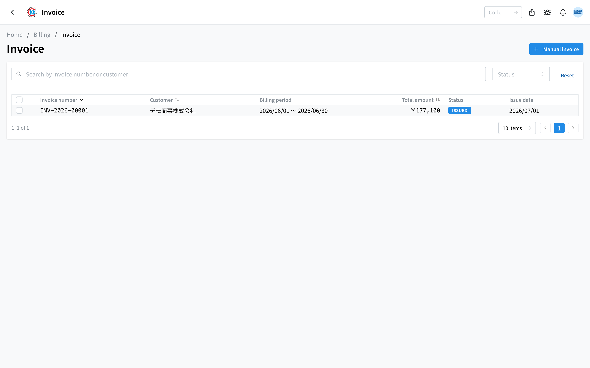
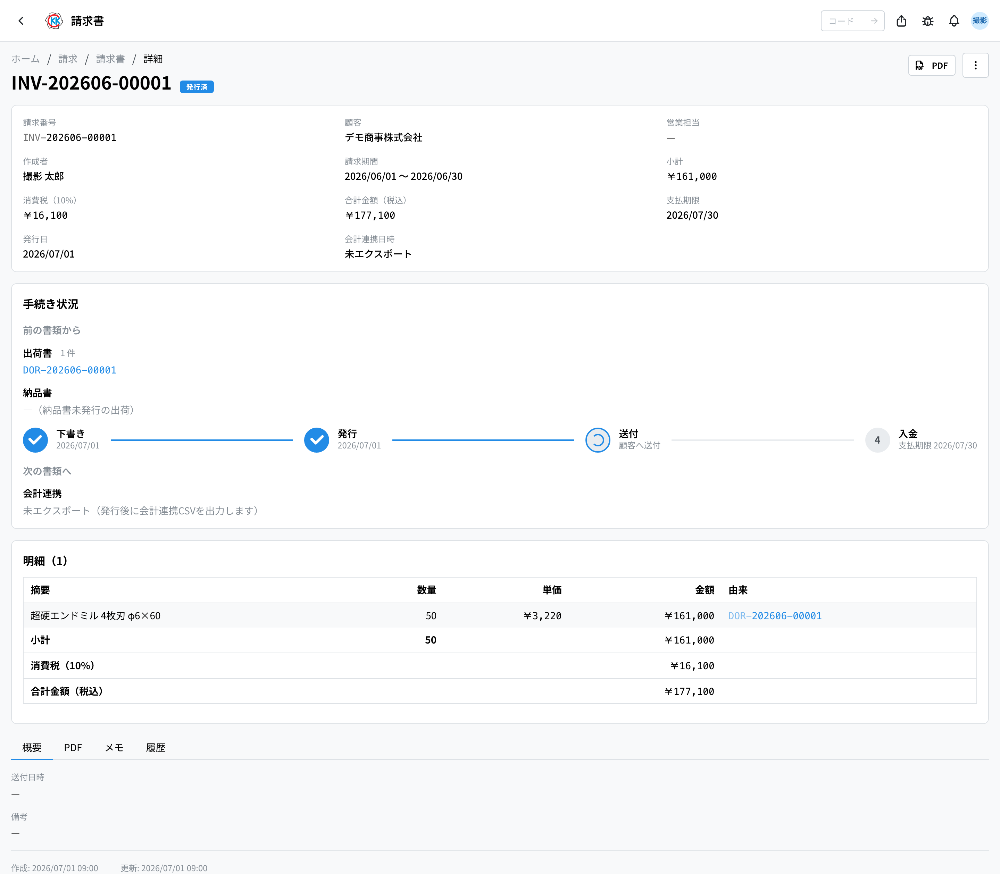
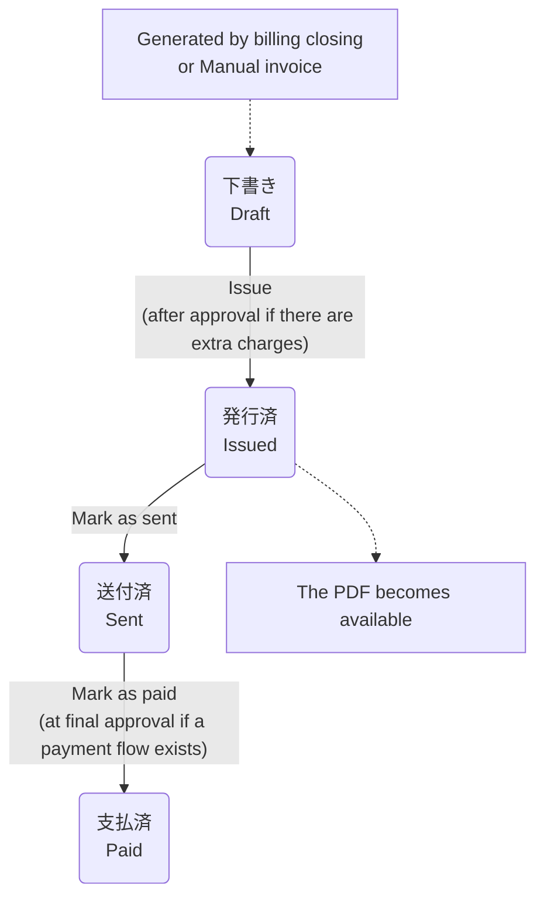
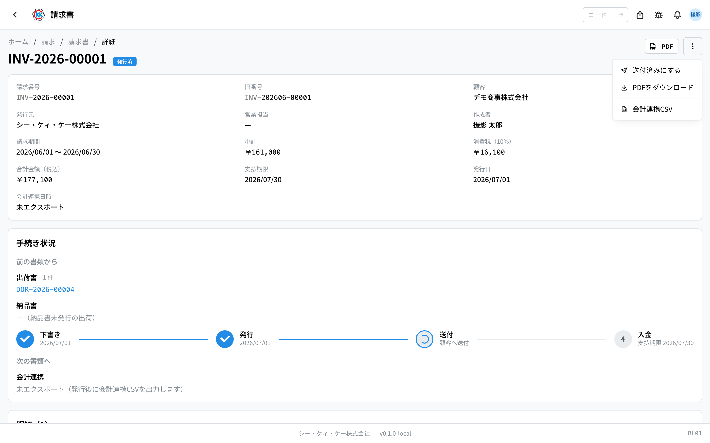
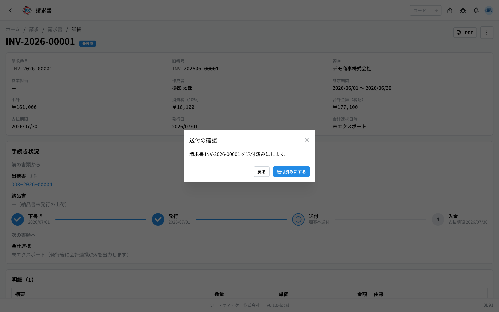

This app is where you check the **invoice** (請求書) you send to a customer to ask for payment, and record everything from issuing it to receiving the money. The operation code is `BL01`.

> ⚠️ This app is still being prepared. Screens and steps may change before it is fully released.

> This app belongs to … [Billing flow](/manual/en/process/billing)

## What you can do with this app

- Check what is on an invoice (what, how many, and for how much).
- Turn the invoice into a **PDF** to print or save it (email it to the customer yourself with the PDF attached — the app does not send email).
- Record, one step at a time, "issued", "sent", and "money received". You can also select several in the list and issue them or mark them as paid together.
- While it is a draft, add **extra charges** such as shipping.
- Download a file that can be read into the accounting software.

Invoices are normally made for you by [monthly billing close](/manual/en/operations/billing/billing-closing/user). To bill without waiting for the cut-off date, use 「**手動請求**」 (Manual invoice) at the top right of the list (see "Making an invoice by hand" on this page).

## Words used on this page

- **請求期間 (billing period)** … The period you are billing for — "everything sent between this date and that date".
- **小計 (subtotal)** … The amount before consumption tax is added.
- **消費税 (consumption tax)** … The tax on the subtotal. It is worked out line by line from each **product's tax category** (standard 10% / reduced 8% / exempt). A tax category set on the business partner takes precedence over the product.
- **合計金額（税込） (total with tax)** … The subtotal plus the tax — the amount the customer actually pays.
- **支払期限 (payment due date)** … The date by which the customer should pay.
- **請求先 (bill-to)** … Who the invoice is addressed to. If a separate bill-to company (a parent company, for example) is registered for the customer, the invoice is addressed to it.
- **由来 (source)** … Shows which [delivery order](/manual/en/operations/shipping/delivery-order/user) or [delivery note](/manual/en/operations/shipping/delivery-note/user) a line came from.

## Before you start

- Invoices are normally made by [monthly billing close](/manual/en/operations/billing/billing-closing/user). To make one with Manual invoice, you need permission to create invoices.
- You need invoice permission to issue an invoice or move it to the next step.
- To download the file for the accounting software, you also need the export permission from monthly billing close. If you cannot use it, please ask your administrator.

## How to read the screen

When you open the app, you see a list of the invoices made so far.

- **請求番号 (Invoice number)** … A number that starts with `INV-`. The system adds it for you.
- **状態 (Status)** … Grey is 「下書き」 (Draft), blue is 「発行済」 (Issued), purple is 「送付済」 (Sent), green is 「支払済」 (Paid).
- In the search box at the top you can type an invoice number or a customer name to narrow the list.
- Click a row to open the detail screen for that invoice.
- When there are none yet, you see 「**請求書がありません（締日処理から生成します）**」 (No invoices — generate them from monthly billing close).

## Checking the contents

At the top you see the invoice number, customer, billing period, subtotal, consumption tax, total with tax, payment due date, and issue date.

- **発行元** (issuer) … your own company that issues this invoice ([own company](/manual/en/operations/masters/own-company/user)). People who handle documents of two or more companies see it as a company-code badge (for example `TSP`) next to the invoice number in the heading ([Issuing company badge](/manual/en/operations/masters/own-company/user#company-badge)). It is decided from the site of the underlying shipments when the invoice is created, and does not change afterwards. Even for the same customer and period, shipments of different companies become **separate invoices per company**.
- **支払期限 (Payment due date)** … Filled in for you. If a **payment day** (paid on day N of the month) is registered for the customer, it is the first payment day on or after the cut-off date plus the payment-terms days (at least 1 day). Without a payment day, it is the cut-off date plus the payment-terms days (30 days if nothing was agreed).
- **会計連携日時 (Accounting export date)** … The date and time the file for the accounting software was made. If it has not been made yet, it shows 「**未エクスポート**」 (Not exported).

The 「明細」 (Lines) area below lists each line you are billing.

- **摘要 (Description)** … The product name and lot number.
- **由来 (Source)** … Click the blue text to open the [delivery order](/manual/en/operations/shipping/delivery-order/user) or [delivery note](/manual/en/operations/shipping/delivery-note/user) it came from.
- At the bottom you see the subtotal, the consumption tax, and the total with tax.

Below the lines there are four tabs. 「**概要**」 (Overview) shows the date and time it was sent to the customer plus the notes, 「**PDF**」 shows the invoice PDF after issuing, 「**メモ**」 (Memo) holds a shared internal memo, and 「**履歴**」 (History) shows who moved this invoice along and when.

> 💡 If you want to make sure the amount is right, open the original delivery order from the "由来" (Source) link — you can check there and then how many pieces were sent and when.

> 💡 The tax is shown **one line per rate** — 「**消費税（10%）**」 (Consumption tax (10%)), 「**消費税（8%）**」 (8%), and so on. When an invoice mixes rates, the taxable amount for each rate is shown next to it. This is what a qualified invoice requires.

## Recording from issue to payment

An invoice moves through four stages: 「下書き」 (Draft) → 「発行済」 (Issued) → 「送付済」 (Sent) → 「支払済」 (Paid). There is no editing on this screen; you work from the 「**…**」 button (the three dots) at the top right.

### 1. Issue it

1. Press 「**…**」.
2. Choose 「**発行**」 (Issue).
3. 「発行の確認」 (Issue check) appears. Press 「**発行**」 (Issue).

Today's date is recorded as the **発行日 (issue date)**.

> 💡 Only an invoice with **extra charges** (costs added from the [charge item master](/manual/en/operations/masters/charge-item/user) `MS0G`) needs approval before it is issued. Pressing 「発行」 (Issue) sends an approval request, and the approval status appears at the very top of the screen. Once it is approved, press 「発行」 (Issue) again. Changing the extra charges after approval resets the approval. If no steps are set up in [approval settings](/manual/en/operations/masters/approval-setting/user), it is issued straight away without approval.

### 2. When you have sent it to the customer

1. Press 「**…**」.
2. Choose 「**送付済みにする**」 (Mark as sent).
3. A check window appears. Press 「**送付済みにする**」 (Mark as sent).

> ⚠️ The app does not send email or faxes to the customer. 「送付済みにする」 (Mark as sent) only records that it was sent and when. Send the PDF yourself.

### 3. When you have confirmed the payment

1. Press 「**…**」.
2. Choose 「**入金済みにする**」 (Mark as paid).
3. A check window appears. Press 「**入金済みにする**」 (Mark as paid).

The status becomes 「**支払済**」 (Paid) and that invoice is finished.

> 💡 If your company has set up a **payment approval flow**, pressing 「入金済みにする」 (Mark as paid) sends an approval request, and the invoice becomes 「**支払済**」 (Paid) when the final approval is given. With no steps in the approval settings, it becomes paid on the spot.

### Doing several at once

Tick invoices in the list to work on them together.

- 「**発行**」 (Issue) … Issues the selected drafts together. Invoices that need approval stop for the same reason as when pressed one at a time, and are shown in the result.
- 「**入金済みにする**」 (Mark as paid) … Marks the selected sent invoices as paid (sends approval requests if a payment flow exists).
- 「**承認**」 (Approve) / 「**差し戻し**」 (Send back) … Approves or sends back the selected invoices pending approval.

If one fails, the others are still processed.

## Printing (PDF)

You can see the PDF **only after issuing**. While it is a draft the PDF has not been made yet, and the 「**PDF**」 tab shows 「発行後に PDF を閲覧できます。」 (the PDF can be viewed after issuing).

After issuing, press 「**PDF**」 at the top right of the screen and the invoice PDF opens in another tab; from there you can print it or save it. The 「**PDF**」 tab also shows it right on the screen.

The issuer block at the top right of the PDF prints the name, address, phone number and invoice registration number of the invoice's **issuer** company. The company seal printed is also the one registered for that company. To correct these details or register a seal, use [Own companies](/manual/en/operations/masters/own-company/user) (`MS0I`).

## Making the file for the accounting software

You can download, **per invoice**, a file for the accounting team to read into the accounting software (TKC FX4 Cloud). It is available **only after issuing** (drafts cannot be exported).

1. On the invoice screen, press 「**…**」 at the top right.
2. Choose 「**会計連携CSV**」 (Accounting CSV).
3. The file is downloaded — read it into the accounting software.

The first export **freezes the journal as an accounting document**. The date and time appear in the 「**会計連携日時**」 (Accounting export date) box on the detail screen, and the document number is listed in 「**会計文書履歴**」 (Accounting document history). The billing closing that created this invoice moves from 「処理済」 (Processed) to 「**エクスポート済**」 (Exported).

From the second time on, the menu shows 「**会計連携CSV（再ダウンロード）**」 (Accounting CSV (download again)), and **the contents are the same every time** — even if you later change the masters or the accounting export settings (`SY0J`).

To correct the contents, choose 「**反対仕訳を作成**」 (Create reversal) from 「**…**」, enter a reason and confirm. A cancelling document with debit and credit swapped is created, and the original becomes 「反対仕訳済み」 (Reversed). After fixing the masters, export 「会計連携CSV」 (Accounting CSV) again to write out a new document.

## Making an invoice by hand

Use this to bill on the spot without waiting for the cut-off date.

1. Press 「**手動請求**」 (Manual invoice) at the top right of the list.
2. Choose the customer. That customer's **unbilled shipments** are listed.
3. Select the shipments to bill and press 「**請求書を作成**」 (Create invoice).

A draft invoice is made. From there it works the same as an invoice made by billing closing. If a selected shipment has already been used on another invoice, you are asked to choose again.

## Input fields

Invoices are **created by the closing run (or Manual invoice)**, so product amounts and lines are never typed by hand. The only thing you can add by hand is 「**追加料金**」 (Extra charges, in the Overview tab) while the invoice is a draft.

| Action | What happens |
|--------|--------------|
| [Issue](#field-issue) | The contents of the invoice are fixed |
| [Mark as sent](#field-sent) | Records that it went to the customer |
| [Mark as paid](#field-paid) | Records that payment arrived |

### Issue [#field-issue]

Fixes the invoice after you have checked it. The invoice number is already there — it was given when the invoice was created. An invoice with extra charges needs approval first. **Issuing fixes the contents; they can no longer be changed.** If you spot a mistake, go back to the shipment or the closing run to correct it.

### Mark as sent [#field-sent]

Records that it went to the customer, and when. How it is sent (email, fax, post) is set per customer. **The app does not send it** — you send it yourself.

### Mark as paid [#field-paid]

Records that payment arrived, so unpaid invoices can be found. If a payment approval flow exists, it becomes paid at the final approval.

The amounts are **collected automatically from delivery orders (dispatches that have been shipped)**. Delivery notes are attached as each line's "source" link. If an amount does not add up, check the shipping side rather than this screen.

## Questions and problems

**Q. I cannot find a 「新規作成」 (New) button.**
A. 「**手動請求**」 (Manual invoice) at the top right of the list is the way in (「新規」 (New) on a phone). Everyday invoices are made by [monthly billing close](/manual/en/operations/billing/billing-closing/user).

**Q. I want to fix an amount, but there is no edit screen.**
A. Invoice lines cannot be fixed directly (while it is a draft, you can only add extra charges). Something is probably wrong on the original [delivery order](/manual/en/operations/shipping/delivery-order/user), so please talk to the accounting or sales person in charge.

**Q. I pressed 「発行」 (Issue) and got "approval requested", but it was not issued.**
A. The invoice has extra charges, so it needs approval before issuing. Once approved, press 「発行」 (Issue) again.

**Q. I pressed 「送付済みにする」 (Mark as sent), but the customer did not get an email.**
A. The app does not send email; it only records that it was sent. Download the PDF and send it to the customer.

**Q. I get 「下書きの請求書のみ発行できます」 (Only draft invoices can be issued).**
A. That invoice has already been issued. Close the screen and open it again to see where it stands now.

**Q. I get 「発行済みの請求書のみ送付済みにできます」 (Only issued invoices can be marked as sent).**
A. A step has been skipped. Please go in order: issue → mark as sent → mark as paid.

**Q. The consumption tax does not look like it was worked out at 10%.**
A. The tax comes from each **product's tax category**. Check the product's 「税区分」 (tax category) first. If the business partner has a tax category of its own, that wins over the product (for a tax-exempt partner, for example) — in that case look at the [business partner](/manual/en/operations/masters/business-partner/user).

**Q. If I change a tax category later, does the tax on an issued invoice change?**
A. No. The rate is written into each line when the invoice is created. Changing a product or a tax category afterwards does not move an invoice that has already been issued.

**Q. I press 「会計連携CSV」 but no file comes out.**
A. Draft invoices cannot be exported — issue it first. If it is issued and still nothing comes out, you may not have the export permission. Please ask your administrator.

**Q. I fixed a master, but the accounting CSV contents do not change.**
A. Once exported, the journal is frozen and comes out the same every time. To correct it, cancel it with 「**反対仕訳を作成**」 (Create reversal — a reason is required), then export again.

<!-- permissions:start -->
## Permissions required

Using this screen requires the **Invoice** (`invoice`) permission.

| What you want to do | Permission needed |
| --- | --- |
| Open the screen, view lists and details | Invoice — View |
| Add, change or delete | Invoice — Create / Edit / Delete |

Viewing only needs *View*. Where a screen offers adding, changing or deleting, each of those needs its matching permission.

Permissions come through roles. If something is missing, ask an administrator.

For the whole picture see [Permissions and roles](../../../permissions).
<!-- permissions:end -->
