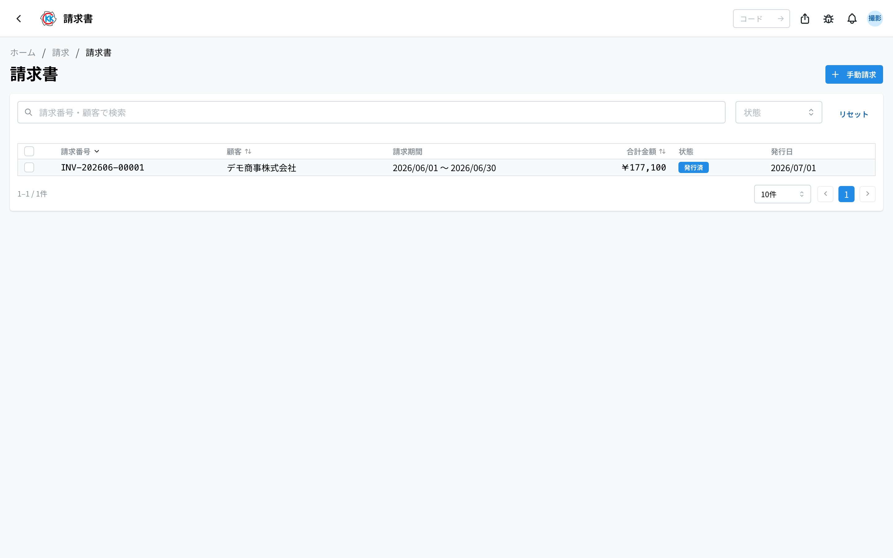
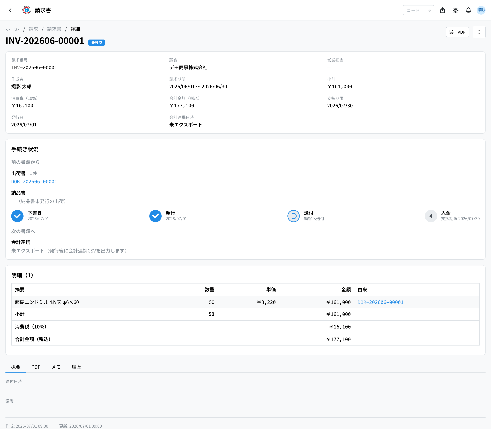
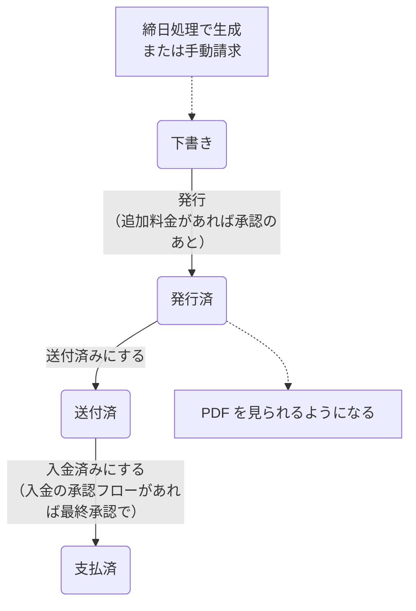
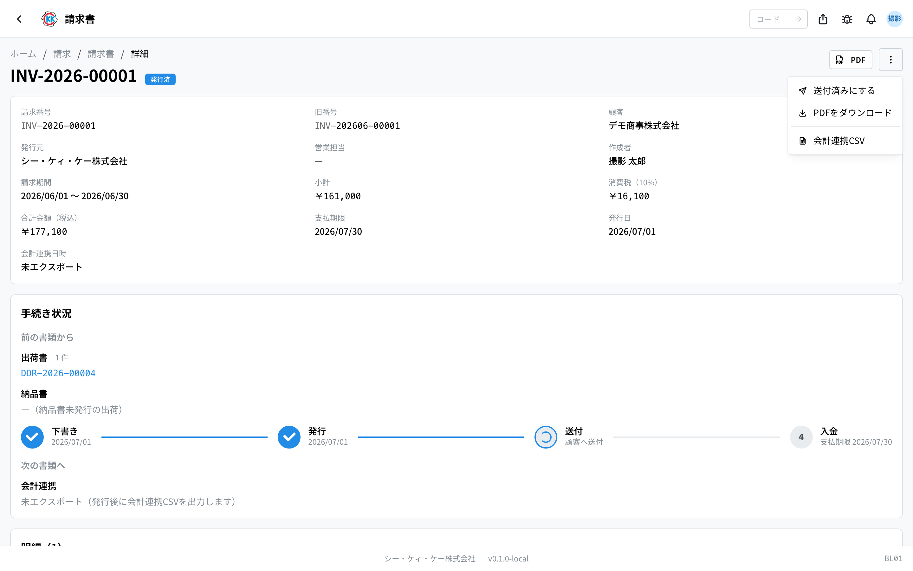
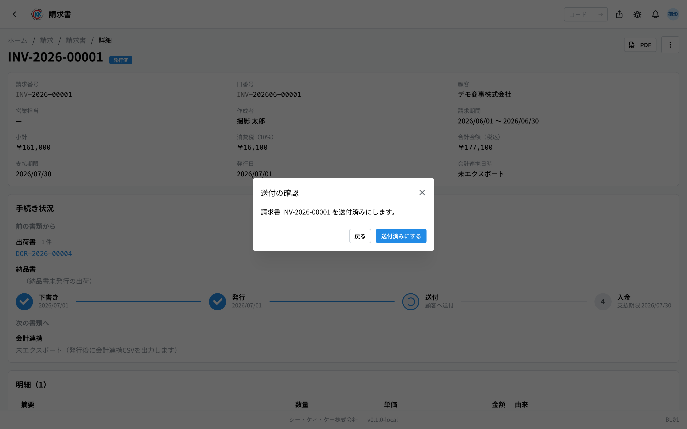

お客様へお金を請求する **請求書** を確認して、発行・送付・入金までを記録するアプリです。操作コードは `BL01` です。

> ⚠️ このアプリはまだ準備中です。正式に使えるようになるまでに、画面や手順が変わることがあります。

> このアプリが属するフロー … [請求の流れ](/manual/ja/process/billing)

## このアプリでできること

- 請求書の中身（何をいくつ、いくらで請求するか）を確認できます。
- 請求書を **PDF** にして、印刷したり保存したりできます（お客様へのメールは、PDF を添えてご自分で送ります。アプリからメールは送られません）。
- 「発行した」「送った」「入金があった」を順に記録できます。一覧で選んで、まとめて発行・入金済みにもできます。
- 下書きのうちは、送料などの**追加料金**を足せます。
- 会計ソフトに読み込ませるファイルをダウンロードできます。

請求書は、ふだんは[締日処理](/manual/ja/operations/billing/billing-closing/user)で自動的に作られます。締日を待たずに請求したいときは、一覧右上の「**手動請求**」から作れます（このページの「手動で請求書を作る」）。

## 用語（このページで出てくる言葉）

- **請求期間（せいきゅうきかん）** … 「いつからいつまでに送った分」をまとめて請求するか、その期間です。
- **小計（しょうけい）** … 消費税を入れる前の金額です。
- **消費税** … 小計にかかる税金です。**製品ごとの税区分**（標準 10% / 軽減 8% / 非課税）に合わせて、明細ごとに自動で計算されます。お客様に課税区分を設定している場合は、そちらが製品より優先されます。
- **合計金額（税込）** … 小計と消費税を足した、実際にお支払いいただく金額です。
- **支払期限** … いつまでにお支払いいただくかの期日です。
- **請求先** … 請求書の宛先です。お客様に別の請求先（親会社など）が登録されているときは、そちらが宛先になります。
- **由来（ゆらい）** … その 1 行がどの[出荷書](/manual/ja/operations/shipping/delivery-order/user)・[納品書](/manual/ja/operations/shipping/delivery-note/user)から来たかを示します。

## はじめる前に

- 請求書は、ふだんは[締日処理](/manual/ja/operations/billing/billing-closing/user)で作られます。手動請求で作るには、請求書の作成の権限が必要です。
- 請求書を発行したり記録を進めたりするには、請求書の権限が必要です。
- 会計ソフト用のファイルをダウンロードするには、締日処理の書き出しの権限も必要です。使えないときは管理者にご相談ください。

## 画面の見かた

アプリを開くと、これまでに作られた請求書の一覧が出ます。

- **請求番号** … `INV-` で始まる番号です。システムが自動で付けます。
- **状態** … 灰色は「下書き」、青は「発行済」、紫は「送付済」、緑は「支払済」です。
- 上の検索欄には、請求番号かお客様の名前を入れて絞り込めます。
- 行をクリックすると、その請求書の詳しい画面が開きます。
- まだ 1 件もないときは「**請求書がありません（締日処理から生成します）**」と出ます。

## 内容を確認する

上のほうに、請求番号・お客様・請求期間・小計・消費税・合計金額（税込）・支払期限・発行日が並びます。

- **発行元** … この請求書を出す自分の会社（[自社法人](/manual/ja/operations/masters/own-company/user)）です。2 社以上の法人の書類を扱う人には、見出しの請求番号の横に法人コード（例 `TSP`）のバッジで出ます（[発行会社のバッジ](/manual/ja/operations/masters/own-company/user#company-badge)）。請求書を作ったときに、もとの出荷の拠点から決まり、あとから変わりません。同じお客様・同じ期間でも、会社が違う出荷は **会社ごとに別の請求書** になります。
- **支払期限** … お客様に**支払日**（毎月○日払い）が登録されていれば、締めの日から支払サイトの日数（なければ 1 日）たった以降の、最初の支払日が入ります。支払日がなければ、締めの日から支払サイトの日数（決めていなければ 30 日）あとの日付が入ります。
- **会計連携日時** … 会計ソフト用のファイルを出した日時です。まだのときは「**未エクスポート**」と出ます。

下の「明細」には、請求する 1 行ずつが並びます。

- **摘要（てきよう）** … 製品名とロット番号です。
- **由来** … 青い文字をクリックすると、元になった[出荷書](/manual/ja/operations/shipping/delivery-order/user)や[納品書](/manual/ja/operations/shipping/delivery-note/user)を開けます。
- 一番下に、小計・消費税・合計金額（税込）が出ます。

明細の下には 4 つのタブがあります。「**概要**」ではお客様へ送った日時と備考を、「**PDF**」では発行後の請求書 PDF を、「**メモ**」では社内向けの共有メモを、「**履歴**」ではいつ誰がこの請求書を進めたかを確認できます。

> 💡 金額が合っているか確かめたいときは、「由来」のリンクから元の出荷書を開くと、いつ何本送ったかをその場で確認できます。

> 💡 消費税は**税率ごとに 1 行ずつ**表示されます（「**消費税（10%）**」「**消費税（8%）**」など）。税率が混ざっている請求書では、その税率の「対象額」も並びます。これは適格請求書（インボイス）に必要な書き方です。

## 発行から入金までの記録

請求書は「下書き → 発行済 → 送付済 → 支払済」と 4 段階で進みます。この画面に編集はなく、操作は右上の「**…**」（点が 3 つのボタン）から行います。

### 1. 発行する

1. 「**…**」を押します。
2. 「**発行**」を選びます。
3. 「発行の確認」が出るので「**発行**」を押します。

その日の日付が **発行日** として記録されます。

> 💡 **追加料金**（[料金マスタ](/manual/ja/operations/masters/charge-item/user) `MS0G` から足した費用）がある請求書だけは、発行の前に承認が要ります。「発行」を押すと承認依頼が出て、画面の一番上に承認の状況が出ます。承認されたら、もう一度「発行」を押します。承認のあとで追加料金を直すと、承認はやり直しになります。[承認設定](/manual/ja/operations/masters/approval-setting/user)に段が 1 つもなければ、承認なしでそのまま発行されます。

### 2. お客様へ送ったら

1. 「**…**」を押します。
2. 「**送付済みにする**」を選びます。
3. 確認の画面が出るので「**送付済みにする**」を押します。

> ⚠️ アプリからお客様へメールや FAX は送られません。「送付済みにする」は、送ったことと、その日時を記録するだけです。PDF はご自分で送ってください。

### 3. 入金を確認したら

1. 「**…**」を押します。
2. 「**入金済みにする**」を選びます。
3. 確認の画面が出るので「**入金済みにする**」を押します。

状態が「**支払済**」になり、その請求書は完了です。

> 💡 会社で**入金の承認フロー**を組んでいる場合は、「入金済みにする」を押すと承認依頼が出ます。最後の承認が済んだ時点で「**支払済**」になります。承認設定に段がなければ、その場で支払済になります。

### まとめて進める

一覧で請求書のチェックボックスを選ぶと、まとめて操作できます。

- 「**発行**」… 選んだ下書きをまとめて発行します。承認が要る請求書は、1 件ずつ押したときと同じ理由で止まり、結果に出ます。
- 「**入金済みにする**」… 選んだ送付済みの請求書をまとめて入金済みにします（承認フローがあれば承認依頼を出します）。
- 「**承認**」「**差し戻し**」… 承認依頼中の請求書をまとめて承認・差し戻しします。

1 件で失敗しても、ほかの請求書は処理されます。

## 印刷する（PDF）

PDF を見られるのは **発行したあと** です。下書きのあいだは PDF はまだ作られておらず、「**PDF**」タブには「発行後に PDF を閲覧できます。」と表示されます。

発行後は、画面右上の「**PDF**」を押すと請求書の PDF が別のタブで開き、そこから印刷したり保存したりできます。「**PDF**」タブでも画面の中でそのまま確認できます。

PDF の右上の発行元欄には、その請求書の **発行元** の会社の名称・住所・電話番号・適格請求書発行事業者登録番号が印字されます。社印（印影）も、その会社に登録されたものが印字されます。内容を直したいとき・印影を登録したいときは、[自社法人](/manual/ja/operations/masters/own-company/user)（`MS0I`）で行います。

## 会計ソフト用のファイルを出す

経理で会計ソフト（TKC FX4クラウド）に取り込むためのファイルを、**請求書ごとに**ダウンロードできます。出せるのは**発行したあと**です（下書きは出せません）。

1. 請求書の画面で右上の「**…**」を押します。
2. 「**会計連携CSV**」を選びます。
3. ファイルがダウンロードされるので、会計ソフトに取り込みます。

初めて出したときに、その時点の仕訳が**会計文書として固定**されます。詳しい画面の「**会計連携日時**」欄に日時が出て、「**会計文書履歴**」に文書番号が並びます。この請求書を作った締日処理は「処理済」から「**エクスポート済**」に変わります。

2 回目からは「**会計連携CSV（再ダウンロード）**」になり、**何度出しても同じ中身**です。あとでマスタや会計連携（`SY0J`）の設定を直しても変わりません。

中身を直したいときは、「**…**」から「**反対仕訳を作成**」を選び、理由を入れて確定します。貸借を入れ替えた打ち消しの文書ができ、元の文書は「反対仕訳済み」になります。そのあとマスタなどを直してから「会計連携CSV」を出すと、新しい文書として書き出されます。

## 手動で請求書を作る

締日を待たずに、臨時に請求したいときに使います。

1. 一覧右上の「**手動請求**」を押します。
2. お客様を選びます。そのお客様の**未請求の出荷**が並びます。
3. 請求する出荷を選んで「**請求書を作成**」を押します。

請求書の下書きができます。あとの流れは締日処理で作った請求書と同じです。選んだ出荷がすでに別の請求書に使われていたときは、選び直すよう案内が出ます。

## 入力項目

請求書は**締日処理（または手動請求）で作られる**ため、製品の金額や明細を手で打つことはありません。手で足せるのは、下書きのあいだの「**追加料金**」（概要タブ）だけです。

| 操作 | 何が起きるか |
|------|-------------|
| [発行](#field-issue) | 請求書の内容が確定する |
| [送付済みにする](#field-sent) | お客様へ送ったことを記録する |
| [入金済みにする](#field-paid) | 支払いを受け取ったことを記録する |

### 発行 [#field-issue]

内容を確認したあと、請求書を確定します。請求番号は請求書が作られたときにすでに付いています。追加料金がある請求書は、先に承認が要ります。**発行すると内容が確定し、変えられなくなります。** 間違いに気づいたときは、元の出荷や締日処理をたどって直してください。

### 送付済みにする [#field-sent]

お客様へ送ったことと、その日時を記録します。送り方（メール・FAX・郵送）はお客様ごとに決まっています。**アプリから送られるわけではありません** — 送るのはご自分です。

### 入金済みにする [#field-paid]

支払いを受け取ったことを記録します。まだの請求書を探すときに使えます。入金の承認フローがあるときは、最終承認で支払済になります。

金額の内訳は、**出荷書（出荷済みになった発送分）から自動で集められます**。納品書は各行の「由来」リンクとして付きます。金額が合わないときは、この画面ではなく出荷の側を確認してください。

## よくある質問・困ったとき

**Q. 「新規作成」のボタンが見当たりません。**
A. 一覧右上の「**手動請求**」が新規作成の入口です（スマートフォンでは「新規」）。ふだんの請求書は[締日処理](/manual/ja/operations/billing/billing-closing/user)で作られます。

**Q. 金額を直したいのですが、編集の画面がありません。**
A. 請求書の明細は直接直せません（下書きのうちに足せるのは追加料金だけです）。元になった[出荷書](/manual/ja/operations/shipping/delivery-order/user)の内容が違っているはずなので、経理・営業の担当者にご相談ください。

**Q. 「発行」を押したら「承認を依頼しました」と出て、発行されません。**
A. 追加料金がある請求書なので、発行の前に承認が要ります。承認されたら、もう一度「発行」を押してください。

**Q. 「送付済みにする」を押しましたが、お客様にメールが届いていません。**
A. アプリはメールを送りません。送ったことを記録するだけです。PDF をダウンロードして、お客様へ送ってください。

**Q. 「下書きの請求書のみ発行できます」と出ます。**
A. その請求書はすでに発行済みです。画面をいったん閉じて開き直すと、今の状態が確認できます。

**Q. 「発行済みの請求書のみ送付済みにできます」と出ます。**
A. 順番が飛んでいます。「発行 → 送付済みにする → 入金済みにする」の順に進めてください。

**Q. 消費税が 10% で計算されていないようです。**
A. 消費税は**製品ごとの税区分**で決まります。まず[製品](/manual/ja/operations/masters/product/user)の「税区分」を確認してください。お客様側に課税区分を設定している場合は、そちらが製品より優先されます（非課税のお客様など）— その場合は[取引先](/manual/ja/operations/masters/business-partner/user)の登録内容を見てください。

**Q. 発行済みの請求書の税率は、あとから税区分を変えると変わりますか。**
A. 変わりません。税率は請求書を作った時点で 1 行ずつ書き込まれます。あとで製品や税区分の設定を変えても、発行済みの請求書は動きません。

**Q. 「会計連携CSV」を押してもファイルが出ません。**
A. 下書きの請求書は書き出せません。先に発行してください。発行済みでも出ないときは、書き出しの権限がない可能性があります。管理者にご相談ください。

**Q. マスタを直したのに、会計連携CSVの中身が変わりません。**
A. 一度書き出した仕訳は固定され、何度出しても同じ中身になります。直すときは「**反対仕訳を作成**」（理由が必要）で打ち消してから、もう一度書き出してください。

<!-- permissions:start -->
## 必要な権限

この画面を使うには **請求書**（`invoice`）の権限が要ります。

| したいこと | 必要な権限 |
| --- | --- |
| 画面を開く・一覧や詳細を見る | 請求書 の 閲覧 |
| 追加・変更・削除する | 請求書 の 作成 / 更新 / 削除 |

見るだけなら「閲覧」で足ります。追加・変更・削除の操作がある画面では、その操作にあたる権限がそれぞれ必要です。

権限は役割（ロール）を通して付きます。足りないときは管理者に相談してください。

権限の全体像は「[権限とロール](../../../permissions)」を参照してください。
<!-- permissions:end -->
