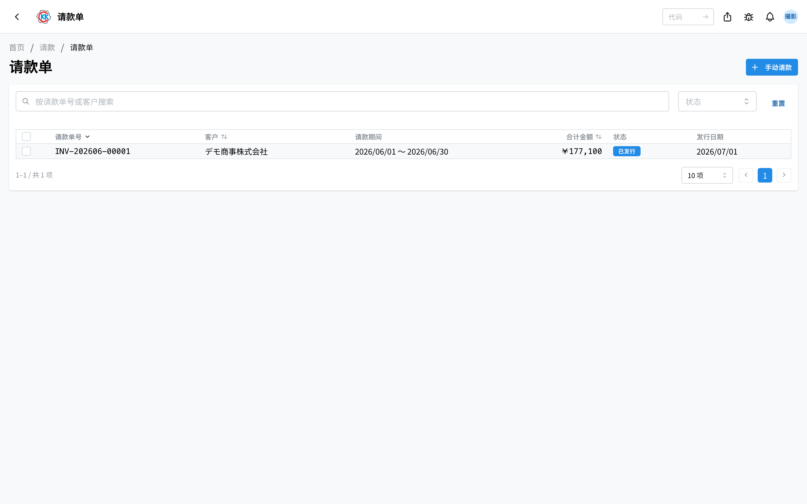
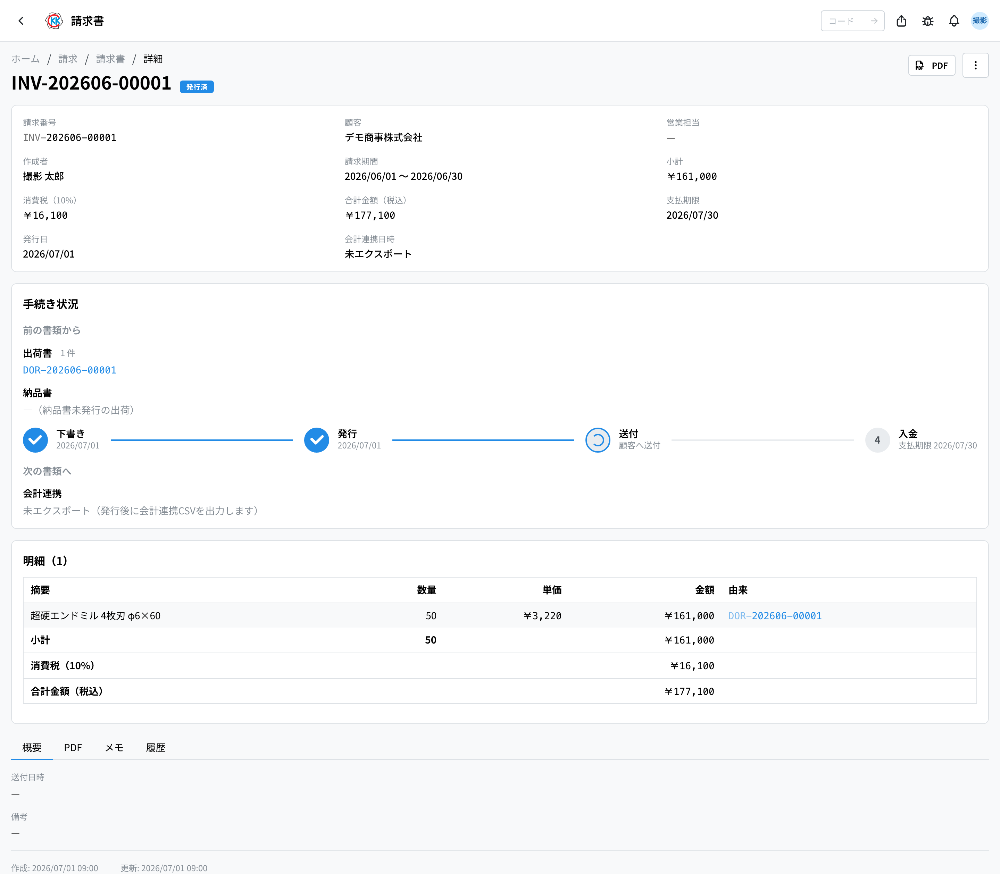
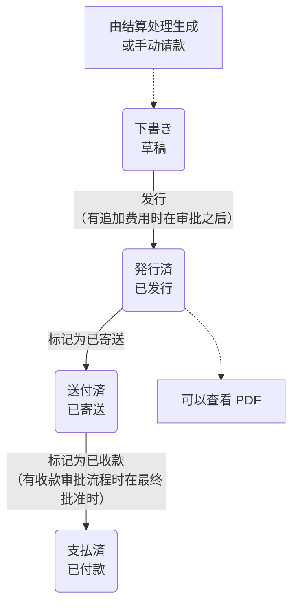
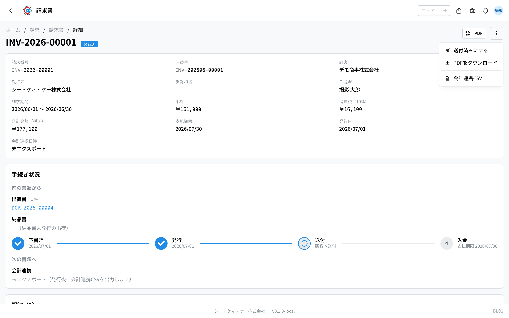
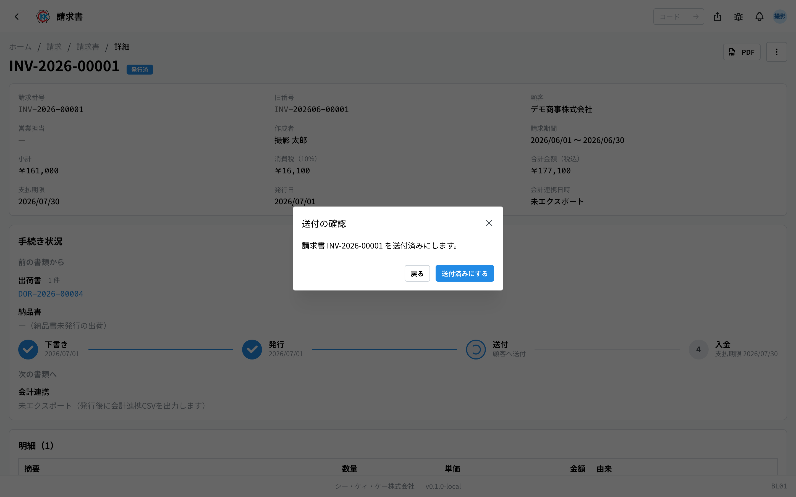

用来确认向客户请款的 **请款单**（請求書），并记录发行、寄送、收款全过程的应用。操作代码是 `BL01`。

> ⚠️ 本应用还在准备中。正式启用之前，界面和步骤可能会有变化。

> 本应用所属的流程……[请款流程](/manual/zh/process/billing)

## 本应用能做什么

- 可以确认请款单的内容（请款的是什么、多少、多少钱）。
- 可以把请款单转成 **PDF**，打印或保存（发给客户的邮件请自己附上 PDF 发送，应用不会发送邮件）。
- 可以依次记录「已发行」「已寄送」「已收款」。也可以在一览中选中多张，一起发行或标记为已收款。
- 草稿期间可以追加运费等**追加费用**。
- 可以下载给会计软件读入的文件。

请款单通常由[结算处理](/manual/zh/operations/billing/billing-closing/user)自动做出。不等结算截止日就要请款时，可以从一览右上角的「**手動請求**」（手动请款）新建（见本页的「手动做请款单」）。

## 本页出现的词

- **請求期間（请款期间）** … 把「从什么时候到什么时候发出的部分」合在一起请款，这段期间就是请款期间。
- **小計（小计）** … 加消费税之前的金额。
- **消費税（消费税）** … 对小计征收的税。按**各产品的税种**（标准 10% / 减免 8% / 免税）逐行自动计算。若业务伙伴已设置税种，则优先于产品。
- **合計金額（税込）（合计金额（含税））** … 小计加上消费税，也就是客户实际支付的金额。
- **支払期限（付款期限）** … 客户应该在什么时候之前付款的日期。
- **請求先（请款对象）** … 请款单的抬头。客户登记了别的请款对象（如母公司）时，以那家公司为抬头。
- **由来（来源）** … 表示这一行是从哪张[出货单](/manual/zh/operations/shipping/delivery-order/user)或[送货单](/manual/zh/operations/shipping/delivery-note/user)来的。

## 开始之前

- 请款单通常由[结算处理](/manual/zh/operations/billing/billing-closing/user)做出。用手动请款新建时，需要请款单的新建权限。
- 发行请款单或推进记录，需要请款单权限。
- 下载给会计软件用的文件，还需要结算处理的导出权限。如果不能用，请联系管理员。

## 界面怎么看

打开应用后，会看到之前做出的请款单一览。

- **請求番号（请款单号）** … 以 `INV-` 开头的编号，由系统自动编。
- **状態（状态）** … 灰色是「下書き」（草稿），蓝色是「発行済」（已发行），紫色是「送付済」（已寄送），绿色是「支払済」（已付款）。
- 上面的搜索框里可以输入请款单号或客户名称来筛选。
- 处理 2 家以上本公司法人单据的人，会在请款单号旁看到法人代码的小徽章（例如 `TSP`）。
- 点一行就能打开这张请款单的详细界面。
- 一张都还没有时，会显示「**請求書がありません（締日処理から生成します）**」（没有请款单 — 请从结算处理生成）。

## 确认内容

上方会显示请款单号、客户、请款期间、小计、消费税、合计金额（含税）、付款期限、发行日。

- **発行元**（开具方）… 开具这张请款单的本公司（[本公司法人](/manual/zh/operations/masters/own-company/user)）。画面上没有专门的栏位。只有处理 2 个以上法人单据的人，会在标题的请款单号旁看到法人编号的标记（例 `TSP`）（[开具公司标记](/manual/zh/operations/masters/own-company/user#company-badge)）。在创建请款单时，由来源出货的据点决定，之后不会改变。即使是同一客户・同一期间，不同公司的出货也会 **按公司分成不同的请款单**。
- **支払期限（付款期限）** … 自动填入。客户登记了**付款日**（每月○日付款）时，是从结算截止日起经过账期天数（至少 1 天）之后的第一个付款日。没有付款日时，是结算截止日加上账期天数（没有约定时是 30 天）后的日期。
- **会計連携日時（会计对接时间）** … 做出会计软件用文件的日期时间。还没做时显示「**未エクスポート**」（未导出）。

下面的「明細」（明细）里逐行列出要请款的内容。

- **摘要（摘要）** … 产品名称和批次号。
- **由来（来源）** … 点蓝色文字，可以打开作为依据的[出货单](/manual/zh/operations/shipping/delivery-order/user)或[送货单](/manual/zh/operations/shipping/delivery-note/user)。
- 最下面会显示小计、消费税、合计金额（含税）。

明细下面有几个标签页。「**概要**」（概要）可以看附加费用、寄给客户的日期时间和备注，「**PDF**」可以看发行后的请求书 PDF，「**メモ**」（备忘）可以留公司内部的共享备忘，「**履歴**」（历史）可以看谁在什么时候推进了这张请款单。只有存在审批记录时，才会出现「**承認**」（审批）标签页。

> 💡 想确认金额对不对时，从「由来」（来源）的链接打开原来的出货单，就能当场确认什么时候发了多少支。

> 💡 消费税会**按税率逐行显示**：「**消費税（10%）**」（消费税 10%）、「**消費税（8%）**」（8%）等。税率混合的请款单还会并列显示该税率的「应税金额」。这是合规发票所要求的写法。

## 从发行到收款的记录

请款单按「下書き」（草稿）→「発行済」（已发行）→「送付済」（已寄送）→「支払済」（已付款）四个阶段推进。这个界面没有编辑功能，操作都在右上角的「**…**」（三个点的按钮）里进行。

### 1. 发行

1. 点「**…**」。
2. 选「**発行**」（发行）。
3. 弹出「発行の確認」（发行确认）后，点「**発行**」（发行）。

当天的日期会记为 **発行日（发行日）**。

> 💡 只有含**追加费用**（从[费用主数据](/manual/zh/operations/masters/charge-item/user) `MS0G` 追加的费用）的请款单，发行前需要审批。点「発行」（发行）会发出审批申请，画面最上方会显示审批状态。批准后，再点一次「発行」（发行）。批准后修改追加费用，审批会重新来过。[审批设置](/manual/zh/operations/masters/approval-setting/user)里一级都没有，或请款单的「使用审批」已关闭时，不经审批直接发行。

### 2. 寄给客户之后

1. 点「**…**」。
2. 选「**送付済みにする**」（标记为已寄送）。
3. 弹出确认界面后，点「**送付済みにする**」（标记为已寄送）。

> ⚠️ 应用不会向客户发送邮件或传真。「送付済みにする」（标记为已寄送）只记录已寄送及其时间。PDF 请自己发送。

### 3. 确认收到款之后

1. 点「**…**」。
2. 选「**入金済みにする**」（标记为已收款）。
3. 弹出确认界面后，点「**入金済みにする**」（标记为已收款）。

状态变成「**支払済**」（已付款），这张请款单就完成了。

> 💡 公司设有**收款审批流程**时，点「入金済みにする」（标记为已收款）会发出审批申请，最终批准时变成「**支払済**」（已付款）。审批设置里没有任何一级，或收款的「使用审批」已关闭时，当场变为已付款。

### 批量推进

在一览中勾选请款单，可以一起操作。

- 「**発行**」（发行）… 把选中的草稿一起发行。需要审批的请款单会和逐张点时一样被拦下，并显示在结果里。
- 「**入金済みにする**」（标记为已收款）… 把选中的已寄送请款单一起标记为已收款（有审批流程时发出审批申请）。
- 「**承認**」（批准）/「**差し戻し**」（退回）… 把审批中的请款单一起批准或退回。

即使有一张失败，其他请款单也会照常处理。

## 打印（PDF）

能看到 PDF 的是 **发行之后**。草稿期间 PDF 还没有生成，「**PDF**」标签页会显示「発行後に PDF を閲覧できます。」（发行后即可查看 PDF）。

发行后，点界面右上角的「**PDF**」，请求书的 PDF 会在新标签页里打开，可以从那里打印或保存。在「**PDF**」标签页里也可以直接在画面中查看。

PDF 右上方的开具方栏中，印的是该请款单 **开具方** 公司的名称・地址・电话号码・合格请款单发行事业者登记号。公司印章（印影）也使用该公司登记的印章。想修改这些内容或登记印章时，请在[本公司法人](/manual/zh/operations/masters/own-company/user)（`MS0I`）中操作。

## 做出会计软件用的文件

可以**按每张请款单**下载给财务读入会计软件（TKC FX4 Cloud）的文件。只能在**发行之后**导出（草稿不能导出）。

1. 在请款单界面点右上角的「**…**」。
2. 选「**会計連携CSV**」（会计对接 CSV）。
3. 文件会下载下来，请读入会计软件。

首次导出时，当时的记账凭证会**作为会计文书固定下来**。详细界面的「**会計連携日時**」（会计对接时间）栏里会显示日期时间，「**会計文書履歴**」（会计文书历史）里会列出文书编号。做出这张请款单的结算处理会从「処理済」（已处理）变为「**エクスポート済**」（已导出）。

第 2 次起菜单变为「**会計連携CSV（再ダウンロード）**」（会计对接 CSV（重新下载）），**无论导出多少次内容都相同**。之后修改主数据或会计对接（`SY0J`）的设置也不会变。

要更正内容时，从「**…**」选「**反対仕訳を作成**」（创建冲销分录），填写理由后确定。会生成借贷互换的冲销文书，原文书变为「反対仕訳済み」（已冲销）。修改主数据等之后再导出「会計連携CSV」，会作为新文书导出。

## 手动做请款单

不等结算截止日、要临时请款时使用。

1. 点一览右上角的「**手動請求**」（手动请款）。
2. 选择客户。会列出该客户**未请款的出货**。
3. 选中要请款的出货，点「**請求書を作成**」（做请款单）。

会做出请款单草稿。之后的流程与结算处理做出的请款单相同。选中的出货已被其他请款单使用时，会提示重新选择。

## 输入项

请求书**由结算日处理（或手动请款）生成**，因此无需手动输入产品金额或明细。能手动追加的只有草稿期间的「**追加料金**」（追加费用，在概要标签页）。

| 操作 | 会发生什么 |
|------|-----------|
| [发行](#field-issue) | 请求书的内容确定下来 |
| [标记为已送付](#field-sent) | 记录已发送给客户 |
| [标记为已收款](#field-paid) | 记录已收到付款 |

### 发行 [#field-issue]

确认内容后确定请求书。请求编号在请求书生成时就已经编好。含追加费用的请求书需要先审批。**发行后内容即确定，将无法更改。** 若发现错误，请追溯至原发货或结算日处理进行修正。

### 标记为已送付 [#field-sent]

记录已发送给客户及其时间。发送方式（邮件・传真・邮寄）按客户预先设定。**应用不会代为发送** — 请自己发送。

### 标记为已收款 [#field-paid]

记录已收到付款，便于查找未收款的请求书。设有收款审批流程时，最终批准时变为已付款。

金额明细**自动从出货单（已变为「出荷済」的「発送」部分）汇总**。送货单会作为各行的「由来」链接附上。金额不一致时，请确认发货一侧而非本画面。

## 常见问题与困扰

**Q. 找不到「新規作成」（新建）按钮。**
A. 一览右上角的「**手動請求**」（手动请款）就是新建入口（手机上显示为「新規」）。平时的请款单由[结算处理](/manual/zh/operations/billing/billing-closing/user)做出。

**Q. 想改金额，却没有编辑界面。**
A. 请款单的明细不能直接改（草稿期间只能追加追加费用）。应该是作为依据的[出货单](/manual/zh/operations/shipping/delivery-order/user)的内容有问题，请联系财务或营业的负责人。

**Q. 点了「発行」（发行），却显示「承認を依頼しました」（已申请审批），没有发行。**
A. 这张请款单含追加费用，发行前需要审批。批准后请再点一次「発行」（发行）。

**Q. 点了「送付済みにする」（标记为已寄送），客户却没收到邮件。**
A. 应用不发送邮件，只记录已寄送。请下载 PDF 发给客户。

**Q. 出现「下書きの請求書のみ発行できます」（只有草稿状态的请款单才能发行）。**
A. 这张请款单已经发行过了。把界面关掉再打开，就能看到现在的状态。

**Q. 出现「発行済みの請求書のみ送付済みにできます」（只有已发行的请款单才能标记为已寄送）。**
A. 跳过了步骤。请按「発行（发行）→ 送付済みにする（标记为已寄送）→ 入金済みにする（标记为已收款）」的顺序推进。

**Q. 消费税好像不是按 10% 算的。**
A. 消费税由**各产品的税种**决定。请先确认产品的「税区分」（税种）。若业务伙伴设置了税种，则优先于产品（例如免税的业务伙伴）——这时请查看[业务伙伴](/manual/zh/operations/masters/business-partner/user)的登记内容。

**Q. 之后修改税种，已发行请款单的税率会变吗？**
A. 不会。税率在生成请款单时已逐行写入。之后修改产品或税种的设置，都不会影响已发行的请款单。

**Q. 点了「会計連携CSV」，文件却没出来。**
A. 草稿请款单不能导出，请先发行。已发行仍导不出时，可能是没有导出权限。请联系管理员。

**Q. 改了主数据，会计对接 CSV 的内容却没变。**
A. 一旦导出，记账凭证就会固定，之后导出的内容都相同。要更正时，请先用「**反対仕訳を作成**」（创建冲销分录，必须填写理由）冲销，再重新导出。

<!-- permissions:start -->
## 所需权限

使用本画面需要 **请款单**（`invoice`）权限。

| 想做的事 | 所需权限 |
| --- | --- |
| 打开画面、查看列表与明细 | 请款单 — 查看 |
| 新增・变更・删除 | 请款单 — 创建 / 更新 / 删除 |

仅查看有「查看」即可。画面中若有新增、变更或删除的操作，则分别需要对应的权限。

权限通过角色授予。若不足，请与管理员联系。

权限的整体说明请参见「[权限与角色](../../../permissions)」。
<!-- permissions:end -->
