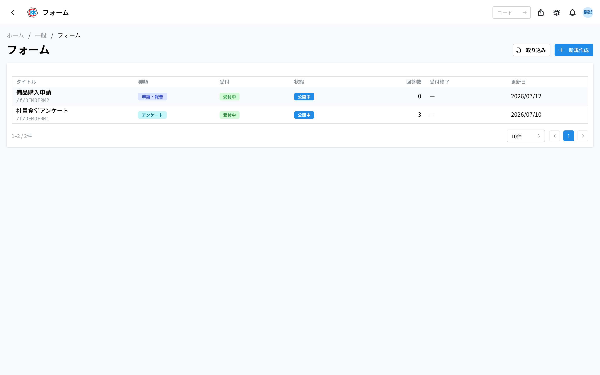
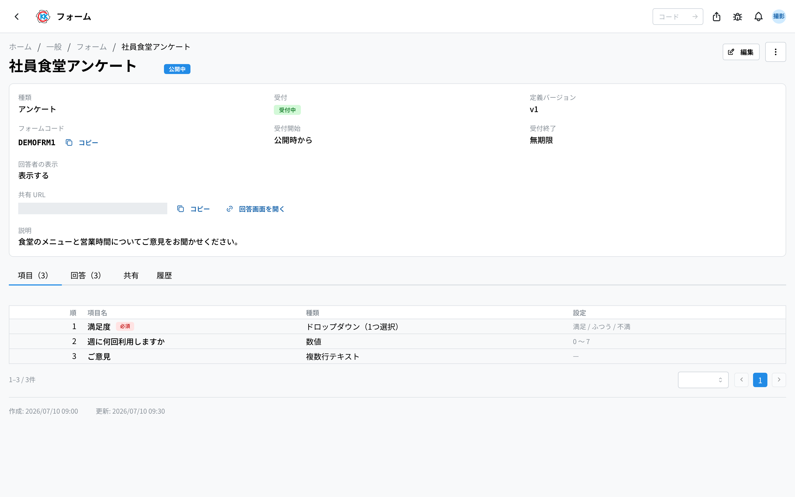
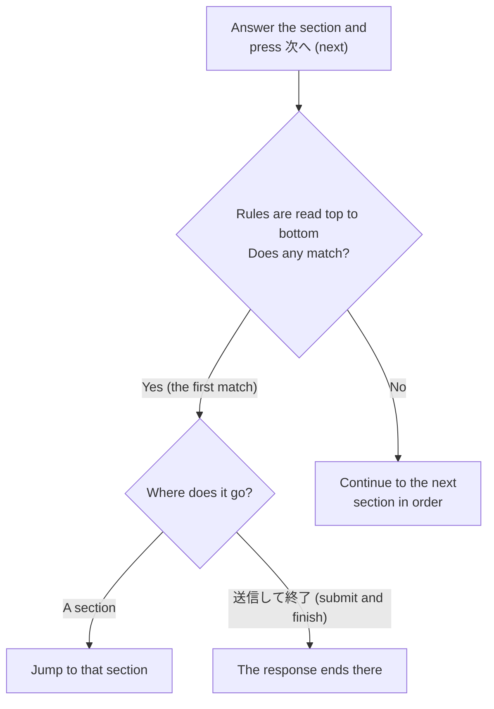
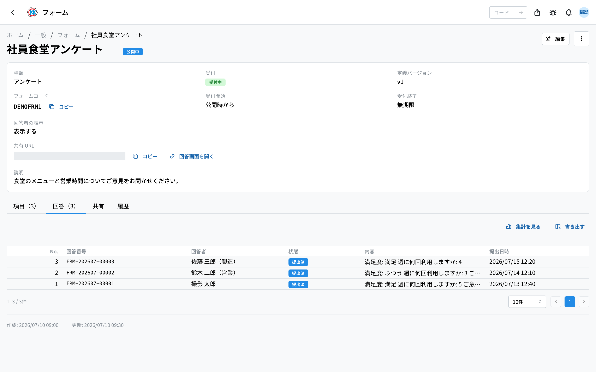

Build your own survey or request/report sheets and collect the answers. The operation code is `CM02`.

> ⚠️ This app is still being prepared, so it may not appear on the live system yet. If you cannot find it, please ask the person in charge at your company.

## What you can do

- Lay out your own questions to build a **form**.
- Share the form's **URL** so people in the company can answer it.
- Split a long form into **sections (pages)** and change which page comes next based on the answers.
- View all answers in a list, or **export them to Excel**.
- Print a single answer as a **PDF**, or print a whole batch at once.
- See "how many people chose what" on the **summary** screen.
- Hand the data to **Metabase** when you need deeper analysis.

## Words used on this page

- **Field** … one question in the form. "Name" and "Department" are two fields.
- **Response** … one submission. If one person submits twice, that is two responses.
- **Survey / Request-report** … the two kinds of form. A request-report goes to approvers once submitted.
- **Form code** … an 8-character code given to each form. You use it to filter in Metabase.
- **Section** … one page of a form that has been split into several. Leave it alone and the form stays a single page.
- **Branching rule** … a rule that says "when the answer is this, go to that section next".
- **Sharing** … who may see or answer this form. **With no sharing set, only you and administrators can see it.**

## Before you start

You need permission to create forms. If you cannot find the **"New"** button on the list, ask an administrator. Exporting answers in bulk also needs the export permission.

To collect answers you need **both** to set the form to "published" **and** to set up sharing. If either is missing, people will not see the form even with the URL.

## Reading the screen

Opening the app shows the forms you have made and the forms shared with you. The list shows "Title", "Kind", "Reception" (scheduled / open / closed), "Status" (Draft / Published / Archived), "Responses", "Closed" and "Updated". Click a row to open that form.

The top of the detail screen shows the kind, reception, form code, open period, share URL and so on. Below that, the screen is split into tabs.

- **Fields** … the questions in the form. Press **"Edit"** at the top right of the screen to change them.
- **Responses** … the answers collected. The summary and exports start here.
- **Approval** … only for request-report forms. Sets who approves.
- **Sharing** … who may see or answer.
- **History** … who did what, and when.

> 💡 The "Approval" and "Sharing" tabs open in read-only mode. Press **Edit** at the top right of the tab to change it, then press Save.

## Create a form [#create]

1. Press **"New"** at the top right of the list.
2. Under **"Basic settings"**, enter a "Title". Add a "Description" if needed (it appears at the top of the respondent's screen).
3. Under "Kind", choose "Survey (collect responses)" or "Request or report (approval steps can be added)".
4. Choose "Show respondents". Even with "Do not show respondents (summarize anonymously)", the system still records who answered.
5. If needed, fill in "Opens" and "Closed" under **"Open period"**. Left empty, the form accepts answers from the moment it is published.
6. Under "Editing by the respondent", choose whether respondents can change an answer after submitting it.
7. Press **"Save"**. The screen switches to the edit screen.
8. Under **"Item"**, add questions and arrange them.
9. Press **"Save"**.

For request-report forms, tick **"Use an approval flow"** to send submitted answers to approval. The approval steps are set afterwards on the form's **"Approval"** tab. To let each person answer only once, tick **"Allow only one response per person"**.

> 💡 If you change the fields after publishing, they are published as a new version. Answers already submitted keep the fields as they were when answered.

To bring a form over from another environment, choose **"Export the definition (.txt)"** from "⋯" on the detail screen, then press **"Import"** on the list in the destination and load that file. Answers and sharing settings are not carried over.

## Publish and stop accepting answers [#publish]

A newly made form is a **"Draft"** and nobody can answer it yet.

1. On the form's detail screen, press **"⋯"** at the top right.
2. Choose **"Publish"**.

The status becomes **"Published"**. A form with no fields cannot be published.

- To pause answers, choose **"Return to draft"** from "⋯". The share URL no longer accepts answers (existing answers stay).
- When a form is finished with, choose **"Archive"** from "⋯". It stops accepting answers, but the answers and summary remain.
- If you set a "Closed" date and time, answers stop automatically once it passes.

## Set up sharing [#share]

1. Open the **"Sharing"** tab.
2. Press **"Edit"**.
3. Press **"Add a share"**.
4. Under "Target", choose All, Site, Role or User, then choose who.
5. Choose the "Permission".
   - **Respond only** … can only answer. Cannot see other people's answers.
   - **View** … can see the answers. With "Narrow which responses are shown", you can show only the answers that match a condition.
   - **Edit** … can change the form's fields and settings.
   - **Manage** … can also change the sharing settings.
6. For request-report forms, people ticked with **"Notify when completed"** receive a notice when a request is completed. The notice also appears under "Completed requests" in their [Pending list](/manual/en/operations/general/my-tasks/user) (CM01).
7. Press **"Save"**.

## Answering a form (the respondent's screen) [#respond]

Open the share URL, or open the form from "Unanswered forms" in the [Pending list](/manual/en/operations/general/my-tasks/user) (CM01).

1. Answer the questions.
2. To stop partway, press **"Save as draft"**. You can continue the draft later.
3. When you are done, press **"Send"**.

On forms that can be answered more than once, press **"Respond once more"** after sending to write another answer.

## Splitting questions into pages and branching on answers [#sections]

A form with many questions can be split into **sections**, answered one page at a time. **Leave it unsplit and it stays a single page**, so existing forms look exactly as before.

### Splitting into pages

1. On the form's detail screen, press 「**編集**」(edit) at the top right.
2. Turn on 「**セクションに分ける**」(split into sections). Your current fields are gathered into "Section 1".
3. Press 「**＋ セクションを追加**」(add a section) for each further page and give it a title.
4. Drag a field into the section it belongs to (press and hold first on a phone). Sections themselves can be dragged to reorder.
5. Press 「**保存**」(save).

> 💡 A section that still holds fields cannot be deleted — you are told to move or delete the fields first.

### Changing the next page based on an answer

Each section can carry **branching rules**.

1. Under 「**分岐ルール**」(branching rules) for that section, press 「**ルールを追加**」(add a rule).
2. Press 「**条件を追加**」(add a condition) and choose a field, an operator and a value.
3. In 「**遷移先**」(go to), choose the section to jump to when the condition matches. Choosing 「**送信して終了**」(submit and finish) ends the response there.
4. Press 「**保存**」(save).

When a rule has two or more conditions, it applies **only when all of them match**. Rules are read **top to bottom and the first match wins**. If nothing matches, the respondent simply continues to the next section in order — which is also what happens when there are no rules at all.

As a diagram:

- Only 「**ドロップダウン（1つ選択）**」(dropdown) and 「**数値**」(number) fields can be used in a condition. Other types do not appear.
- Only fields asked **at or before that section** can be used. Fields further down the form are not offered.

### What the respondent sees

A sectioned form shows **one section at a time**, with 「**次へ**」(next) to advance and 「**戻る**」(back) to retrace the pages already visited.

> 💡 **Required fields in a skipped section never block submission.** You cannot end up unable to submit because of a question you were never asked.

> 💡 Import and export carry the sections too. A file exported before sections existed loads as "no sections".

## Export answers to Excel [#export-excel]

Use this when you want to work with the collected answers in a spreadsheet.

1. Open the **Responses** tab.
2. Press **Export**.
3. Narrow it down if you need to. Leave it alone to export everything.
   - **Status** … for example only "Approved". Drafts cannot be exported.
   - **Submitted date** … for example only March.
   - **Fields to export** … which questions become columns. All are ticked at first.
4. Press **Download as Excel**.

One row is one response and one column is one field. Numeric questions stay numeric, so you can total and sort them in Excel straight away.

> ⚠️ Answers contain what people wrote personally. Be careful where you save the file and who you send it to. **Every export is recorded.** Exporting needs the export permission.

## Print answers as PDF [#export-pdf]

Use this when you want to circulate answers on paper or keep a copy.

**A single answer**

1. On the **Responses** tab, click the answer you want.
2. Press **⋯** at the top right and choose **Print as PDF**.

For request-report forms, **the record of who approved and when is printed too**.

**A batch**

1. On the **Responses** tab press **Export**.
2. Narrow it down as you would for Excel.
3. Press **Print all as PDF**.

One answer becomes one page. A large batch takes a while.

Multi-line answers keep their line breaks and sub-tables print as tables.
Questions with no answer print "（未回答）" rather than a blank, so you can tell a
skipped question from a printing fault.

> 💡 Batch printing does not include the approval record. Print one at a time if you need it.

## Summarise the answers [#summary]

Press **View the summary** on the Responses tab (or **Summarize the responses** under "⋯" at the top right). Each question gets the chart that
suits its type.

| Question type | What you get |
|---|---|
| Pick one (dropdown, business-data lookup) | Doughnut chart with a breakdown |
| Pick several | Horizontal bars |
| Number | Min / average / median / max, plus a column chart of the spread |
| Date, time | A column chart showing when submissions cluster |
| Free text | No chart — a count and a few recent answers |
| Attachment, sub-table | Counts only |

Each question shows **Answered N / Unanswered M**. On optional questions, how many
people skipped it is a result too, so the denominator is shown alongside the count.

- **Most first / Definition order** under "Option order" changes how the choices are sorted. Definition
  order reads better when the order means something (a 1–5 rating scale).
- **Auto / Pie / Bar** under "Option chart" picks the chart shape for choice questions.
- **Monthly / Daily** under "How dates are grouped" changes how submissions over time are grouped.
- **CSV** saves the numbers behind the charts.

> 💡 **Pick-several questions never get a pie chart.** One person can tick two
> options, so the percentages add up to more than 100%. A pie would make "share of
> the whole" a lie, so those stay as bars (the percentage is "of the people who
> answered").

This screen only shows the breakdown of one question at a time. For cross-question analysis, use Metabase below.

## Deeper analysis in Metabase [#metabase]

**Metabase** turns company data into charts and tables. You do not need to write any code — it is all mouse work.

### Before you start

- Metabase uses **the same login you use every day**.
- If you are not sure how to open it, press **Open Metabase** on the summary screen.

### Steps

1. On the summary screen, press **Copy** next to **Form code**. The 8-character code is copied.
2. Press **Open Metabase**.
3. Choose **New** → **Question**.
4. For the data, pick **CKK Business** → **Form answer details**.
5. Press **Filter**, choose **Form code**, and paste the code you copied.
6. Press **Summarize** and choose **Count**.
7. Under **Group by**, choose **Field label** for a count per question. Add **Answer value** for the breakdown per choice.
8. Press **Visualization** to switch the table to a bar or pie chart.

### Worth knowing

- **Form answer details** has **one row per question per response**. Ten responses to a five-question form is fifty rows. Keep that in mind when counting.
- To see **one row per response**, use **Form responses** instead.
- Use the **Answer value (number)** and **Answer value (date)** columns for numeric and date questions — the plain text column cannot be calculated on.
- **Save** your question and you can reopen it any time for up-to-date numbers.

> ⚠️ On forms set to hide respondents, names do not appear in Metabase either. What the app hides stays hidden here.

> 💡 Draft answers never reach Metabase. Only submitted ones do.

## Questions and problems

**Q. I shared the URL but people say they cannot open it.**
A. Check the Sharing tab to confirm they are covered. A form with no sharing set is visible only to you and administrators. Also check that the form's status is "Published" and that it is currently open.

**Q. The Excel file has a column for a question I deleted.**
A. That is expected. Deleting a question does not delete the answers given before that. Dropping the column would make those responses unreadable.

**Q. Dates in Excel look shifted.**
A. Dates are exported in the time zone from your profile settings. Check that setting.

**Q. Some answers are missing from the export.**
A. There is a limit per export. Split it by month using the submitted-date filter.

**Q. My form does not appear in Metabase.**
A. Forms with no submitted answers do not appear. Metabase data can also lag slightly behind.

**Q. Metabase numbers do not match the app's summary.**
A. Form answer details has one row per question per response. To count responses, use Form responses, or count distinct response numbers.

**Q. I want to correct an answer I submitted.**
A. You can edit your own answer within the window the form allows. Open it and press Edit on the Answer tab. Approved answers, and answers whose approval has progressed, cannot be changed — ask an approver to send it back. An answer that was sent back can be fixed and resubmitted regardless of the window.

<!-- permissions:start -->
## Permissions required

This screen needs no special permission — being signed in is enough.

Permissions come through roles. If something is missing, ask an administrator.

For the whole picture see [Permissions and roles](../../../permissions).
<!-- permissions:end -->
