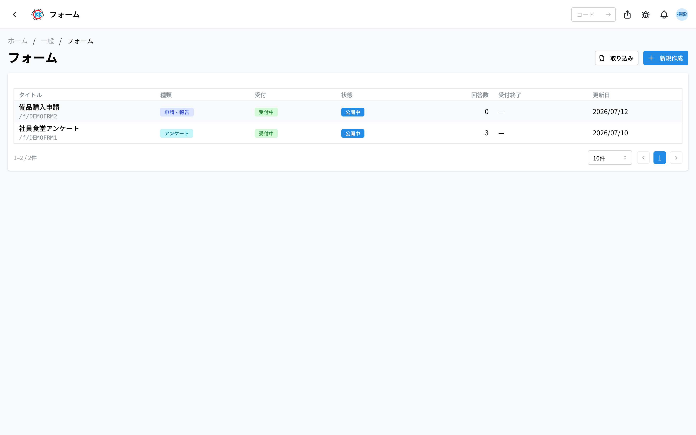
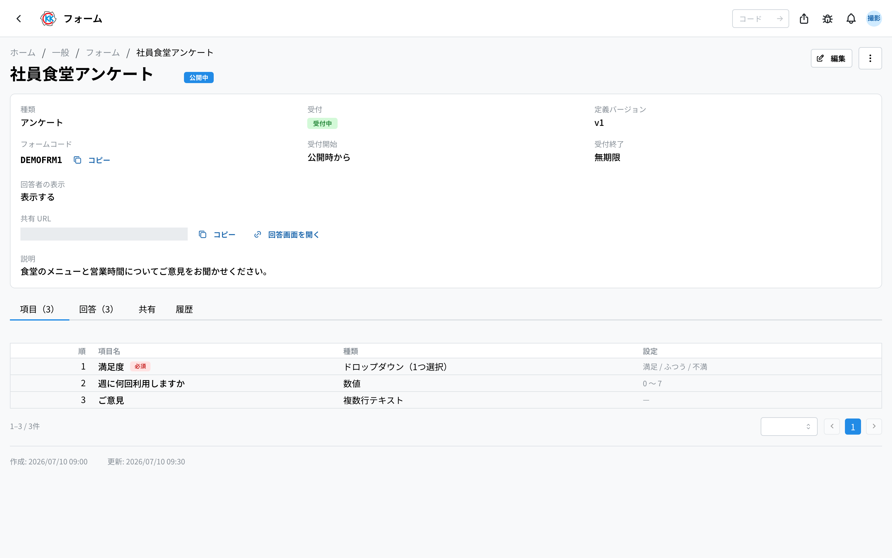
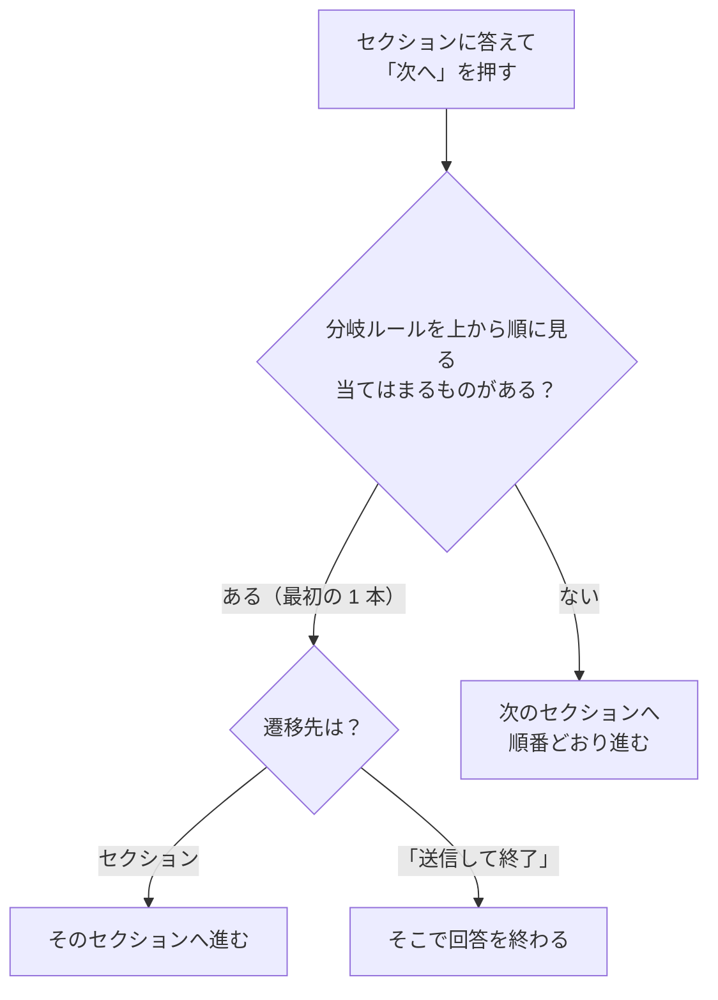
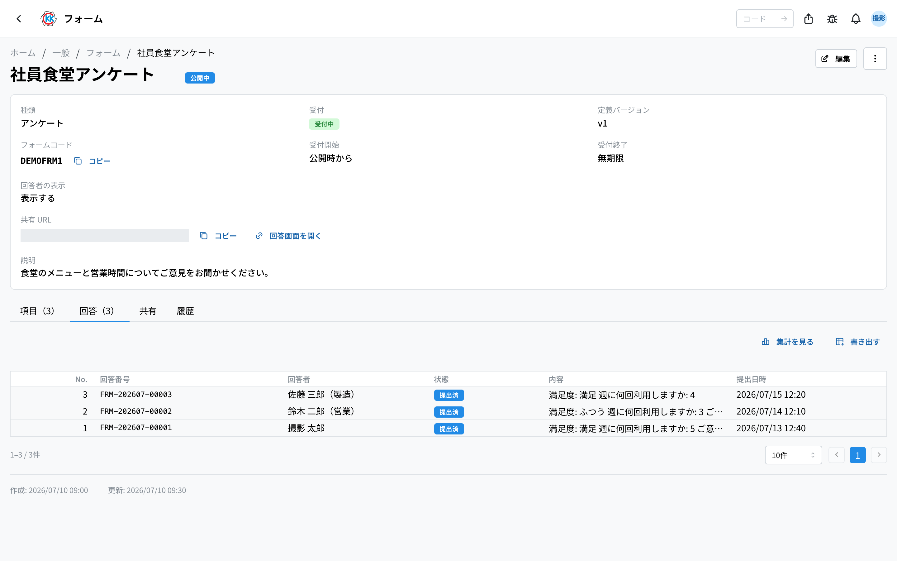

アンケートや申請・報告の用紙を自分で作り、集まった回答をまとめられるアプリです。操作コードは `CM02` です。

> ⚠️ このアプリはまだ準備中のため、本番の画面には出ていないことがあります。見当たらないときは、社内の担当者にご確認ください。

## このアプリでできること

- 質問の欄を自分で並べて、**用紙（フォーム）** を作れます。
- できたフォームの **URL を配る** と、社内の人が回答できます。
- 質問が多いときは **セクション（ページ）に分けて**、答えによって次のページを変えられます。
- 集まった回答を一覧で見たり、**Excel に書き出し** たりできます。
- 回答 1 件ずつを **PDF** にして印刷できます。まとめて印刷することもできます。
- 「何がどれだけ選ばれたか」を **集計** の画面でグラフにできます。
- もっと細かく分析したいときは、**Metabase** という別の道具に渡せます。

## 用語（このページで出てくる言葉）

- **項目（こうもく）** … フォームの中の質問 1 つのことです。「氏名」「部署」などが 1 項目です。
- **回答** … 誰かが 1 回入力して出したもののことです。1 人が 2 回出せば、回答は 2 件になります。
- **アンケート / 申請・報告** … フォームの種類です。申請・報告は、提出すると承認の人へ回ります。
- **フォームコード** … フォーム 1 つずつに付く 8 文字の記号です。Metabase で絞り込むときに使います。
- **セクション** … フォームを複数ページに分けたときの 1 ページぶんです。分けなければ 1 ページのままです。
- **分岐ルール** … 「この答えのときは、次にこのセクションへ進む」という決まりです。
- **共有** … 誰にこのフォームを見せる・答えてもらうかの設定です。**何も設定しないと、作った本人と管理者にしか見えません。**

## はじめる前に

フォームを作るには、フォームを作る権限が要ります。一覧に「**新規作成**」のボタンが見当たらないときは、管理の方に相談してください。回答をまとめて書き出すには、書き出しの権限も要ります。

回答を集めるには、**フォームを「公開」にする**ことと、**共有を設定する**ことの両方が必要です。どちらかが抜けていると、URL を配っても相手の画面には出てきません。

## 画面の見かた

アプリを開くと、自分が作ったフォームと、自分に共有されたフォームの一覧が出ます。一覧には「タイトル」「種類」「受付」（受付前 / 受付中 / 受付終了）「状態」（下書き / 公開中 / アーカイブ）「回答数」「受付終了」「更新日」が並びます。行をクリックすると、そのフォームの詳しい画面が開きます。

詳しい画面の上のほうには、種類・受付・フォームコード・受付期間・共有 URL などが出ます。その下はタブに分かれています。

- **項目** … どんな質問が並んでいるかを見られます。直すときは画面右上の「**編集**」を押します。
- **回答** … 集まった回答の一覧です。ここから集計と書き出しができます。
- **承認** … 申請・報告フォームのときだけ出ます。誰が承認するかの設定です。
- **共有** … 誰に見せる・答えてもらうかの設定です。
- **履歴** … このフォームに誰がいつ何をしたかの記録です。

> 💡 「承認」タブと「共有」タブは、最初「見るだけ」の状態で開きます。直したいときは、そのタブの右上にある「**編集**」を押してください。書き終わったら「保存」を押します。

## フォームを作る [#create]

1. 一覧の右上の「**新規作成**」を押します。
2. 「**基本設定**」で「タイトル」を入れます。必要なら「説明」も入れます（回答する人の画面の先頭に出ます）。
3. 「種類」で「アンケート（回答を集める）」か「申請・報告（承認ステップを付けられる）」を選びます。
4. 「回答者の表示」を選びます。「回答者を表示しない（匿名で集計）」にしても、誰が答えたかはシステムには残ります。
5. 必要なら「**受付期間**」の「受付開始」「受付終了」を入れます。空のままなら、公開したときから受け付けます。
6. 「回答者による編集」で、提出したあとに回答者が直せるかを選びます。
7. 「**保存**」を押します。編集の画面に切り替わります。
8. 「**項目**」で質問を追加して並べます。
9. 「**保存**」を押します。

申請・報告フォームでは、「**承認フローを使う**」に印を付けると、提出された回答が承認へ回ります。承認の段は、保存したあとにフォームの「**承認**」タブで決めます。1 人が 1 回しか答えられないようにしたいときは「**1 人 1 回だけ回答できるようにする**」に印を付けます。

> 💡 公開したあとに項目を直すと、新しいバージョンとして公開されます。それまでに出た回答は、回答した時点の項目のまま残ります。

別の環境で作ったフォームを持ってくるときは、詳しい画面の「⋯」から「**定義を書き出す（.txt）**」を選び、持っていく先の一覧で「**取り込み**」を押してそのファイルを読み込みます。回答と共有の設定は持っていけません。

## 公開する・受付を止める [#publish]

作ったばかりのフォームは「**下書き**」で、まだ誰も答えられません。

1. フォームの詳しい画面で、右上の「**⋯**」を押します。
2. 「**公開する**」を選びます。

公開すると状態が「**公開中**」になります。項目が 1 つも無いと公開できません。

- 受付を一時的に止めたいときは、「⋯」から「**下書きに戻す**」を選びます。共有 URL を開いても回答できなくなります（今ある回答は残ります）。
- 使い終わったフォームは、「⋯」から「**アーカイブする**」を選びます。受付は止まりますが、回答と集計は残ります。
- 「受付終了」の日時を入れておくと、その時刻を過ぎたところで自動で受付が終わります。

## 共有を設定する [#share]

1. 「**共有**」タブを開きます。
2. 「**編集**」を押します。
3. 「**共有先を追加**」を押します。
4. 「対象」で、全社・拠点・ロール・個人のどれかを選び、相手を選びます。
5. 「権限」を選びます。
   - **回答のみ** … 答えることだけできます。他の人の回答は見えません。
   - **閲覧** … 回答を見られます。「見せる回答を絞る」で、条件に当てはまる回答だけを見せることもできます。
   - **編集** … フォームの項目や設定を直せます。
   - **管理** … 共有の設定まで変えられます。
6. 申請・報告フォームでは、「**完了したら通知する**」に印を付けた相手に、申請が完了したときの通知が届きます。届いた通知は、その人の[未処理一覧](/manual/ja/operations/general/my-tasks/user)（CM01）の「完了した申請」に並びます。
7. 「**保存**」を押します。

## 回答する（答える人の画面） [#respond]

共有 URL を開くか、[未処理一覧](/manual/ja/operations/general/my-tasks/user)（CM01）の「未回答のフォーム」から開きます。

1. 質問に答えます。
2. 途中でやめるときは「**下書き保存**」を押します。下書きはあとで続きから書けます。
3. 書き終わったら「**送信**」を押します。

何度でも答えられるフォームでは、送信したあとに「**もう 1 件回答する**」で次の回答を書けます。

## 質問をページに分ける・答えで分岐する [#sections]

質問が多いフォームは、**セクション**に分けて 1 ページずつ答えてもらえます。**分けなければこれまでどおり 1 ページのまま**なので、いま使っているフォームの見た目は変わりません。

### ページに分ける

1. フォームの詳しい画面で、右上の「**編集**」を押します。
2. 「**セクションに分ける**」を入れると、いまの項目が「セクション 1」にまとまります。
3. 「**＋ セクションを追加**」で 2 ページ目以降を作り、タイトルを入れます。
4. 項目はドラッグして、入れたいセクションへ移せます（スマホは長押ししてから動かします）。セクションそのものもドラッグして順番を変えられます。
5. 「**保存**」を押します。

> 💡 項目が入っているセクションは削除できません（「先に項目を移動または削除してください」と出ます）。

### 答えによって次のページを変える

セクションごとに「**分岐ルール**」を作れます。

1. 分岐させたいセクションの「**分岐ルール**」で「**ルールを追加**」を押します。
2. 「**条件を追加**」で、項目・条件・値を選びます。
3. 「**遷移先**」で、条件に当てはまったときに進むセクションを選びます。**「送信して終了」**を選ぶと、そこで回答を終わりにできます。
4. 「**保存**」を押します。

1 本のルールに条件を 2 つ以上付けると、**全部に当てはまったときだけ**そのルールが使われます。ルールは**上から順に見て、最初に当てはまった 1 本**が使われます。どれにも当てはまらなければ、次のセクションへ順番どおり進みます（ルールを作らなければ常にこの動きです）。

図にすると次のとおりです。

- 条件に使えるのは「**ドロップダウン（1つ選択）**」と「**数値**」の項目だけです。ほかの型は条件に出てきません。
- 条件に使えるのは、**そのセクションまでに聞いた項目**だけです。まだ聞いていない後ろの項目は選べません。

### 答える人の画面

セクションがあるフォームは、**1 セクションずつ**表示されます。「**次へ**」で進み、「**戻る**」で通ってきたページを戻れます。

> 💡 **飛ばしたセクションの必須項目は、提出をさまたげません。** 「答えていないのに必須と言われて出せない」ということは起きない作りです。

> 💡 取込・書き出し（フォームのコピー）もセクションごと運びます。セクションが無かった頃に書き出したファイルは「セクション未使用」として読み込めます。

## 回答を Excel に書き出す [#export-excel]

集まった回答を表計算ソフトで扱いたいときに使います。

1. 「**回答**」タブを開きます。
2. 「**書き出す**」を押します。
3. 出てきた画面で、必要なら次の条件を指定します。指定しなければ全部が対象です。
   - **状態** … 「承認済」だけ、のように絞れます。下書きは書き出せません。
   - **提出日** … 「3 月に出たものだけ」のように絞れます。
   - **書き出す項目** … 列に出す質問を選べます。最初はすべてに印が付いています。
4. 「**Excel でダウンロード**」を押します。

ファイルは 1 行が 1 回答、1 列が 1 項目になっています。数値の質問は数値のまま入るので、Excel でそのまま合計や並べ替えができます。

> ⚠️ 回答には個人が書いた内容が入ります。書き出したファイルの置き場所と渡す相手には注意してください。**誰がいつ書き出したかは記録に残ります。** 書き出しには書き出しの権限が要ります。

## 回答を PDF で印刷する [#export-pdf]

紙で回覧したり、控えとして残したりするときに使います。

**1 件だけ印刷する**

1. 「**回答**」タブで、印刷したい回答をクリックします。
2. 右上の「**⋯**」を押して、「**PDF で印刷**」を選びます。

申請・報告フォームでは、**誰がいつ承認したかの記録も一緒に印刷** されます。

**まとめて印刷する**

1. 「**回答**」タブで「**書き出す**」を押します。
2. Excel のときと同じように条件を指定します。
3. 「**PDF でまとめて印刷**」を押します。

1 件が 1 ページになります。件数が多いと時間がかかります。

複数行の回答は改行のまま、サブテーブルは表のまま印刷されます。答えていない項目は
空欄ではなく「（未回答）」と出るので、書き忘れなのか印刷漏れなのかが判ります。

> 💡 まとめて印刷したものには、承認の記録は入りません。承認の記録が要るときは、1 件ずつ印刷してください。

## 回答を集計する [#summary]

「回答」タブの「**集計を見る**」を押すと、質問の種類に合わせたグラフが出ます（右上の「⋯」の「**回答を集計する**」からも開けます）。

| 質問の種類 | 出るもの |
|---|---|
| 1 つだけ選ぶ（ドロップダウン・業務データ検索） | 円グラフ（ドーナツ）と内訳 |
| 複数選べる | 横棒 |
| 数値 | 最小・平均・中央・最大と、値の分布の縦棒 |
| 日付・時刻 | いつに寄っているかの縦棒 |
| 自由記述 | グラフにしません（件数と、最近の回答の抜粋） |
| 添付・サブテーブル | 件数だけ |

質問ごとに「**回答 N / 未回答 M**」が出ます。必須でない質問では「答えなかった人が
何人いたか」も結果なので、答えた数だけでなく母数も一緒に出しています。

- 「選択肢の並び」の「**多い順 / 定義順**」で、選択肢の並び方を変えられます。5 段階評価のように
  順序に意味がある質問は「定義順」のほうが読めます。
- 「選択肢のグラフ」の「**自動 / 円 / 棒**」で、選択肢のグラフの形を選べます。
- 「日付のまとめ方」の「**月別 / 日別**」で、提出の推移のまとめ方を変えられます。
- 「**CSV**」を押すと、グラフの数字を表として保存できます。

> 💡 **複数選べる質問は円グラフにできません。** 1 人が 2 つ以上選べるので、
> 割合を足すと 100% を超えます。円にすると「全体の何割」が嘘になるため、
> 横棒だけにしてあります（割合は「回答した人のうち何 %」です）。

この画面でわかるのは「1 つの質問の内訳」までです。質問どうしの掛け合わせや、他の業務データとの突き合わせは、次の Metabase で行います。

## Metabase でもっと詳しく集計する [#metabase]

**Metabase（メタベース）** は、社内のデータをグラフや表にするための道具です。プログラムを書かなくても、マウスの操作だけで集計できます。

### 使う前に

- Metabase は **ふだんのログインと同じ ID** で入れます。
- 開き方がわからないときは、集計の画面にある「**Metabase を開く**」を押してください。

### フォームの回答を出す手順

1. 集計の画面で「**フォームコード**」の横にある「**コピー**」を押します。8 文字の記号がコピーされます。
2. 「**Metabase を開く**」を押します。
3. Metabase の画面で「**新規**」→「**質問**」を選びます。
4. データの選択で「**CKK 業務**」→「**フォーム回答明細**」を選びます。
5. 「**フィルタ**」を押して「**フォームコード**」を選び、さきほどコピーした記号を貼り付けます。
6. 「**集計**」を押して「**カウント**」を選びます。
7. 「**グループ化**」で「**項目名**」を選ぶと、質問ごとの件数が出ます。さらに「**回答値**」を足すと、選択肢ごとの内訳になります。
8. 「**可視化**」を押すと、表を棒グラフや円グラフに変えられます。

### 覚えておくとよいこと

- 「**フォーム回答明細**」は **1 行が「1 つの回答の 1 つの質問」** です。回答が 10 件で質問が 5 つあれば 50 行になります。件数を数えるときは、この形を思い出してください。
- **回答そのものを 1 行で見たい**ときは「**フォーム回答**」を選びます。こちらは 1 行が 1 回答です。
- 数値の質問は「**回答値(数値)**」、日付の質問は「**回答値(日付)**」の列を使うと、合計や期間の絞り込みができます。文字の列（「回答値」）のままでは計算できません。
- 作った質問は「**保存**」しておくと、次から開くだけで最新の数字が見られます。

> ⚠️ 「回答者を表示しない」設定のフォームでは、Metabase でも回答者の名前は出ません。アプリの画面で隠したものは、こちらでも隠れています。

> 💡 下書きの回答は Metabase には出てきません。提出されたものだけが対象です。

## よくある質問・困ったとき

**Q. URL を配ったのに「開けません」と言われます。**
A. 「共有」タブで、その人が対象になっているか確かめてください。共有を 1 つも設定していないフォームは、作った本人と管理者にしか見えません。フォームの状態が「公開中」で、受付が「受付中」になっているかも合わせて確認してください。

**Q. 書き出した Excel に、消した質問の列が入っています。**
A. 正常な動きです。質問を消しても、それより前に出された回答はその答えを持っています。消えた列を出さないと、その回答が読めなくなるため残しています。

**Q. Excel の日付がずれて見えます。**
A. 日付はご自分の表示設定（プロフィール）のタイムゾーンで書き出されます。設定を確かめてください。

**Q. 書き出したい回答が全部入っていません。**
A. 一度に書き出せる件数には上限があります。「提出日」で月ごとに区切って、何回かに分けて書き出してください。

**Q. Metabase にフォームが出てきません。**
A. 提出された回答が 1 件も無いフォームは出てきません。また、Metabase のデータは少し遅れて反映されることがあります。

**Q. Metabase で数字がアプリの集計と合いません。**
A. 「フォーム回答明細」は 1 行が「1 回答 × 1 質問」です。回答の件数を数えたいときは「フォーム回答」を使うか、「回答番号」の重複を除いて数えてください。

**Q. 提出した回答を直したいです。**
A. 自分が出した回答は、フォームの設定で決められた期限内なら直せます。回答を開いて「回答」タブの「編集」を押してください。承認済みの回答や、承認が進んでいる回答は直せません。その場合は承認の方に差し戻してもらってください。差し戻された回答は、期限に関係なく直して出し直せます。

<!-- permissions:start -->
## 必要な権限

この画面に特別な権限は要りません。ログインしていれば使えます。

権限は役割（ロール）を通して付きます。足りないときは管理者に相談してください。

権限の全体像は「[権限とロール](../../../permissions)」を参照してください。
<!-- permissions:end -->
