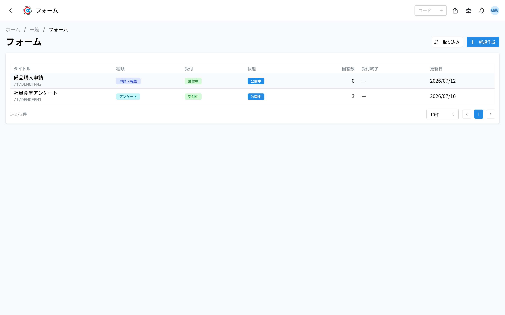
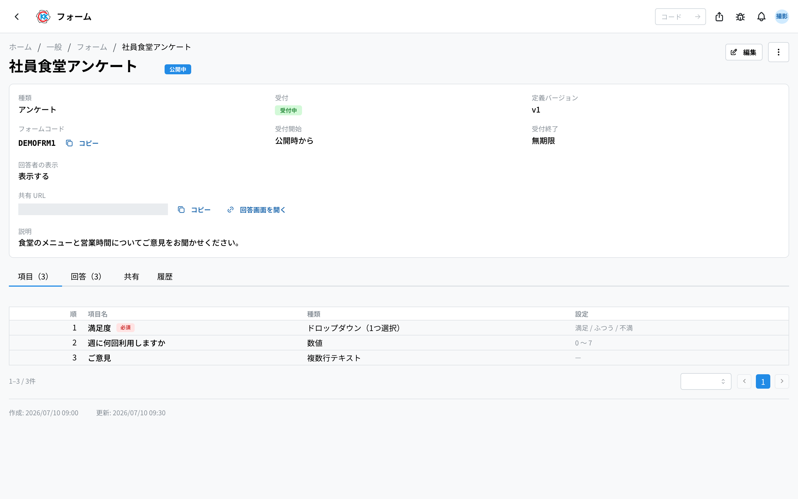
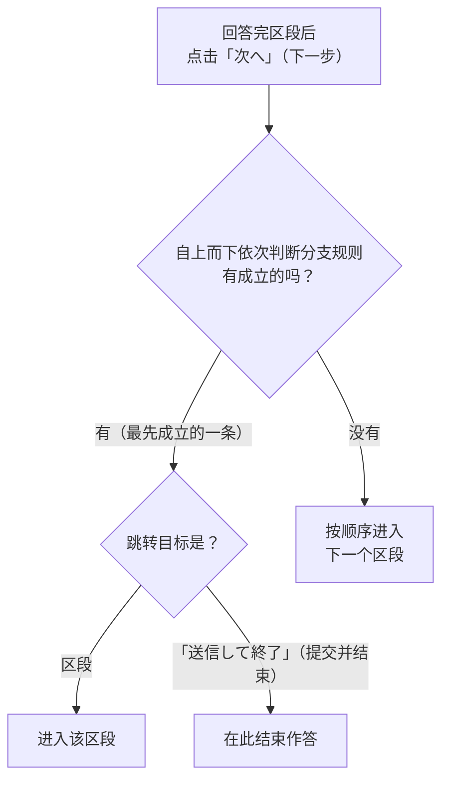
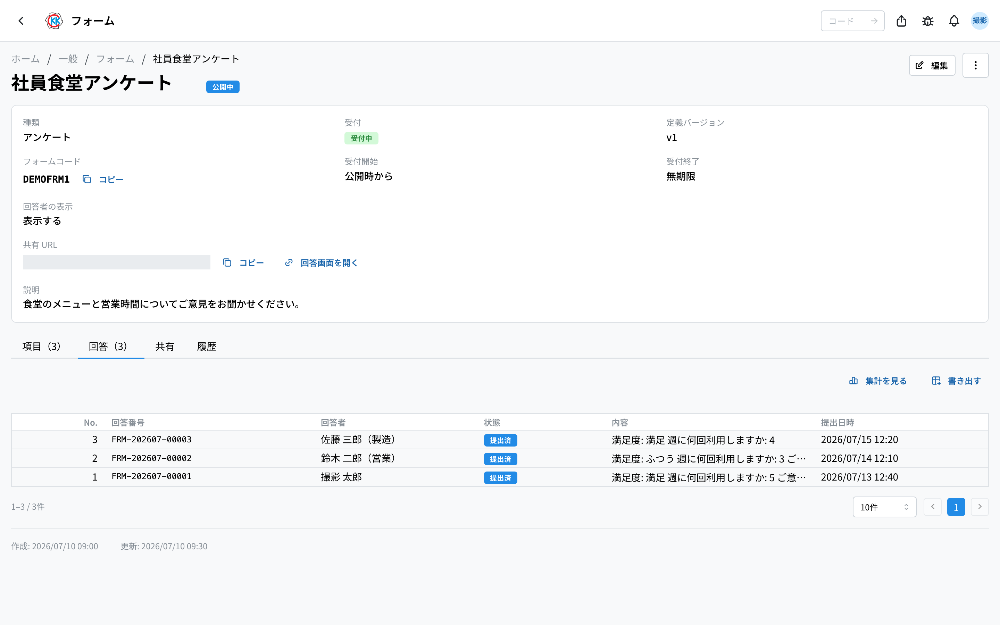

可以自行制作问卷或申请、报告用的表单，并汇总收集到的回答。操作代码为 `CM02`。

> ⚠️ 本应用仍在准备中，正式环境上可能还看不到。找不到时请咨询公司内的负责人。

## 这个应用能做什么

- 自行排列问题，制作**表单**。
- 分发表单的 **URL**，公司内的人就可以填写。
- 问题较多时，可以**分成多个区段（页面）**，并根据回答改变下一页。
- 以列表查看回答，或**导出到 Excel**。
- 将单条回答打印为 **PDF**，也可以批量打印。
- 在**汇总**画面上看到「什么被选了多少次」。
- 需要更细致的分析时，交给 **Metabase** 处理。

## 本页出现的词语

- **项目** … 表单中的一个问题。「姓名」「部门」各算一个项目。
- **回答** … 一次提交的内容。同一个人提交两次，就是两条回答。
- **问卷 / 申请・报告** … 表单的种类。申请・报告提交后会转给审批人。
- **表单代码** … 每个表单的 8 位代码。在 Metabase 中筛选时使用。
- **区段** … 把表单分成多页时的一页。不分就仍是一页。
- **分支规则** … 「回答是这个时，下一步进入那个区段」的规定。
- **共享** … 设定谁可以查看或填写本表单。**未做任何设定时，只有创建者和管理员能看到。**

## 开始之前

创建表单需要相应权限。列表中找不到「**新建**」按钮时请咨询管理员。批量导出回答还需要导出权限。

要收集回答，**既要**把表单「发布」，**也要**设置共享。缺少任何一项，对方即使有 URL 也看不到表单。

## 画面的看法

打开应用会显示自己创建的表单和共享给自己的表单列表。列表中显示「标题」「种类」「受理」（未开始 / 受理中 / 已结束）「状态」（草稿 / 已发布 / 已归档）「回答数」「已结束」「更新日」。点击某一行即可打开该表单。

详细画面上方显示种类、受理、表单代码、受理期间、共享 URL 等。下方分为多个标签页。

- **项目** … 查看排列了哪些问题。修改时按画面右上角的「**编辑**」。
- **回答** … 收集到的回答列表。汇总和导出从这里开始。
- **审批** … 仅申请・报告表单显示。设定由谁审批。
- **共享** … 设定谁可以查看或填写。
- **历史** … 谁在何时做了什么的记录。

> 💡 「审批」和「共享」标签页默认以「只读」状态打开。要修改时，请按该标签页右上角的「**编辑**」，写完后按「保存」。

## 创建表单 [#create]

1. 按列表右上角的「**新建**」。
2. 在「**基本设置**」中填写「标题」。需要时也填写「说明」（会显示在填写者画面的开头）。
3. 在「种类」中选择「问卷（收集回答）」或「申请・报告（可添加审批级别）」。
4. 选择「显示回答人」。即使选择「不显示回答人（匿名汇总）」，系统中仍会记录是谁回答的。
5. 需要时，在「**受理期间**」中填写「开始受理」和「已结束」。留空则从发布时开始受理。
6. 在「回答人编辑」中选择提交后回答人能否修改。
7. 按「**保存**」。画面会切换到编辑画面。
8. 在「**项目**」中添加并排列问题。
9. 按「**保存**」。

申请・报告表单中，勾选「**使用审批流程**」后，提交的回答会转入审批。审批级别在保存后到表单的「**审批**」标签页中设定。想让每人只能回答一次时，勾选「**每人仅可回答一次**」。

> 💡 发布后修改项目，会作为新版本发布。已提交的回答会保持回答当时的项目不变。

要从其他环境带入表单时，在详细画面的「⋯」中选择「**导出定义（.txt）**」，然后在目标环境的列表中按「**导入**」读取该文件。回答和共享设置不会带过去。

## 发布・停止受理 [#publish]

刚创建的表单是「**草稿**」，还没有人能回答。

1. 在表单的详细画面按右上角的「**⋯**」。
2. 选择「**发布**」。

发布后状态变为「**已发布**」。一个项目都没有的表单无法发布。

- 想暂时停止受理时，从「⋯」中选择「**退回草稿**」。打开共享 URL 也无法回答（已有的回答会保留）。
- 用完的表单，从「⋯」中选择「**归档**」。受理会停止，但回答和汇总会保留。
- 如果填写了「已结束」的日期时间，过了该时间会自动停止受理。

## 设置共享 [#share]

1. 打开「**共享**」标签页。
2. 按「**编辑**」。
3. 按「**添加共享对象**」。
4. 在「对象」中选择全公司・据点・角色・个人之一，再选择具体对象。
5. 选择「权限」。
   - **仅回答** … 只能回答，看不到其他人的回答。
   - **查看** … 可以查看回答。使用「限定显示的回答」，可以只显示符合条件的回答。
   - **编辑** … 可以修改表单的项目和设置。
   - **管理** … 还可以修改共享设置。
6. 申请・报告表单中，勾选了「**完成后通知**」的对象，会在申请完成时收到通知。该通知也会出现在对方[未处理列表](/manual/zh/operations/general/my-tasks/user)（CM01）的「已完成的申请」中。
7. 按「**保存**」。

## 填写表单（填写者的画面） [#respond]

打开共享 URL，或从[未处理列表](/manual/zh/operations/general/my-tasks/user)（CM01）的「未回答的表单」中打开。

1. 回答问题。
2. 中途停止时按「**保存草稿**」。之后可以接着填写草稿。
3. 填写完毕后按「**发送**」。

可多次回答的表单，发送后按「**再回答一条**」即可填写下一条回答。

## 把问题分页・按回答分支 [#sections]

问题较多的表单，可以分成**区段**，让填写者一页一页作答。**不分的话仍和以前一样是一页**，现有表单的外观不会改变。

### 分成多页

1. 在表单的详细画面点击右上角的「**編集**」（编辑）。
2. 打开「**セクションに分ける**」（分成区段），当前的项目会归入「区段 1」。
3. 用「**＋ セクションを追加**」（添加区段）创建第二页以后的页面，并填写标题。
4. 拖动项目即可移到想要的区段（手机上先长按再移动）。区段本身也可以拖动排序。
5. 点击「**保存**」（保存）。

> 💡 还有项目的区段无法删除（会提示先移动或删除项目）。

### 根据回答改变下一页

每个区段都可以设置「**分岐ルール**」（分支规则）。

1. 在该区段的「**分岐ルール**」中点击「**ルールを追加**」（添加规则）。
2. 用「**条件を追加**」（添加条件）选择项目、条件与数值。
3. 在「**遷移先**」（跳转目标）中选择条件成立时进入的区段。选择「**送信して終了**」（提交并结束）则在此结束作答。
4. 点击「**保存**」（保存）。

一条规则附有两个以上条件时，**只有全部成立时**才采用该规则。规则**自上而下依次判断，采用最先成立的一条**。都不成立时，就按顺序进入下一个区段（没有设置规则时也是这样）。

用图表示如下。

- 可用于条件的只有「**ドロップダウン（1つ選択）**」（下拉・单选）和「**数値**」（数值）项目，其他类型不会出现在选项里。
- 只能使用**该区段之前（含本区段）已经问过的项目**，后面还没问的项目无法选择。

### 填写者看到的画面

分了区段的表单**一次显示一个区段**，用「**次へ**」（下一步）前进，用「**戻る**」（上一步）返回已经走过的页面。

> 💡 **被跳过的区段中的必填项目不会妨碍提交。** 不会出现「没被问到却因必填而无法提交」的情况。

> 💡 导入・导出（表单的复制）也会带上区段。在还没有区段功能时导出的文件，会按「未使用区段」读入。

## 将回答导出到 Excel [#export-excel]

想用电子表格软件处理收集到的回答时使用。

1. 打开「**回答**」标签页。
2. 按「**导出**」。
3. 需要时指定以下条件。不指定则导出全部。
   - **状态** … 例如只导出「已批准」。草稿无法导出。
   - **提交日期** … 例如只导出 3 月提交的。
   - **导出的项目** … 选择作为列的问题。初始为全选。
4. 按「**导出为 Excel**」。

文件中一行为一条回答，一列为一个项目。数值类问题保持数值格式，可直接在 Excel 中求和与排序。

> ⚠️ 回答中包含个人填写的内容。请注意文件的保存位置和发送对象。**谁在何时导出都会留下记录。** 导出需要导出权限。

## 将回答打印为 PDF [#export-pdf]

想以纸质传阅或留作存根时使用。

**打印单条**

1. 在「**回答**」标签页点击要打印的回答。
2. 按右上角的「**⋯**」，选择「**打印为 PDF**」。

申请・报告表单会**一并打印谁在何时审批的记录**。

**批量打印**

1. 在「**回答**」标签页按「**导出**」。
2. 与 Excel 相同地指定条件。
3. 按「**批量打印为 PDF**」。

一条回答为一页。数量多时需要一些时间。

多行回答会保留换行，子表格会以表格形式打印。未回答的项目不是留空，而是显示
「（未回答）」，以便区分是漏答还是漏印。

> 💡 批量打印不包含审批记录。需要审批记录时请逐条打印。

## 汇总回答 [#summary]

在「回答」标签页按「**查看汇总**」（也可从右上角「⋯」中的「**汇总回答**」打开），会按问题的类型显示相应的图表。

| 问题类型 | 显示内容 |
|---|---|
| 单选（下拉、业务数据检索） | 圆环图与明细 |
| 多选 | 横向柱状图 |
| 数值 | 最小 / 平均 / 中位 / 最大，以及分布的纵向柱状图 |
| 日期、时间 | 显示集中在何时的纵向柱状图 |
| 自由填写 | 不做图表（件数与最近回答的摘录） |
| 附件、子表格 | 仅显示件数 |

每个问题都会显示「**回答 N / 未回答 M**」。对于非必填的问题，「有多少人没有回答」
本身也是结果，所以同时给出分母。

- 「选项顺序」中的「**从多到少 / 定义顺序**」可改变选项的排列方式。像 5 级评价这类顺序本身有意义的
  问题，用「定义顺序」更易读。
- 「选项图表」中的「**自动 / 圆 / 柱**」可选择选项图表的形式。
- 「日期归类方式」中的「**按月 / 按日**」可改变提交趋势的归类方式。
- 按「**CSV**」可将图表的数字保存为表格。

> 💡 **多选题不能用圆环图。** 一个人可以选两项以上，比例相加会超过 100%。
> 用圆形会让「占整体的比例」变成谎言，所以只用横向柱状图（比例是「在回答者中占
> 百分之几」）。

此画面只能看到「单个问题的构成」。问题之间的交叉分析请使用下面的 Metabase。

## 在 Metabase 中做更细致的汇总 [#metabase]

**Metabase** 是把公司数据变成图表的工具。无需编写程序，只用鼠标操作即可汇总。

### 使用之前

- Metabase 使用**与平时相同的登录账号**。
- 不知道如何打开时，请按汇总画面上的「**打开 Metabase**」。

### 操作步骤

1. 在汇总画面按「**表单代码**」旁边的「**复制**」，8 位代码即被复制。
2. 按「**打开 Metabase**」。
3. 在 Metabase 中选择「**新建**」→「**问题**」。
4. 数据选择「**CKK 业务**」→「**表单回答明细**」。
5. 按「**筛选**」选择「**表单代码**」，粘贴刚才复制的代码。
6. 按「**汇总**」选择「**计数**」。
7. 在「**分组**」中选择「**项目名**」，即可得到每个问题的件数。再加上「**回答值**」，就是各选项的构成。
8. 按「**可视化**」可将表格切换为柱状图或饼图。

### 值得记住的几点

- 「**表单回答明细**」**一行是「一条回答的一个问题」**。10 条回答、5 个问题就是 50 行。计数时请记住这个形式。
- 想**以一行看一条回答**时，请选择「**表单回答**」。
- 数值类问题请用「**回答值(数值)**」列，日期类问题请用「**回答值(日期)**」列，这样才能求和与按期间筛选。文字列（「回答值」）无法计算。
- 把做好的问题「**保存**」下来，下次打开就能看到最新数字。

> ⚠️ 设为「不显示回答者」的表单，在 Metabase 中同样不显示回答者姓名。应用中隐藏的内容在这里也是隐藏的。

> 💡 草稿状态的回答不会出现在 Metabase 中，只有已提交的才会。

## 常见问题

**Q. 分发了 URL，但对方说打不开。**
A. 请在「共享」标签页确认对方是否在范围内。未设置任何共享的表单，只有创建者和管理员能看到。同时请确认表单状态是否为「已发布」、受理是否为「受理中」。

**Q. 导出的 Excel 中有已删除问题的列。**
A. 这是正常的。删除问题后，此前提交的回答仍然保有该答案。不输出该列会导致那些回答无法阅读。

**Q. Excel 中的日期看起来有偏差。**
A. 日期按您个人设置（个人资料）中的时区导出，请确认该设置。

**Q. 想导出的回答没有全部包含在内。**
A. 单次导出有数量上限。请用「提交日期」按月分几次导出。

**Q. Metabase 中找不到我的表单。**
A. 没有任何已提交回答的表单不会出现。另外 Metabase 的数据可能会稍有延迟。

**Q. Metabase 的数字与应用的汇总对不上。**
A. 「表单回答明细」一行是「一条回答 × 一个问题」。要统计回答件数时，请使用「表单回答」，或按「回答编号」去重计数。

**Q. 想修改已提交的回答。**
A. 自己提交的回答在表单设定的期限内可以修改。打开回答后按「回答」标签页的「编辑」。已批准的回答或审批已推进的回答无法修改，请让审批人退回。被退回的回答不受期限限制，可以修改后重新提交。

<!-- permissions:start -->
## 所需权限

仅打开本画面不需要特别权限，但下列操作分别需要相应权限。

### 各操作所需权限

| 想做的事 | 所需权限 |
| --- | --- |
| 新建或导入表单 | 表单（`form`）— 新建 |
| 变更表单的设置、项目或共享（还需要该表单的编辑权限） | 表单（`form`）— 更新 |
| 将回答导出为 CSV / PDF | 表单（`form`）— 导出 |

权限通过角色授予。若不足，请与管理员联系。

权限的整体说明请参见「[权限与角色](../../../permissions)」。
<!-- permissions:end -->
