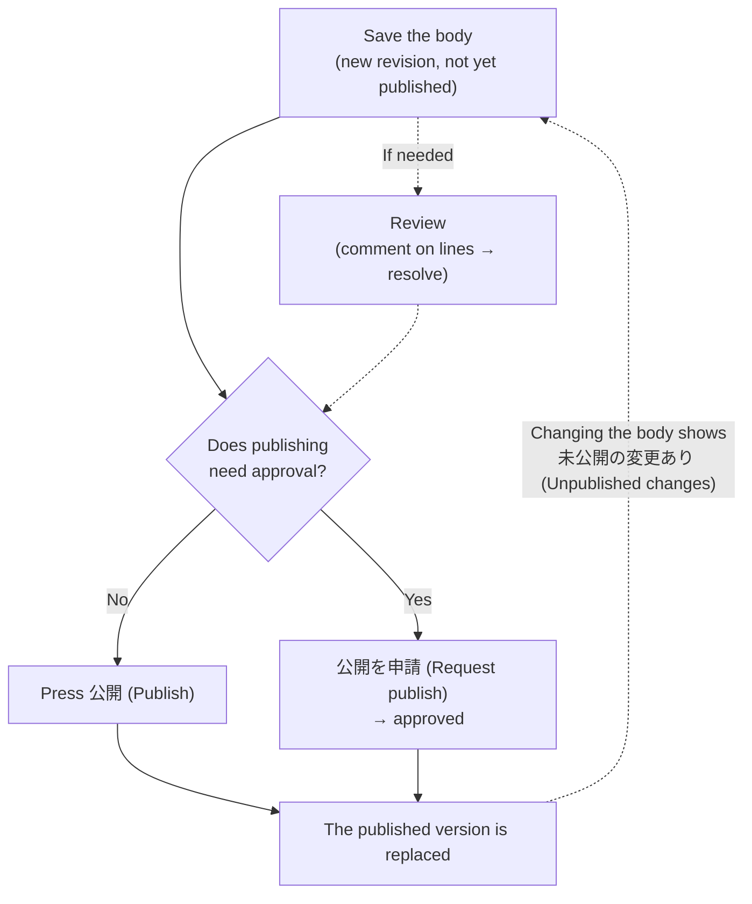

An app for **writing and sharing documents inside the company** — procedures, cautions, handover notes and the like. The operation code is `CM03`.

> ⚠️ For now this app is available **in the test environment only**. Screens and steps may change before it becomes available in production.

## What you can do with this app

- Write a document and publish it only to the people you want to show it to (the whole company, a site, a role, or individuals).
- Every rewrite leaves a version (revision), and you can compare it with earlier versions.
- Before publishing, the document can be reviewed with comments attached line by line.
- A document can be set so that "publishing needs approval".
- Use it to gather in one place things that used to be handed out on paper, such as shipping and inspection procedures.

## Words used on this page

- **Revision (version)** … the history that grows each time you save. Revisions are referred to by number.
- **Published version** … the version readers see right now. It is not necessarily the latest version.
- **Review** … the screen for discussing the document, by attaching comments to lines of the body, before it is published.
- **Shared with** … the people who can read the document. If nothing is set, only the person who created it and administrators can read it.

## Before you start

- Creating a document needs the Create permission (without it, the 「文書を作る」 (Create document) button does not appear).
- If publishing is to use approval, set up the steps in [Approval settings](/manual/en/operations/masters/approval-setting/user) beforehand.

## Creating a document

1. Press 「**文書を作る**」 (Create document) on the list.
2. Enter the 「タイトル」 (Title). **You can build a hierarchy by separating with slashes** (for example `手順書/出荷`).
3. If needed, turn on 「**公開に承認を必要とする**」 (Require approval to publish).
4. Write the content in 「本文（Markdown）」 (Body (Markdown)).
5. Press 「**本文を保存（新しいリビジョン）**」 (Save body (new revision)).

When you save, 「リビジョン 1 として保存しました」 (Saved as revision 1) is shown. Saving alone does **not publish it yet**.

> 💡 Writing "a word about what you fixed" in the change-reason box makes it easier to find in the history later.

## How to write (Markdown)

- Headings, bullet lists and tables can be used. 「太字」 (Bold), 「斜体」 (Italic) and 「箇条書き」 (Bullet list) can be inserted from the toolbar.
- You can switch between 「編集」 (Edit), 「プレビュー」 (Preview) and 「分割」 (Split). On a narrow screen it becomes a toggle.
- **Only images posted inside the company** are shown. Images from outside sites are not displayed.
- A link to an external site goes through a confirmation page when pressed.

> ⚠️ A body that is too long cannot be saved (「本文が長すぎます」 (The body is too long) is shown). Split the document by chapter.

## Deciding who it is shared with

Under 「共有」 (Sharing), decide who can read the document. It can be specified in four ways: the whole company, a site, a role, or individuals.

> ⚠️ **A document with no one to share with can be read only by the person who created it and administrators.** Just writing it does not deliver it to anyone.

## Getting it reviewed

1. Open 「レビュー」 (Review).
2. Select a line of the body and write 「**{n} 行目にコメント**」 (Comment on line {n}).
3. Once the author has fixed it, press 「**解決にする**」 (Mark as resolved).
4. To see resolved comments as well, turn on 「**解決済みも表示**」 (Show resolved too).

Comments appear **on the review screen only**. People reading the published document do not see them.

## Publishing

1. On the card at the top of the detail screen, press 「**公開を申請**」 (Request publish — for documents that need approval) or 「公開」 (Publish).
2. If there are unresolved comments, their number is shown. You can still go ahead.
3. For a document that needs approval, the published version is replaced once it is approved.

If you change the body after publishing, 「**未公開の変更あり**」 (Unpublished changes) is shown. Publish again and that version takes its place.

As a diagram, from writing to being published:

## Comparing and restoring versions

- In 「版一覧」 (Version list) you can check which version changed when, and by whom.
- With 「**差分**」 (Diff) you can compare any two versions. Only the surroundings of the changed lines are shown.
- To go back to earlier content, press 「**復元**」 (Restore). The history is not rewound: **a new version is created with that content**, so you return by moving forward.

## Questions and problems

**Q. I saved it, but other people cannot read it.**
A. Either no one is set to share it with, or it has not been published yet. Decide who it is shared with, then publish.

**Q. The published version differs from what I am editing.**
A. That is how it is designed. Saving only adds a version; the published version is replaced when you publish.

**Q. Won't the comments show up on the published page?**
A. No. Comments belong to the review screen only.

**Q. I want to delete a document.**
A. Archive a document you no longer use. Its versions and history are kept.

<!-- permissions:start -->
## Permissions required

Using this screen requires the **Internal documents** (`internal_page`) permission.

| What you want to do | Permission needed |
| --- | --- |
| Open the screen, view lists and details | Internal documents — View |
| Add, change or delete | Internal documents — Create / Edit / Delete |

Viewing only needs *View*. Where a screen offers adding, changing or deleting, each of those needs its matching permission.

Permissions come through roles. If something is missing, ask an administrator.

For the whole picture see [Permissions and roles](../../../permissions).
<!-- permissions:end -->
