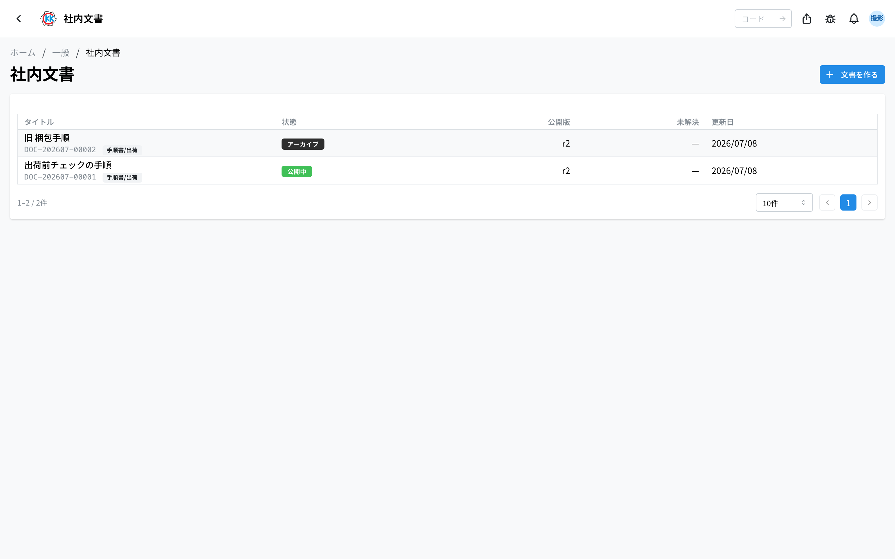
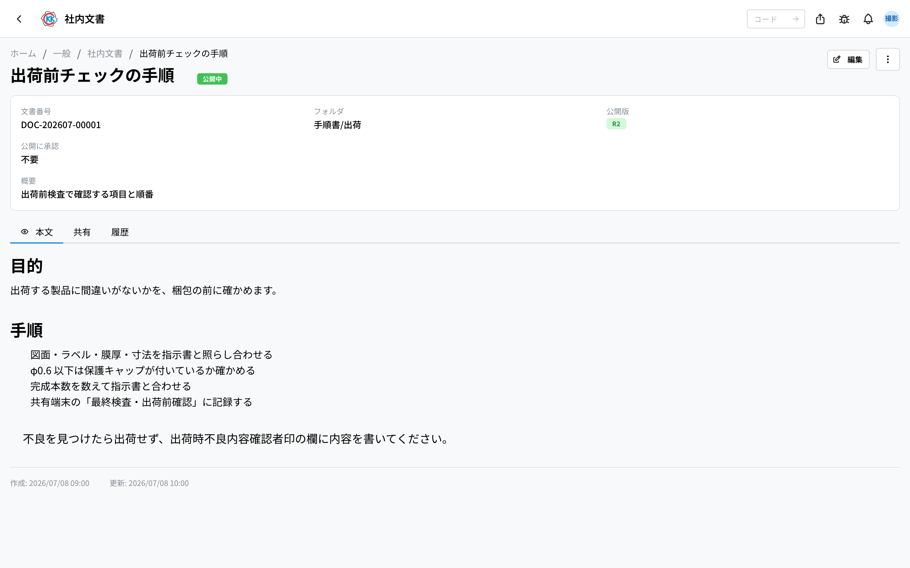
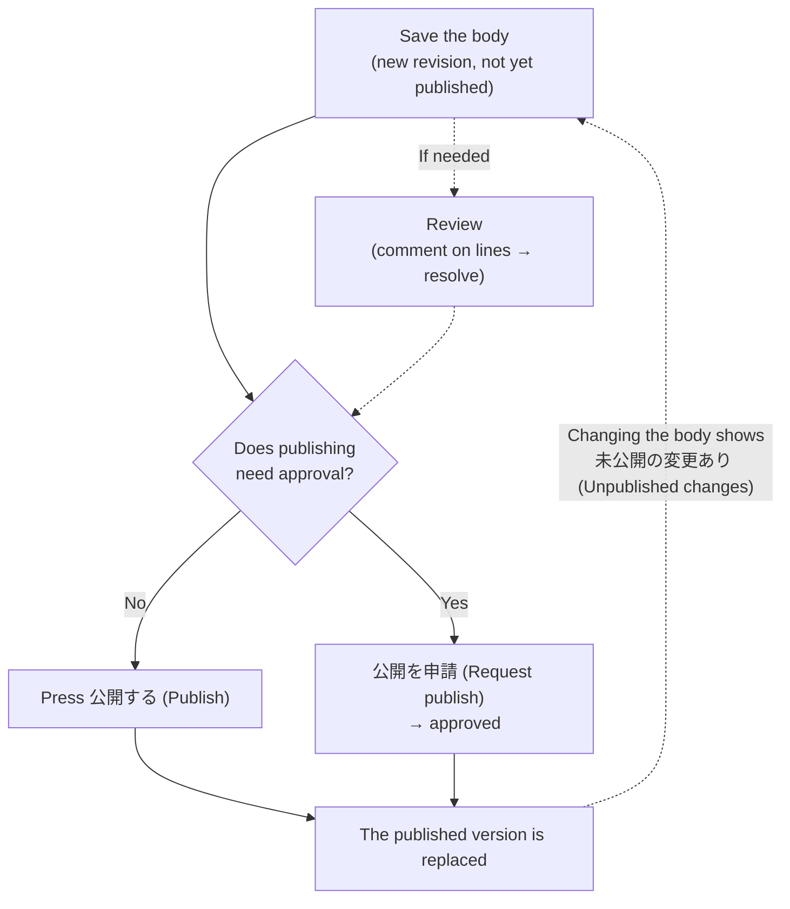
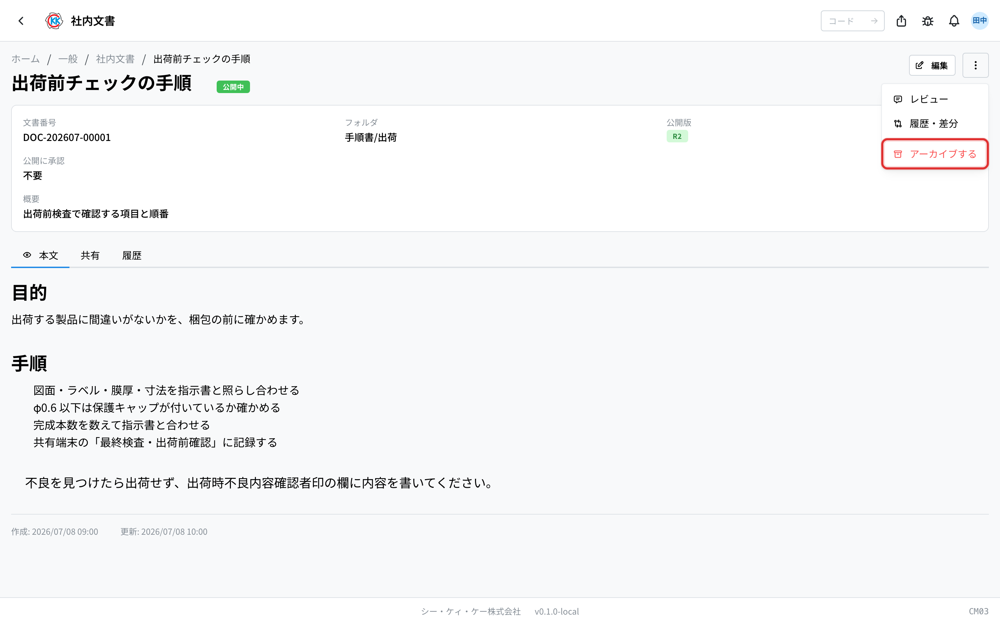
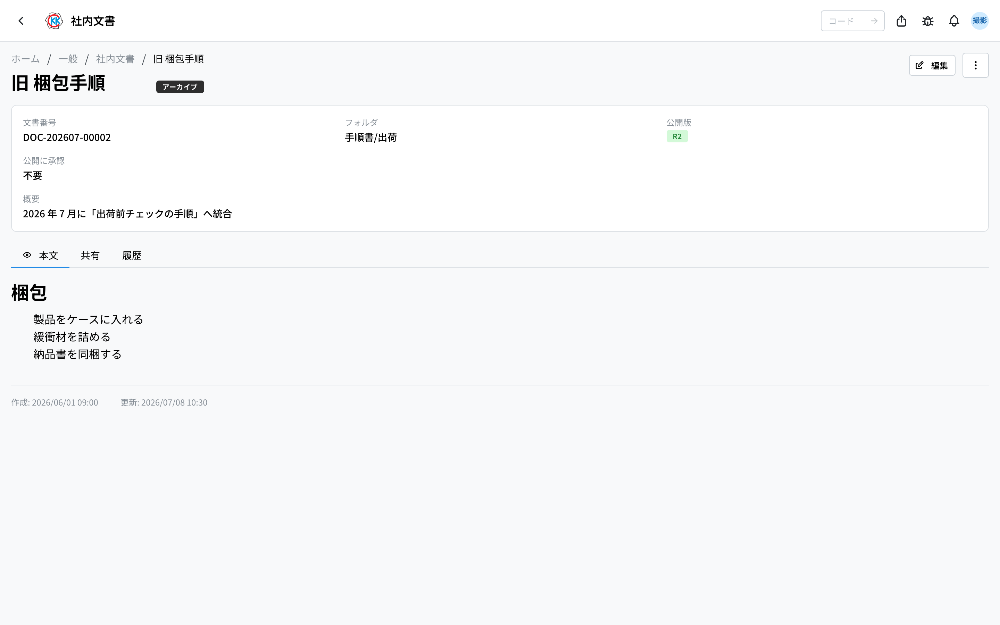

An app for **writing and sharing documents inside the company** — procedures, cautions, handover notes and the like. The operation code is `CM03`.

> ⚠️ For now this app is available **in the test environment only**. Screens and steps may change before it becomes available in production.

## What you can do with this app

- Write a document and publish it only to the people you want to show it to (the whole company, a site, a role, or individuals).
- Every rewrite leaves a version (revision), and you can compare it with earlier versions.
- Before publishing, the document can be reviewed with comments attached line by line.
- A document can be set so that "publishing needs approval".
- Put away a document you have finished with by archiving it.
- Use it to gather in one place things that used to be handed out on paper, such as shipping and inspection procedures.

## Words used on this page

- **Revision (version)** … the history that grows each time you save. Revisions are referred to by number.
- **Published version** … the version readers see right now. It is not necessarily the latest version.
- **Review** … the screen for discussing the document, by attaching comments to lines of the body, before it is published.
- **Shared with** … the people who can read the document. If nothing is set, only the person who created it and administrators can read it.

## Before you start

- Creating a document needs the Create permission (without it, the 「文書を作る」 (Create document) button does not appear).
- The list shows only documents you can read. It shows 「タイトル」 (Title), 「状態」 (Status: Draft / Pending publish approval / Published / Archived), 「公開版」 (Published version), 「未解決」 (Unresolved — the number of comments not yet resolved) and 「更新日」 (Updated).
- If publishing is to use approval, set up the steps in [Approval settings](/manual/en/operations/masters/approval-setting/user) beforehand.

## Creating a document

1. Press 「**文書を作る**」 (Create document) on the list.
2. Enter the 「**タイトル**」 (Title) (required).
3. If needed, enter the 「**フォルダ**」 (Folder). **You can build a hierarchy by separating with slashes** (for example `手順書/出荷`).
4. If needed, enter the 「**概要**」 (Overview).
5. If needed, tick 「**公開に承認を必要とする**」 (Require approval to publish).
6. Press 「**保存**」 (Save). The screen switches to the body editor.
7. Write the content in 「本文（Markdown）」 (Body (Markdown)).
8. Press 「**本文を保存（新しいリビジョン）**」 (Save the body (new revision)).

When you save, 「リビジョン 1 として保存しました」 (Saved as revision 1) is shown. Saving alone does **not publish it yet**. To change it later, press 「**編集**」 (Edit) at the top right of the document screen.

> 💡 Writing "a word about what you fixed" in the change-reason box makes it easier to find in the history later.

## How to write (Markdown)

- Headings, bullet lists and tables can be used. 「太字」 (Bold), 「斜体」 (Italic), 「コード」 (Code), 「見出し」 (Heading), 「箇条書き」 (Bulleted list) and 「リンク」 (Link) can be inserted from the toolbar.
- You can switch between 「編集」 (Edit), 「プレビュー」 (Preview) and 「分割」 (Split). On a narrow screen it becomes a toggle.
- **Only images posted inside the company** are shown. Images from outside sites are not displayed.
- A link to an external site goes through a confirmation page when pressed.

> ⚠️ A body that is too long cannot be saved (「本文が長すぎます」 (The body is too long) is shown). Split the document by chapter.

## Deciding who it is shared with

1. On the document screen, open the 「**共有**」 (Sharing) tab.
2. Press 「**編集**」 (Edit).
3. Press 「**共有先を追加**」 (Add a share) and choose who: the whole company, a site, a role, or an individual.
4. Choose the permission: 「閲覧」 (View), 「編集」 (Edit) or 「管理」 (Manage). People with Manage can also change the sharing settings.
5. Press 「**保存**」 (Save).

> ⚠️ **A document with no one to share with can be read only by the person who created it and administrators.** Just writing it does not deliver it to anyone.

## Getting it reviewed

1. Press 「**⋯**」 at the top right of the document screen and choose 「**レビュー**」 (Review). The latest revision (including content not yet published) is shown line by line.
2. Press the comment button of the line you want to comment on.
3. Write the comment and press 「**コメントする**」 (Comment).
4. Once the author has fixed it, press 「**解決にする**」 (Mark as resolved).
5. To see resolved comments as well, tick 「**解決済みも表示**」 (Include resolved).

You can also 「**返信**」 (Reply) to a comment. Comments appear **on the review screen only**. People reading the published document do not see them.

Unresolved comments on documents you created or edited are also listed under "Document comments" in the [Pending list](/manual/en/operations/general/my-tasks/user) (CM01).

## Publishing

When there are unpublished changes, a card saying 「**公開されていない変更があります**」 (There are unpublished changes) appears at the top of the document screen.

1. On the card, press 「**公開を申請**」 (Request to publish — for documents that need approval) or 「**公開する**」 (Publish).
2. A confirmation appears. If there are unresolved comments, their number is shown. You can still go ahead.
3. Press 「**申請する**」 (Request) or 「**公開する**」 (Publish).

For a document that needs approval, the status becomes 「**公開承認依頼中**」 (Pending publish approval), and the published version is replaced once it is approved. Approvers see 「承認」 (Approve) and 「差し戻し」 (Send back) buttons in the same place. Documents waiting for approval also appear under "Pending approval" in the [Pending list](/manual/en/operations/general/my-tasks/user) (CM01). While approval is pending, the body cannot be edited.

If you change the body after publishing, 「**未公開の変更あり**」 (Has unpublished changes) is shown next to the published version. Publish again and that version takes its place.

As a diagram, from writing to being published:

## Comparing and restoring versions

Press 「**⋯**」 at the top right of the document screen and choose 「**履歴・差分**」 (History and diff).

- On the 「**版一覧**」 (Versions) tab you can check which version changed when, and by whom.
- On the 「**差分**」 (Diff) tab, pick any two versions under 「比較元」 (Compare from) and 「比較先」 (Compare to). Only the surroundings of the changed lines are shown.
- To go back to earlier content, press 「**復元**」 (Restore) on that version in the version list. The history is not rewound: **a new version is created with that content**, so you return by moving forward.

## Archiving a document (putting it away)

A document you have finished with can be put away by making it 「**アーカイブ**」 (Archived). The published version, history, comments and shares all stay as they are, and people it is shared with can still read it.

1. Press 「**⋯**」 at the top right of the document screen.
2. Choose 「**アーカイブする**」 (Archive).
3. On the confirmation screen, press 「**アーカイブする**」 (Archive).

- Only people who can edit the document can do this (people with the "update" permission for internal documents who are its creator or in a share that allows editing).
- It cannot be pressed while publishing is pending approval (the screen shows 「**公開の承認依頼中はアーカイブできません（決裁を待つか、差し戻してから操作してください）**」 (Cannot archive while publishing is pending approval (wait for the decision, or send it back first))).
- While it is archived, the publishing card (「公開する」 (Publish), 「公開を申請」 (Request publishing) and so on) does not appear. Unarchive it first if you want to publish.

To bring it back, choose 「**アーカイブを解除**」 (Unarchive) from the same 「**⋯**」, then press 「**アーカイブを解除**」 on the confirmation screen. If the published version is the newest version, it returns to 「**公開中**」 (Published); if there is no published version, or there are edits made after publishing, it returns to 「**下書き**」 (Draft).

## Questions and problems

**Q. I saved it, but other people cannot read it.**
A. Either no one is set to share it with, or it has not been published yet. Decide who it is shared with, then publish.

**Q. The published version differs from what I am editing.**
A. That is how it is designed. Saving only adds a version; the published version is replaced when you publish.

**Q. Won't the comments show up on the published page?**
A. No. Comments belong to the review screen only.

**Q. I want to delete a document.**
A. There is no screen operation to delete a document. A document you have finished with can be put away with 「**アーカイブする**」 (Archive) under 「**⋯**」 (see "Archiving a document" above). Archiving does not stop people it is shared with from reading it, though. If you no longer want people to read it, remove its shares on the 「共有」 (Sharing) tab (only the creator and administrators can read it then).

**Q. When I tried to edit the body, it said the body cannot be edited while a publish approval is pending.**
A. The body cannot be changed while publishing is waiting for approval. Wait for the decision, or ask an approver to send it back, then edit it.

<!-- permissions:start -->
## Permissions required

Using this screen requires the **Internal documents** (`internal_page`) permission.

| What you want to do | Permission needed |
| --- | --- |
| Open the screen, view lists and details | Internal documents — View |
| Add, change or delete | Internal documents — Create / Edit / Delete |

Viewing only needs *View*. Where a screen offers adding, changing or deleting, each of those needs its matching permission.

Permissions come through roles. If something is missing, ask an administrator.

For the whole picture see [Permissions and roles](../../../permissions).
<!-- permissions:end -->
