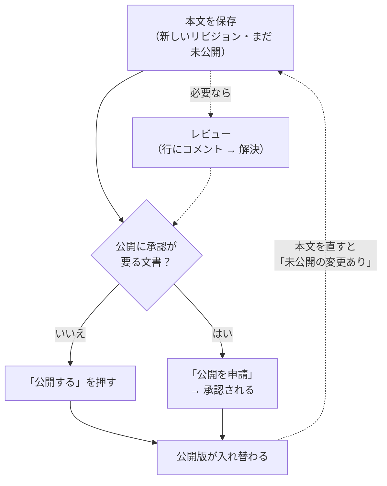

手順書・注意事項・引き継ぎメモなどを **社内向けに書いて共有する** アプリです。操作コードは `CM03` です。

> ⚠️ このアプリは今のところ **テスト用の環境だけ** で使えます。本番で使えるようになるまでに、画面や手順が変わることがあります。

## このアプリでできること

- 文書を書いて、見せたい相手（全社・拠点・ロール・個人）にだけ公開できます。
- 書き直すたびに版（リビジョン）が残り、前の版と見比べられます。
- 公開する前に、行ごとにコメントを付けてレビューできます。
- 「公開には承認が要る」文書にできます。
- 使い終わった文書をアーカイブにして片付けられます。
- 出荷や検査の手順など、紙で配っていたものを 1 か所にまとめるときに使います。

## 用語（このページで出てくる言葉）

- **リビジョン（版）** … 保存するたびに増える履歴です。番号で呼びます。
- **公開版** … いま読み手に見えている版です。最新の版とは限りません。
- **レビュー** … 公開する前に、本文の行にコメントを付けて相談する画面です。
- **共有先** … その文書を読める相手です。設定しなければ、作った本人と管理者しか読めません。

## はじめる前に

- 文書を作るには作成の権限が要ります（持っていないときは「文書を作る」ボタンが出ません）。
- 一覧には、自分が読める文書だけが出ます。一覧には「タイトル」「状態」（下書き / 公開承認依頼中 / 公開中 / アーカイブ）「公開版」「未解決」（まだ解決していないコメントの数）「更新日」が並びます。
- 公開に承認を使う場合は、[承認設定](/manual/ja/operations/masters/approval-setting/user)で段を決めておきます。

## 文書を作る

1. 一覧の「**文書を作る**」を押します。
2. 「**タイトル**」を入れます（必ず必要です）。
3. 必要なら「**フォルダ**」を入れます。**スラッシュ区切りで階層にできます**（例: `手順書/出荷`）。
4. 必要なら「**概要**」を入れます。
5. 必要なら「**公開に承認を必要とする**」に印を付けます。
6. 「**保存**」を押します。本文を書く画面に切り替わります。
7. 「本文（Markdown）」に内容を書きます。
8. 「**本文を保存（新しいリビジョン）**」を押します。

保存すると「リビジョン 1 として保存しました」と出ます。保存しただけでは **まだ公開されていません**。あとから直すときは、文書の画面の右上の「**編集**」を押します。

> 💡 変更理由の欄に「何を直したかを一言」書いておくと、あとで履歴から探しやすくなります。

## 書きかた（Markdown）

- 見出し・箇条書き・表が使えます。ツールバーから「太字」「斜体」「コード」「見出し」「箇条書き」「リンク」を入れられます。
- 「編集」「プレビュー」「分割」を切り替えられます（狭い画面では切り替え式になります）。
- **画像は社内に貼ったものだけ** が出ます。外のサイトの画像は表示しません。
- 外部サイトへのリンクは、押すと確認ページをはさみます。

> ⚠️ 本文が長すぎると保存できません（「本文が長すぎます」と出ます）。章ごとに文書を分けてください。

## 共有先を決める

1. 文書の画面で「**共有**」タブを開きます。
2. 「**編集**」を押します。
3. 「**共有先を追加**」を押し、相手を全社・拠点・ロール・個人のどれかで選びます。
4. 「権限」を「閲覧」「編集」「管理」から選びます。「管理」の人は、共有の設定も変えられます。
5. 「**保存**」を押します。

> ⚠️ **共有先が 1 つも無い文書は、作った本人と管理者しか読めません。** 書いただけでは誰にも届きません。

## レビューしてもらう

1. 文書の画面の右上の「**⋯**」を押し、「**レビュー**」を選びます。最新のリビジョン（まだ公開していない内容も含む）が行ごとに出ます。
2. コメントしたい行のコメントボタンを押します。
3. コメントを書いて「**コメントする**」を押します。
4. 書いた人が直したら「**解決にする**」を押します。
5. 解決済みも見たいときは「**解決済みも表示**」に印を付けます。

コメントには「**返信**」もできます。コメントは **レビューの画面にだけ** 出ます。公開された文書を読む人には見えません。

自分が作った・直した文書に付いた未解決のコメントは、[未処理一覧](/manual/ja/operations/general/my-tasks/user)（CM01）の「文書のコメント」にも並びます。

## 公開する

公開されていない変更があると、文書の画面の上に「**公開されていない変更があります**」というカードが出ます。

1. カードの「**公開を申請**」（承認が要る文書）または「**公開する**」を押します。
2. 確認の画面が出ます。未解決のコメントがあるときは件数が出ます。そのまま進めることもできます。
3. 「**申請する**」または「**公開する**」を押します。

承認が要る文書は、状態が「**公開承認依頼中**」になり、承認されると公開版が入れ替わります。承認する人の画面には同じ場所に「承認」「差し戻し」のボタンが出ます。承認を待っている文書は、[未処理一覧](/manual/ja/operations/general/my-tasks/user)（CM01）の「承認依頼中」にも並びます。承認依頼中は本文を直せません。

公開したあとに本文を直すと、「公開版」の横に「**未公開の変更あり**」と出ます。もう一度公開すると、その版に入れ替わります。

書いてから公開されるまでを図にすると、次のとおりです。

## 版を見比べる・戻す

文書の画面の右上の「**⋯**」を押し、「**履歴・差分**」を選びます。

- 「**版一覧**」タブで、どの版がいつ・誰の手で変わったかを確認できます。
- 「**差分**」タブで、「比較元」と「比較先」に好きな 2 つの版を選んで比べられます。変わった行の周りだけが出ます。
- 前の内容に戻したいときは、版一覧でその版の「**復元**」を押します。履歴は巻き戻さず、**その内容で新しい版を作って** 前に進めて戻します。

## 文書をアーカイブする（片付ける）

使い終わった文書は「**アーカイブ**」にして片付けられます。公開版・履歴・コメント・共有先はそのまま残り、共有先の人はそのまま読めます。

1. 文書の画面の右上の「**⋯**」を押します。
2. 「**アーカイブする**」を選びます。
3. 確認の画面で「**アーカイブする**」を押します。

- この操作ができるのは、その文書を編集できる人です（社内文書の「更新」の権限があり、作った本人か、編集できる共有先に入っている人）。
- 公開の承認依頼中は押せません（「**公開の承認依頼中はアーカイブできません（決裁を待つか、差し戻してから操作してください）**」と出ます）。
- アーカイブ中は、公開のカード（「公開する」「公開を申請」など）が出ません。公開したいときは、先に解除します。

元に戻すときは、同じ「**⋯**」から「**アーカイブを解除**」を選び、確認の画面で「**アーカイブを解除**」を押します。公開版がいちばん新しい版と同じなら「**公開中**」に、公開版が無いときや公開したあとに直した版があるときは「**下書き**」に戻ります。

## よくある質問・困ったとき

**Q. 保存したのに、ほかの人が読めません。**
A. 共有先が設定されていないか、まだ公開していません。共有先を決めてから公開してください。

**Q. 公開版と編集中の内容が違います。**
A. そういう作りです。保存は版を増やすだけで、公開版は「公開」したときに入れ替わります。

**Q. コメントが公開ページに出てしまいませんか。**
A. 出ません。コメントはレビュー画面だけのものです。

**Q. 文書を消したいです。**
A. 画面から文書を削除する操作はありません。使い終わった文書は「**⋯**」の「**アーカイブする**」で片付けられます（上の「文書をアーカイブする」を参照）。ただし、アーカイブしても共有先からはそのまま読めます。読ませたくないときは、「共有」タブで共有先を外してください（作った本人と管理者だけが読める状態に戻ります）。

**Q. 本文を直そうとしたら「公開の承認依頼中は本文を編集できません」と出ました。**
A. 公開の承認を待っているあいだは、本文を直せません。承認の結果を待つか、承認する人に差し戻してもらってから直してください。

<!-- permissions:start -->
## 必要な権限

この画面を使うには **社内文書**（`internal_page`）の権限が要ります。

| したいこと | 必要な権限 |
| --- | --- |
| 画面を開く・一覧や詳細を見る | 社内文書 の 閲覧 |
| 追加・変更・削除する | 社内文書 の 作成 / 更新 / 削除 |

見るだけなら「閲覧」で足ります。追加・変更・削除の操作がある画面では、その操作にあたる権限がそれぞれ必要です。

権限は役割（ロール）を通して付きます。足りないときは管理者に相談してください。

権限の全体像は「[権限とロール](../../../permissions)」を参照してください。
<!-- permissions:end -->
