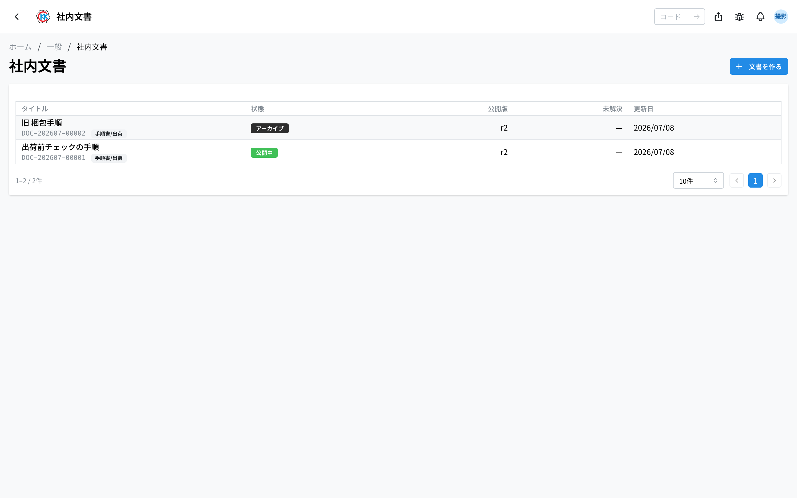
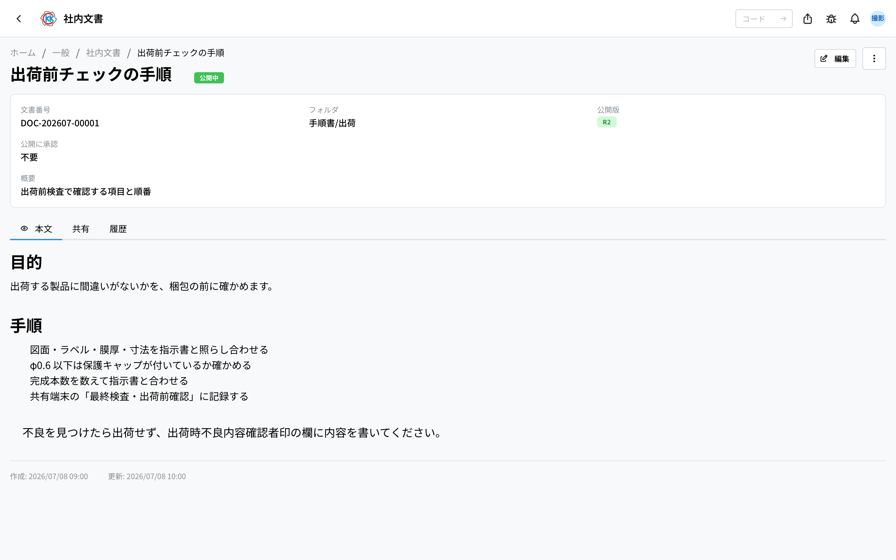
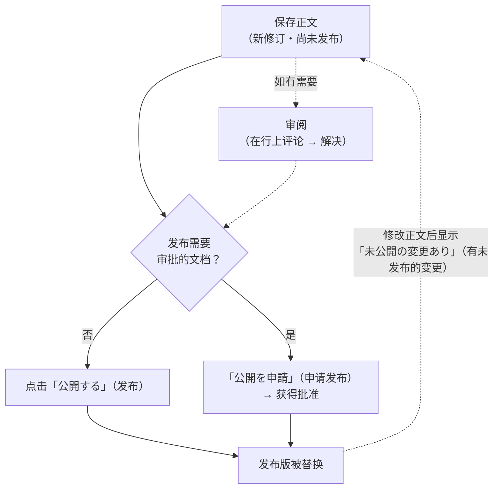
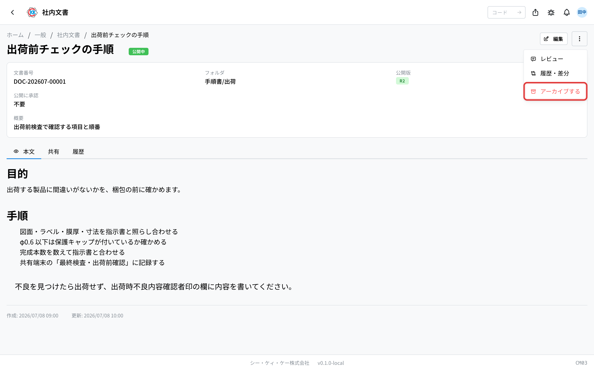
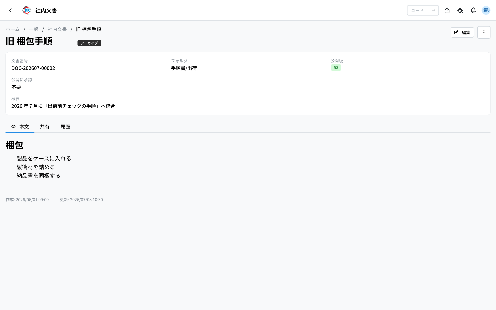

用于 **面向公司内部撰写并共享** 操作步骤书・注意事项・交接备忘等的应用。操作代码为 `CM03`。

> ⚠️ 本应用目前 **仅在测试环境** 中可用。在正式环境可用之前，画面和步骤可能会有变化。

## 本应用能做什么

- 可以撰写文档，只向想让其看到的对象（全公司・据点・角色・个人）发布。
- 每次修改都会留下版本（修订），可以与之前的版本对比。
- 发布之前，可以逐行添加评论进行审阅。
- 可以把文档设为「发布需要审批」。
- 可以将使用完毕的文档归档收起来。
- 适合把出货、检查的步骤等以前用纸分发的内容汇总到一处。

## 用语（本页出现的词）

- **修订（版本）** … 每次保存都会增加的历史。用编号来称呼。
- **发布版** … 现在读者能看到的版本。不一定是最新的版本。
- **审阅** … 发布之前，在正文的行上添加评论进行商量的画面。
- **共享对象** … 可以阅读该文档的对象。不设置的话，只有创建者本人和管理员能阅读。

## 开始之前

- 创建文档需要创建权限（没有权限时不会出现「文書を作る」（创建文档）按钮）。
- 列表中只显示自己可以阅读的文档。列表中显示「タイトル」（标题）、「状態」（状态：草稿 / 待发布审批 / 已发布 / 已归档）、「公開版」（发布版本）、「未解決」（未解决，即尚未解决的评论数）、「更新日」（更新日）。
- 发布要使用审批时，请先在[审批设置](/manual/zh/operations/masters/approval-setting/user)中决定好各级。

## 创建文档

1. 点击列表中的「**文書を作る**」（创建文档）。
2. 输入「**タイトル**」（标题）（必填）。
3. 如有需要，输入「**フォルダ**」（文件夹）。**可以用斜杠分隔做成层级**（例: `手順書/出荷`）。
4. 如有需要，输入「**概要**」（概要）。
5. 如有需要，勾选「**公開に承認を必要とする**」（发布需要审批）。
6. 点击「**保存**」（保存）。画面会切换到编写正文的画面。
7. 在「本文（Markdown）」（正文（Markdown））中写内容。
8. 点击「**本文を保存（新しいリビジョン）**」（保存正文（新修订版））。

保存后会显示「リビジョン 1 として保存しました」（已保存为版本 1）。仅仅保存 **还没有发布**。之后要修改时，点击文档画面右上角的「**編集**」（编辑）。

> 💡 在变更理由栏里写上「一句话说明改了什么」，之后从历史中查找会更方便。

## 写法（Markdown）

- 可以使用标题・列表・表格。可以从工具栏插入「太字」（加粗）「斜体」「コード」（代码）「見出し」（标题）「箇条書き」（项目符号）「リンク」（链接）。
- 可以切换「編集」（编辑）「プレビュー」（预览）「分割」（分栏）（在窄画面上为切换式）。
- **只有贴在公司内部的图片** 才会显示。外部网站的图片不显示。
- 指向外部网站的链接，点击后会先经过确认页面。

> ⚠️ 正文太长时无法保存（会显示「本文が長すぎます」（正文过长））。请按章节拆分文档。

## 决定共享对象

1. 在文档画面打开「**共有**」（共享）标签页。
2. 点击「**編集**」（编辑）。
3. 点击「**共有先を追加**」（添加共享对象），从全公司・据点・角色・个人中选择对象。
4. 从「閲覧」（查看）「編集」（编辑）「管理」（管理）中选择权限。拥有「管理」的人还可以修改共享设置。
5. 点击「**保存**」（保存）。

> ⚠️ **一个共享对象都没有的文档，只有创建者本人和管理员能阅读。** 只是写了并不会传达给任何人。

## 请人审阅

1. 点击文档画面右上角的「**⋯**」，选择「**レビュー**」（审阅）。最新的修订版（包括尚未发布的内容）会按行显示。
2. 点击要评论的行的评论按钮。
3. 写好评论后点击「**コメントする**」（评论）。
4. 作者修改后，点击「**解決にする**」（标记为已解决）。
5. 想同时查看已解决的评论时，勾选「**解決済みも表示**」（同时显示已解决）。

也可以对评论「**返信**」（回复）。评论 **只会出现在审阅画面**。阅读已发布文档的人看不到。

自己创建或修改的文档上未解决的评论，也会列在[未处理列表](/manual/zh/operations/general/my-tasks/user)（CM01）的「文档评论」中。

## 发布

有未发布的变更时，文档画面上方会出现「**公開されていない変更があります**」（存在未发布的变更）卡片。

1. 点击卡片中的「**公開を申請**」（申请发布，需要审批的文档）或「**公開する**」（发布）。
2. 会出现确认画面。有未解决的评论时会显示件数。也可以直接继续。
3. 点击「**申請する**」（申请）或「**公開する**」（发布）。

需要审批的文档，状态会变为「**公開承認依頼中**」（待发布审批），获得批准后发布版会被替换。审批人在同一位置会看到「承認」（批准）「差し戻し」（退回）按钮。等待审批的文档也会列在[未处理列表](/manual/zh/operations/general/my-tasks/user)（CM01）的「审批中」中。审批期间无法修改正文。

发布后再修改正文，「发布版本」旁会显示「**未公開の変更あり**」（有未发布的更改）。再次发布后，会替换为该版本。

从撰写到发布的过程，用图表示如下。

## 对比版本・恢复

点击文档画面右上角的「**⋯**」，选择「**履歴・差分**」（历史与差异）。

- 在「**版一覧**」（版本列表）标签页中可以确认哪个版本在什么时候、由谁修改。
- 在「**差分**」（差异）标签页中，在「比較元」（比较来源）和「比較先」（比较目标）选择任意 2 个版本进行对比。只显示变更行的前后部分。
- 想恢复为之前的内容时，在版本列表中点击该版本的「**復元**」（恢复）。历史不会回退，而是 **用该内容创建新版本**，以向前推进的方式恢复。

## 归档文档（收起来）

使用完毕的文档可以设为「**アーカイブ**」（已归档）收起来。发布版、历史、评论、共享对象都会保留，共享对象仍可阅读。

1. 点击文档画面右上角的「**⋯**」。
2. 选择「**アーカイブする**」（归档）。
3. 在确认画面中点击「**アーカイブする**」。

- 只有能编辑该文档的人才能进行此操作（拥有内部文档「更新」权限，并且是创建者本人或属于可编辑的共享对象的人）。
- 发布审批中无法点击（会显示「**公開の承認依頼中はアーカイブできません（決裁を待つか、差し戻してから操作してください）**」（发布审批中无法归档（请等待审批结果，或退回后再操作）））。
- 归档期间不会显示发布卡片（「公開する」（发布）、「公開を申請」（申请发布）等）。想发布时请先取消归档。
- 归档期间也不显示「**編集**」（编辑），无法修改正文、设置，也不能使用「この版に戻す」（恢复到此版本），画面上会显示原因。需要修改时，请先解除归档。

要恢复时，从同一个「**⋯**」中选择「**アーカイブを解除**」（取消归档），并在确认画面中点击「**アーカイブを解除**」。如果发布版与最新版本相同，则恢复为「**公開中**」（已发布）；如果没有发布版，或发布后又有修改的版本，则恢复为「**下書き**」（草稿）。

## 常见问题・遇到困难时

**Q. 已经保存了，但其他人读不到。**
A. 可能是没有设置共享对象，或者还没有发布。请先决定共享对象再发布。

**Q. 发布版和正在编辑的内容不一样。**
A. 就是这样设计的。保存只会增加版本，发布版在「发布」时才会替换。

**Q. 评论会不会出现在发布页面上？**
A. 不会。评论只属于审阅画面。

**Q. 想删除文档。**
A. 画面上没有删除文档的操作。使用完毕的文档可以通过「**⋯**」中的「**アーカイブする**」（归档）收起来（参见上面的「归档文档」）。但归档后共享对象仍可阅读。不想让别人阅读时，请在「共有」（共享）标签页中移除共享对象（这样只有创建者本人和管理员能阅读）。

**Q. 修改正文时提示「公開の承認依頼中は本文を編集できません」。**
A. 等待发布审批期间无法修改正文。请等待审批结果，或请审批人退回后再修改。

<!-- permissions:start -->
## 所需权限

使用本画面需要 **内部文档**（`internal_page`）权限。

| 想做的事 | 所需权限 |
| --- | --- |
| 打开画面、查看列表与明细 | 内部文档 — 查看 |
| 新增・变更・删除 | 内部文档 — 创建 / 更新 / 删除 |

仅查看有「查看」即可。画面中若有新增、变更或删除的操作，则分别需要对应的权限。

权限通过角色授予。若不足，请与管理员联系。

权限的整体说明请参见「[权限与角色](../../../permissions)」。
<!-- permissions:end -->
