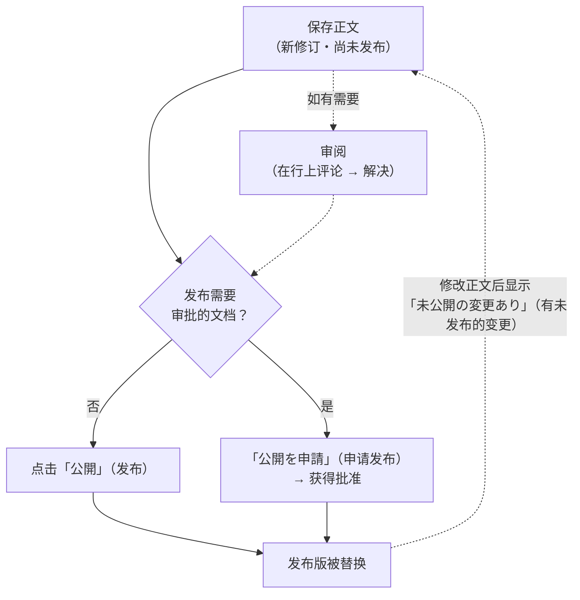

用于 **面向公司内部撰写并共享** 操作步骤书・注意事项・交接备忘等的应用。操作代码为 `CM03`。

> ⚠️ 本应用目前 **仅在测试环境** 中可用。在正式环境可用之前，画面和步骤可能会有变化。

## 本应用能做什么

- 可以撰写文档，只向想让其看到的对象（全公司・据点・角色・个人）发布。
- 每次修改都会留下版本（修订），可以与之前的版本对比。
- 发布之前，可以逐行添加评论进行审阅。
- 可以把文档设为「发布需要审批」。
- 适合把出货、检查的步骤等以前用纸分发的内容汇总到一处。

## 用语（本页出现的词）

- **修订（版本）** … 每次保存都会增加的历史。用编号来称呼。
- **发布版** … 现在读者能看到的版本。不一定是最新的版本。
- **审阅** … 发布之前，在正文的行上添加评论进行商量的画面。
- **共享对象** … 可以阅读该文档的对象。不设置的话，只有创建者本人和管理员能阅读。

## 开始之前

- 创建文档需要创建权限（没有权限时不会出现「文書を作る」（创建文档）按钮）。
- 发布要使用审批时，请先在[审批设置](/manual/zh/operations/masters/approval-setting/user)中决定好各级。

## 创建文档

1. 点击列表中的「**文書を作る**」（创建文档）。
2. 输入「タイトル」（标题）。**可以用斜杠分隔做成层级**（例: `手順書/出荷`）。
3. 如有需要，开启「**公開に承認を必要とする**」（发布需要审批）。
4. 在「本文（Markdown）」（正文（Markdown））中写内容。
5. 点击「**本文を保存（新しいリビジョン）**」（保存正文（新修订））。

保存后会显示「リビジョン 1 として保存しました」（已保存为修订 1）。仅仅保存 **还没有发布**。

> 💡 在变更理由栏里写上「一句话说明改了什么」，之后从历史中查找会更方便。

## 写法（Markdown）

- 可以使用标题・列表・表格。可以从工具栏插入「太字」（粗体）「斜体」「箇条書き」（列表）。
- 可以切换「編集」（编辑）「プレビュー」（预览）「分割」（分栏）（在窄画面上为切换式）。
- **只有贴在公司内部的图片** 才会显示。外部网站的图片不显示。
- 指向外部网站的链接，点击后会先经过确认页面。

> ⚠️ 正文太长时无法保存（会显示「本文が長すぎます」（正文过长））。请按章节拆分文档。

## 决定共享对象

在「共有」（共享）处决定可以阅读的对象。可以用全公司・据点・角色・个人 4 种方式指定。

> ⚠️ **一个共享对象都没有的文档，只有创建者本人和管理员能阅读。** 只是写了并不会传达给任何人。

## 请人审阅

1. 打开「レビュー」（审阅）。
2. 选择正文的行，写「**{n} 行目にコメント**」（在第 {n} 行评论）。
3. 作者修改后，点击「**解決にする**」（设为已解决）。
4. 想同时查看已解决的评论时，开启「**解決済みも表示**」（也显示已解决）。

评论 **只会出现在审阅画面**。阅读已发布文档的人看不到。

## 发布

1. 在详情画面上方的卡片中点击「**公開を申請**」（申请发布，需要审批的文档）或「公開」（发布）。
2. 有未解决的评论时会显示件数。也可以直接继续。
3. 需要审批的文档，获得批准后发布版会被替换。

发布后再修改正文，会显示「**未公開の変更あり**」（有未发布的变更）。再次发布后，会替换为该版本。

从撰写到发布的过程，用图表示如下。

## 对比版本・恢复

- 在「版一覧」（版本列表）中可以确认哪个版本在什么时候、由谁修改。
- 用「**差分**」（差异）可以对比任意 2 个版本。只显示变更行的前后部分。
- 想恢复为之前的内容时，点击「**復元**」（恢复）。历史不会回退，而是 **用该内容创建新版本**，以向前推进的方式恢复。

## 常见问题・遇到困难时

**Q. 已经保存了，但其他人读不到。**
A. 可能是没有设置共享对象，或者还没有发布。请先决定共享对象再发布。

**Q. 发布版和正在编辑的内容不一样。**
A. 就是这样设计的。保存只会增加版本，发布版在「发布」时才会替换。

**Q. 评论会不会出现在发布页面上？**
A. 不会。评论只属于审阅画面。

**Q. 想删除文档。**
A. 不再使用的文档请归档。版本和历史会保留。

<!-- permissions:start -->
## 所需权限

使用本画面需要 **内部文档**（`internal_page`）权限。

| 想做的事 | 所需权限 |
| --- | --- |
| 打开画面、查看列表与明细 | 内部文档 — 查看 |
| 新增・变更・删除 | 内部文档 — 创建 / 更新 / 删除 |

仅查看有「查看」即可。画面中若有新增、变更或删除的操作，则分别需要对应的权限。

权限通过角色授予。若不足，请与管理员联系。

权限的整体说明请参见「[权限与角色](../../../permissions)」。
<!-- permissions:end -->
