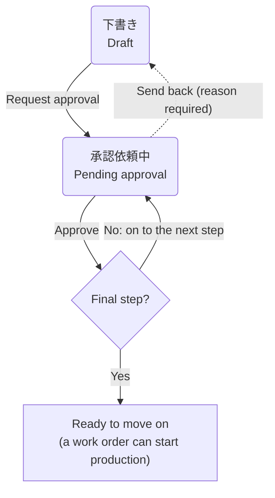

A single screen for the things you personally need to do. The operation code is `CM01`. It used to be a separate app called "Approval management" (`PD03`), which has been merged with the work plans here.

> ⚠️ This app is still being prepared, so it may not appear on the live system yet. If you cannot find it, please ask the person in charge at your company.

## What this app does

Tabs bring together:

- **Work plans** — your assigned work steps that are not yet finished.
- **Pending approval** — documents whose current approval step is yours (shown only if you have approval permission).
- **Privileged access** — privileged access requests waiting for your decision (shown only if you can decide them).
- **Unanswered forms** — forms shared with you that you have not submitted yet.
- **Answered forms** — your own form responses.
- **Completed requests** — completion notices addressed to you (shown only once you have received one).
- **Document comments** — unresolved comments on documents you created or edited.

Click a row to open the underlying work step, document, or form directly. The number to the right of a tab name is how many items are left in that tab (hidden when zero).

## Choosing which tabs to show

If some tabs don't apply to you, you can hide them.

1. Click **"Tabs to show"** at the top right.
2. Uncheck the tabs you want to hide.
3. Click **"Save"**.

This is a personal setting — it does not affect anyone else's screen. At least one tab must stay visible.

## Work plans

Lists the steps assigned to you in work-order work plans that are not yet finished (not started or in progress), ordered by planned date and start time. Steps of cancelled work orders are not shown.

Each row shows the planned date, time, step name, step status, work order number, product name, work location and quantity. Clicking a row opens that step's execution screen.

## Pending approval

Lists the documents waiting for approval, across document types — think of it as your approval inbox. **This tab does not appear at all if you don't have approval permission.**

> 💡 This list shows **only documents whose current approval step is yours** (you are in that step's approval group, or you are standing in as someone's delegate). On steps that need all members, a document disappears once you have approved it.

The following document types can appear. Which documents go through approval is decided in Approval settings (`MS0B`).

- **Work order** — the step decided by approval settings ([Work order](/manual/en/operations/production/work-order/user), PD02)
- **Work order close-out** — a request to end a work order partway. Clicking the row opens that work order.
- **Workflow change** — a change to branches in an approved/in-progress work order's process flow. Clicking the row opens that work order.
- **Order acceptance** — approval before confirmation ([Order acceptance](/manual/en/operations/sales/order-acceptance/user), SA04)
- **Order acceptance cancellation request** — a request to cancel an already-confirmed order acceptance. Clicking the row opens that order acceptance.
- **Price list** — only price lists with unit prices not carried over from a price estimate go through approval ([Price list](/manual/en/operations/sales/price-list/user), SA02)
- **Design request** — [Design request](/manual/en/operations/sales/design-request/user), SA06
- **Material purchase order** — approval before ordering ([Material purchase order](/manual/en/operations/purchasing/purchase-order/user), PU02)
- **Purchase request** — [Purchase request](/manual/en/operations/purchasing/purchase-request/user), PU01
- **Drawing version** — approval before a drawing version is finalized ([Drawing](/manual/en/operations/production/design-file/user), PD06)
- **Machining program change** — a request to add or change a machining program on a drawing version. Clicking the row opens that version.
- **Delivery order** — goes through approval only when shipping more or less than the ordered quantity
- **Stocktaking**
- **Invoice** — approval before issuing an invoice that has extra-charge lines
- **Invoice payment** — approval before marking an invoice as paid
- **Form request** — responses to request/report [forms](/manual/en/operations/general/forms/user) (CM02)
- **Internal documents** — requests to publish an [internal document](/manual/en/operations/general/internal-pages/user) (CM03)

### Terms used on this tab

- **Approval group** — the roster of people allowed to approve. Only members can approve or send back. Which group approves at which step is decided in Approval settings (`MS0B`).
- **Delegate** — someone assigned, for a set period, to approve in place of the regular approver while they are away.
- **Step** — the position in the approval sequence. How many steps a document goes through is decided per document type in Approval settings (`MS0B`), and can vary by the document's content.
- **Send back** — returning a document to its creator when there is a problem.

### Reading the screen

- **Type** — a colored badge showing the document type from the list above ("Work order", "Order acceptance", and so on).
- **Target number** — the document's number. For requests (workflow change, order acceptance cancellation request, etc.) the number of the original document is shown.
- **Tier** — shown as e.g. "**2/3 Department approval**" (current step / total steps, plus the step name; just the step name if there is only one step). The final step is highlighted so you can see it's one step from completion. Steps set to "All" also show "All ◯/◯".
- **Requester** — who requested the approval.
- **Requested at** — when it was requested. **Oldest first**, so requests that have been waiting longest appear at the top.
- **Notes** — any memo written when the request was made.
- Search by **target number, requester, or notes**; filter by **type**.
- A **"No view permission"** badge means you're in the approval group but lack permission to open that document. Since approving happens on the document's own screen, ask an administrator to grant access.

### Approving

1. Click a row in the list to open the document.
2. Near the top of the screen, **"Progress"** shows the current step.
3. If it's your turn to approve, an **"Approve"** button appears.
4. Review the content and click it.

How many approval steps a document goes through is fixed per document type. The card shows something like "Step 2/3 'Department approval' — Manufacturing manager." Once the final step is done, the document is ready to move on (e.g. a work order can start production).

When a step is set to **"All"**, it does not proceed until everyone assigned to that step has approved. The card shows "◯ remaining" along with who hasn't approved yet.

> 💡 Only members of that step's approval group, and any delegate currently in period, can approve. If the button doesn't appear, you'll see "Only members of ◯◯ can approve or send back."

### Sending back

Return a document to its creator when something is wrong.

1. Click **"Send back"**.
2. A small "Confirm send back" dialog appears.
3. Enter a **reason** (required).
4. Click **"Send back"** to confirm.

The document goes back to its creator, and the reason is shown on the creator's screen. Most documents revert to **Draft**; after fixing it, the creator requests approval again. Requests such as a workflow change or an order acceptance cancellation request are closed without changing anything.

As a diagram, approving and sending back work like this:

#### Reason for sending back [#field-reject-reason]

The reason you're sending the document back. **The requester sees it exactly as written**, so phrase it so they know what to fix — e.g. "Quantity doesn't match the order" or "Material spec is missing." The reason is kept in the history so you can trace why a document was stopped later.

### Approval history

Each approval or send-back is recorded below "Progress" as an **approval record** — who acted, when, at which step, approve or send back, and any comment. Actions taken by a delegate show "(Delegate for: original approver)".

## Privileged access

Lists the [privileged access](/manual/en/operations/system/privileged-access/user) (`SY0G`) requests waiting for your decision. **The tab is hidden if you cannot decide any of them.**

A notification also goes out to everyone who can decide the request (bell, email, device push — see [User settings](/manual/en/user-settings)). Notifications get missed, so this screen lets you see **how many are still open** at any time.

You only read them here — **the decision itself is not made on this screen**. "**Decide**" opens the Privileged access (`SY0G`) screen; act on its "**Approve**" tab.

Only requests you hold the approval permission for are listed, and **your own requests never appear** (you cannot approve yourself). Decided requests drop off this list and stay readable on the "History" tab of SY0G.

## Unanswered forms / Answered forms

"Unanswered forms" lists [forms](/manual/en/operations/general/forms/user) (`CM02`) shared with you that are currently open and that you have not submitted yet (soonest deadline first).

"Answered forms" lists the responses you've submitted, plus any drafts you started. Even for forms that hide the respondent from others, your own response is always visible to you (never to others). If still within the edit window, open it from here to change it.

## Completed requests

Lists completion notices addressed to you — not every completed request, only the ones whose form sharing settings include a completion notice to you. Unread rows carry an "Unread" mark, and the tab number counts unread notices. **This tab does not appear until you have received at least one completion notice.**

## Document comments

Collects unresolved line comments on [internal documents](/manual/en/operations/general/internal-pages/user) (`CM03`) you created or edited. Comments you left on your own work don't appear here. Think of it as a "review requests" inbox so feedback doesn't get missed.

## FAQ / Troubleshooting

**Q. I don't see a "Pending approval" tab.**
A. You don't have approval permission. To approve, you need to be in the approval group for the relevant step — ask an administrator.

**Q. I don't see a "Privileged access" tab.**
A. You do not have permission to decide privileged access requests. Only someone holding the approval permission for that request's code (shared-device secrets, devices, cards, personal data, user administration) can decide it. Ask an administrator.

**Q. I don't see a "Completed requests" tab.**
A. No completion notice has reached you yet. The tab appears once one arrives.

**Q. A tab shows nothing.**
A. There is nothing pending right now in that category. Items disappear automatically once handled.

**Q. The Approve button doesn't show up.**
A. You're not in that step's approval group. Ask an administrator to add you in Approval settings.

**Q. A row shows a "No view permission" badge.**
A. You're in the approval group but lack permission to open that document. Approving happens on the document's detail screen, so ask an administrator to grant access.

**Q. Clicking Send back says "Enter a reason for sending back."**
A. The reason field is empty — it's required. Fill it in and click Send back again.

**Q. A pending approval I saw earlier is gone now.**
A. Someone else who could approve it likely already handled it. Completed requests disappear from this list automatically; you can still open the document itself from its own app.

**Q. Approvals stall while I'm away.**
A. You can set a delegate for a fixed period. This is configured in [Approval settings](/manual/en/operations/masters/approval-setting/user) — ask an administrator.

**Q. I want to remove tabs I don't use.**
A. Hide them from "Tabs to show" at the top right. You can bring them back later.

<!-- permissions:start -->
## Permissions required

This screen needs no special permission — being signed in is enough.

Permissions come through roles. If something is missing, ask an administrator.

For the whole picture see [Permissions and roles](../../../permissions).
<!-- permissions:end -->
