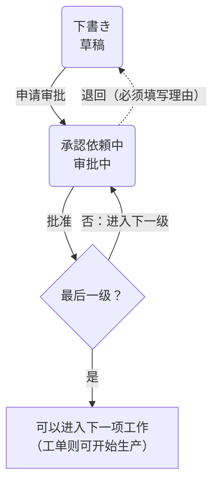

将自己的待办事项汇总在一个画面的应用。操作代码为 `CM01`。以前是名为「审批管理」（`PD03`）的独立应用，现已与工作计划合并到这里。

> ⚠️ 本应用仍在准备中，正式环境上可能还看不到。找不到时请咨询公司内的负责人。

## 本应用可以做什么

以标签页的形式汇总以下内容：

- **工作计划** — 分配给自己、尚未完成的工序计划。
- **审批中** — 等待审批的单据（只有拥有审批权限的人才会显示此标签）。
- **特权访问** — 轮到自己决裁的特权访问申请（只有能够决裁的人才会显示此标签）。
- **未回答的表单** — 已共享给自己、尚未提交的表单。
- **已回答的表单** — 自己提交过的表单回答。
- **已完成的申请** — 发给自己的表单完成通知（只有收到过通知的人才会显示）。
- **文档评论** — 自己创建或修改的文档上尚未解决的评论。

点击一行即可直接打开对应的工序、单据或表单画面。标签名右侧的数字是该标签中剩余的件数（为 0 时不显示）。

## 选择要显示的标签

如果标签太多、有些用不到，可以将其隐藏。

1. 点击画面右上角的「**显示的标签页**」。
2. 取消勾选要隐藏的标签。
3. 点击「**保存**」。

此设置仅对自己生效，不影响其他人的画面。至少需要保留 1 个标签。

## 工作计划

在工单的作业计划中分配给自己、且尚未完成（未开始・进行中）的工序，按计划日期和开始时间的顺序列出。已作废工单的工序不会显示。

每一行显示计划日期、时间、工序名称、工序状态、工单编号、产品名称、作业场所和数量。点击一行会打开该工序的执行画面。

## 审批中

跨单据类型列出等待审批的单据，相当于审批的「收件箱」。**没有审批权限的人不会看到此标签。**

> 💡 此列表会列出 **所有等待审批的单据**。自己是否为当前审批级的审批人，打开该行的单据画面即可知道（轮到自己时会显示「批准」按钮）。

列表中会出现以下单据。哪些单据需要经过审批，由审批设置（`MS0B`）决定。

- **工单** — 由审批设置决定的审批级（[工单](/manual/zh/operations/production/work-order/user) PD02）
- **工单中止** — 中途结束工单的申请。点击该行会打开对应工单的画面
- **工序流程变更** — 对已批准、进行中的工单新增或修改工序分支的变更。点击该行会打开对应工单的画面
- **订单确认书** — 确定前的审批（[订单确认书](/manual/zh/operations/sales/order-acceptance/user) SA04）
- **订单确认书作废申请** — 用于作废已确定订单确认书的申请。点击该行会打开对应订单确认书的画面
- **价格表** — 只有填入了未从价格试算继承的单价的价格表才需要审批（[价格表](/manual/zh/operations/sales/price-list/user) SA02）
- **设计委托单** — [设计委托单](/manual/zh/operations/sales/design-request/user) SA06
- **材料采购单** — 下单前的审批（[材料采购单](/manual/zh/operations/purchasing/purchase-order/user) PU02）
- **采购申请** — [采购申请](/manual/zh/operations/purchasing/purchase-request/user) PU01
- **图纸版本** — 确定图纸版本前的审批（[图纸](/manual/zh/operations/production/design-file/user) PD06）
- **加工程序变更** — 对图纸版本上的加工程序进行新增或修改的申请。点击该行会打开对应版本的画面
- **出货单** — 只有出货数量多于或少于订单数量时才需要审批
- **盘点**
- **请款单** — 发行含有追加费用明细的请款单前的审批
- **请款单入款** — 将请款单设为已付款前的审批
- **表单申请** — 申请・报告类[表单](/manual/zh/operations/general/forms/user)（CM02）的回答
- **内部文档** — [内部文档](/manual/zh/operations/general/internal-pages/user)（CM03）的发布申请

### 本标签中出现的术语

- **审批组** — 可以审批的人员名单。只有名单内的人才能审批或退回。哪一级由哪个组审批，由审批设置（`MS0B`）决定。
- **代理** — 在原审批人不在期间，被指定在限定时间内代为审批的人。
- **审批级** — 审批的顺序。需要经过几级审批，按单据类型在审批设置（`MS0B`）中决定，也可能因单据内容而不同。
- **退回** — 内容有问题时，将单据退回给创建者。

### 画面说明

- **种别** — 以彩色徽章显示上面列出的单据类型（「工单」「订单确认书」等）。
- **对象编号** — 该单据的编号。如果是申请（工序流程变更、订单确认书作废申请等），则显示原单据的编号。
- **档** — 显示如「**2/3 部门审批**」（当前第几级 / 共几级，以及该级名称；只有 1 级时只显示级别名称）。最后一级会以不同颜色突出显示，表示再通过一级即可完成。设置为「全员」的级别还会附带显示「全员 ◯/◯」。
- **申请人** — 提出审批请求的人。
- **申请时间** — 提出请求的时间。**旧的排在最前**，等待时间较长的请求会排在上方。
- **备注** — 申请时填写的备注。
- 可在搜索框中按 **对象编号、申请人、备注** 搜索，也可按「**种别**」筛选。
- 带有「**无查看权限**」徽章的行，表示虽在审批组内，但没有打开该单据的权限。由于审批操作在单据画面中进行，请联系管理员申请权限。

### 审批

1. 点击列表中的一行，打开对应单据的画面。
2. 画面上方会显示「**办理状态**」，可以看到当前处于哪一级。
3. 如果轮到自己审批，会显示「**批准**」按钮。
4. 确认内容后点击该按钮。

单据需要经过几级审批是固定的。卡片上会显示如「第 2/3 级『部门审批』・制造部长」这样的信息，表示当前所处级别。最后一级完成后，单据即可进入下一步（工单则可以开始生产）。

当某一级设置为「**全员**」时，需要该级全部指定人员都批准后才能进入下一步。卡片会显示「还剩 ◯ 人」，并列出尚未批准的人员姓名。

> 💡 只有该级审批组内的人员，以及处于代理期限内的代理人才能审批。如果按钮未显示，会提示「仅 ◯◯ 的成员可以批准或退回」。

### 退回

内容有问题时，可将单据退回给创建者。

1. 点击「**退回**」。
2. 会弹出「确认退回」的小窗口。
3. 在「**退回理由**」中填写理由（必填）。
4. 点击「**退回**」确认。

退回后，单据会回到创建者手中，理由会显示在创建者的画面上。大多数单据会回到「**草稿**」状态，创建者修改后可以重新提出审批申请。工序流程变更、订单确认书作废申请之类的申请，退回后会在不做任何更改的情况下关闭。

审批与退回的流程用图表示如下。

#### 退回理由 [#field-reject-reason]

退回时填写的理由。**申请人会原样看到这段文字**，请写成对方一看就知道该改什么的内容，例如「数量与订单不符」「材料规格缺失」。理由会保留在历史记录中，方便日后追溯为什么被退回。

### 审批记录

每次批准或退回，都会在「办理状态」下方留下一条**审批记录**——谁在何时、在哪一级、批准还是退回，以及备注内容都会记录下来。由代理人批准的记录会附带「（代理：原审批人）」。

## 特权访问

列出轮到自己决裁的[特权访问](/manual/zh/operations/system/privileged-access/user)（`SY0G`）申请。**没有决裁权限的人不会显示此标签。**

提交申请时，也会向能够决裁的人发送通知（铃铛・邮件・终端推送，接收方式可在[用户设置](/manual/zh/user-settings)中选择）。通知有可能被漏看，因此在本画面也能随时查看**还剩多少件**。

这里只能查看内容，**不能进行决裁（批准・退回）**。点击「**决裁**」会打开 特权访问（`SY0G`）的画面，请在「**批准**」标签中操作。

列出的只有自己拥有审批权限的申请，**自己提交的申请不会出现**（不能自我审批）。决裁完成的申请会从列表中消失，可在 SY0G 的「历史」标签中查看。

## 未回答的表单 / 已回答的表单

「未回答的表单」列出已共享给自己、当前正在受理、且自己尚未提交的[表单](/manual/zh/operations/general/forms/user)（`CM02`）（按截止日期由近及远排序）。

「已回答的表单」列出自己已提交的回答，以及写到一半的草稿。即使表单设置为不显示回答人，自己提交的那份回答依然只对自己可见（他人不可见）。在编辑期限内，可从这里打开并修改。

## 已完成的申请

列出发给自己的表单**完成通知**——并非「所有已完成的申请」，而是根据表单的共享设置中附带完成通知的收件人才会收到。未读的行带有「未读」标记，标签上的数字是未读件数。**从未收到过完成通知的人不会显示此标签。**

## 文档评论

汇总自己创建或修改的[内部文档](/manual/zh/operations/general/internal-pages/user)（`CM03`）上尚未解决的行评论。自己给自己添加的评论不会出现在此处。可视为防止漏看指出意见的「待审阅」列表。

## 常见问题 / 疑难解答

**问：找不到「审批中」标签。**
答：这是因为没有审批权限。要进行审批，需要加入相应级别的审批组，请联系管理员。

**问：找不到「特权访问」标签。**
答：这是因为没有决裁特权访问申请的权限。只有对该申请的权限代码（共用终端的秘密・终端・卡片・个人数据・用户管理）拥有审批权限的人才能决裁，请联系管理员。

**问：找不到「已完成的申请」标签。**
答：这是因为还没有收到过任何完成通知。收到通知后就会显示。

**问：列表中没有任何内容。**
答：目前没有对应的待办、申请或回答。已处理完的项目会自动从列表中消失。

**问：没有出现「批准」按钮。**
答：说明未加入该级的审批组，请联系管理员在审批设置中添加。

**问：某行带有「无查看权限」徽章。**
答：虽已加入审批组，但没有打开该单据的权限。由于审批需要在单据详情画面进行，请联系管理员申请权限。

**问：点击「退回」后提示「请输入退回理由」。**
答：理由栏为空。退回理由为必填项，请填写后再次点击「退回」。

**问：刚才还在的审批申请消失了。**
答：可能已被其他可审批的人处理。已处理的申请会自动从列表中消失，单据本身仍可在对应应用中打开查看。

**问：自己休假期间审批会停滞。**
答：可以设置限定期间的代理人，该设置位于[审批设置](/manual/zh/operations/masters/approval-setting/user)，请联系管理员。

**问：想隐藏用不到的标签。**
答：可在画面右上角的「显示的标签页」中隐藏，之后也可以再恢复显示。

<!-- permissions:start -->
## 所需权限

本画面不需要特别权限，登录后即可使用。

权限通过角色授予。若不足，请与管理员联系。

权限的整体说明请参见「[权限与角色](../../../permissions)」。
<!-- permissions:end -->
