This app shows **where and how much** product and material you have. Recording a change of storage location is also done here. The operation code is `ST01`.

> ⚠️ This app is currently available **only in the test environment**. The screens and the steps may change before it becomes available for real work.

> This app belongs to … [Production flow](/manual/en/process/production)

## What you can do in this app

- Check how much finished product and material you have, at which site and on which shelf.
- See reserved (held) quantity separately from what is still freely available.
- For materials, see **when and how much** an already-ordered quantity will arrive.
- See goods that were processed partway and put into stock (WIP) — how far each has been processed and how many there are.
- See how much is currently in progress, by work order and by process step (in process).
- Record it when you move goods to a different shelf or a different warehouse.
- Look back at the record of every stock movement (when, what, how much).

The screen has 5 tabs.

- **製品** (Product) … finished-product stock.
- **素材** (Material) … material stock.
- **仕掛品** (WIP) … goods processed partway and kept in stock.
- **工程内** (In process) … the quantity currently in progress (not yet stock).
- **ロケーション** (Location) … a view of "what is where", going site → storage location → shelf.

> 💡 You cannot correct the stock quantity directly here. The quantity **moves automatically** along with everyday operations. The only manual operation on this screen is「**在庫移動**」(stock transfer — changing the storage location). To correct a discrepancy, recount with [Stock Take](/manual/en/operations/inventory/stock-takes/user) (ST05).

> 💡 To see "what is where" as a list by location (site/shelf), use [Stock Overview](/manual/en/operations/inventory/stock-overview/user) (ST02). To see "is there enough of this item" over time from the item's side, use [Stock Requirements](/manual/en/operations/inventory/stock-requirements/user) (ST03). These can look like they overlap with this app, but each looks at stock from a different direction.

## Terms used on this page

- **拠点 (Site)** … a large-scale location, such as a factory or a warehouse.
- **保管場所 / 棚 (Storage location / shelf)** … a place within a site. Managed in two steps, e.g. shelf "A-1" in "Warehouse 1".
- **ロット (Lot)** … the number attached to a batch of product made together. It is the same number as its work order.
- **予約（取り置き）(Reserved/held)** … the portion set aside for a specific order. It cannot be used for another order.
- **利用可能 (Available)** … the portion of stock not yet reserved — what you can actually use.
- **仕掛品 (WIP)** … goods processed partway and put into stock. Units sorted as "semi-finished" at a step become WIP. They can be used to continue another work order.
- **仕掛ブランク (WIP blank)** … the unit WIP is grouped by: goods of the same material type, diameter and length.
- **加工状態 (Processing state)** … how far the WIP has been processed, expressed as the list of completed part-changing steps.
- **目標製品 (Target product)** … what the WIP was on its way to becoming.
- **工程内 (In process)** … the quantity currently partway through a process. Not yet stock.
- **次回入荷 (Next arrival)** … the date an already-ordered material is expected to arrive next.

## Where stock increases and decreases

Stock does not move from this screen — it moves automatically along with everyday operations. Every movement is recorded as exactly one [Stock Movement](/manual/en/operations/inventory/inventory-movements/user) (ST04) slip.

- **Product comes in** … when all the process steps on a [work order](/manual/en/operations/production/work-order/user) are complete, the good units go into stock with a lot number. Units sorted as "semi-finished" go into stock as **WIP**, split by processing state.
- **Material comes in** … registering a receipt in [Material Receipt](/manual/en/operations/purchasing/material-receipt/user) (PU03) increases stock at the receiving site.
- **It gets reserved** … running「**在庫照合**」(stock check) on an order line, or approving a "to manufacture" work order, reserves the quantity (product or material) needed for that order/work order.
- **Material decreases** … when all the process steps on that work order are complete, the reserved material is deducted as used.
- **WIP gets used** … for a work order started from WIP in stock, approving it reserves that WIP, and completing all its process steps deducts it.
- **Partly made items come back** … when an in-progress work order is stopped with「**打ち切り**」(abort), the partly processed items go back into stock as **WIP**, split by processing state.
- **Product goes out** … shipping via a [delivery order](/manual/en/operations/shipping/delivery-order/user) removes it from stock and releases the reservation.

As a diagram (dotted lines are reservations):

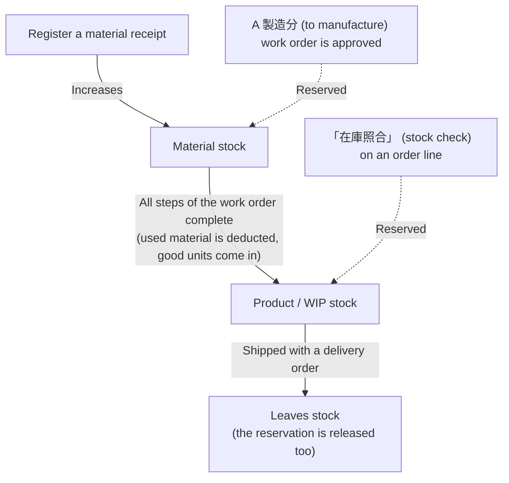

## The Product tab

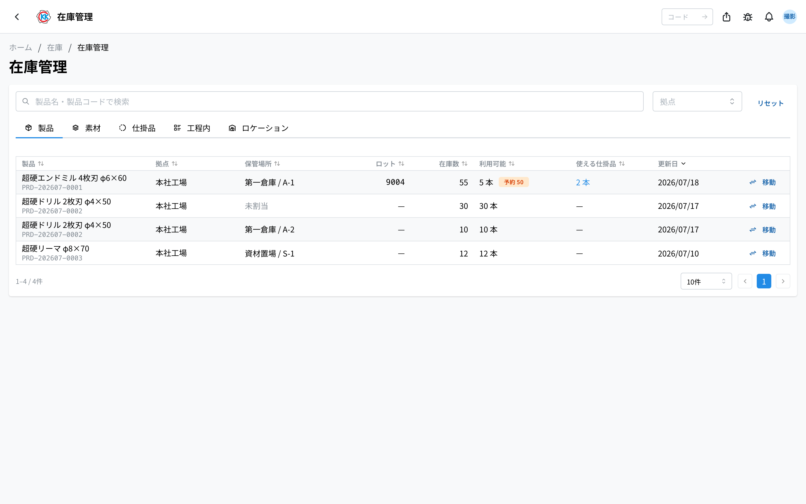

- **製品 (Product)** … the product's name and product code.
- **拠点 (Site)** … which site it is at.
- **保管場所 (Storage location)** … shown as "location name / shelf code". Not yet placed shows "**未割当**" (unassigned).
- **ロット (Lot)** … the lot number of that stock.
- **在庫数 (On hand)** … the actual quantity present.
- **利用可能 (Available)** … the freely usable portion of it. A badge like "予約 50" (reserved 50) appears when there is a reservation.
- 「**使える仕掛品**」(usable WIP) … how many pieces of WIP could be used for that product (same material type; size exact, longer or larger in diameter; and a processing state that is a leading part of the product's steps). Click the quantity to open the WIP tab narrowed to just that WIP. "—" when there is none.
- **更新日 (Updated)** … the date that stock last moved.
- **移動 (Move)** … the button to press to change the storage location.
- Search by product name or code in the box above. You can also narrow by 「**拠点**」(site).
- Click a row to open that stock's detail screen.

### Viewing product detail

Clicking a row opens the detail screen for that one stock entry.

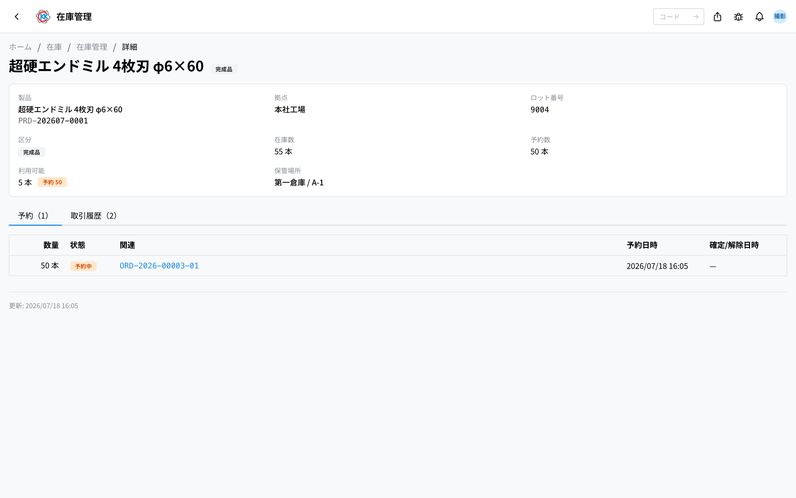

At the top: product, site, lot number, category, on-hand quantity, reserved quantity, available quantity, and storage location. When opened from a WIP row, 「**発生工程**」(origin process) — which work order and step it came from — is also shown.

Below are 2 tabs:

- **予約 (Reservations)** … the list of orders holding this stock. Status progresses 「**予約中**」(reserved) → 「**確定**」(confirmed) → 「**解除**」(released). The related order line number and work order number can also be checked.
- **取引履歴 (Transaction history)** … the record of stock movements (see "Transaction history" below).

## The Material tab

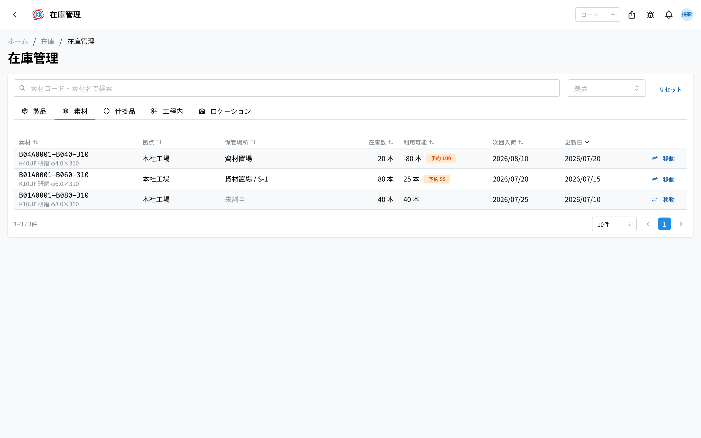

- **素材 (Material)** … the material's code and name.
- **拠点 (Site)** … which site it is at.
- **保管場所 (Storage location)** … shown as "location name / shelf code". Not yet decided shows "**未割当**" (unassigned).
- **在庫数 (On hand)** … the actual quantity present (shown with its unit).
- **利用可能 (Available)** … the portion not reserved — what you can actually use.
- **次回入荷 (Next arrival)** … the expected date the next ordered quantity arrives.
- **更新日 (Updated)** … the date that stock last moved.
- **移動 (Move)** … the button to press to change the storage location.
- Search by material code or name in the box above. You can also narrow by 「**拠点**」(site).
- Click a row to open that material stock's detail screen.

### Viewing material detail

Clicking a row opens the detail screen for that one material. At the top: material, site, on-hand quantity, reserved quantity, available quantity, next arrival, storage location, and notes.

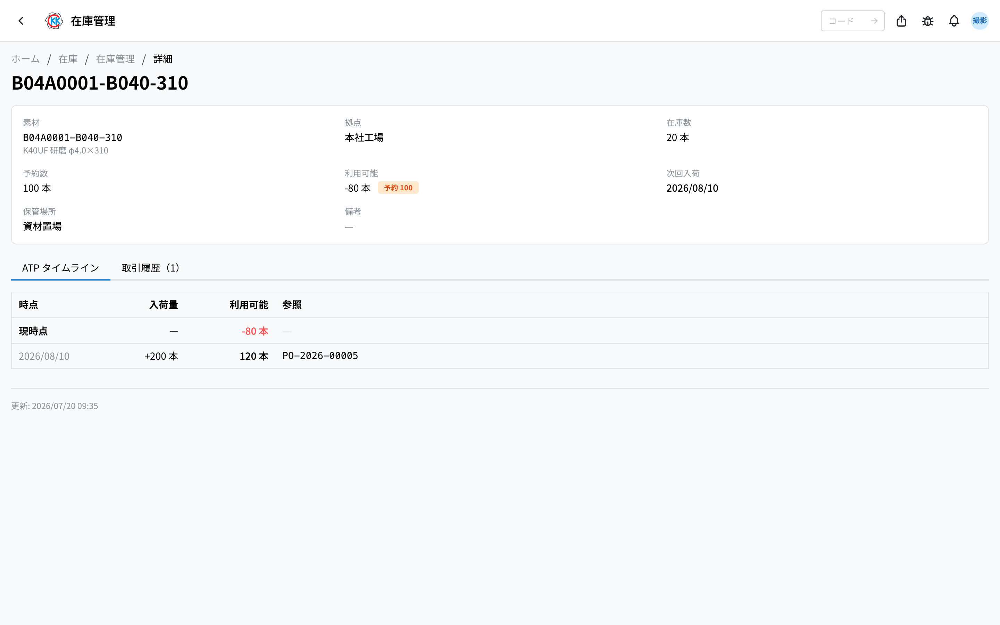

Below are 2 tabs:

- **ATP タイムライン (ATP timeline)** … a table, ordered by date, that starts from "how much is available right now" and adds each expected arrival to show **when and how much will become available**.
  - **時点 (Point in time)** … the top row is 「**現時点**」(now). Below it are expected arrival dates. An arrival with no fixed date shows 「**未定**」(undecided).
  - **入荷量 (Arriving quantity)** … the quantity expected to arrive on that day.
  - **利用可能 (Available)** … the quantity usable after that day passes (the running total of arrivals so far).
  - **参照 (Reference)** … the purchase order number it came from.

  A day whose 「利用可能」turns **red (negative)** means there is a shortfall at that point — what has been reserved exceeds on-hand stock plus expected arrivals. Treat it as a signal to consider ordering. To look into "when will this material run short" in more depth, [Stock Requirements](/manual/en/operations/inventory/stock-requirements/user) (ST03) shows the same kind of table including past history.
- **取引履歴 (Transaction history)** … the record of stock movements (see "Transaction history" below).

## The WIP tab

A screen for goods that were **processed partway and put into stock**. WIP is grouped by "WIP blank" (goods of the same material type, diameter and length) and then split by **how far it has been processed (the processing state)**.

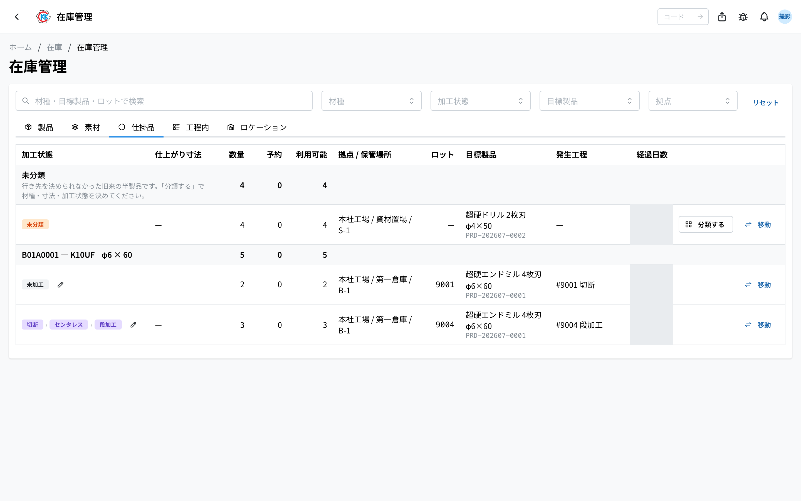

- The grey heading row is the **material type and diameter × length** (the WIP blank), with the total quantity on the right.
- 「**加工状態**」(processing state) … the completed part-changing steps, in the order they were done, like "切断 › センタレス › 段加工". Goods with no completed step show 「**未加工**」(unprocessed). A processing state that has been given a name shows that name above the steps.
- 「**仕上がり寸法**」(finished size) … the diameter × length after grinding. "—" when it was not recorded.
- 「**数量**」/「**予約**」/「**利用可能**」 … the on-hand quantity, the reserved quantity, and the quantity still free to use.
- 「**拠点 / 保管場所**」 … where it is.
- 「**ロット**」 … the number of the work order the WIP came from.
- 「**目標製品**」(target product) … what the goods were on their way to becoming. They can still be used for a different product.
- 「**発生工程**」(source step) … which work order and step put them into stock.
- 「**経過日数**」(age) … how many days they have been in stock.
- Narrow the list with 「**材種**」(material type), 「**加工状態**」, 「**目標製品**」 and 「**拠点**」(site) above. The search box takes a material type, target product or lot number.
- Click a row to open the detail screen for that stock (reservations and transaction history). Use 「**移動**」(Move) to change its storage location.

### Naming a processing state

A state that has a name on the shop floor (for example "stepped blank") can be given that name.

1. Press the pencil button to the right of the processing state.
2. Enter the 「**呼び名**」(name). Names in other languages go under 「**多言語**」(Translations).
3. Press 「**保存**」(Save).

Saving an empty name returns to showing the list of steps. The name is only a label to make states easier to tell apart — it changes neither the quantity nor which products the WIP can be used for.

### Classifying unclassified WIP

A heading 「**未分類**」(unclassified) may appear at the top. These are semi-finished goods that entered stock under the earlier mechanism and whose material type, size and processing state could not be determined automatically. Check the actual goods and classify them.

1. Press 「**分類する**」(Classify) on the unclassified row.
2. Enter the 「**分類する数量**」(quantity to classify) — you can classify only part of it.
3. Enter the 「**材種**」(material type), 「**径**」(diameter) and 「**長**」(length).
4. Pick the completed steps, in the order they were done, from 「**済んだ工程を追加**」(add a completed step). Pick none if nothing has been done (unprocessed).
5. Enter the 「**仕上がり径**」(finished diameter) and 「**仕上がり長**」(finished length). They are required once you pick at least one step.
6. Change the 「**目標製品**」(target product) if needed.
7. Press 「**分類する**」.

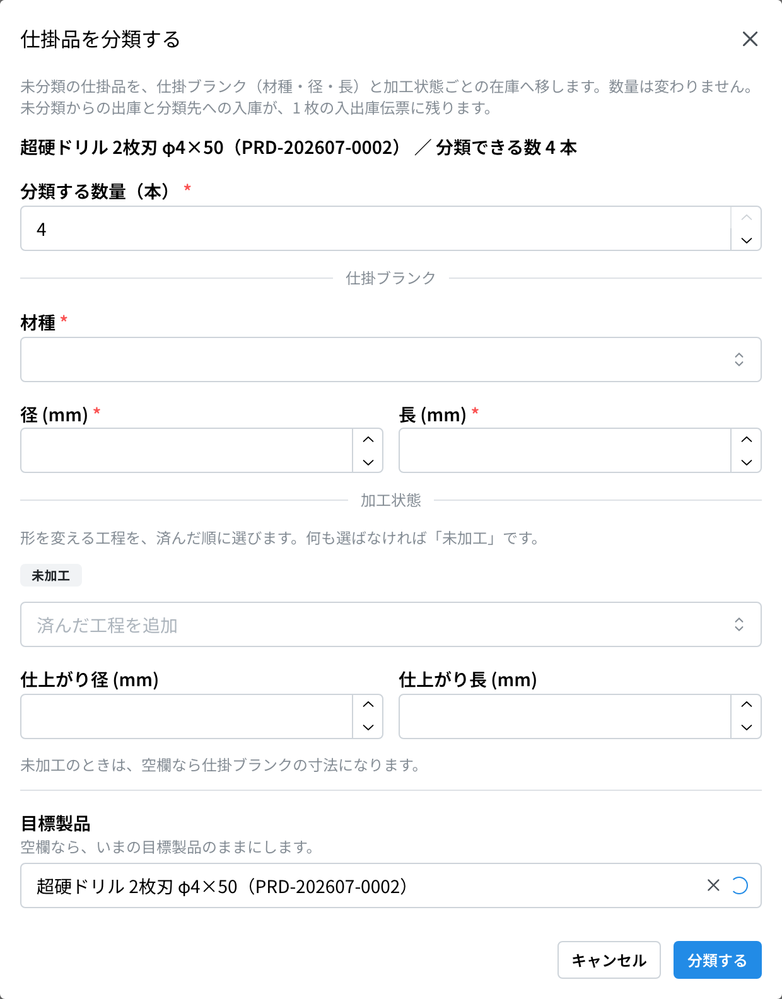

> 💡 Classifying **does not change the quantity**. Two lines — the issue from the unclassified stock and the receipt into the classified stock — are recorded on one [inventory movement](/manual/en/operations/inventory/inventory-movements/user) (ST04). The storage location and lot stay the same.

> ⚠️ Reserved quantity cannot be classified. Only 「未分類」 rows can be classified; WIP that has been classified once cannot be moved to a different processing state.

## The In-process tab

A screen listing how much is currently in progress, by work order and by process step.

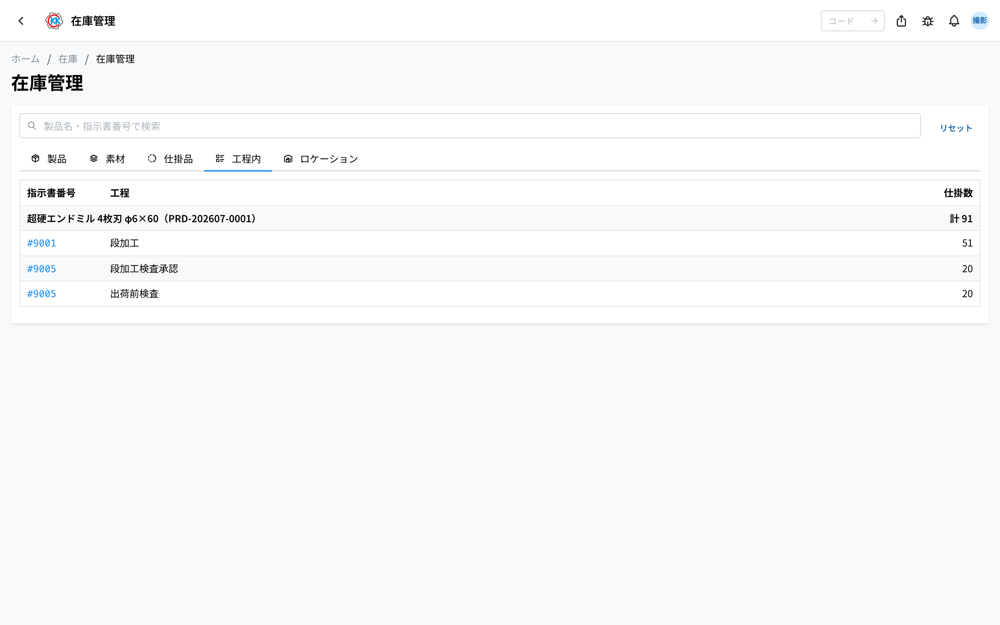

- Grouped by product, with a running total like "計 51" (total 51).
- Below that, 「**指示書番号**」(work order number) / 「**工程**」(process step) / 「**仕掛数**」(WIP quantity) are listed.
- Click a work order number to open that [work order](/manual/en/operations/production/work-order/user)'s screen.
- When no work order is in progress, it shows 「**進行中の仕掛品はありません**」(no work in progress).

> ⚠️ In-process quantity is not yet stock. It only becomes actual stock once all the process steps on the work order are complete. It appears on neither the Product tab nor the WIP tab.

## Transaction history

Both the product and the material detail screens have a "取引履歴" (transaction history) tab, listing the record of stock movements (date/time, type, quantity, movement number, reference, notes). Press the 「**伝票番号**」 (Movement no.) to open that movement's [inventory movement](/manual/en/operations/inventory/inventory-movements/user) (ST04). Old records without a slip show 「—」.

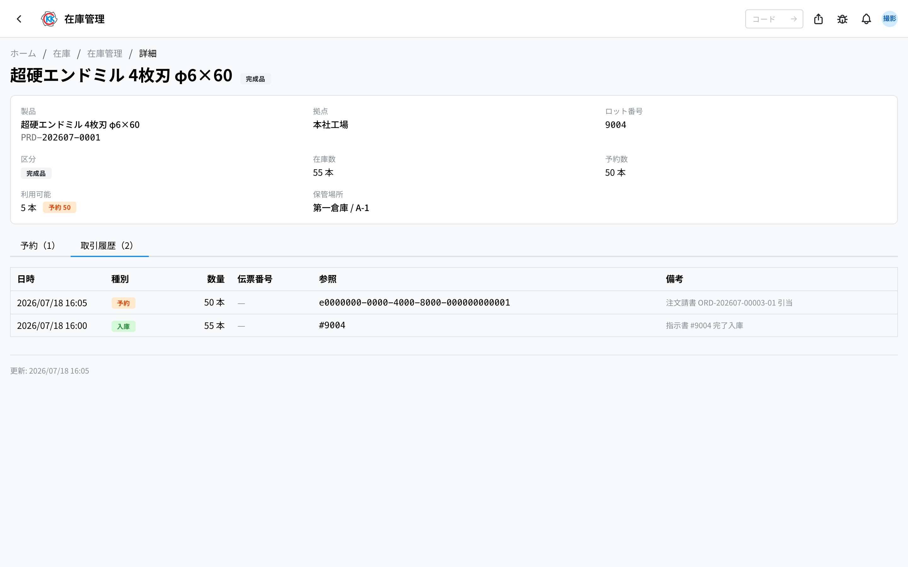

There are 5 「**種別**」(types):

- **入庫 (In)** … when stock increased.
- **出庫 (Out)** … when stock decreased.
- **予約 (Reserve)** … when it was held for an order.
- **予約解除 (Release)** … when the hold was released.
- **棚卸調整 (Adjustment)** … when a stock take corrected the quantity.

A stock transfer leaves 2 rows: an "out" at the source and an "in" at the destination. Both rows go on the same single [Stock Movement](/manual/en/operations/inventory/inventory-movements/user) (ST04) slip. You cannot jump from this table to the slip, so look for it in the Stock Movement list.

## Changing the storage location (stock transfer)

Use this operation to record it when you move goods to a different shelf or a different warehouse. The steps are the same for product, material and WIP.

1. Press the「**移動**」(Move) button at the right of the row in the list (also available from a chip on the Location tab).
2. The "Stock Transfer" screen opens, showing the current location and the transferable quantity at the top.
3. Choose 「**移動先の拠点**」(destination site).
4. Choose 「**保管場所**」(storage location).
5. Choose 「**棚**」(shelf).
6. Enter the quantity to move in 「**数量**」(quantity).
7. Add 「**備考**」(notes) if needed.
8. Press 「**移動する**」(Transfer).

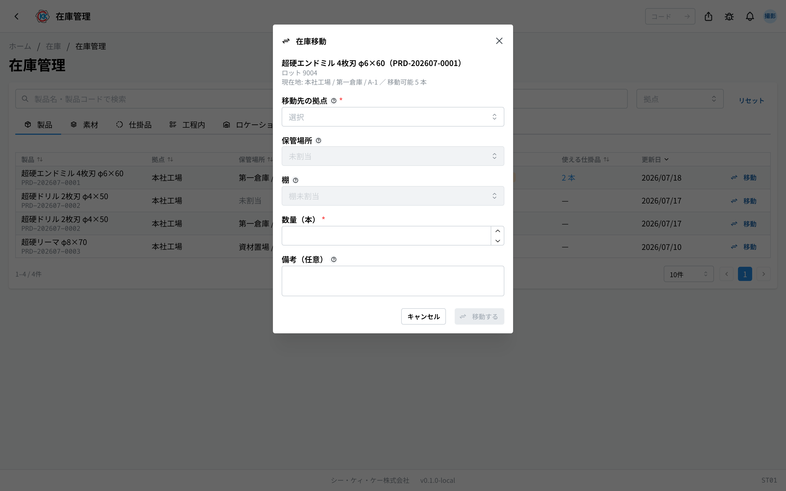

> ⚠️ Reserved quantity cannot be transferred. The maximum you can enter is the「利用可能」(available) quantity. Product quantity cannot be entered in fractions.

This operation never happens automatically — like [Manual Stock Movement](/manual/en/operations/inventory/goods-movement/user) (ST06), it is one of the few operations a person chooses to do on the spot (stock transfer is a dedicated entry point that skips choosing a movement type).

## The Location tab

A screen for seeing "what is where" in the shape of physical locations.

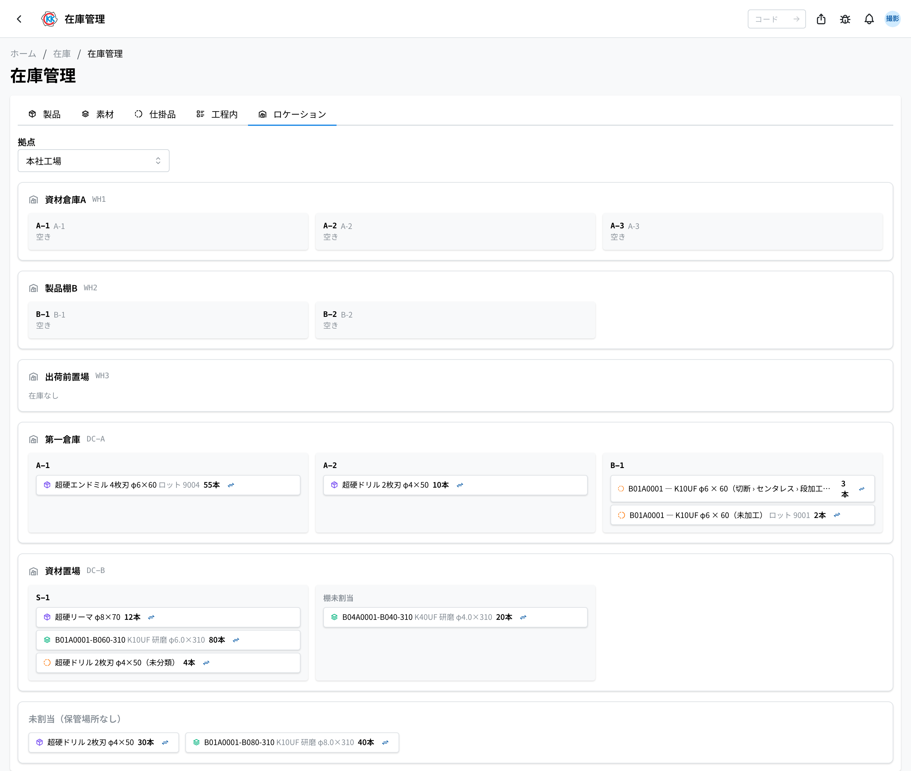

- Choosing a 「**拠点**」(site) above shows that site's **storage location cards** (name and code).
- Each card shows a **grid of shelves**, each with the goods and quantity on it. An empty shelf shows 「**空き**」(empty).
- Stock with a known storage location but no shelf goes into a 「**棚未割当**」(shelf unassigned) box; stock with neither goes into 「**未割当（保管場所なし）**」(unassigned — no storage location).
- If the site has a floor map registered with storage-location pins placed, the **floor map** is also shown. Clicking a pin scrolls to and highlights the matching card.
- When a site has nothing registered, it shows "この拠点には保管場所も在庫もありません" (this site has no storage locations or stock).

Storage locations and shelves themselves are registered in [Storage Location](/manual/en/operations/masters/storage-location/user).

Using this app requires the inventory permission.

## Fields

Inventory Management is mostly a **screen for viewing**, but you enter values only when moving stock to a different location.

| Field | Required | What to enter |
|-------|----------|----------------|
| [Destination site](#field-plant) | Required | Where to move it to |
| [Storage location / shelf](#field-location) | Optional | Where within the site to place it |
| [Quantity](#field-quantity) | Required | How much to move |
| [Notes](#field-notes) | Optional | The reason for the move, etc. |

### Destination site [#field-plant]

The site to transfer stock to. **Stock at the source site decreases and stock at the destination site increases.**

### Storage location / shelf [#field-location]

Where within the destination site to place it. Setting this makes it easier to locate the physical stock later.

### Quantity [#field-quantity]

The quantity to transfer. It cannot exceed the amount available at the source.

### Notes [#field-notes]

A field for recording the reason for the transfer, etc. The transfer is recorded in the history.

## Frequently asked questions / troubleshooting

**Q. I want to correct a stock quantity by hand.**
A. The only thing this screen can do is "stock transfer" (changing the storage location). If the count is off, recount and adjust with [Stock Take](/manual/en/operations/inventory/stock-takes/user) (ST05).

**Q. "利用可能" (Available) shows 0 even though "在庫数" (on hand) has a value.**
A. That portion is being held (reserved) for another order. Open the "予約" (Reservations) tab to see which order it is held for.

**Q. The reserved quantity is more than the on-hand quantity. Is that a mistake?**
A. Not necessarily. A work order can be approved even when stock is insufficient, and the needed quantity is reserved at that point. A shortfall is a signal that ordering may be needed. Check the ATP timeline on the material's detail screen to see whether it will be enough once the arrival comes in.

**Q. I tried to transfer stock, but it won't accept the quantity I want.**
A. You can only transfer up to the「利用可能」(available) quantity. Reserved stock cannot be moved.

**Q. The storage location shows "未割当" (unassigned).**
A. Stock added automatically (e.g. by completing a work order) starts with no storage location decided. Once you place it on an actual shelf, record it with "Move".

**Q. Product I'm still making does not show on the "製品" (Product) tab.**
A. Quantity still being manufactured is not yet stock. Check the「**工程内**」(In process) tab instead. It enters stock once all the process steps are complete.

**Q. Semi-finished goods do not show on the "製品" (Product) tab.**
A. Semi-finished goods moved to the「**仕掛品**」(WIP) tab. Goods processed partway are listed as WIP, by processing state, rather than as product.

**Q. The "次回入荷" (Next arrival) field is empty.**
A. There is no ordered material purchase order for that material. If nothing has been ordered, no expected arrival is shown.

**Q. Nothing shows on the Location tab.**
A. Either that site has no storage locations registered yet, or it has no stock. Ask an administrator to register storage locations.

**Q. What is the difference between this app and [Stock Overview](/manual/en/operations/inventory/stock-overview/user) (ST02)?**
A. Both look at the same stock, just from different directions. This app splits the view by kind of thing (product / material / WIP / in process / location); Stock Overview shows "what is where" as a single flat list. Use Stock Overview when you want a quick count across locations.

## Other inventory apps

This screen is for seeing "what is where right now". Recounting, moving stock by hand, and tracing what moved are separate apps.

- [Stock Overview](/manual/en/operations/inventory/stock-overview/user) (`ST02`) — a list viewed from the site / storage location / shelf side. Stock held by an outsourcer also shows here.
- [Stock Requirements](/manual/en/operations/inventory/stock-requirements/user) (`ST03`) — a single item's "what's coming in, what's going out" laid out over time.
- [Stock Movement](/manual/en/operations/inventory/inventory-movements/user) (`ST04`) — the record of every stock movement: when, what, and how many.
- [Stocktaking](/manual/en/operations/inventory/stock-takes/user) (`ST05`) — recount and reconcile with the book quantity.
- [Manual Stock Movement](/manual/en/operations/inventory/goods-movement/user) (`ST06`) — move stock in, out, or between locations by hand.
- [Movement Type](/manual/en/operations/inventory/movement-types/user) (`ST09`) — manage the categories chosen in manual stock movement.

> 💡 **Every stock movement creates a [Stock Movement](/manual/en/operations/inventory/inventory-movements/user) slip.** This screen's "Move" action is the same — every move leaves a record.

> ⚠️ **Stock held by an outsourcer does not count toward the quantities on this screen.** Anything not on hand is not counted as your own stock. Check what is held by an outsourcer from "Held by" on [Stock Overview](/manual/en/operations/inventory/stock-overview/user).

> ⚠️ **Tools received from a customer (customer-owned stock) do not count here either.** They are only held for regrinding and are not ours, so they are not counted as stock. Check them from "Owner" on [Stock Overview](/manual/en/operations/inventory/stock-overview/user).

<!-- permissions:start -->
## Permissions required

Using this screen requires the **Inventory** (`inventory`) permission.

| What you want to do | Permission needed |
| --- | --- |
| Open the screen, view lists and details | Inventory — View |
| Add, change or delete | Inventory — Create / Edit / Delete |

Viewing only needs *View*. Where a screen offers adding, changing or deleting, each of those needs its matching permission.

Permissions come through roles. If something is missing, ask an administrator.

For the whole picture see [Permissions and roles](../../../permissions).
<!-- permissions:end -->
