製品・素材・作りかけの品物が **どこに何本あるか** を確認するアプリです。置き場所を変えたときの記録もここで行います。操作コードは `ST01` です。

> ⚠️ このアプリは今のところ **テスト用の環境だけ** で使えます。本番で使えるようになるまでに、画面や手順が変わることがあります。

> このアプリが属するフロー … [生産の流れ](/manual/ja/process/production)

## このアプリでできること

- できあがった製品・素材が、どの拠点のどの棚に何本あるかを確認できます。
- 取り置き（予約）されている分と、まだ自由に使える分を分けて確認できます。
- 素材は、発注済みの分が **いつ・どれだけ入ってくるか** も確認できます。
- 途中まで加工して在庫に置いた品物（仕掛品）が、どこまで加工された状態で何本あるかを確認できます。
- 今どの指示書のどの工程に、何本が乗っているか（工程内）を確認できます。
- 品物を別の棚や別の倉庫に移したとき、その記録を残せます。
- 在庫が動いた記録（いつ・何が・何本）を後から確認できます。

画面は 5 つのタブに分かれています。

- **製品** … できあがった製品の在庫です。
- **素材** … 素材の在庫です。
- **仕掛品** … 途中まで加工して在庫に置いてある品物です。
- **工程内** … いま作っている途中の本数です（まだ在庫ではありません）。
- **ロケーション** … 拠点 → 保管場所 → 棚 の順に「どこに何があるか」を見る画面です。

> 💡 在庫の数はここで直接は直せません。数は毎日の業務にあわせて **自動で動きます**。この画面から手で行える操作は「**在庫移動**」（置き場所を変える）だけです。ずれを直したいときは[棚卸](/manual/ja/operations/inventory/stock-takes/user)（ST05）で数え直します。

> 💡 「どこに何があるか」を場所（拠点・棚）の側から一覧で見たいときは [在庫一覧](/manual/ja/operations/inventory/stock-overview/user)（ST02）、「この品目は足りるか」を品目の側から時系列で見たいときは [在庫・所要量](/manual/ja/operations/inventory/stock-requirements/user)（ST03）を使います。このアプリと重なって見える場面がありますが、それぞれ見る向きが違う別のアプリです。

## 用語（このページで出てくる言葉）

- **拠点（きょてん）** … 工場や倉庫など、大きな場所の単位です。
- **保管場所 / 棚** … 拠点の中の置き場所です。「第一倉庫」の「A-1」棚、のように 2 段階で管理します。
- **ロット** … まとめて作った製品のかたまりに付く番号です。指示書の番号がそのまま入ります。
- **予約（取り置き）** … 特定の注文のために確保されている分です。ほかの注文には使えません。
- **利用可能** … 在庫のうち、まだ予約されていない分です。実際に使える本数です。
- **仕掛品（しかかりひん）** … 途中まで加工して在庫に置いた品物です。工程で「半製品」に振り分けた分がこれになります。別の指示書の続きに使えます。
- **仕掛ブランク** … 仕掛品をまとめる単位です。材種・径・長さが同じものを 1 つにまとめます。
- **加工状態** … 仕掛品がどこまで加工されているかです。済んだ「形を変える工程」の並びで表します。
- **目標製品** … その仕掛品が、何を作る途中だったかです。
- **工程内** … いま工程の途中にある本数です。まだ在庫にはなっていません。
- **次回入荷** … 発注済みの素材が、次に入ってくる予定の日です。

## 在庫はどこから増えたり減ったりするのか

在庫はこの画面ではなく、ふだんの業務の操作にあわせて自動で動きます。動いた記録は必ず 1 枚の[入出庫伝票](/manual/ja/operations/inventory/inventory-movements/user)（ST04）になって残ります。

- **製品が入る** … [指示書](/manual/ja/operations/production/work-order/user)のすべての工程が完了すると、良品がロット番号付きで在庫に入ります。「半製品」に振り分けた分は、加工状態ごとに分かれて **仕掛品** として在庫に入ります。
- **素材が入る** … [素材入荷](/manual/ja/operations/purchasing/material-receipt/user)（PU03）で入荷を登録すると、入荷先の拠点の在庫が増えます。
- **取り置きされる** … 注文明細の画面で「**在庫照合**」を実行する、または「製造分」の指示書が承認されると、使う分（製品・素材）がその注文・指示書のために予約されます。
- **素材が減る** … その指示書のすべての工程が完了すると、取り置きしていた素材が使った分として減ります。
- **仕掛品が使われる** … 在庫の仕掛品から始めた指示書は、承認されるとその仕掛品が取り置きされ、すべての工程が完了するとその仕掛品が減ります。
- **途中の品物が戻る** … 進行中の指示書を「**打ち切り**」にすると、途中まで加工した品物が、加工状態ごとに **仕掛品** として在庫に戻ります。
- **製品が出る** … [出荷書](/manual/ja/operations/shipping/delivery-order/user)で出荷すると在庫から出て、予約も外れます。

図にすると次のとおりです（点線は取り置き）。

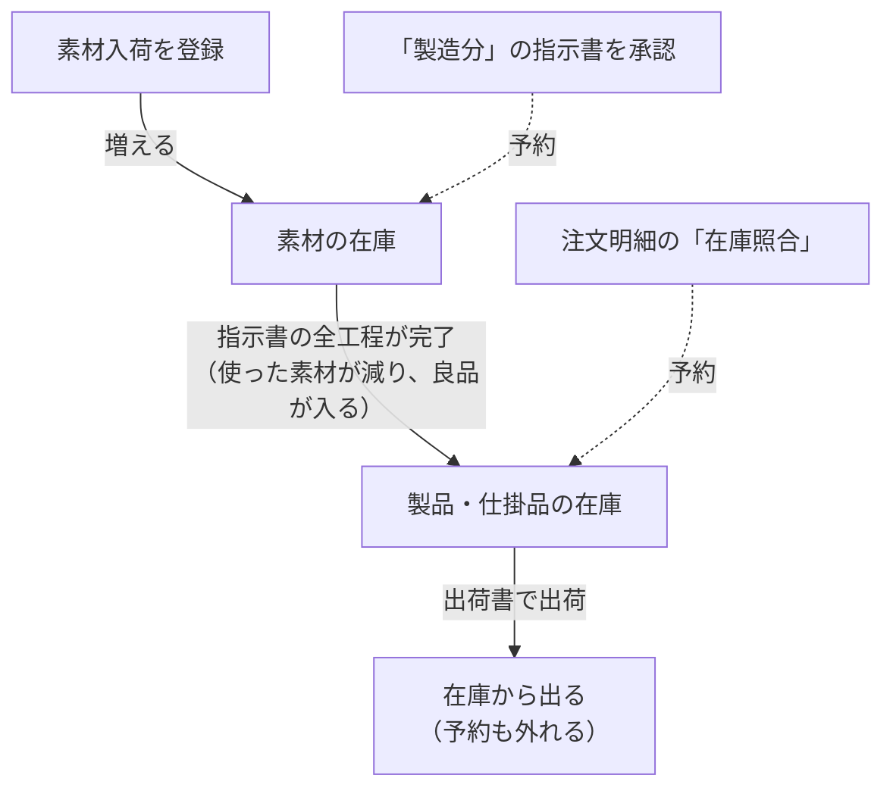

## 製品タブの見かた

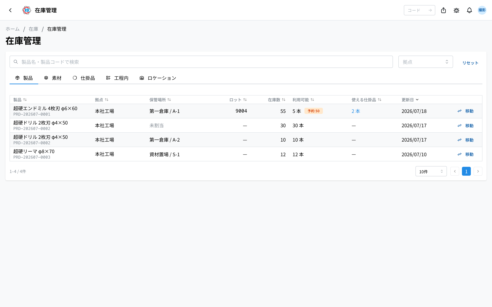

- **製品** … 製品の名前と製品コードです。
- **拠点** … どの拠点にあるかです。
- **保管場所** … 「場所名 / 棚コード」の形で出ます。まだ置き場所を決めていないものは「**未割当**」と出ます。
- **ロット** … その在庫のロット番号です。
- **在庫数** … 実際にある本数です。
- **利用可能** … そのうち自由に使える本数です。予約がある場合は「予約 50」のようなバッジが付きます。
- **使える仕掛品** … その製品に回せる仕掛品の本数です（材種が同じで、寸法が ちょうど・長い・太い のいずれかに当たり、加工状態がその製品の工程の先頭部分になっているもの）。本数を押すと、仕掛品タブがその仕掛品だけに絞られて開きます。回せるものが無ければ「—」です。
- **更新日** … その在庫が最後に動いた日です。
- **移動** … 置き場所を変えるときに押すボタンです。
- 上の検索欄に製品名や製品コードを入れて探せます。「**拠点**」でも絞り込めます。
- 行をクリックすると、その在庫の詳しい画面が開きます。

### 製品の詳しい画面を見る

行をクリックすると、その在庫 1 件の詳しい画面が開きます。

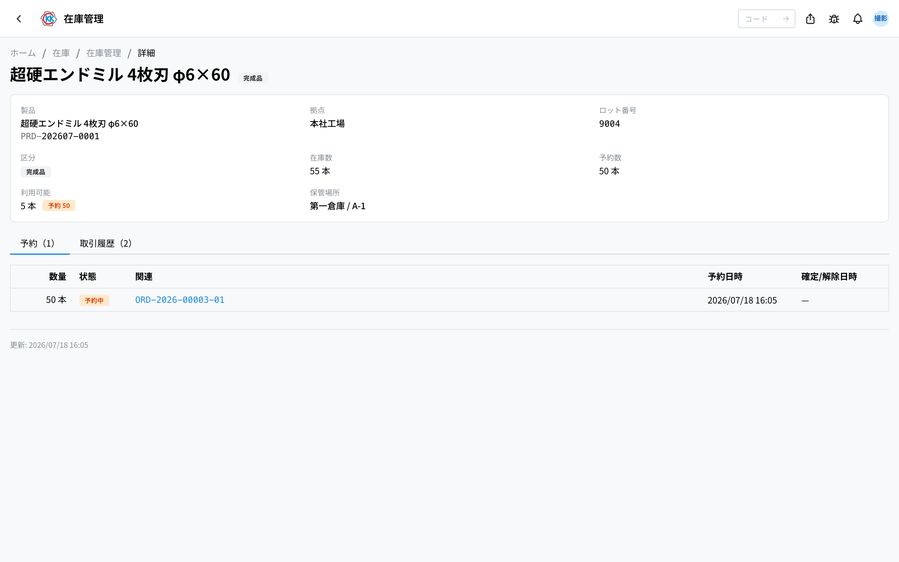

上のほうに、製品・拠点・ロット番号・区分・在庫数・予約数・利用可能・保管場所が並びます。仕掛品の行から開いたときは「**発生工程**」（どの指示書のどの工程から出たか）も表示されます。

下には 2 つのタブがあります。

- **予約** … この在庫を取り置きしている注文の一覧です。状態は「**予約中**」→「**確定**」→「**解除**」と進みます。関係する注文明細番号・指示書番号も確認できます。
- **取引履歴** … 在庫が動いた記録です（下の「取引履歴」を参照）。

## 素材タブの見かた

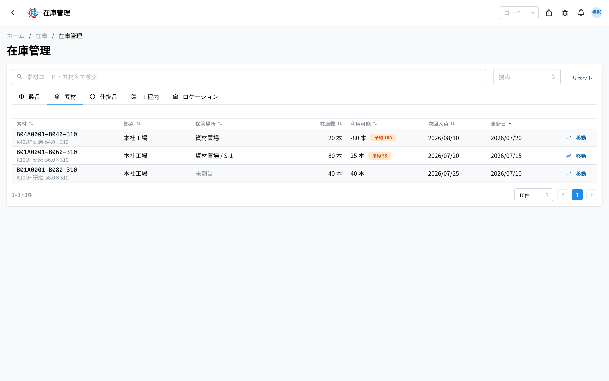

- **素材** … 素材コードと名称です。
- **拠点** … どの拠点にあるかです。
- **保管場所** … 「場所名 / 棚コード」の形で出ます。決まっていないものは「**未割当**」と出ます。
- **在庫数** … 実際にある数です（単位付きで出ます）。
- **利用可能** … そのうち取り置きされていない、実際に使える数です。
- **次回入荷** … 発注済みの素材が次に入ってくる予定日です。
- **更新日** … その在庫が最後に動いた日です。
- **移動** … 置き場所を変えるときに押すボタンです。
- 上の検索欄に素材コードや素材名を入れて探せます。「**拠点**」でも絞り込めます。
- 行をクリックすると、その素材在庫の詳しい画面が開きます。

### 素材の詳しい画面を見る

行をクリックすると、その素材 1 件の詳しい画面が開きます。上のほうに素材・拠点・在庫数・予約数・利用可能・次回入荷・保管場所・備考が並びます。

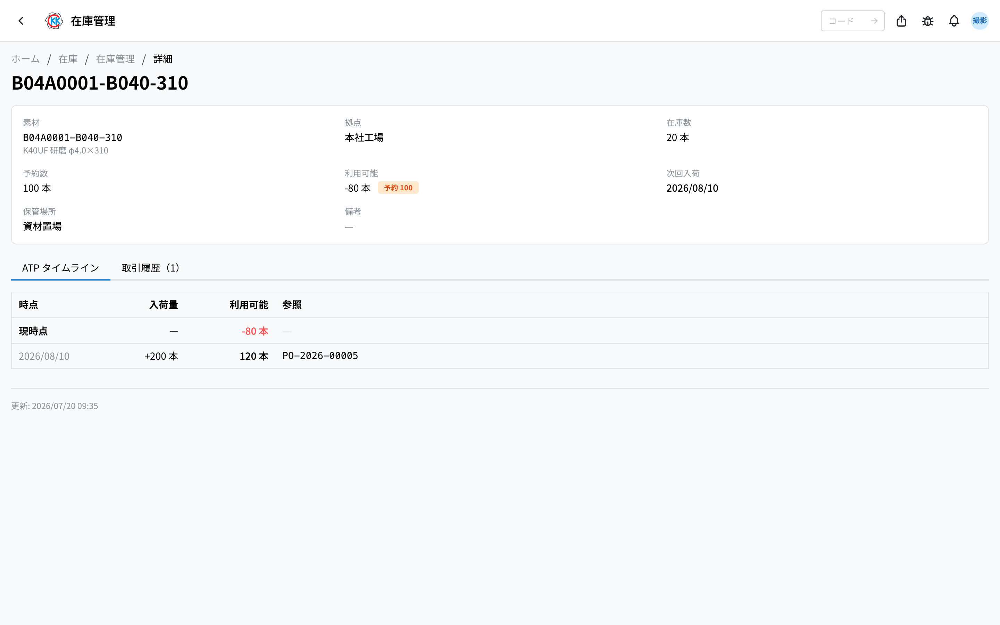

下には 2 つのタブがあります。

- **ATP タイムライン** … 「いま何本使えるか」から始めて、入荷予定を足していくと **いつ何本使えるようになるか** を、日付順に並べた表です。
  - **時点** … いちばん上の行は「**現時点**」です。その下は入荷予定日です。入荷日が決まっていない分は「**未定**」と出ます。
  - **入荷量** … その日に入ってくる予定の数です。
  - **利用可能** … その日を過ぎたあとに使える数です（それまでの入荷を足した数です）。
  - **参照** … もとになった発注書の番号です。

  「利用可能」が **赤い数字（マイナス）** になっている日は、その時点では足りないという意味です。取り置きされた分が、手元の在庫と入荷予定を上回っています。発注を検討する目印になります。「この素材はいつ足りなくなるか」をもっと詳しく調べたいときは、[在庫・所要量](/manual/ja/operations/inventory/stock-requirements/user)（ST03）で同じ考え方の表を過去の履歴も含めて見られます。
- **取引履歴** … 素材が動いた記録です（下の「取引履歴」を参照）。

## 仕掛品タブの見かた

途中まで加工して **在庫に置いてある品物** を見る画面です。仕掛品は「仕掛ブランク」（材種・径・長さが同じ品物のまとまり）ごとに、**どこまで加工したか（加工状態）** で分けて並びます。

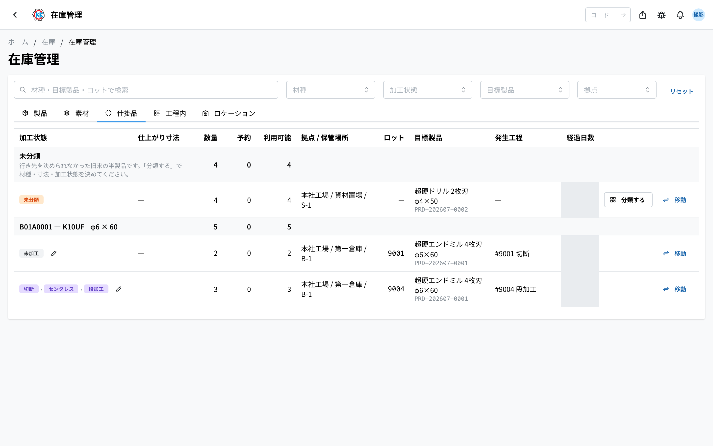

- 灰色の見出し行が **材種・径 × 長さ**（仕掛ブランク）で、その右に合計の本数が出ます。
- **加工状態** … 済んだ「形を変える工程」が、済んだ順に「切断 › センタレス › 段加工」のように並びます。何も済んでいないものは「**未加工**」と出ます。名前を付けた加工状態は、その名前が上に出ます。
- **仕上がり寸法** … 研削したあとの径 × 長さです。記録が無いものは「—」です。
- **数量 / 予約 / 利用可能** … 実際にある本数、取り置きされている本数、まだ自由に使える本数です。
- **拠点 / 保管場所** … どこにあるかです。
- **ロット** … その仕掛品が出た指示書の番号です。
- **目標製品** … 何を作る途中だった品物かです。別の製品に回すこともできます。
- **発生工程** … どの指示書のどの工程で在庫に置いたかです。
- **経過日数** … 在庫に入ってから何日たったかです。
- 上の欄で「**材種**」「**加工状態**」「**目標製品**」「**拠点**」を選ぶと絞り込めます。検索欄には材種・目標製品・ロット番号を入れられます。
- 行をクリックすると、その在庫の詳しい画面（予約と取引履歴）が開きます。「**移動**」で置き場所を変えられます。

### 加工状態に名前を付ける

現場で呼び名がある状態（たとえば「段付きブランク」）には、名前を付けておけます。

1. 加工状態の右にある鉛筆のボタンを押します。
2. 「**呼び名**」を入れます。ほかの言語の名前は「**多言語**」から入れます。
3. 「**保存**」を押します。

名前を空にして保存すると、もとの「工程の並び」の表示に戻ります。名前は見分けやすくするためのラベルで、在庫の数や、どの製品に使えるかの判定は変わりません。

### 未分類の仕掛品を分類する

いちばん上に「**未分類**」という見出しが出ていることがあります。これは、以前の仕組みで在庫に入った半製品のうち、材種・寸法・加工状態を自動では決められなかった品物です。実物を確かめて分類してください。

1. 未分類の行の「**分類する**」を押します。
2. 「**分類する数量**」を入れます（一部だけ分類することもできます）。
3. 「**材種**」「**径**」「**長**」を入れます。
4. 済んでいる工程を、済んだ順に「**済んだ工程を追加**」から選びます。何も済んでいなければ選ばずにおきます（未加工）。
5. 「**仕上がり径**」「**仕上がり長**」を入れます。工程を 1 つでも選んだときは必ず入れます。
6. 必要なら「**目標製品**」を選び直します。
7. 「**分類する**」を押します。

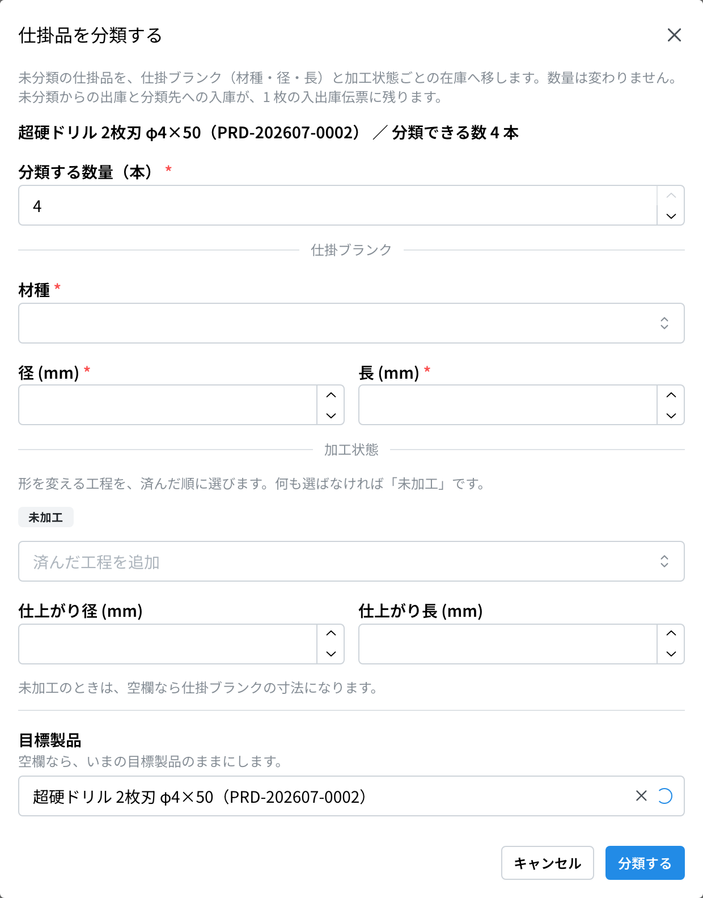

> 💡 分類しても **本数は変わりません**。未分類から出して分類先へ入れる、という 2 行が 1 枚の[入出庫伝票](/manual/ja/operations/inventory/inventory-movements/user)（ST04）に残ります。置き場所・ロットもそのままです。

> ⚠️ 予約されている分は分類できません。分類できるのは「未分類」の行だけで、いちど分類した仕掛品を別の加工状態へ付け替えることはできません。

## 工程内タブの見かた

今どれだけ作っている途中かを、指示書と工程ごとに並べた画面です。

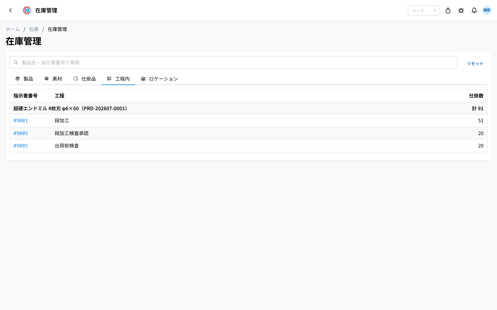

- 製品ごとにまとまり、「計 51」のように合計が出ます。
- その下に「**指示書番号**」「**工程**」「**仕掛数**」が並びます。
- 指示書番号をクリックすると、その[指示書](/manual/ja/operations/production/work-order/user)の画面が開きます。
- 進行中の指示書が無いときは「**進行中の仕掛品はありません**」と表示されます。

> ⚠️ 工程内の本数はまだ在庫ではありません。実際の在庫に入るのは、指示書のすべての工程が完了したときです。製品タブにも仕掛品タブにも出てきません。

## 取引履歴

製品・素材どちらの詳細画面にも「取引履歴」タブがあり、在庫が動いた記録（日時・種別・数量・伝票番号・参照・備考）が並びます。「**伝票番号**」を押すと、その動きの[入出庫伝票](/manual/ja/operations/inventory/inventory-movements/user)（ST04）が開きます。伝票の無い古い記録では「—」と出ます。

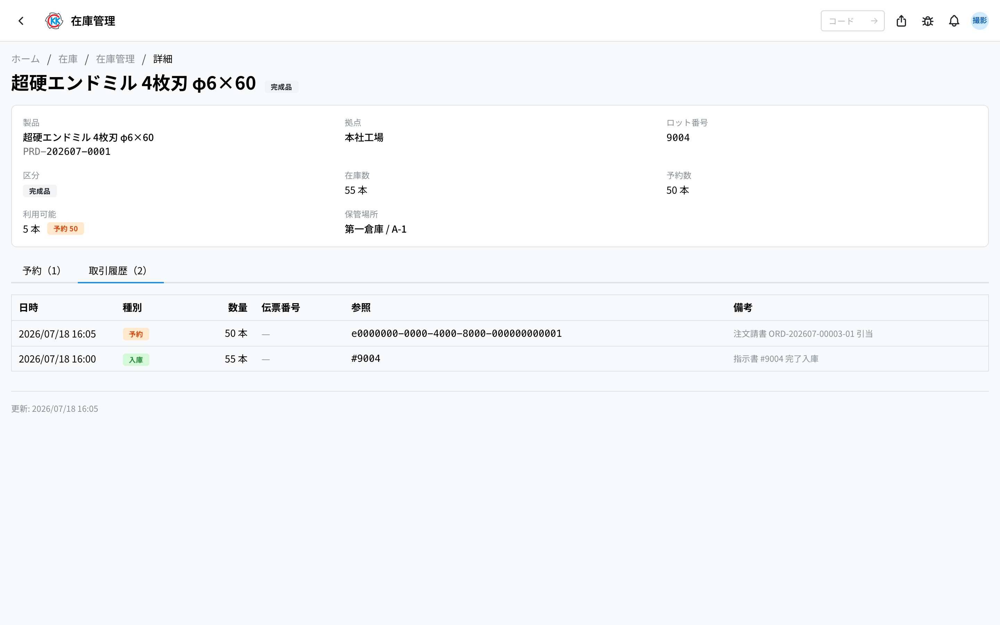

「**種別**」は次の 5 つです。

- **入庫** … 在庫が増えたとき
- **出庫** … 在庫が減ったとき
- **予約** … 注文のために取り置きされたとき
- **予約解除** … 取り置きが外れたとき
- **棚卸調整** … 棚卸しなどで数を合わせたとき

在庫移動をすると、移動元の「出庫」と移動先の「入庫」の 2 行が残ります。2 行は同じ 1 枚の[入出庫伝票](/manual/ja/operations/inventory/inventory-movements/user)（ST04）に入ります。この表から伝票へは移れないので、伝票は入出庫伝票の一覧で探します。

## 置き場所を変える（在庫移動）

品物を別の棚や別の倉庫に移したら、この操作で記録します。製品・素材・仕掛品のどれも同じ手順です。

1. 一覧の行の右にある「**移動**」ボタンを押します（ロケーションタブの在庫のチップからも押せます）。
2. 「在庫移動」の画面が開きます。上に「現在地」と「移動可能」な本数が出ます。
3. 「**移動先の拠点**」を選びます。
4. 「**保管場所**」を選びます。
5. 「**棚**」を選びます。
6. 「**数量**」に移す本数を入れます。
7. 必要なら「**備考**」を書きます。
8. 「**移動する**」を押します。

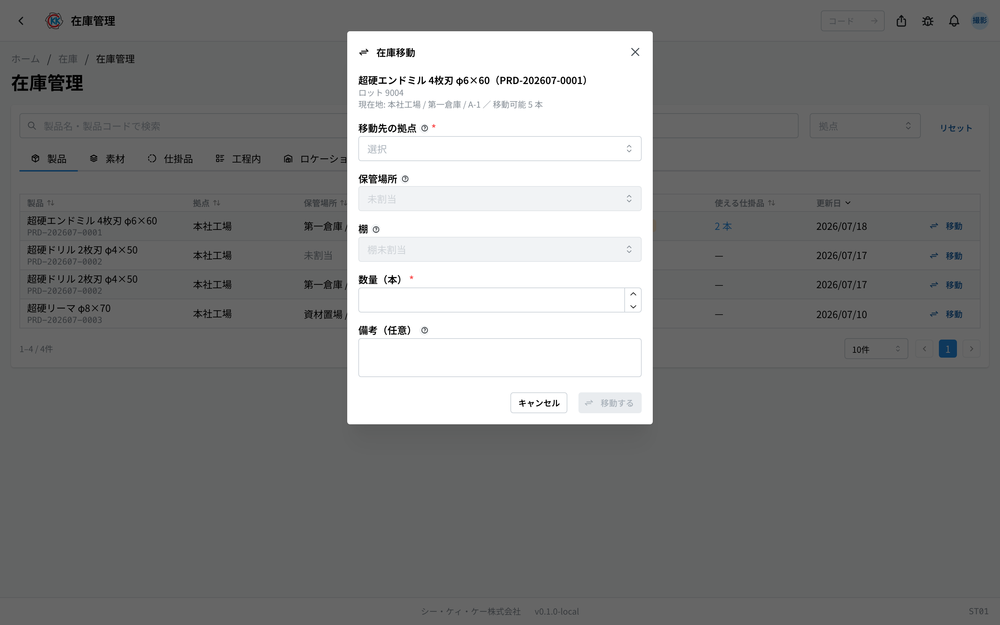

> ⚠️ 予約されている分は移動できません。入れられる本数の上限は「利用可能」の本数です。製品は小数では入れられません。

この操作は自動では起きません — [手動入出庫](/manual/ja/operations/inventory/goods-movement/user)（ST06）と同じく、人がその場で選んで行う数少ない操作の 1 つです（在庫移動は移動タイプを選ばずに済む専用の入口です）。

## ロケーションタブの見かた

「どこに何があるか」を場所の形で見る画面です。

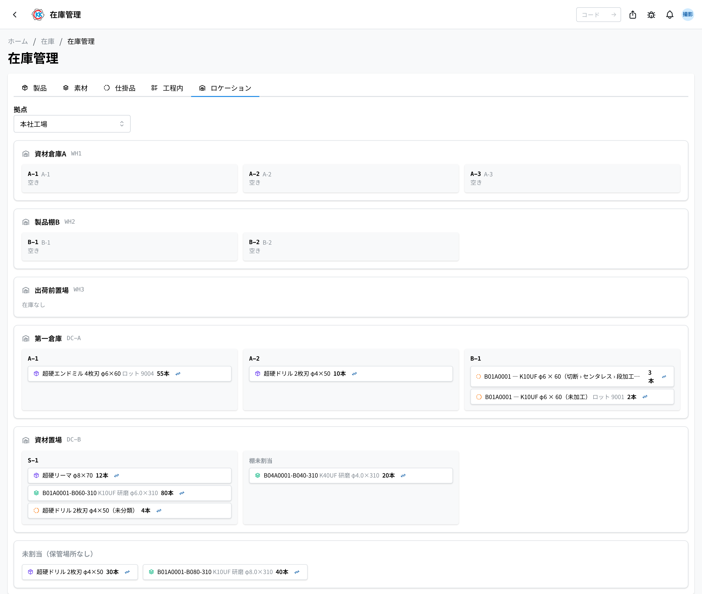

- 上の「**拠点**」を選ぶと、その拠点の **保管場所のカード**（名前とコード）が並びます。
- カードの中には **棚のマス目** が並び、そこにある品物と本数が表示されます。何も入っていない棚には「**空き**」と出ます。
- 保管場所は決まっているが棚が決まっていない在庫は「**棚未割当**」の枠に、保管場所も決まっていない在庫は「**未割当（保管場所なし）**」の枠にまとまります。
- 拠点にフロアマップ（拠点の見取り図）が登録されていて、保管場所のピンが置かれていれば、**フロアマップ** も表示されます。ピンをクリックすると、その保管場所のカードまで画面が動いて目立つ表示になります。
- その拠点に何も無いときは「この拠点には保管場所も在庫もありません」という案内が出ます。

保管場所と棚そのものの登録は[保管場所](/manual/ja/operations/masters/storage-location/user)で行います。

このアプリを使うには、在庫の権限が必要です。

## 入力項目

在庫管理は基本的に**見るための画面**ですが、在庫を別の場所へ移すときだけ入力します。

| 項目 | 必須 | 何を入れるか |
|------|------|-------------|
| [移動先の拠点](#field-plant) | 必須 | どこへ移すか |
| [保管場所 / 棚](#field-location) | 任意 | 拠点の中のどこへ置くか |
| [数量](#field-quantity) | 必須 | 移す数 |
| [備考](#field-notes) | 任意 | 移動の理由など |

### 移動先の拠点 [#field-plant]

どの拠点へ移すかです。**移動元の在庫が減り、移動先の在庫が増えます。**

### 保管場所 / 棚 [#field-location]

移動先の拠点の中で、どこに置くかです。決めておくと、あとで現物を探しやすくなります。

### 数量 [#field-quantity]

移す数です。移動元の「利用可能」の数を超えては移せません（予約されている分は移せません）。

### 備考 [#field-notes]

移動の理由などを残しておく欄です。移動の記録は履歴に残ります。

## よくある質問・困ったとき

**Q. 在庫の数を手で直したいのですが。**
A. この画面からできるのは「在庫移動」（置き場所を変えること）だけです。数がずれている場合は[棚卸](/manual/ja/operations/inventory/stock-takes/user)（ST05）で数え直して調整します。

**Q.「利用可能」が 0 なのに「在庫数」があります。**
A. その分はほかの注文のために取り置き（予約）されています。「予約」タブを開くと、どの注文に取り置きされているかを確認できます。

**Q. 予約数が在庫数より多くなっています。おかしいのでは。**
A. 異常ではありません。指示書は在庫が足りなくても承認でき、そのときに必要な分が取り置きされます。足りない状態は「発注が必要」という合図です。素材の詳細画面の ATP タイムラインで、入荷後に足りるかどうかを確認してください。

**Q. 移動しようとしたら、入れたい本数が入りません。**
A. 移動できるのは「利用可能」の本数までです。予約されている分は動かせません。

**Q. 保管場所が「未割当」になっています。**
A. 指示書の完了などで自動的に入った在庫は、置き場所が決まっていない状態で入ります。実際の棚に置いたら「移動」で場所を記録してください。

**Q. 作っている途中の製品が「製品」タブに出てきません。**
A. 製造中の本数はまだ在庫になっていません。「**工程内**」タブで確認できます。在庫に入るのは、すべての工程が完了したときです。

**Q. 半製品が「製品」タブに出てきません。**
A. 半製品は「**仕掛品**」タブに移りました。途中まで加工した品物は、製品ではなく仕掛品として、加工状態ごとに並びます。

**Q.「次回入荷」の欄が空です。**
A. その素材について、発注済みの素材発注書がありません。発注していない場合は、入荷予定は表示されません。

**Q. ロケーションタブに何も出ません。**
A. その拠点にまだ保管場所が登録されていないか、在庫がありません。保管場所の登録は管理者に相談してください。

**Q. このアプリと[在庫一覧](/manual/ja/operations/inventory/stock-overview/user)（ST02）は何が違うのですか。**
A. どちらも同じ在庫を見ていますが、向きが違います。このアプリは「製品・素材・仕掛品・工程内・ロケーション」というモノの種類で分けて見る画面、在庫一覧は「どの場所に何があるか」を一覧表 1 本で見る画面です。場所を横断してざっと数えたいときは在庫一覧を使ってください。

## 在庫のほかのアプリ

この画面は「いま何がどこにあるか」を見るためのものです。数え直したり、手で動かしたり、動いた記録を追うのは別のアプリです。

- [在庫一覧](/manual/ja/operations/inventory/stock-overview/user)（`ST02`）… 拠点・保管場所・棚の側から見る一覧です。外注へ預けている分もここで見ます。
- [在庫・所要量](/manual/ja/operations/inventory/stock-requirements/user)（`ST03`）… 品目 1 つの「これから増えるぶん・減るぶん」を時間の順に見ます。
- [入出庫伝票](/manual/ja/operations/inventory/inventory-movements/user)（`ST04`）… 在庫が動いた記録です。いつ・何が・何本動いたかを追えます。
- [棚卸](/manual/ja/operations/inventory/stock-takes/user)（`ST05`）… 数え直して帳簿と合わせます。
- [手動入出庫](/manual/ja/operations/inventory/goods-movement/user)（`ST06`）… 人の手で入れる・出す・移します。
- [移動タイプ](/manual/ja/operations/inventory/movement-types/user)（`ST09`）… 手動入出庫で選ぶ区分を管理します。

> 💡 **在庫が動くと、必ず[入出庫伝票](/manual/ja/operations/inventory/inventory-movements/user)が 1 枚できます。** この画面の「移動」も同じで、動かすたびに記録が残ります。

> ⚠️ **外注に預けている分は、この画面の本数に入りません。** 手元に無いものは在庫として数えない決まりです。預けている分は[在庫一覧](/manual/ja/operations/inventory/stock-overview/user)の「預け先」から確認します。

> ⚠️ **お客様から預かっている工具（預り品）も、この画面の本数に入りません。** 再研磨のために預かっているだけで自分の物ではないので、在庫として数えない決まりです。[在庫一覧](/manual/ja/operations/inventory/stock-overview/user)の「所有者」から確認します。

<!-- permissions:start -->
## 必要な権限

この画面を使うには **在庫**（`inventory`）の権限が要ります。

| したいこと | 必要な権限 |
| --- | --- |
| 画面を開く・一覧や詳細を見る | 在庫 の 閲覧 |
| 追加・変更・削除する | 在庫 の 作成 / 更新 / 削除 |

見るだけなら「閲覧」で足ります。追加・変更・削除の操作がある画面では、その操作にあたる権限がそれぞれ必要です。

権限は役割（ロール）を通して付きます。足りないときは管理者に相談してください。

権限の全体像は「[権限とロール](../../../permissions)」を参照してください。
<!-- permissions:end -->
