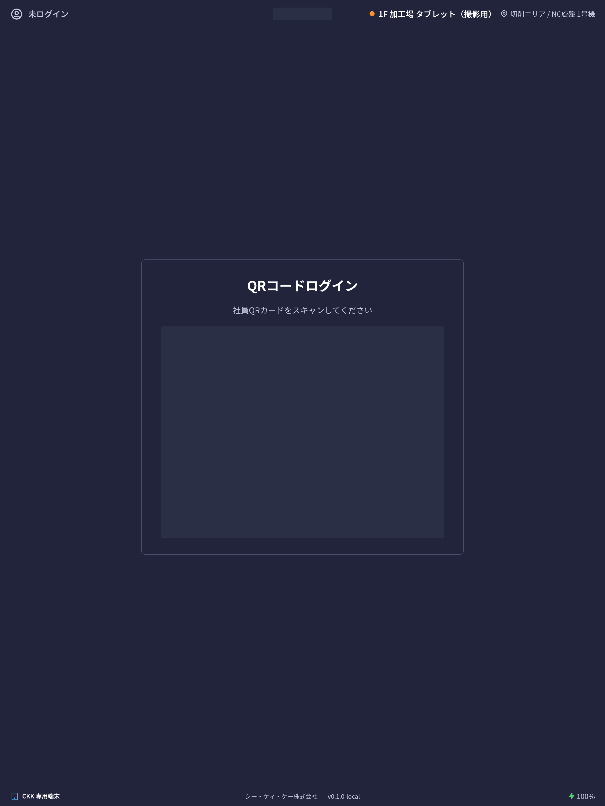
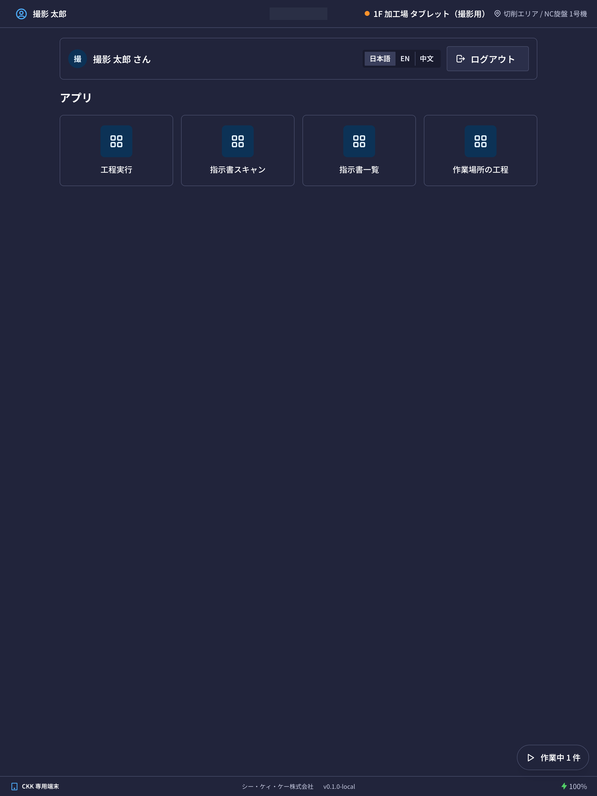
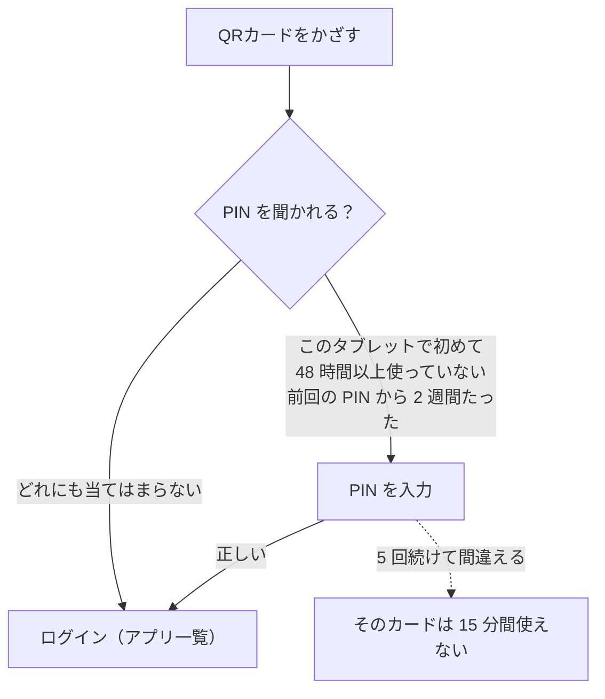
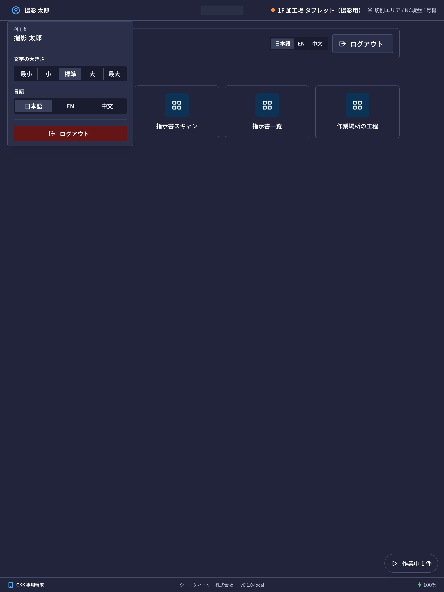

工場に置いてある **共有タブレット**（現場端末）の使いかたです。パソコンではなく、作業場に据え置きのタブレットで使います。

## このタブレットでできること

- 自分に割り当てられた **今日の作業（工程）** を確認できます。
- 指示書の QR コードを読み取って、その指示書の工程を開けます。
- 作業の **開始・一時停止・完了** を記録できます。
- 何本できたか、不良が何本出たかを入力できます。
- 検査の記録を残せます。

パソコンの画面（見積書や在庫など）はここには出ません。現場での作業記録に絞った画面です。

## 用語（このページで出てくる言葉）

- **QRカード** … 社員証のようなカードです。これをかざしてログインします。
- **PIN（ピン）** … 自分だけが知っている数字の暗証番号です。新しく決めるときは **6 桁** です。
- **端末（たんまつ）** … タブレット本体のことです。管理者が登録したタブレットだけが使えます。
- **工程（こうてい）** … 「切断」「段加工」「検査」など、作業の 1 ステップのことです。

## はじめる前に

- **自分の QRカード** が必要です。持っていない場合は管理者に発行してもらってください。
- タブレットは **管理者が登録したもの** だけが使えます。画面に「この端末は登録されていません」と出るときは管理者にご連絡ください。
- 初めて使うときは **PIN を自分で決めて登録** します（次の手順の中で案内が出ます）。

タブレット本体を新しく用意する手順（アプリの入れかた・登録用 QR コード）は、管理者向けの[管理マニュアル](/admin-manual/ja/system/kiosk-device-setup)にあります（閲覧にはログインと権限が必要です）。

## ログインする

1. タブレットの画面に「**社員QRカードをスキャンしてください**」と表示されていることを確認します。
2. カードの QR コードを、画面の枠の中に映します。少し離して、明るいところでかざすと読み取りやすくなります。

3. カードが読み取られると、**PIN の入力画面** に変わります。画面の数字ボタンで PIN を入力します。
4. 初めて使うカードのときは、PIN を新しく決めて 2 回入力します（確認のため同じ番号をもう一度入れます）。新しい PIN は **6 桁** です。同じ数字の連続（`111111`）や `123456` のような並び、`121212` のような繰り返しは「**その PIN は使えません**」と出て登録できません。

ログインできると、使えるアプリの一覧が表示されます。

> 💡 いつも使っているタブレットなら、しばらくの間はカードをかざすだけでログインできます。ただし **初めて使うタブレットでは必ず PIN を聞かれます**。また、続けて使っていても **2 週間に一度は PIN の入力** が必要です。

> ⚠️ PIN を **5 回続けて間違える** と、そのカードは **15 分間** 使えなくなります。時間をおいてからもう一度お試しください。急ぐときは管理者に PIN を再設定してもらえます。

ログインの流れを図にすると次のとおりです。

## 画面の見かた

いちばん上の帯には、次のものが表示されます。

- 左 … ログインしている人の名前。押すと「**文字の大きさ**」「**言語**」の切り替えと「**ログアウト**」が出ます。ログインしていないときは「**未ログイン**」と出ます。
- 中央 … 今の日付と時刻。
- 右 … 通信の状態を表す丸印と、このタブレットの名前（例「1F 加工場 タブレット」）。このタブレットに決められた作業場所があるときは、その名前も並びます。丸印が緑なら正常です。オレンジは専用アプリではなくブラウザで開いているとき、灰色はつながっていないとき、赤はタブレットが登録されていないときです。点滅しているときは、通信が不安定です。

いちばん下の帯の右には、電池の残りが表示されます。

アプリ一覧の画面では、上の帯のすぐ下に「〇〇 さん」と自分の名前が出ます。その右で **画面の言語**（日本語 / English / 中文）を切り替えられます。切り替えても、記録される内容は変わりません。

## 作業を始める

アプリ一覧には、次の 4 つのアプリがあります。

- 「**工程実行**」 … 自分に割り当てられた作業の一覧が開きます。使いかたは[工程の記録](/manual/ja/operations/kiosk/steps/user)をご覧ください。
- 「**指示書スキャン**」 … 指示書に印刷されている QR コードをカメラで読み取ると（番号を手で入れることもできます）、その指示書の **すべての工程** が工程の順番どおりに表示されます。工程を選ぶと、「工程実行」と同じ記録画面が開きます。ほかの人に割り当てられている工程には「**他の担当者の工程です**」と表示され、その人だけが操作できます。
- 「**指示書一覧**」 … 紙の指示書が手元に無いときに、いま動いている指示書（承認済み・進行中）を一覧から選んで、「指示書スキャン」と同じ工程の一覧を開きます。使いかたは[指示書一覧](/manual/ja/operations/kiosk/wo-list/user)をご覧ください。
- 「**作業場所の工程**」 … 自分の担当ではなく、**この機械・この場所** に待っている工程を表示します。担当者を決めずに「いつ・どこで」だけ計画された作業を見つけるときに使います。使いかたは[作業場所の工程](/manual/ja/operations/kiosk/work-location/user)をご覧ください。

## 使い終わったら

- アプリ一覧の画面の右上にある「**ログアウト**」を押します。
- 上の帯の左にある自分の名前を押して、「**ログアウト**」を選ぶこともできます。
- 押し忘れても、**5 分間なにも操作しないと自動でログアウト** されます。残りが少なくなると「**あと … で自動ログアウト**」と表示されます。次の人が自分のカードでログインしてください。

> ⚠️ 共有のタブレットです。**自分の作業が終わったらログアウト** してください。ログインしたままだと、次の人の作業があなたの名前で記録されてしまいます。

## 入力項目

| 項目 | 必須 | 何を入れるか |
|------|------|-------------|
| [QR カード](#field-card) | 必須 | 自分のカードをかざす |
| [暗証番号（PIN）](#field-pin) | 条件付き | 自分で決めた 数字 |
| [言語](#field-language) | — | 画面に出す言語 |

### QR カード [#field-card]

自分のカードをタブレットのカメラにかざします。カードは**人ごと**に配られます。他の人のカードは使わないでください — 記録がその人の名前で残ります。

### 暗証番号（PIN） [#field-pin]

自分で決めた数字です。新しく決める PIN は **6 桁** で、同じ数字の連続・`123456` のような並び・`121212` のような繰り返しは使えません。以前に 4 桁で登録した PIN は、そのまま使えます（管理者にリセットしてもらったあと、次に決めるときから 6 桁になります）。

次のときに必ず聞かれます。

- **その端末で初めて**カードを使うとき
- その端末で **48 時間以上**カードを使っていなかったとき
- 前回 PIN を入れてから **2 週間**たったとき

PIN の入力画面の説明文で、聞かれた理由がわかります。

- 「**この端末で 48 時間以上使われていない（または初めて使う）ため、本人確認が必要です。**」… 上の 1 つめか 2 つめに当たるとき
- 「**前回の PIN 確認から 2 週間たったため、本人確認が必要です。**」… 上の 3 つめだけに当たるとき

どれにも当てはまらない場合は、カードをかざすだけで入れます。**5 回続けて間違えると 15 分間ロック**されます。忘れたときは、管理者にリセットを頼んでください。

### 言語 [#field-language]

画面に出す言語です。日本語・英語・中国語から選べます。

## よくある質問・困ったとき

**Q. カードをかざしても反応しません。**
A. QR コードが汚れていないか、画面の枠の中に入っているかを確認してください。暗い場所では読み取りにくいことがあります。それでも駄目なときは、カードが有効期限切れか停止されている可能性があるので管理者にご確認ください。

**Q.「カードが無効です。管理者に確認してください。」と出ました。**
A. そのカードは停止されているか、まだ誰にも割り当てられていません。管理者にご連絡ください。

**Q. PIN を忘れてしまいました。**
A. 自分では戻せません。管理者に PIN のリセットを依頼してください。リセット後、次のログインで新しい PIN を決められます。

**Q. 毎回 PIN を聞かれます。**
A. そのタブレットを初めて使うとき、しばらく（48 時間以上）そのタブレットを使っていないとき、前回の PIN 入力から 2 週間が過ぎたときは、PIN の入力が必要です。

**Q. ほかの人がログインしたままになっています。**
A. 5 分間だれも操作しなければ自動でログアウトされます。急ぐときは、その人にログアウトしてもらってください。

**Q. 画面に「この端末は登録されていません」と出ます。**
A. そのタブレットがまだ登録されていないか、登録が解除されています。管理者にご連絡ください。

<!-- permissions:start -->
## 必要な権限

この画面に特別な権限は要りません。ログインしていれば使えます。

権限は役割（ロール）を通して付きます。足りないときは管理者に相談してください。

権限の全体像は「[権限とロール](../../../permissions)」を参照してください。
<!-- permissions:end -->
