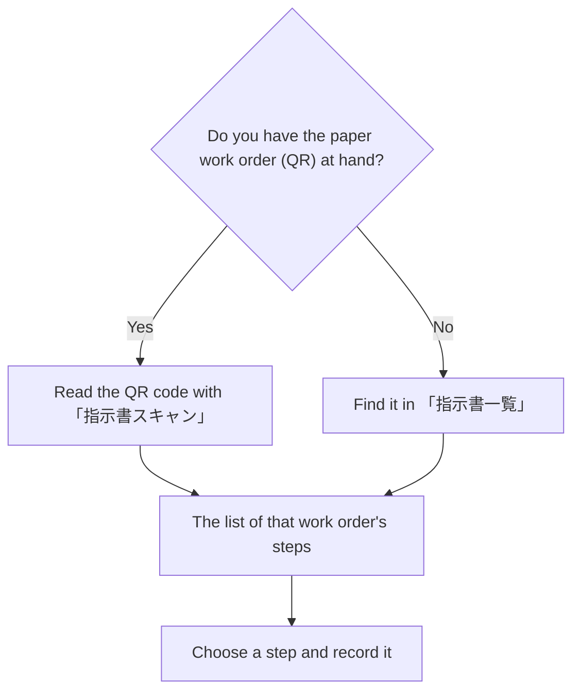
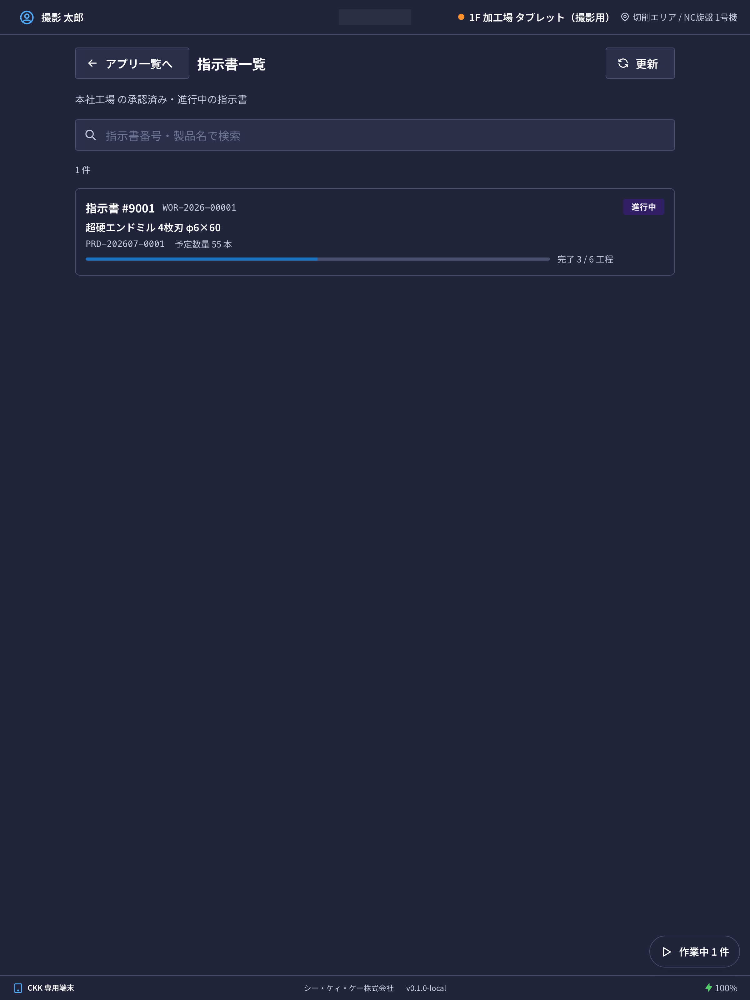
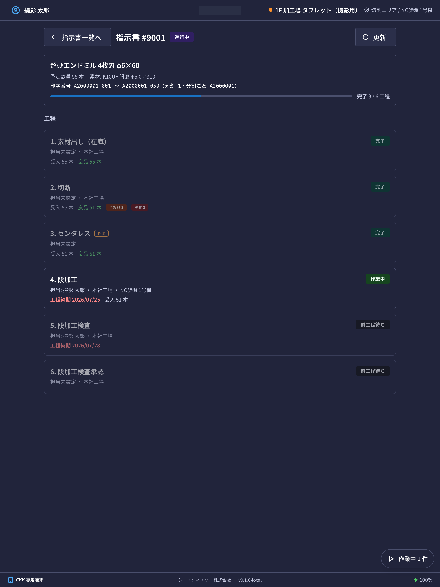

In 「**指示書一覧**」 (Work order list) on the tablet, you pick **a work order that is running now** from a list and open its steps.

## Why this app exists

「**指示書スキャン**」 (Work order scan) opens the steps by reading the QR code printed on the paper work order. But sometimes the paper is not at hand, the QR code is too dirty to read, or you do not remember the number.

「指示書一覧」 is the way in for those cases: **find it in the list and open the same screen**. The screen and the operations after opening are exactly the same as with 「指示書スキャン」.

## What you can do with this app

- You can see the **approved and in-progress** work orders in a list.
- You can search by work order number or product name.
- You can see how far the steps of each work order have progressed.
- Choosing a work order shows **all its steps** in step order, and you can open the recording screen from there.

## Words used on this page

- **Work order number (lot number)** … a serial number such as `#9001`. It is the number on the paper work order and on the goods.
- **Document number** … a number such as `WOR-2026-00001`. Office screens and lists use this one.
- **Approved / in progress** … approved means approval is done and no step has been started yet. In progress means at least one step has been started.

## Before you start

- You need the same **work order** permission as 「工程実行」 (Step execution) to use this app. If you cannot open it, please ask your system administrator.
- The list shows only work orders that have at least one step done at **this tablet's site**. When no site is set on the tablet, work orders of all sites are shown. The site is set in Device Management (`SY09`).

## How to open it

Press 「**指示書一覧**」 (Work order list) in the app list.

## Reading the screen

- Under the heading, 「**◯◯ の承認済み・進行中の指示書**」 (approved and in-progress work orders at ◯◯) shows which site you are looking at.
- Work orders are listed **newest first** (largest number first).
- Each card shows the following.
  - **指示書 #9001** … the work order number (lot number). The document number (`WOR-…`) is shown next to it.
  - The label at the top right … 「**承認済**」 (Approved) or 「**進行中**」 (In progress).
  - The **product name** and **product code**, and 「**予定数量 ◯ 本**」 (planned quantity)
  - A progress bar and 「**完了 3 / 6 工程**」 (3 of 6 steps completed) … how many steps are completed, not counting cancelled steps.
- Below the search box, 「**◯ 件**」 shows the number of work orders currently listed.

> 💡 Draft, pending-approval, completed and cancelled work orders are not shown, because they are not work to be done on the shop-floor tablet.

## Find a work order

1. Press the 「**指示書番号・製品名で検索**」 (search by work order number or product name) box at the top.
2. Type what you are looking for. The list narrows as you type.

You can search by any of these.

- Work order number (`9001` or `#9001`)
- Document number (`WOR-2026-00001`). The **legacy number** from before renumbering (such as `WOR-202607-09001`) also works
- Product name or product code

If you enter two or more words separated by spaces, only work orders that **contain all of them** remain. Full-width and half-width characters, and upper and lower case, are treated the same.

> 💡 When there are many work orders, **up to 300** of the newest are shown, and 「**新しい順に上限まで表示しています。検索で絞ってください**」 (showing the newest up to the limit; narrow it down with search) appears next to the count. If you cannot find an old work order, narrow the list with search.

## Open the steps

1. Press the card of the work order you want to open.
2. **All the steps** of that work order are shown in step order.
3. Press the step you want to work on, and the same recording screen as 「工程実行」 opens.

The step list screen is the same as when opened from 「指示書スキャン」. The card at the top shows the product name, planned quantity, material, **marking number** and progress. Each step card shows the assignee, site and quantities, and the **step due date** if one is set (a step past its due date and not yet finished is shown in red).

- Starting, pausing, completing and entering quantities work the same as on the [Recording Work](/manual/en/operations/kiosk/steps/user) page.
- Steps assigned to someone else show 「**他の担当者の工程です**」 (This step belongs to another person), and only that person can operate them. **Opening from the list does not change which steps you can operate.**
- For a work order that starts from work in progress in stock (pieces partly processed and kept in stock), 「**開始状態**」 (Starting state) appears on the top card. Steps already done at the work-in-progress stage are shown as 「**仕掛品で済んでいるので行わない工程: ◯◯**」 (Steps skipped because the WIP has already done them: ◯◯).
- A work order waiting for approval to be stopped partway shows 「**打ち切り承認依頼中**」 (Stop pending approval). Once approved, its steps close and the pieces partway through go back into stock as work in progress.
- Press 「**指示書一覧へ**」 (Back to work orders) at the top left to return to the list.

## Questions and problems

**Q. Nothing is listed.**
A. If 「**承認済み・進行中の指示書はありません**」 (no approved or in-progress work orders) is shown, there are no running work orders at this tablet's site. Work orders that are not yet approved are not shown, so please check with the office.

**Q. The work order I am looking for does not appear.**
A. It is one of the following.
- It is not approved yet, or it is already completed (only approved and in-progress work orders are listed).
- That work order has no step done at this tablet's site.
- There are many work orders and it is not among the newest 300. Type its number in the search box.

**Q. 「該当する指示書はありません」 (no matching work orders) is shown.**
A. No work order matches what you typed in the search box. Use fewer words, or type only the number.

**Q. The list seems out of date.**
A. Press 「**更新**」 (Refresh) at the top right to reload the latest state.

**Q. What is the difference from 「指示書スキャン」 (Work order scan)?**
A. Only the way in. 「指示書スキャン」 opens one work order from a QR code or a number, and 「指示書一覧」 lets you pick one from a list. The screen after opening, and the steps you can operate, are the same.

<!-- permissions:start -->
## Permissions required

Using this screen requires the **Work order** (`work_order`) permission.

| What you want to do | Permission needed |
| --- | --- |
| Open the screen, view lists and details | Work order — View |
| Add, change or delete | Work order — Create / Edit / Delete |

Viewing only needs *View*. Where a screen offers adding, changing or deleting, each of those needs its matching permission.

Permissions come through roles. If something is missing, ask an administrator.

For the whole picture see [Permissions and roles](../../../permissions).
<!-- permissions:end -->
