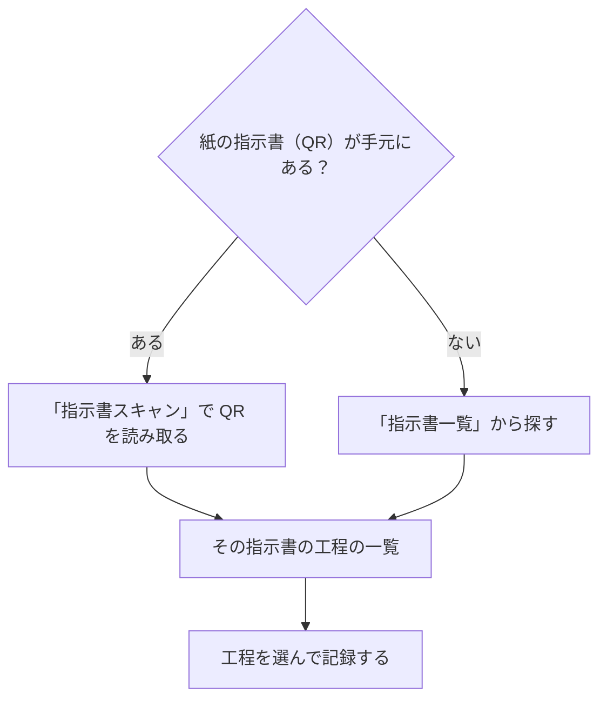
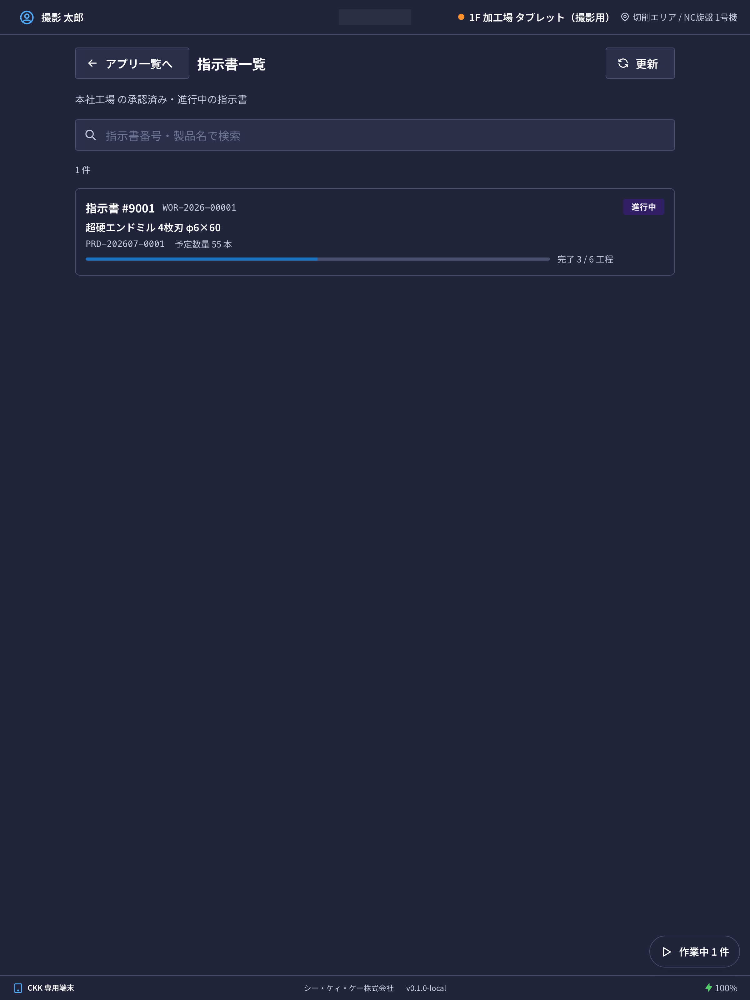
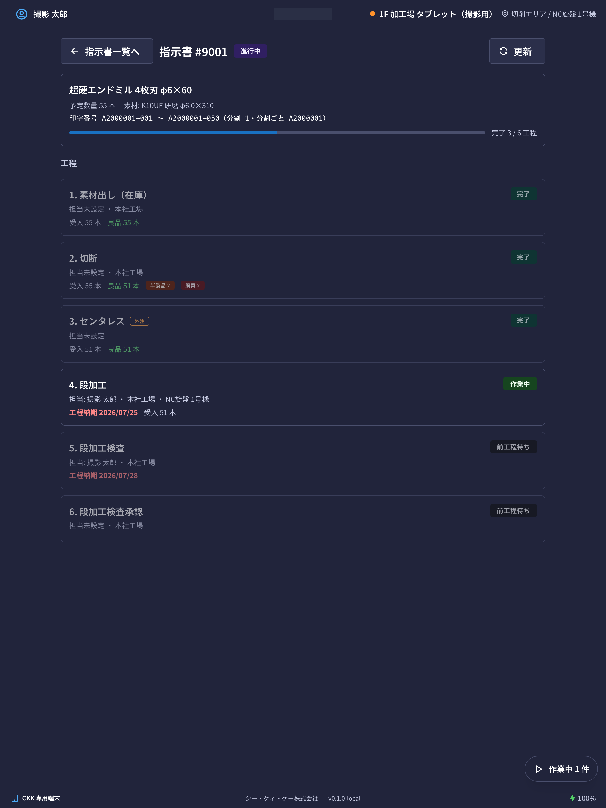

タブレットの「**指示書一覧**」で、**いま動いている指示書** を一覧から選び、その指示書の工程を開きます。

## なぜこのアプリが要るのか

「**指示書スキャン**」は、紙の指示書に印刷された QR コードを読み取って工程を開きます。ですが、紙が手元に無い・QR が汚れて読めない・番号を覚えていない、ということがあります。

「指示書一覧」は、そういうときに **一覧から探して同じ画面を開く** ための入口です。開いたあとの画面と操作は「指示書スキャン」とまったく同じです。

## このアプリでできること

- **承認済み・進行中** の指示書を一覧で確認できます。
- 指示書番号や製品名で探せます。
- 指示書ごとに、工程がどこまで進んだかを確認できます。
- 指示書を選ぶと、その指示書の **すべての工程** が工程の順番どおりに出て、そこから記録画面を開けます。

## 用語（このページで出てくる言葉）

- **指示書番号（ロット番号）** … `#9001` のような通し番号です。紙の指示書や現物に付いている番号です。
- **書類番号** … `WOR-2026-00001` のような番号です。事務所の画面や一覧ではこちらが使われます。
- **承認済み / 進行中** … 承認済みは、承認が済んでまだ工程を始めていない指示書です。進行中は、工程を 1 つでも始めた指示書です。

## はじめる前に

- このアプリを使うには「工程実行」と同じ **指示書** の権限が要ります。開けない場合は、システム管理者にご相談ください。
- 一覧に出るのは、**このタブレットの拠点** で行う工程が 1 つでもある指示書だけです。タブレットに拠点が設定されていないときは、すべての拠点の指示書が出ます。拠点の設定は端末管理（`SY09`）で行います。

## 開き方

アプリ一覧から「**指示書一覧**」を押します。

## 画面の見かた

- 見出しの下に「**◯◯ の承認済み・進行中の指示書**」と、どの拠点の分を見ているかが出ます。
- 指示書は **新しい順**（番号の大きい順）に並びます。
- 各カードには次のものが並びます。
  - **指示書 #9001** … 指示書番号（ロット番号）です。その横に書類番号（`WOR-…`）が出ます。
  - 右上のラベル … 「**承認済**」か「**進行中**」です。
  - **製品名** と **製品コード**、「**予定数量 ◯ 本**」
  - 進み具合の棒と「**完了 3 / 6 工程**」 … キャンセルした工程を除いて、いくつの工程が完了したかです。
- 検索欄の下に「**◯ 件**」と、いま表示している件数が出ます。

> 💡 下書き・承認依頼中・完了・キャンセルの指示書は出ません。現場のタブレットで進める仕事ではないためです。

## 指示書を探す

1. 上の「**指示書番号・製品名で検索**」の欄を押します。
2. 探したい言葉を入れます。入れるそばから一覧が絞り込まれます。

次のどれでも探せます。

- 指示書番号（`9001` でも `#9001` でも）
- 書類番号（`WOR-2026-00001`）。番号が振り直される前の **旧番号**（`WOR-202607-09001` のような形）でも探せます
- 製品名・製品コード

空白で区切って 2 つ以上の言葉を入れると、**全部を含む** 指示書だけが残ります。全角・半角、英字の大文字・小文字は区別しません。

> 💡 指示書が多いときは、新しいものから **300 件まで** が出て、件数の横に「**新しい順に上限まで表示しています。検索で絞ってください**」と表示されます。古い指示書が見つからないときは、検索で絞ってください。

## 工程を開く

1. 一覧から、開きたい指示書のカードを押します。
2. その指示書の **すべての工程** が、工程の順番どおりに表示されます。
3. 進めたい工程を押すと、「工程実行」と同じ記録画面が開きます。

工程の一覧の画面は「指示書スキャン」で開いたときと同じです。上のカードには、製品名・予定数量・使う素材・**印字番号**・進み具合が出ます。工程ごとのカードには、担当・拠点・本数と、決まっていれば **工程納期** が出ます（過ぎていてまだ終わっていない工程は赤で表示されます）。

- 開始・一時停止・完了・数量の入力のしかたは、[工程の記録](/manual/ja/operations/kiosk/steps/user)のページと同じです。
- ほかの人に割り当てられている工程には「**他の担当者の工程です**」と表示され、その人だけが操作できます。**一覧から開いても、操作できる工程は変わりません。**
- 左上の「**指示書一覧へ**」を押すと、一覧に戻ります。

## よくある質問・困ったとき

**Q. 一覧に何も出ません。**
A.「**承認済み・進行中の指示書はありません**」と出ている場合、このタブレットの拠点には、いま動いている指示書がありません。承認がまだの指示書は出ないので、事務所の担当者にご確認ください。

**Q. 探している指示書が出てきません。**
A. 次のどれかに当たります。
- まだ承認されていない、またはもう完了している（一覧に出るのは承認済み・進行中だけです）。
- その指示書に、このタブレットの拠点で行う工程が無い。
- 指示書が多く、新しい 300 件に入っていない。検索欄に番号を入れて探してください。

**Q.「該当する指示書はありません」と出ます。**
A. 検索欄に入れた言葉に合う指示書がありません。言葉を減らすか、番号だけを入れて探してください。

**Q. 一覧が古いままのようです。**
A. 右上の「**更新**」を押すと、最新の状態に読み込み直します。

**Q.「指示書スキャン」との違いは何ですか。**
A. 入口が違うだけです。「指示書スキャン」は QR コードか番号から 1 件を開き、「指示書一覧」は一覧から選んで開きます。開いたあとの画面と、操作できる工程は同じです。

<!-- permissions:start -->
## 必要な権限

この画面を使うには **指示書**（`work_order`）の権限が要ります。

| したいこと | 必要な権限 |
| --- | --- |
| 画面を開く・一覧や詳細を見る | 指示書 の 閲覧 |
| 追加・変更・削除する | 指示書 の 作成 / 更新 / 削除 |

見るだけなら「閲覧」で足ります。追加・変更・削除の操作がある画面では、その操作にあたる権限がそれぞれ必要です。

権限は役割（ロール）を通して付きます。足りないときは管理者に相談してください。

権限の全体像は「[権限とロール](../../../permissions)」を参照してください。
<!-- permissions:end -->
