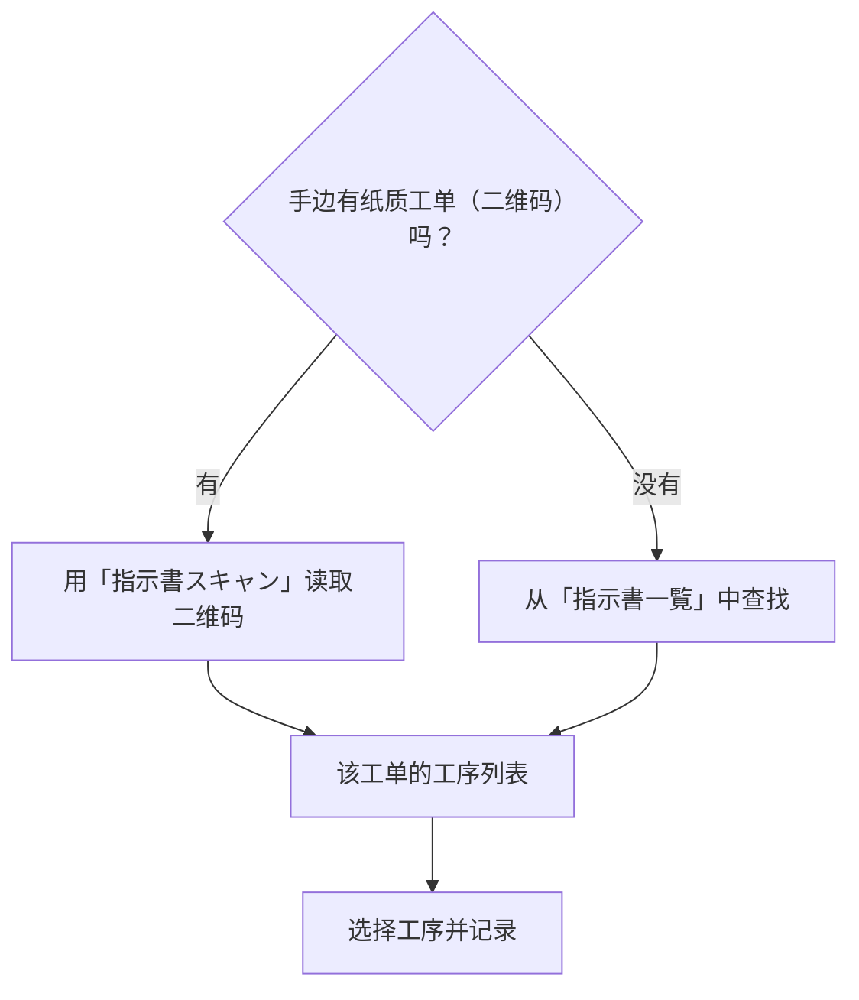
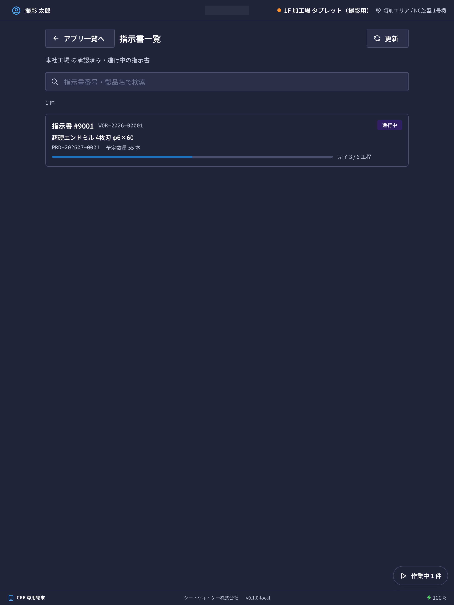
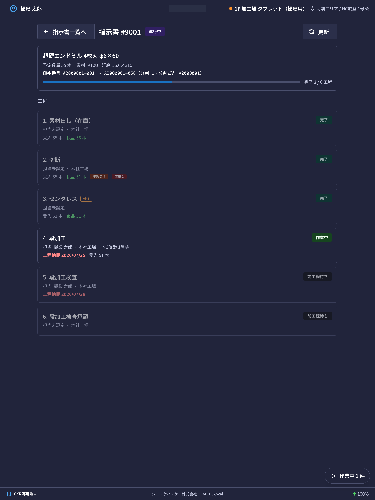

通过平板上的「**指示書一覧**」（工单列表），可以从列表中选择 **正在进行的工单**，并打开该工单的工序。

## 为什么需要这个应用

「**指示書スキャン**」（工单扫码）通过读取印在纸质工单上的二维码来打开工序。但有时纸不在手边、二维码脏了读不出来，或者不记得编号。

「指示書一覧」就是为这些情况准备的入口：**从列表中找到并打开同一个画面**。打开之后的画面和操作与「指示書スキャン」完全相同。

## 本应用可以做什么

- 可以在列表中查看 **已批准・进行中** 的工单。
- 可以按工单编号或产品名称查找。
- 可以查看每张工单的工序进行到了哪里。
- 选择工单后，会按工序顺序显示该工单的 **全部工序**，并可从那里打开记录画面。

## 术语（本页出现的词语）

- **指示書番号（工单编号・批次号）** … `#9001` 这样的流水号。是纸质工单和实物上的编号。
- **書類番号（单据编号）** … `WOR-2026-00001` 这样的编号。办公室的画面和列表使用这个编号。
- **承認済み / 進行中（已批准 / 进行中）** … 已批准是指审批已完成、尚未开始工序的工单。进行中是指已开始至少 1 道工序的工单。

## 开始之前

- 使用本应用需要与「工程実行」（工序执行）相同的 **工单** 权限。无法打开时，请咨询系统管理员。
- 列表中只显示有至少 1 道工序在 **本平板所属据点** 进行的工单。平板未设定据点时，显示所有据点的工单。据点在终端管理（`SY09`）中设定。

## 打开方法

在应用列表中点击「**指示書一覧**」（工单列表）。

## 画面的看法

- 标题下方以「**◯◯ の承認済み・進行中の指示書**」（◯◯ 的已批准・进行中工单）显示当前查看的是哪个据点。
- 工单按 **从新到旧**（编号从大到小）排列。
- 每张卡片上显示以下内容。
  - **指示書 #9001** … 工单编号（批次号）。旁边显示单据编号（`WOR-…`）。
  - 右上角的标签 … 「**承認済**」（已批准）或「**進行中**」（进行中）。
  - **产品名称** 和 **产品编号**、「**予定数量 ◯ 本**」（计划数量）
  - 进度条和「**完了 3 / 6 工程**」（已完成 3 / 6 道工序）… 不含已取消的工序，表示完成了几道工序。
- 搜索栏下方以「**◯ 件**」显示当前显示的条数。

> 💡 草稿・审批中・已完成・已取消的工单不会显示，因为它们不是在现场平板上进行的工作。

## 查找工单

1. 点击上方的「**指示書番号・製品名で検索**」（按工单编号・产品搜索）栏。
2. 输入要查找的内容。输入的同时列表就会被筛选。

以下任意一项都可以查找。

- 工单编号（`9001` 或 `#9001` 都可以）
- 单据编号（`WOR-2026-00001`）。重新编号之前的 **旧编号**（`WOR-202607-09001` 这样的形式）也可以
- 产品名称・产品编号

用空格分隔输入 2 个以上的词时，只保留 **全部包含** 的工单。不区分全角・半角，也不区分英文字母的大小写。

> 💡 工单很多时，只显示最新的 **300 条**，并在条数旁显示「**新しい順に上限まで表示しています。検索で絞ってください**」（按新旧顺序显示至上限，请用搜索缩小范围）。找不到较旧的工单时，请用搜索筛选。

## 打开工序

1. 在列表中点击要打开的工单卡片。
2. 该工单的 **全部工序** 会按工序顺序显示。
3. 点击要进行的工序，就会打开与「工程実行」相同的记录画面。

工序列表的画面与从「指示書スキャン」打开时相同。上方的卡片显示产品名称・计划数量・使用的材料・**打标编号**・进度。每道工序的卡片显示负责人・据点・数量，如果已设定，还显示 **工序交期**（已过期且尚未完成的工序以红色显示）。

- 开始・暂停・完成・数量的输入方法，与[工序记录](/manual/zh/operations/kiosk/steps/user)页面相同。
- 分配给其他人的工序会显示「**他の担当者の工程です**」（这是其他负责人的工序），只有那个人才能操作。**即使从列表打开，可以操作的工序也不会改变。**
- 从库存在制品（加工到一半后放在库存中的品）开始的工单，上方卡片会显示「**開始状態**」（开始状态）。在制品阶段已经完成的工序会显示为「**仕掛品で済んでいるので行わない工程: ◯◯**」（在制品已完成、无需进行的工序: ◯◯）。
- 正在等待中途终止审批的工单会显示「**打ち切り承認依頼中**」（终止审批中）。批准后工序关闭，进行到一半的品会作为在制品退回库存。
- 点击左上角的「**指示書一覧へ**」（返回工单列表）可回到列表。

## 常见问题・遇到困难时

**Q. 列表中什么都没有。**
A. 显示「**承認済み・進行中の指示書はありません**」（没有已批准或进行中的工单）时，本平板所属据点目前没有正在进行的工单。尚未批准的工单不会显示，请向办公室的负责人确认。

**Q. 找不到要找的工单。**
A. 属于以下情况之一。
- 尚未批准，或已经完成（列表中只显示已批准・进行中的工单）。
- 该工单没有在本平板所属据点进行的工序。
- 工单很多，不在最新的 300 条之内。请在搜索栏中输入编号查找。

**Q. 显示「該当する指示書はありません」（没有匹配的工单）。**
A. 没有与搜索栏中输入的内容相符的工单。请减少词语，或只输入编号查找。

**Q. 列表好像没有更新。**
A. 点击右上角的「**更新**」（更新）可重新加载最新状态。

**Q. 与「指示書スキャン」（工单扫码）有什么不同？**
A. 只是入口不同。「指示書スキャン」从二维码或编号打开 1 张工单，「指示書一覧」从列表中选择打开。打开之后的画面和可以操作的工序是相同的。

<!-- permissions:start -->
## 所需权限

使用本画面需要 **工单**（`work_order`）权限。

| 想做的事 | 所需权限 |
| --- | --- |
| 打开画面、查看列表与明细 | 工单 — 查看 |
| 新增・变更・删除 | 工单 — 创建 / 更新 / 删除 |

仅查看有「查看」即可。画面中若有新增、变更或删除的操作，则分别需要对应的权限。

权限通过角色授予。若不足，请与管理员联系。

权限的整体说明请参见「[权限与角色](../../../permissions)」。
<!-- permissions:end -->
