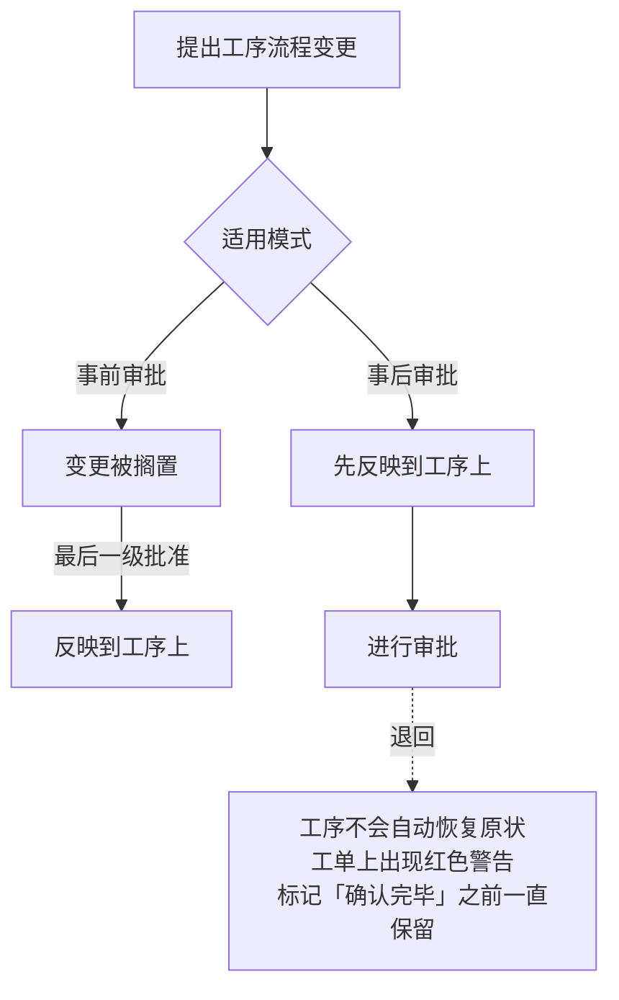
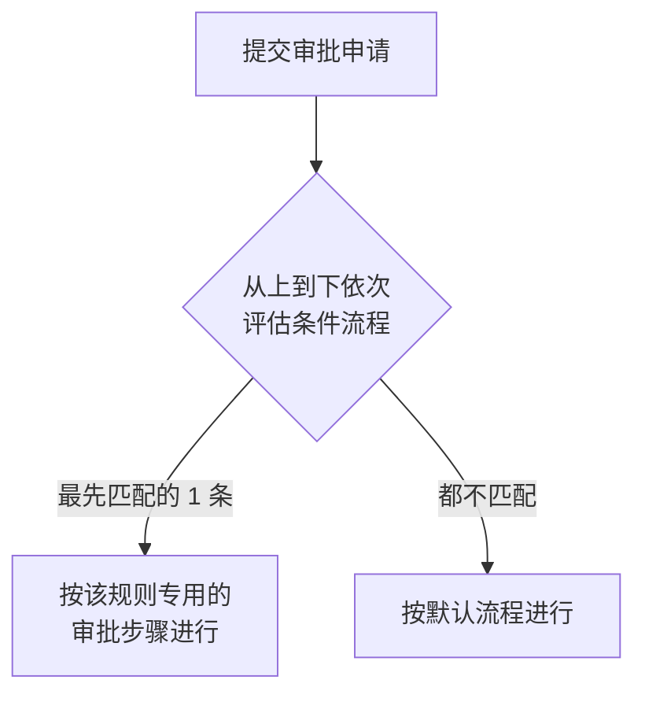
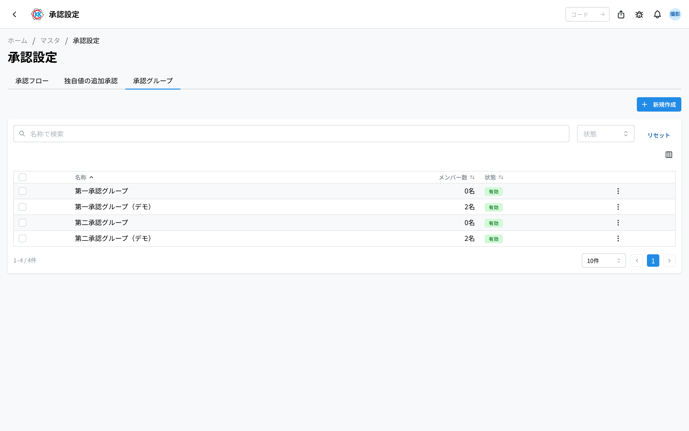
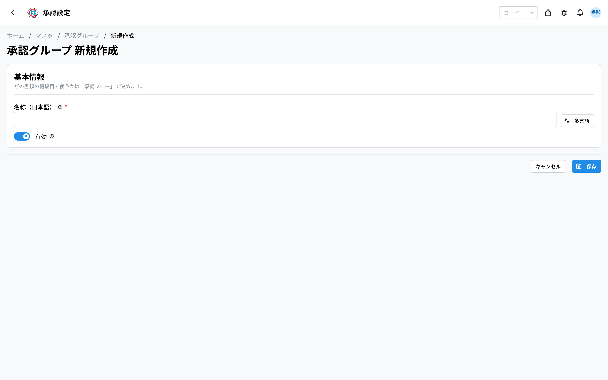
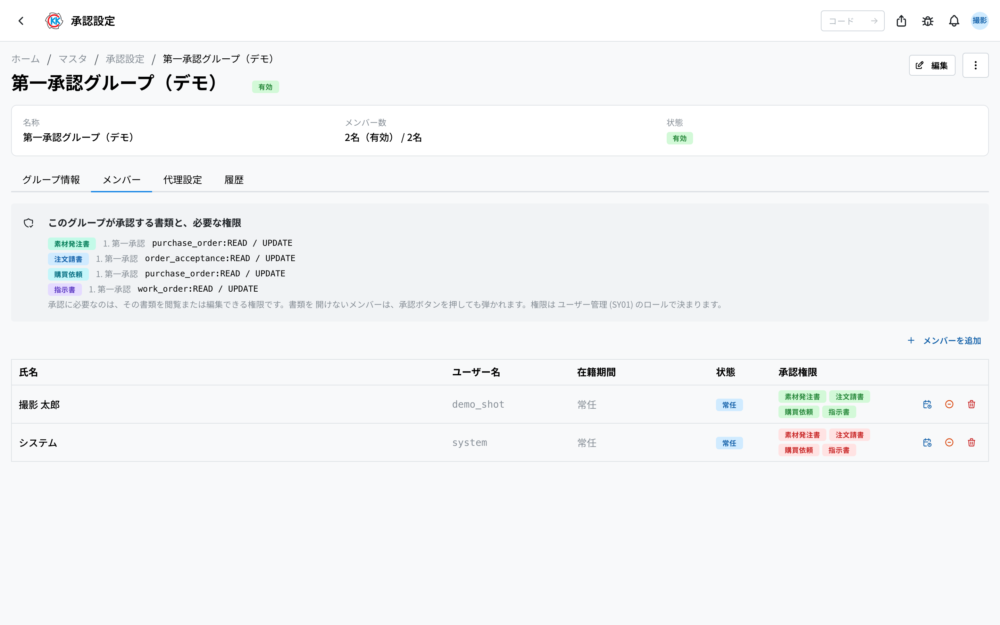
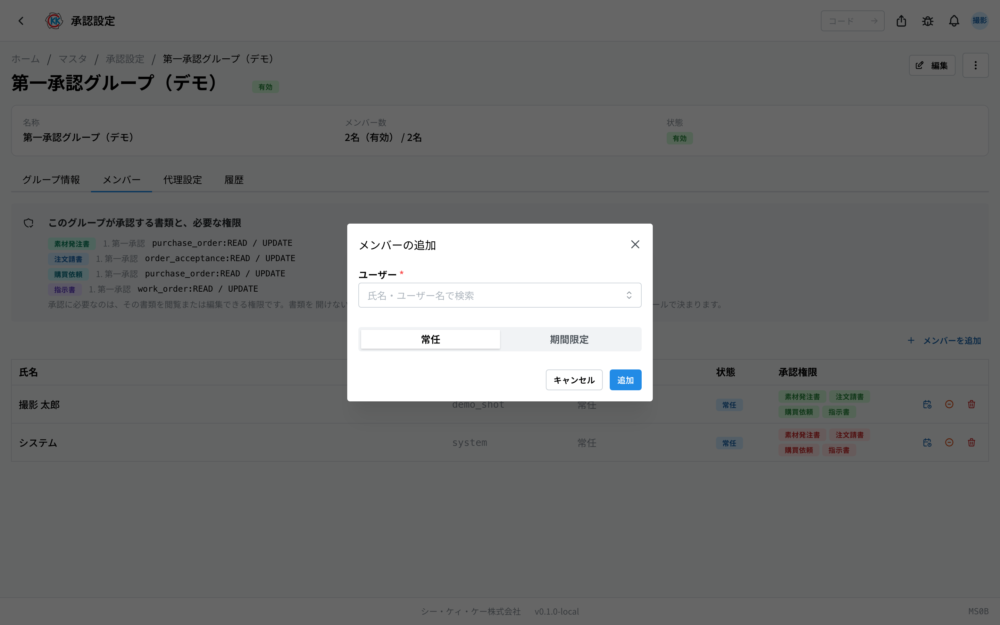
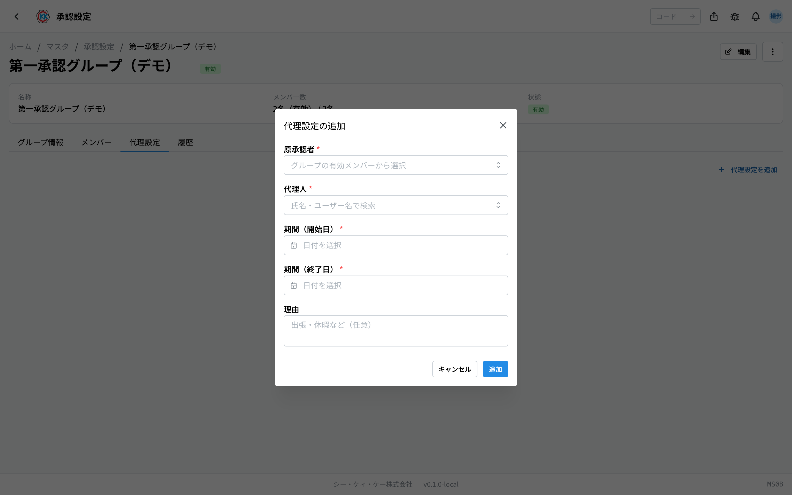

这是用于设定「**每种单据要经过几级审批**」以及「**谁可以审批**」的应用。操作代码是 `MS0B`。

按单据种类排列确定前必须通过的审批级别。每一级指定一个分组，只有属于该分组的人才能审批。**不在分组里的人无法审批。**

## 本应用可以做什么

- 可以按单据设定 **审批流程**（第几级由哪个分组审批）。
- 可以按级别选择「**任意 1 人**审批即可通过」还是「**全员**审批才能通过」。
- 可以按单据切换 **是否使用审批**。
- 可以根据单据内容（金额等）改变要经过的级别（**条件流程**）。
- 仅当有未从前一单据继承的值时，可以追加审批级别（**自定义值追加审批**）。
- 可以创建审批人员的 **分组**。
- 可以在分组中添加、删除 **成员**（可以审批的人）。除常任成员外，还可以登记 **限期成员**。
- 负责人出差或休假时，可以按期间登记 **代理人**（代替审批的人）。
- 不再使用的分组可以停用，记录不会被删除。

## 术语（本页出现的词）

- **审批** … 确认内容并同意继续推进。
- **审批流程** … 单据在确定之前要经过的审批顺序。每种单据设定 1 条。
- **级别** … 审批流程中的每一个审批。名称可自由设定，如「一级审批」「部门审批」。
- **分组** … 可以审批的人的集合。审批申请是发给分组的，而不是发给个人。
- **成员** … 在该分组中可以审批的人。只有这些人可以审批。
- **限期成员** … 只在指定期间内作为分组的一员进行审批的人。
- **代理人** … 原审批人不在时，按期间 **代替** 其审批的人。审批记录中会保留「代理了谁」。

> 💡 **限期成员和代理人不同。** 限期成员是「在该期间内，本人就是分组的一员」。代理人是「代替原审批人按下按钮」，审批记录中会留下原审批人的姓名。因调动或支援临时加入分组时用限期成员，只是在休假期间代为处理时用代理人。

## 开始之前

- 使用本应用需要 **主数据权限**。
- 只能添加系统中已登记的人员。如果找不到姓名，请先确认公司账号是否已创建。

## 界面说明

打开应用后会显示三个标签页。

- **审批流程** … 按单据设定的审批级别（首先打开的标签页）。
- **自定义值追加审批** … 仅当有未从前一单据继承的值时才追加的审批级别。
- **审批分组** … 可以审批的人员分组一览。

## 设定审批流程

「**承認フロー**」（审批流程）标签页中，按可通过审批的单据种类各显示 1 张卡片。

> 📷 该界面的截图将在下次拍摄时添加。

- 共有 **订单确认书**、**工单**、**材料订购单**、**采购申请**、**工序流程变更**、**订单确认书取消申请**、**内部文档**、**设计委托单**、**出货单**、**盘点**、**请款单**、**请款单的收款**、**图纸版本**、**工单中止**、**加工程序变更** 15 种。其中有几种只在特定情况下才需要审批。
  - **工序流程变更** … 在已批准／进行中的工单上添加、修改或删除工序分支时的审批。
  - **订单确认书取消申请** … 整单取消已确定的订单确认书时的审批（没有按订单明细的取消）。
  - **出货单** … 仅在出货数量比订单多或少（有过不足）时才需要审批。数量正好的出货不需要审批。
  - **请款单** … 仅在发行从收费项目追加了附加费用的请款单时才需要审批。
  - **请款单的收款** … 将请款单设为已付款时的审批。
  - **工单中止** … 停止进行中的工单、将流程中的品作为在制品退回库存时的审批。
  - **加工程序变更** … 添加・修改・新版本・删除・废止图纸版本的加工程序时的审批（[图纸](/manual/zh/operations/production/design-file/user)）。
- **价格表** 和 **表单** 不在此列。价格表在「**独自値の追加承認**」（自定义值追加审批）标签页中设定（参见[自定义值追加审批](#custom-value-approval)）。表单的审批在[表单](/manual/zh/operations/general/forms/user)画面中按表单设定。
- 每张卡片以「1 一级审批 厂长 · 任意1人」的形式列出各级别。有条件流程的卡片会显示「**条件付き ◯ 本**」（◯ 条条件流程）。
- 一个级别都没有、因而无法提出审批申请的单据，卡片左侧会出现红线，并显示「**未設定 — この書類は承認依頼を出せません**」（未设定——该单据无法提出审批申请）。这种状态下按审批申请按钮也无法推进，请设定级别，或关闭「承認を使う」（使用审批）（参见[将某类单据设为不使用审批](#approval-policy)）。
- 无需审批即可继续的单据，卡片上显示「**承認なし**」（无需审批）。工序流程变更・订单确认书取消申请・出货单・盘点・请款单・请款单的收款・图纸版本・工单中止・加工程序变更一开始没有级别，因此会**不经审批立即生效**（避免不使用审批的环境被卡住）。如需审批请设定级别。
- 卡片上还会显示「**审批所需权限**」— 指能**查看或修改**该单据的权限（例：订单确认书需要「订单确认书・订单明细」的查看/修改权限）。不存在审批动作的权限：**谁能审批仅由本画面的审批分组决定**，打不开单据的人即使加入分组也无法审批。
- 每个级别会以徽章显示当前可以审批该级别的人员情况。
  - **◯人可审批**（绿色）… 全员都有权限。
  - **◯人中◯人无权限**（红色）… 这些人点击审批按钮也会被拒绝。将鼠标移到徽章上可看到姓名。
  - **成员0人**（红色）… 当前没有人能审批该级别，提出申请也会停住。
  - **◯人可审批（◯人范围受限）**（黄色）… 有权限，但仅限本人负责的据点等范围，范围外的单据无法审批。
- 任一级别存在上述问题的卡片，左侧也会出现红线（「承認を使う」关闭的卡片除外）。

设定时点击卡片右侧的「**编辑**」（未设定时为「**设定**」）。

1. 点击「**添加级别**」增加 1 个审批级别。
2. 在「**名称（日本語）**」（名称（日语））中输入该级别的称呼（例：一级审批、部门审批）。一开始已填入「第◯承認」（第◯级审批）。
3. 在「**审批分组**」中选择审批该级别的分组。
4. 选择「**任意1人**」或「**全员**」。
   - **任意1人** … 分组中任何 1 人审批后，该级别即通过。
   - **全员** … 该分组的成员全部审批后才会进入下一级别。
5. 需要调整顺序时，用右侧的 **↑** **↓** 按钮交换。级别编号会自动重新排列。
6. 不需要的级别可用 **垃圾桶** 按钮删除。
7. 点击「**保存**」。

一个级别都没有时无法保存（会显示「**承認ステップを 1 段以上設定してください**」（请至少设定 1 个审批级别））。不需要审批时，请不要删除级别，而是关闭「承認を使う」（使用审批）。另外，选择已停用的分组、或当前没有可审批成员的分组时，会显示「**第 ◯ 段の承認グループは無効、または今承認できるメンバーがいません**」（第 ◯ 级的审批分组已停用，或当前没有可审批的成员），无法保存。

选择分组后，其下方会显示「**可以审批该级别的人**」，包括同样的徽章和姓名。保存前即可在此确认所选分组的人是否真的能够审批。

### 仅工序流程变更才有的设定 — 适用模式

**工序流程变更** 的编辑页面上，除了级别设定之外还有「**適用モード**」（适用模式）一栏（仅此单据才有的设定）。切换后会当场立即保存。

- **事前承認（承認後に適用）**（事前审批・审批后适用）… 变更在审批结束之前被搁置，最后一级批准后才反映到工序上（初始为此项）。
- **事後承認（即時適用）**（事后审批・立即适用）… 先把变更反映到工序上，再进行审批。不想让现场等待时选这一项。但是**即使被退回，工序也不会自动恢复原状**。工单画面上会出现红色警告，在手动修正工序等处理并标记「确认完毕」之前，警告会一直保留。

两种模式的区别用图表示如下。

> ⚠️ **修改设定不会影响正在审批中的单据。** 进行中的单据会按提出审批申请时的设定一直走到最后。变更从今后提出的审批申请开始生效。

## 将某类单据设为不使用审批（「承認を使う」开关） [#approval-policy]

「承認フロー」（审批流程）标签的每张卡片上都有「**承認を使う**」（使用审批）开关，可以按单据类型选择是否经过审批。

| 开关 | 有审批级别 | 没有审批级别 |
|------|-----------|-------------|
| 开 | 按级别依次审批 | **无法申请审批**（卡片变红） |
| 关 | 无需审批即可继续（级别保留但不使用） | 无需审批即可继续 |

- **设为关时**，在该单据上按「**承認依頼**」（申请审批）后，会直接变为与审批通过后相同的状态（已批准等）。审批通过时会发生的事（预留库存、通知下一步等）也会照常发生。历史中会记录「**承認なし（承認設定で OFF）**」（无需审批——审批设置中已关闭）。
- 审批级别不会被删除。之后改回开时，会直接使用保留的级别。
- 从未动过开关的单据类型 **与以前的行为相同**（卡片上显示「**まだ設定していません（いまの動きを表示しています）**」，尚未设置——显示当前的行为）。以前有的类型在没有级别时无法申请审批（订单确认书・工单・采购申请・材料采购单・设计委托单・内部文档），有的类型在没有级别时无需审批即可通过（出货数量差异・请款单・请款单的收款・图纸版本・工序流程变更・订单确认书取消・盘点・工单中止・加工程序变更）。一旦切换过开关，就按上表处理。
- 只有能编辑主数据的人可以切换开关。每次切换都会记录在操作历史中。

> ⚠️ 已经在审批途中的单据，即使切换开关也不会停止，会按申请时的审批走到最后。

## 按单据内容拆分流程（条件流程）

可以按单据的内容（金额・类别等）改变审批的层级。例如「材料订购单 50 万日元以上时增加高层审批」「直送最终用户的订单确认书须经销售部长审批」。

在编辑页面的「**条件付きフロー**」（条件流程）区块中设定。

- 规则 = **条件**（全部满足时一致）+ **该规则专用的审批步骤**。
- 提交审批申请的瞬间，**从上到下**评估条件，采用**最先一致的 1 条**规则的步骤。都不一致的单据按上方设定的**默认流程**进行。
- 可用的条件项目因单据而异。
  - **订单确认书** … 合计金额 / 配送方式 / 负责据点
  - **工单** … 类别（制造分・库存分）/ 预定数量
  - **材料订购单** … 合计金额
  - **采购申请** … 明细数
  - **工序流程变更** … 工单的类别 / 工单的预定数量
  - **工单中止** … 工单的类别 / 工单的预定数量
  - **订单确认书取消申请** … 订单确认书的合计金额 / 订单确认书的配送方式
  - **设计委托单** … 触发时机 / 委托区分 / 优先度
  - **出货单** … 出货数量合计 / 出货据点
  - **盘点** … 据点 / 差异件数
  - **请款单** / **请款单的收款** … 合计金额
  - **内部文档** / **图纸版本** / **加工程序变更** … 没有可用作条件的项目
- 用「**条件付きフローを追加**」添加规则，填写名称・条件・审批步骤后保存。不填任何条件的规则会**匹配所有单据**（其下的规则和默认流程将不会被使用 — 注意排序）。
- 用 **↑ ↓** 调整评估顺序，用开关切换启用 / 停用。
- 条件流程是对默认流程的**替换**。默认流程未设定的单据即使有规则也无法提交审批申请 — 请务必同时设定默认流程。

使用哪一个流程，用图表示如下。

> ⚠️ 与默认流程相同，**变更从下一次审批申请开始生效**，不影响审批中的单据。

## 仅在有自定义值时追加审批（自定义值追加审批） [#custom-value-approval]

仅当单据含有「**未从前一单据继承的值**」（自定义值）时，才在**最后追加**审批级。与常规审批流程**分开**，按单据设置。审批设置的「**独自値の追加承認**」（自定义值追加审批）标签页中列出价格表和订单确认书的卡片，点击卡片上的「**設定**」（设定；已设定时为「**編集**」编辑）来组建级别。级别的组建方式与审批流程相同。

- **价格表** … 未使用价格试算的基准单价、与价格试算的试算单价不同的基准单价、数量档的手动单价（自定义）均为自定义值。价格表没有常规审批流程，因此仅在有自定义值时经过这里的审批级。保存后会自动提交审批申请，**批准前该价格表不会用于报价单和订单确认书的定价**。
- **订单确认书** … 不按价格表的明细单价（手动覆盖、与价格表有差异、无价格表、无数量档）均为自定义值。只要有一行，提交审批申请时就会在常规流程（或匹配的条件流程）**之后**追加这里的审批级。

不设置任何审批级则无追加审批（与以前相同）。同样，**更改从下一次审批申请起生效**。

## 创建分组

打开「**审批分组**」标签页，点击右上角的「**新建**」。

1. 在「**名称（日本語）**」（名称（日语））中输入分组名称（例：厂长、制造部长）。英语、中文名称可以通过旁边的「**多言語**」（多语言）按钮输入。留空也可以保存。
2. 「**有効**」（启用）保持打开。
3. 点击「**保存**」。

保存后会打开详细界面，在这里添加成员。创建的分组可以在审批流程的各级别中选择。

> 💡 分组本身不带「第几级」的信息。同一个分组可以用于多种单据、多个级别。

## 添加成员（增加可以审批的人）

1. 在分组的详细界面打开「**成员**」标签页。
2. 点击「**添加成员**」。
3. 在「**按姓名・用户名搜索**」栏中输入姓名，选择要添加的人。
4. 如果一直负责审批，保持「**常任**」即可。如需限定期间，选择「**限期**」并输入「**开始时间**」和「**结束时间**」。需要时可在「**备注**」中填写理由。
5. 点击「**添加**」。

「成员」标签页的上方会显示 **该分组审批的单据及所需权限**。未被任何审批流程使用的分组会有相应提示（此时添加成员也不会发生任何作用）。

成员表中会显示 **姓名 / 用户名 / 在籍期间 / 状态 / 审批权限**。状态为以下之一：

- **常任** … 未指定期间，一直可以审批。
- **有效中** … 限期成员，当前处于期间内，可以审批。
- **期间前** … 限期成员，尚未到开始时间，还不能审批。
- **期间结束** … 限期成员，已过结束时间，不能再审批。
- **无效** … 已手动停用，与期间无关都不能审批。

**审批权限** 列会按该分组审批的单据分别显示徽章。**绿色** … 可以审批。**黄色** … 有权限但仅限本人负责的基地等范围。**红色** … 没有查看・修改该单据的权限，点击审批按钮也会被拒绝。权限并非在本应用中设定，而由 **用户管理（SY01）的角色** 决定。

> 💡 同样的列也会显示在「代理设定」标签页的代理人处。代理审批使用的是 **代理人本人的权限**，因此代理人也需要该单据的审批权限。

通过行右侧的按钮可以 **修改在籍期间**、临时停用该成员（**停用**）、或将其移出分组（**删除**）。

> 💡 只是暂时不参与审批时用「停用」，该人员不再参与时用「删除」，事先已确定结束时间时用「限期」，这样更清晰。

## 登记代理人（代替休假人员）

审批人出差或休假时，可以按期间将审批委托给其他人。

1. 在分组的详细界面打开「**代理设置**」标签页。
2. 点击「**添加代理设置**」。
3. 在「**原审批人**」中选择本来的审批人。这里只显示该分组中当前可以审批的成员。
4. 在「**代理人**」中选择代替审批的人。
5. 输入「**期间（开始日）**」和「**期间（结束日）**」。
6. 需要时可在「**理由**」中填写「出差・休假」等（留空也可以）。
7. 点击「**添加**」。

登记的期间结束后，代理会自动失效，无需手动删除。想提前结束时，可从代理设置表的行中删除。

## 确认分组内容

详细界面分为 4 个标签页。

- **分组信息** … 可以确认名称。
- **成员** … 可以审批的人员一览，同时显示在籍期间和状态。
- **代理设置** … 当前登记的代理一览，显示原审批人・代理人・期间・理由。
- **历史** … 何时由谁修改了成员或代理的记录。

需要修改名称时，点击右上角的「**编辑**」。其右侧的「**…**」（三个点的按钮）中可以进行 **停用** 和 **删除**。

## 输入项目

审批流程和审批分组登记界面中输入的项目一览。

| 项目 | 输入内容 |
|------|---------|
| [级别名称](#field-step-name) | 该审批级别的称呼 |
| [审批分组](#field-group) | 审批该级别的分组 |
| [审批成立条件](#field-mode) | 任意 1 人即可通过，还是需要全员审批 |
| [名称](#field-name) | 分组的名称 |
| [有效](#field-active) | 取消后，该分组将不再用于审批 |
| [开始时间](#field-valid-from) | 限期成员开始可以审批的时间 |
| [结束时间](#field-valid-until) | 限期成员不能再审批的时间 |

### 级别名称 [#field-step-name]

该审批级别的称呼。请输入公司内通用的说法，如「一级审批」「部门审批」。该名称会显示在单据界面和待审批一览中。

### 审批分组 [#field-group]

审批该级别的分组。只有这里选择的分组的成员（或期间内的代理人）才能审批该级别。

### 审批成立条件 [#field-mode]

任意 1 人即可通过，还是需要全员审批。「**任意1人**」在分组中任何 1 人审批后即进入下一级别。「**全员**」需要提出审批申请时的全部成员都审批后才会推进。

### 名称 [#field-name]

分组的名称。在审批流程的级别中选择分组时，会以该名称显示。

### 有效 [#field-active]

取消后，该分组将不再用于审批。成员和代理的设置在详细界面中进行。

### 开始时间 [#field-valid-from]

限期成员开始可以审批的时间。常任成员不填写。在该时间之前不会出现在审批人候选中。

### 结束时间 [#field-valid-until]

限期成员不能再审批的时间。常任成员不填写。过了该时间会自动失去审批权限，无需手动删除。

## 常见问题

**Q. 提示「审批流程未设定」，无法提出审批申请。**
A. 该单据的审批流程尚未设定。请在「审批流程」标签页打开该单据的卡片，设定 1 个以上的级别。

**Q. 被请求审批的人说无法审批。**
A. 能够审批的人需同时满足 3 个条件：① 能**查看或修改**该单据（成员表的「审批权限」为绿色）；② 是该级别 **分组的成员**；③ 「状态」为 **常任** 或 **有效中**（**无效**、**期间前**、**期间结束** 无法审批）。请先在「审批流程」中确认该级别的分组，再在该分组的「成员」标签页确认这 3 点。

**Q. 成员的「审批权限」显示为红色（无权限）。**
A. 该人没有查看・修改此单据的权限。权限由角色决定，请在 **用户管理（SY01）** 中确认该人的角色（本应用无法更改）。可将卡片或徽章上显示的权限名称直接转告负责人。

**Q. 显示「◯人范围受限」（黄色）。**
A. 有审批权限，但范围仅限本人负责的基地等。范围内的单据可以审批，范围外的无法审批。如需审批全公司的单据，请在用户管理（SY01）中确认权限范围。

**Q. 设为「全员」的级别，1 人审批后没有推进。**
A. 这是正常的。「全员」需要提出审批申请时的全部成员都审批后才会推进。单据界面会显示「剩余 ◯ 人」以及尚未审批的人员姓名。

**Q. 增加了审批流程的级别，但进行中单据的级别数没有变化。**
A. 这是设计如此。进行中的单据会按提出审批申请时的设定走到最后。新的级别数从今后提出的审批申请开始生效。

**Q. 提示「已经是成员」。**
A. 该人已在此分组中。请在「成员」标签页的一览中查找姓名。如果处于无效状态，可通过行的按钮恢复为有效。

**Q. 提示「限期成员请输入开始时间和结束时间两者」。**
A. 只输入了其中一项。请两项都输入，或切换为「常任」。

**Q. 提示「结束时间请设为晚于开始时间」。**
A. 结束时间与开始时间相同或早于开始时间。请重新输入。

**Q. 提示「原审批人只能选择该分组的有效成员」。**
A. 需要代理的本来的审批人不是该分组的成员，或处于无效・期间外状态。请先在「成员」标签页添加或启用该人员。

**Q. 提示「原审批人和代理人请选择不同的用户」。**
A. 两处选择了同一个人。请将代替审批的人改为其他人。

**Q. 无法删除分组。**
A. 该分组正被审批流程（包括条件流程・自定义值追加审批・表单审批）的级别使用，或被[检查表模板](/manual/zh/operations/masters/inspection-template/user)指定为审批分组时无法删除。请先从中移除，或使用「**停用**」而不是删除。停用后不会再用于新的审批，以往的记录会原样保留。

<!-- permissions:start -->
## 所需权限

使用本画面需要 **主数据管理**（`master`）权限。

| 想做的事 | 所需权限 |
| --- | --- |
| 打开画面、查看列表与明细 | 主数据管理 — 查看 |
| 新增・变更・删除 | 主数据管理 — 创建 / 更新 / 删除 |

仅查看有「查看」即可。画面中若有新增、变更或删除的操作，则分别需要对应的权限。

权限通过角色授予。若不足，请与管理员联系。

权限的整体说明请参见「[权限与角色](../../../permissions)」。
<!-- permissions:end -->
