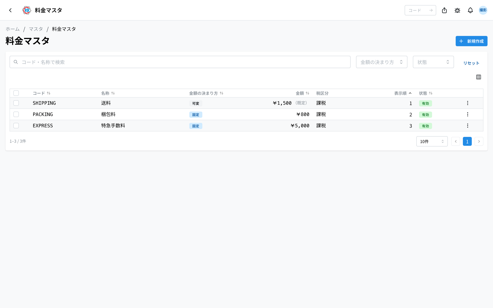
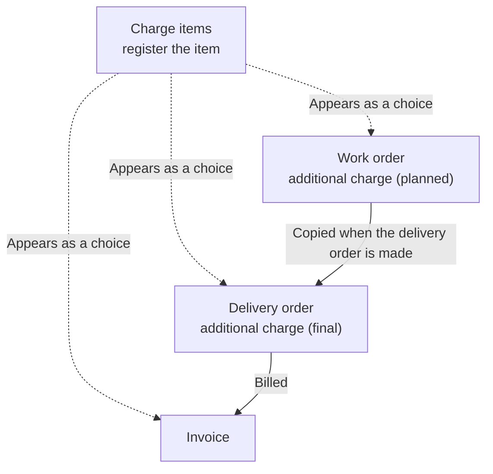

This app is for registering **the things you bill for other than the price of the product**, such as shipping, packing and costs paid on the customer's behalf. The operation code is `MS0G`.

> ⚠️ This app is currently available **only in the test environment**. The screens and the steps may change before it becomes available for real work.

> The flow this app belongs to … [Shipping flow](/manual/en/process/shipping)

## What you can do with this app

- You can register the items that can be added to a bill (shipping and so on).
- For each item you can decide whether the amount is entered every time or is a set amount.
- For each item you can decide the tax category (the consumption-tax category, such as taxable or tax exempt).
- You can disable an item you no longer use.

> 💡 The items registered here appear as the choices for additional charges on the [指示書 (work order)](/manual/en/operations/production/work-order/user) (planned), the [出荷書 (delivery order)](/manual/en/operations/shipping/delivery-order/user) (final) and the [請求書 (invoice)](/manual/en/operations/billing/invoice/user).

As a diagram, this is which documents a registered item goes on to:

## Words used on this page

- **Code** … a mark in letters that tells the items apart (for example `SHIPPING`). It cannot be changed after the item is created.
- **How the amount is decided** … either 「固定」 (fixed) or 「可変」 (variable). Explained below.
- **Tax category** (税区分) … whether consumption tax is added to that item, and at what %. You choose one of those registered in [Tax categories](/manual/en/operations/masters/tax-category/user).

## Two ways the amount is decided

| Way | Meaning | Suited to |
|---|---|---|
| **固定** (fixed) | The registered amount is entered as it is and **cannot be changed when the item is used** | Things that must not differ from one person to another, such as a packing fee set by the company |
| **可変** (variable) | A person enters it every time it is used. The registered amount is **the guide shown first** in the input box | Things whose actual cost is different every time, such as shipping |

> ⚠️ A 「固定」 (fixed) item must have an amount (you see 「固定の料金項目には金額が必要です」 — a fixed charge item needs an amount). If you leave a 「可変」 (variable) item empty, people are made to enter the amount properly every time it is used.

## How to register

1. Press 「**新規作成**」 (New) at the top right.
2. Enter the 「コード」 (code), for example `SHIPPING`. **It cannot be changed later.**
3. Enter the 「名称」 (name). This is the name that appears on the invoice.
4. Choose 「**金額の決まり方**」 (how the amount is decided).
5. Enter the 「金額」 (amount) for a fixed item, or the 「既定の金額」 (default amount) for a variable item.
6. Choose the 「税区分」 (tax category). If you leave it empty, it becomes 「既定に従う」 (use the default).
7. If needed, enter 「表示順」 (sort order) and 「備考」 (notes). 「表示順」 is the order in which the item appears among the choices.
8. Press 「保存」 (Save).

## Correcting a registered item

1. In the list, press the row of the item you want to correct.
2. The 「料金項目を編集」 (edit charge item) screen opens. The 「コード」 (code) cannot be changed.
3. Rewrite the fields you want to correct.
4. Press 「保存」 (Save).

Correcting the amount does not change the amount on lines already written on work orders or delivery orders.

## How the tax category is decided

It is decided **item by item** — shipping is taxable, revenue stamps are tax exempt, and so on. When the item's tax category is empty, the default category set in [Tax categories](/manual/en/operations/masters/tax-category/user) is used. However, if a tax category is set on the customer, **the customer's takes priority** (a tax-exempt business partner, for example).

## Items you no longer use

- **An item that is not in use can be deleted.**
- An item **already used** on a work order or a delivery order cannot be deleted (the counts are shown, as in 「指示書 3 件・出荷書 5 件で使われているため削除できません」 — it cannot be deleted because it is used on 3 work orders and 5 delivery orders).
- **Disable** it instead with 「**無効化**」 (disable). Press 「︙」 at the right end of the row and choose 「無効化」. To disable several at once, tick the boxes on the left of the rows and press 「一括無効化」 (bulk disable).
- A disabled item can no longer be chosen for new lines, but **the lines already written stay as they are**. To use it again, press 「有効化」 (enable) in the same menu.

## Questions and problems

**Q. If I correct the amount, do past invoices change too?**
A. No. The amount at the time the item was used is written into the line of the document.

**Q. I want to change the shipping charge for each shipment.**
A. Register it as 「可変」 (variable). You can enter the actual cost each time it is used.

**Q. Both the work order and the delivery order have additional charges. Which one is billed?**
A. **The delivery order.** The work order side is a plan — "this job will need shipping" — and it is copied when the delivery order is made. After it is copied, correct only the delivery order side.

**Q. I entered the wrong code.**
A. The code cannot be changed. Disable the item and create a new one.

<!-- permissions:start -->
## Permissions required

Using this screen requires the **Master data** (`master`) permission.

| What you want to do | Permission needed |
| --- | --- |
| Open the screen, view lists and details | Master data — View |
| Add, change or delete | Master data — Create / Edit / Delete |

Viewing only needs *View*. Where a screen offers adding, changing or deleting, each of those needs its matching permission.

Permissions come through roles. If something is missing, ask an administrator.

For the whole picture see [Permissions and roles](../../../permissions).
<!-- permissions:end -->
