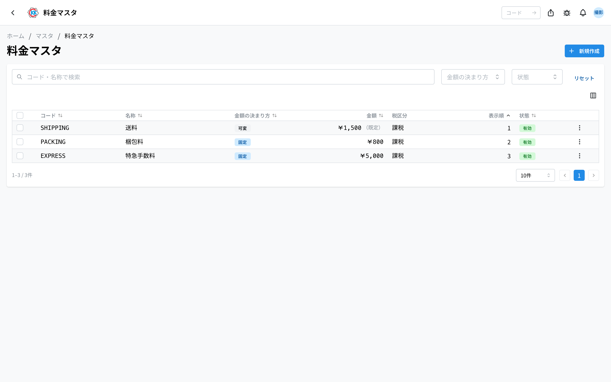
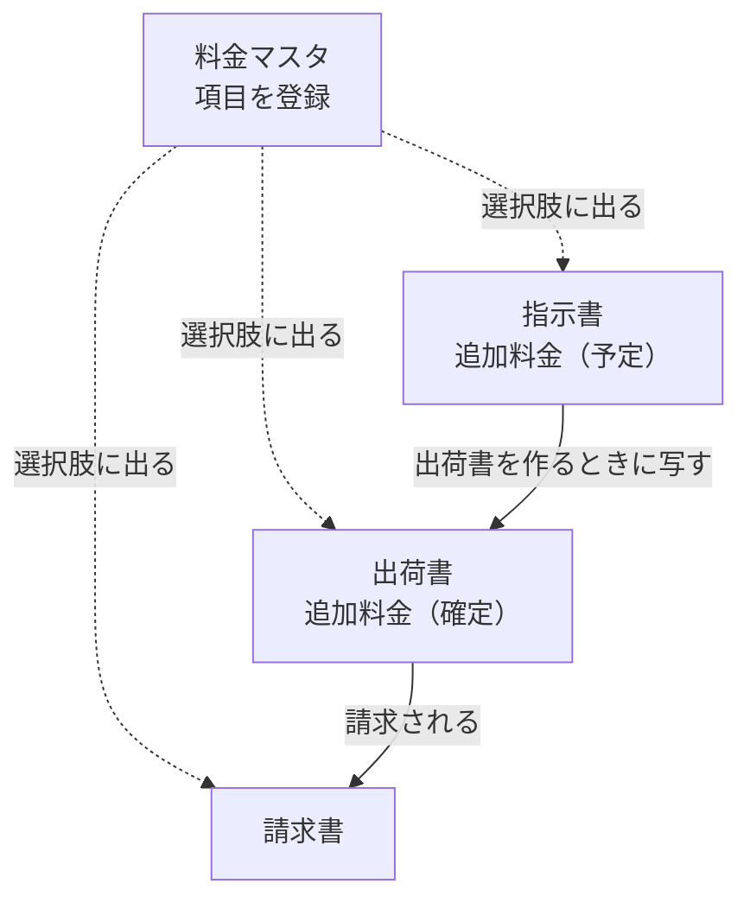

送料・梱包費・立替金など、**製品の代金以外に請求するもの** を登録しておくアプリです。操作コードは `MS0G` です。

> ⚠️ このアプリは今のところ **テスト用の環境だけ** で使えます。本番で使えるようになるまでに、画面や手順が変わることがあります。

> このアプリが属するフロー … [出荷の流れ](/manual/ja/process/shipping)

## このアプリでできること

- 請求に足せる項目（送料など）を登録できます。
- 金額を毎回入れるのか、決まった額にするのかを項目ごとに決められます。
- 項目ごとに税区分（消費税の区分。課税・非課税など）を決められます。
- 使わなくなった項目を無効にできます。

> 💡 ここで登録した項目は、[指示書](/manual/ja/operations/production/work-order/user)（予定）・[出荷書](/manual/ja/operations/shipping/delivery-order/user)（確定）・[請求書](/manual/ja/operations/billing/invoice/user)の追加費用の選択肢に出ます。

登録した項目がどの書類へ進むかを図にすると、次のとおりです。

## 用語（このページで出てくる言葉）

- **コード** … 項目を見分けるための英字の記号です（例: `SHIPPING`）。作ったあとは変えられません。
- **金額の決まり方** … 「固定」か「可変」かです。下で説明します。
- **税区分** … その項目に消費税が付くかどうか、何 % かの区分です。[税区分](/manual/ja/operations/masters/tax-category/user)で登録したものから選びます。

## 金額の決まり方は 2 通り

| 決まり方 | 意味 | 向いているもの |
|---|---|---|
| **固定** | 登録した金額がそのまま入り、**使うときに変えられません** | 社内で決めた梱包費のように、担当者によってぶれてはいけないもの |
| **可変** | 使うたびに人が入れます。登録した金額は入力欄の **最初に出る目安** です | 送料のように、実費が毎回違うもの |

> ⚠️ 「固定」の項目には金額が必ず要ります（「固定の料金項目には金額が必要です」と出ます）。「可変」は空のままにしておくと、使うときに毎回きちんと入力させられます。

## 登録のしかた

1. 右上の「**新規作成**」を押します。
2. 「コード」を入れます（例: `SHIPPING`）。**あとから変えられません。**
3. 「名称」を入れます。請求書に出る名前です。
4. 「**金額の決まり方**」を選びます。
5. 「金額」（固定）または「既定の金額」（可変）を入れます。
6. 「税区分」を選びます。空のままにすると「既定に従う」になります。
7. 必要なら「表示順」と「備考」を入れます。「表示順」は選択肢に並ぶ順番です。
8. 「保存」を押します。

## 登録した項目を直す

1. 一覧で直したい項目の行を押します。
2. 「料金項目を編集」の画面が開きます。「コード」は変えられません。
3. 直したい欄を書き換えます。
4. 「保存」を押します。

金額を直しても、すでに指示書や出荷書に書いた行の金額は変わりません。

## 税区分の決まりかた

送料は課税、印紙代は非課税、というように **項目ごとに** 決まります。項目の税区分が空のときは、[税区分](/manual/ja/operations/masters/tax-category/user)で決めた既定の区分が使われます。ただし、顧客の側に課税区分が設定されていれば **顧客のほうが優先** します（非課税の取引先など）。

## 使わなくなった項目

- **使われていない項目は削除できます。**
- 指示書や出荷書で **すでに使われている項目は削除できません**（「指示書 3 件・出荷書 5 件で使われているため削除できません」のように件数が出ます）。
- 代わりに「**無効化**」します。行の右端の「︙」を押し、「無効化」を選びます。いくつかまとめて無効にするときは、行の左のチェックを付けて「一括無効化」を押します。
- 無効にした項目は、以後新しく選べなくなりますが、**すでに書いた行はそのまま残ります**。もう一度使うときは同じメニューの「有効化」を押します。

## よくある質問・困ったとき

**Q. 金額を直したら、過去の請求書も変わりますか。**
A. 変わりません。使った時点の金額が書類の行に書き込まれます。

**Q. 送料を出荷ごとに変えたいです。**
A. 「可変」で登録してください。使うたびに実費を入れられます。

**Q. 指示書と出荷書の両方に追加料金があります。どちらが請求されますか。**
A. **出荷書のほうです。** 指示書側は「この製造には送料が要る」という予定で、出荷書を作るときに写されます。写したあとは出荷書側だけを直します。

**Q. コードを間違えました。**
A. コードは変えられません。無効化して、新しい項目を作り直してください。

<!-- permissions:start -->
## 必要な権限

この画面を使うには **マスタ管理**（`master`）の権限が要ります。

| したいこと | 必要な権限 |
| --- | --- |
| 画面を開く・一覧や詳細を見る | マスタ管理 の 閲覧 |
| 追加・変更・削除する | マスタ管理 の 作成 / 更新 / 削除 |

見るだけなら「閲覧」で足ります。追加・変更・削除の操作がある画面では、その操作にあたる権限がそれぞれ必要です。

権限は役割（ロール）を通して付きます。足りないときは管理者に相談してください。

権限の全体像は「[権限とロール](../../../permissions)」を参照してください。
<!-- permissions:end -->
