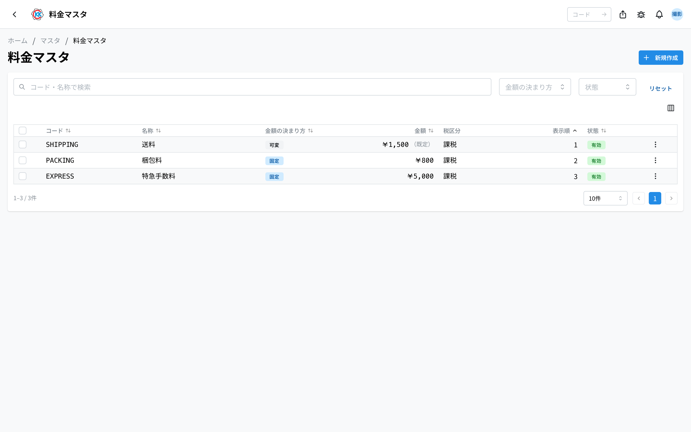
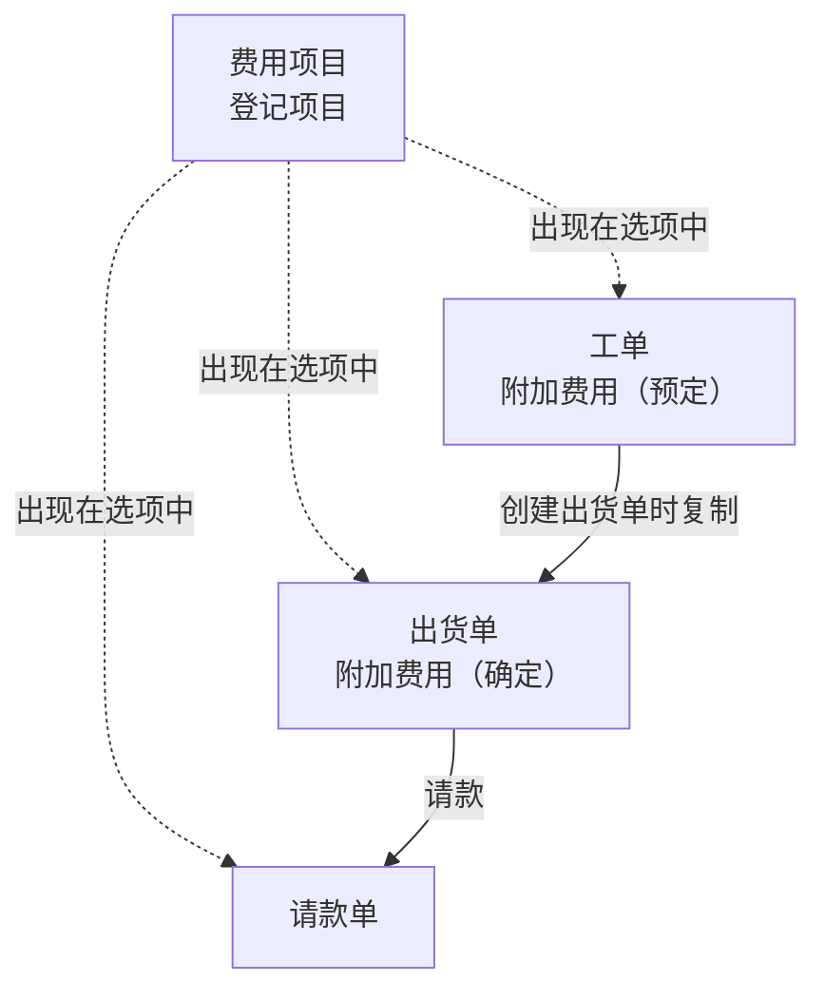

这是用于登记运费、包装费、垫付款等 **产品货款以外的请款内容** 的应用。操作代码是 `MS0G`。

> ⚠️ 本应用目前 **仅在测试环境** 中可用。在正式投入使用之前，画面和操作步骤可能会有变化。

> 本应用所属的流程 … [出货的流程](/manual/zh/process/shipping)

## 本应用可以做什么

- 可以登记能够加到请款中的项目（运费等）。
- 可以按项目决定金额是每次输入，还是使用固定的金额。
- 可以按项目决定税种（消费税的区分，例如应税・免税）。
- 可以把不再使用的项目停用。

> 💡 这里登记的项目，会出现在[工单](/manual/zh/operations/production/work-order/user)（预定）、[出货单](/manual/zh/operations/shipping/delivery-order/user)（确定）、[请款单](/manual/zh/operations/billing/invoice/user)的附加费用选项中。

登记的项目会进入哪些单据，用图表示如下。

## 本页出现的词语

- **代码** … 用于区分项目的英文字母记号（例如 `SHIPPING`）。创建之后无法更改。
- **金额的确定方式** … 「固定」（固定）或「可変」（可变）。在下面说明。
- **税种**（税区分）… 该项目是否要加消费税、税率是多少 % 的区分。从[税种](/manual/zh/operations/masters/tax-category/user)中登记的内容里选择。

## 金额的确定方式有 2 种

| 确定方式 | 含义 | 适合的项目 |
|---|---|---|
| **固定**（固定） | 直接填入登记的金额，**使用时无法更改** | 像公司内部规定的包装费那样，不能因负责人不同而有出入的项目 |
| **可変**（可变） | 每次使用时由人输入。登记的金额是输入栏中 **最先显示的参考值** | 像运费那样，每次实际费用都不同的项目 |

> ⚠️ 「固定」（固定）的项目必须有金额（会显示「固定の料金項目には金額が必要です」— 固定的费用项目需要填写金额）。「可変」（可变）的项目如果留空，使用时每次都必须认真输入。

## 登记的方法

1. 点击右上方的「**新規作成**」（新建）。
2. 填写「コード」（代码）（例如 `SHIPPING`）。**以后无法更改。**
3. 填写「名称」（名称）。这是显示在请款单上的名称。
4. 选择「**金額の決まり方**」（金额的确定方式）。
5. 填写「金額」（金额，固定时）或「既定の金額」（默认金额，可变时）。
6. 选择「税区分」（税种）。留空时为「既定に従う」（按默认）。
7. 如有需要，填写「表示順」（显示顺序）和「備考」（备注）。「表示順」是在选项中排列的顺序。
8. 点击「保存」（保存）。

## 修改已登记的项目

1. 在列表中点击要修改的项目所在的行。
2. 会打开「料金項目を編集」（编辑费用项目）画面。「コード」（代码）无法更改。
3. 改写要修改的栏目。
4. 点击「保存」（保存）。

即使修改了金额，已经写入工单或出货单的行的金额也不会改变。

## 税种如何确定

按 **每个项目** 确定，例如运费应税、印花税免税。项目的税种为空时，使用[税种](/manual/zh/operations/masters/tax-category/user)中设定的默认区分。不过，如果客户一侧设置了税种，则 **以客户为准**（例如免税的业务伙伴）。

## 不再使用的项目

- **没有被使用的项目可以删除。**
- 已经在工单或出货单中 **使用过的项目无法删除**（会显示件数，例如「指示書 3 件・出荷書 5 件で使われているため削除できません」— 已用于 3 张工单和 5 张出货单，无法删除）。
- 请改为「**無効化**」（停用）。点击行右端的「︙」，选择「無効化」。要一次停用多个项目时，勾选行左侧的复选框，再点击「一括無効化」（批量停用）。
- 停用的项目此后无法再新选择，但 **已经写入的行保持不变**。要再次使用时，点击同一菜单中的「有効化」（启用）。

## 常见问题与故障处理

**Q. 修改金额后，过去的请款单也会变吗？**
A. 不会变。使用当时的金额已写入单据的行中。

**Q. 我想每次出货使用不同的运费。**
A. 请登记为「可変」（可变）。每次使用时都可以填写实际费用。

**Q. 工单和出货单都有附加费用。按哪一个请款？**
A. **按出货单。** 工单一侧是「这次制造需要运费」这样的预定，在创建出货单时会被复制过去。复制之后只修改出货单一侧。

**Q. 代码填错了。**
A. 代码无法更改。请停用后重新创建一个新项目。

<!-- permissions:start -->
## 所需权限

使用本画面需要 **主数据管理**（`master`）权限。

| 想做的事 | 所需权限 |
| --- | --- |
| 打开画面、查看列表与明细 | 主数据管理 — 查看 |
| 新增・变更・删除 | 主数据管理 — 创建 / 更新 / 删除 |

仅查看有「查看」即可。画面中若有新增、变更或删除的操作，则分别需要对应的权限。

权限通过角色授予。若不足，请与管理员联系。

权限的整体说明请参见「[权限与角色](../../../permissions)」。
<!-- permissions:end -->
