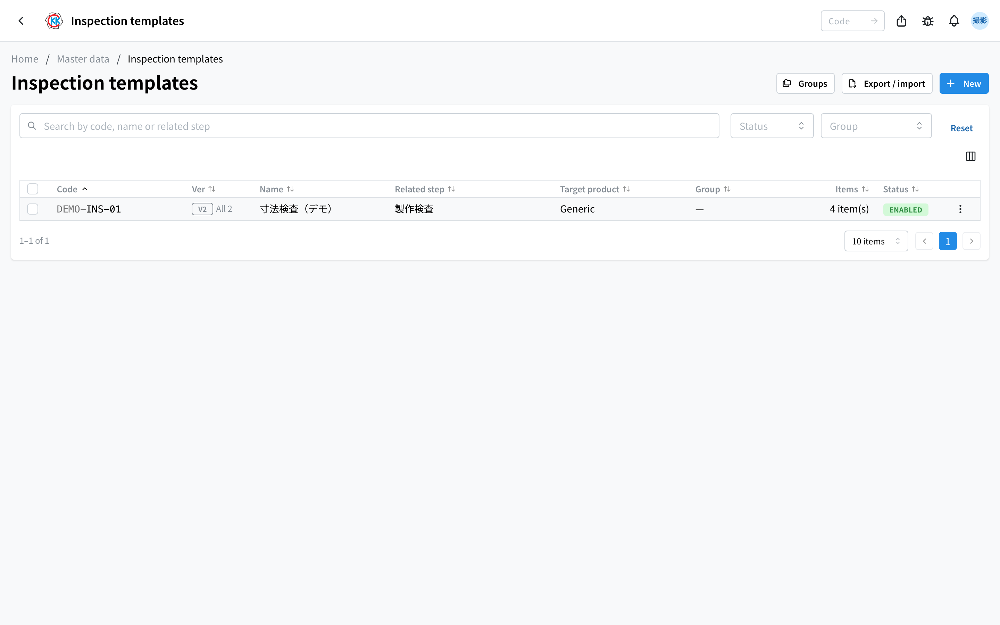
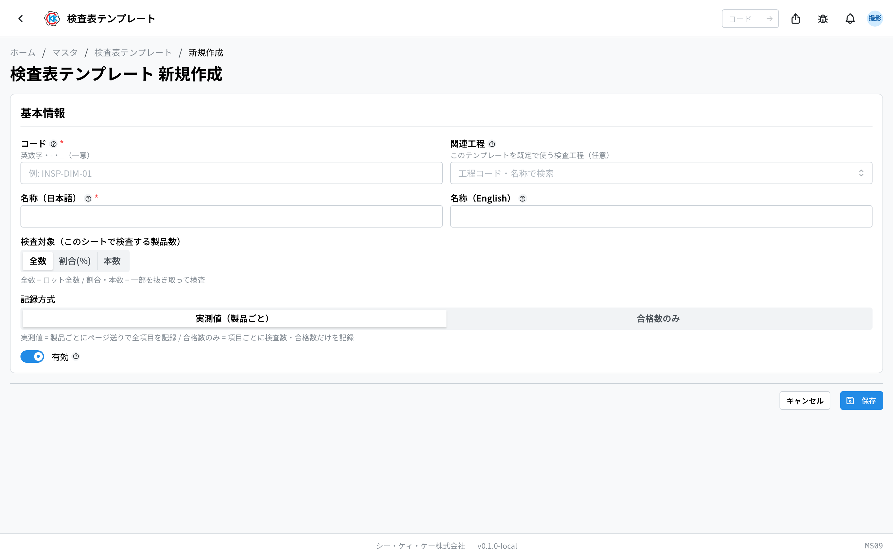
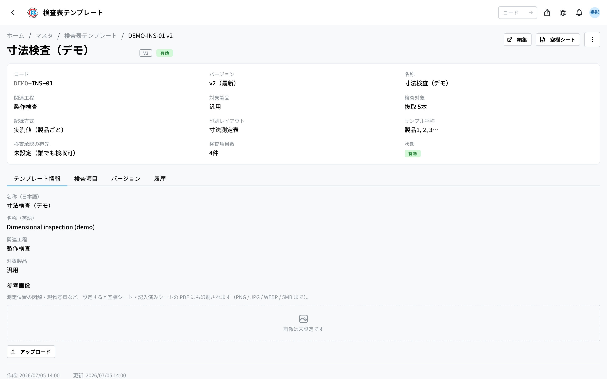
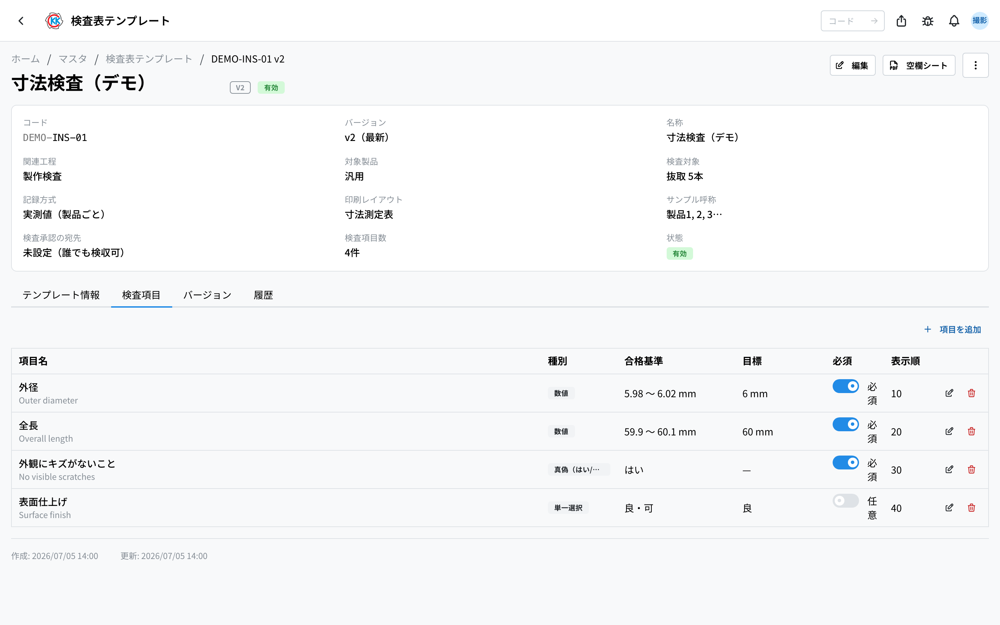
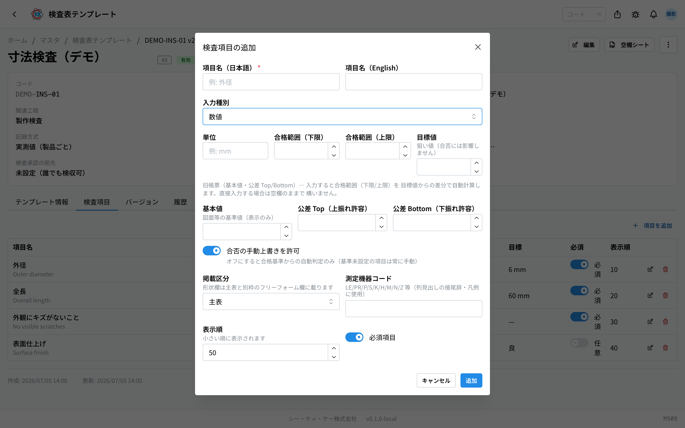
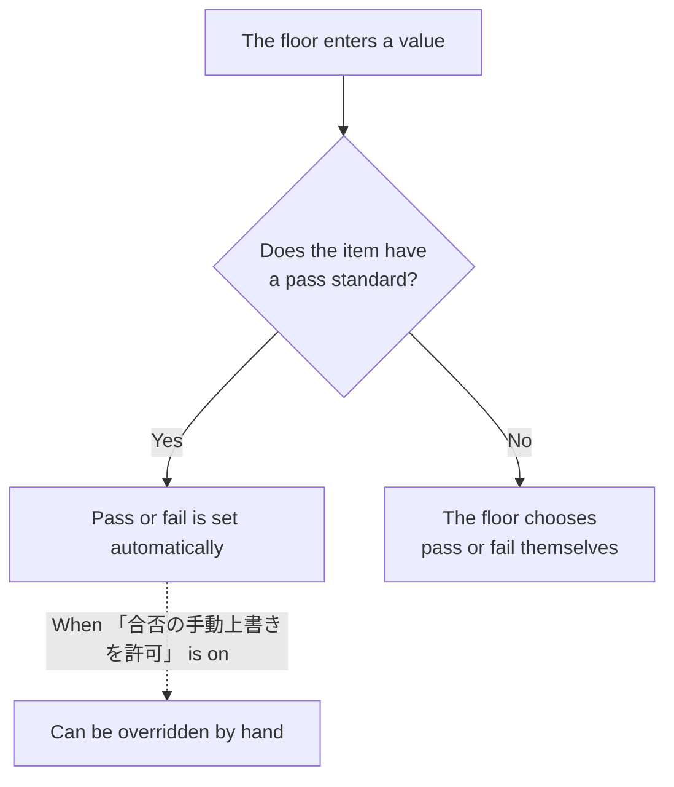
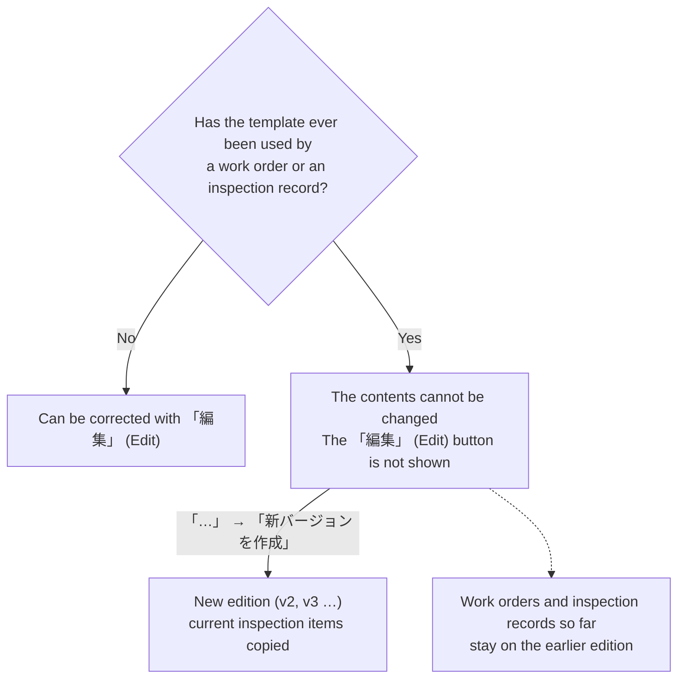
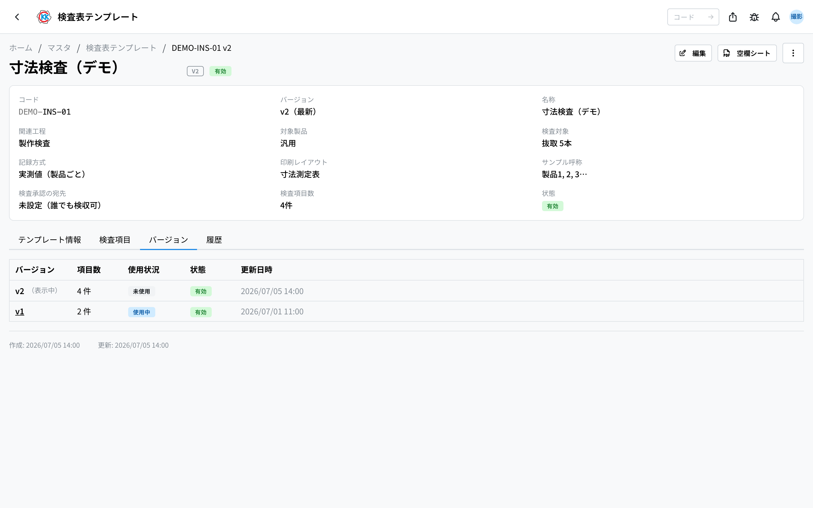

This app is for making a **template** of the inspection sheet, deciding in advance **what will be measured**. The operation code is `MS09`.

When you attach a template to an **inspection step** of a [指示書 (work order)](/manual/en/operations/production/work-order/user), the floor follows this template when entering the inspection record.

> ⚠️ This app is in trial release. Depending on your environment, it may not be shown yet.

## What you can do with this app

- You can make a template of the inspection sheet.
- You can line up **inspection items** inside the template (outer diameter, total length, whether there is a scratch, and so on).
- For each item you can decide the **pass rule**: "it passes if the value is between this and that". Once you set a pass rule, pass or fail is added by itself as soon as the floor enters a value.
- You can decide whether **the whole lot is inspected, or only a sample is taken**.
- You can print a **blank inspection sheet PDF** for writing by hand. A **reference image** that shows where to measure can be printed with it.
- You can sort templates into **groups**, and **export / import** them as files.

## Words used on this page

- **Inspection sheet template** … the template of an inspection sheet. You attach it to an inspection step of a work order to say "please inspect using this template".
- **Inspection item** … one line inside the template. It stands for one thing to check, such as "measure the outer diameter" or "look for scratches".
- **Pass rule** … the condition for judging something as a pass. For a number, you set something like "it passes if it is between 5.98 and 6.02 mm".
- **Sampling** … taking out only a part instead of everything made, and inspecting that. On this screen you set it in 「**検査対象**」 (what is inspected).
- **Version** … an edition of the template. When you change the content, you keep the current edition as it is and make a new edition.
- **Acceptance (検収)** … checking and approving the inspection results the floor recorded.

## Before you start

- You need the **master permission** to use this app.
- If you want to link the template to an inspection step, the inspection step must first be registered in the [process step master (工程マスタ)](/manual/en/operations/masters/process-step/user).
- If you want only certain people to accept the inspection results, it is easier to make an approval group first in [approval settings (承認設定)](/manual/en/operations/masters/approval-setting/user) (you can also choose people directly).

## How to read the screen

When you open the app, a list of the registered templates is shown.

- The list columns are **コード** (code) / **Ver** (version) / **名称** (name) / **関連工程** (related step) / **対象製品** (target product) / **グループ** (group) / **項目数** (number of items) / **状態** (status). A template with no target product shows 「**汎用**」 (generic).
- The 「**Ver**」 column shows the number of the newest edition, for example `v2`. When older editions also exist, the number of editions is shown too, such as 「全2」 (2 in total).
- Use the 「**コード・名称・関連工程で検索**」 (search by code, name or related step) box at the top to narrow down to the template you are looking for. You can also narrow by 「**状態**」 (status) and 「**グループ**」 (group). Choosing 「**グループなし**」 (no group) in the group filter shows only templates that are not in any group.
- At the top right of the screen are the buttons 「**グループ管理**」 (manage groups), 「**書き出し / 取込**」 (export / import) and 「**新規作成**」 (New).
- Tick the boxes at the left of the rows to run 「**選択を書き出し**」 (export selection), 「**一括有効化**」 (bulk enable), 「**一括無効化**」 (bulk disable) or 「**一括削除**」 (bulk delete) on the chosen templates together.
- Click a row to open the detail screen of that template.

## Make a template

1. Press 「**新規作成**」 (New) at the top right of the list screen.
2. Enter text that stands for this template in 「**コード**」 (code), for example `INSP-DIM-01`. Letters, numbers, hyphens and underscores can be used.
3. Type a step name in the 「**関連工程**」 (related step) box and choose the inspection step where this template is normally used. You can save with it left empty.
4. If the template is only for one product, choose it in 「**対象製品**」 (target product). Leave it empty when it is used for any product.
5. If you want to sort it, choose a 「**グループ**」 (group). It can be left empty.
6. Enter the name of the inspection sheet in the Japanese box of 「**名称**」 (name), for example 寸法検査 (dimension inspection).
7. In 「**検査対象**」 (what is inspected), choose how many pieces are inspected. See the explanation below.
8. Choose 「**記録方式**」 (recording method). See the explanation below.
9. Choose 「**印刷レイアウト**」 (print layout). See the explanation below.
10. When the recording method is 「実測値（製品ごと）」 (measured values, per piece), choose 「**サンプル呼称**」 (sample naming). See the explanation below.
11. If you want to decide who can approve the inspection results, choose 「**検査承認の宛先**」 (inspection approver). See the explanation below.
12. Press 「**保存**」 (Save).

You do not enter the inspection items on this form. When you save, the detail screen opens, and you add them there.

> 💡 「**コード**」 (code) cannot be changed after you save. The name and the inspection items can be corrected later.

### 検査対象 (what is inspected — how many pieces)

- **全数** (all) … every piece made is inspected.
- **割合(%)** (percentage) … only the set percentage of pieces is taken out and inspected. For example, 10 % means 10 out of 100 pieces.
- **本数** (fixed count) … only the set number of pieces is taken out and inspected, for example 5 pieces.

When you choose 「割合(%)」 (percentage) or 「本数」 (fixed count), a box for the number appears on the right. The screen also says 「**全数 = ロット全数 / 割合・本数 = 一部を抜き取って検査**」 (all = the whole lot; percentage or fixed count = take a sample and inspect it).

### 記録方式 (recording method — how it is recorded)

- **実測値（製品ごと）** (measured values, per piece) … the values of all items are recorded one piece at a time. Choose this when you want to keep the numbers you actually measured.
- **合格数のみ** (pass count only) … for each item, only "how many were inspected and how many passed" is recorded. The numbers themselves are not kept.

### 印刷レイアウト and サンプル呼称 (how the paper looks)

- **印刷レイアウト** (print layout) … the shape of the table when printed. 「**寸法測定表**」 (dimension sheet) is a table of base value, target value and tolerance; 「**外観・工程チェック表**」 (appearance / process checklist) is a checklist per department (manufacturing and quality assurance).
- **サンプル呼称** (sample naming) … how the headings are named when recording one piece at a time. Choose 「**製品1, 2, 3…**」 (product 1, 2, 3 …) or 「**初品・中間品・最終品**」 (first, middle, last piece). With 「初品・中間品・最終品」 only the first three headings change; from the fourth piece on it is the same as 「製品4…」.

### 検査承認の宛先 (who can accept)

Decide who can accept the inspection results recorded on the floor.

- Choose 「**グループ**」 (group) to pick an approval group from [approval settings (承認設定)](/manual/en/operations/masters/approval-setting/user).
- Choose 「**カスタム**」 (custom) to search people by name and add approvers for this sheet only (any number of people).
- If you choose nothing, it is 「**未設定（誰でも検収可）**」 (not set — anyone can accept).

When you save, the detail screen for that template opens. Near the top, 「**コード**」 (code), 「**バージョン**」 (version), 「**名称**」 (name), 「**関連工程**」 (related process), 「**対象製品**」 (target product), 「**グループ**」 (group), 「**検査対象**」 (what is inspected), 「**記録方式**」 (recording method), 「**印刷レイアウト**」 (print layout), 「**検査承認の宛先**」 (inspection approver), 「**検査項目数**」 (number of inspection items) and 「**状態**」 (status) are shown together, so you can check here what you decided (「**サンプル呼称**」 (sample naming) is also shown when the recording method is measured values). Below them are the tabs 「**テンプレート情報**」 (template information), 「**検査項目**」 (inspection items), 「**バージョン**」 (versions) and 「**履歴**」 (history).

## Attach a reference image

In the 「**参考画像**」 (reference image) area of the 「**テンプレート情報**」 (template information) tab, you can attach a drawing of where to measure or a photo of the real part. The image is also printed on the blank sheet and the filled-in sheet PDFs.

1. Open the 「**テンプレート情報**」 (template information) tab.
2. Press 「**アップロード**」 (Upload).
3. Choose an image file (PNG, JPEG or WebP, up to 5MB).

To replace it press 「**選び直す**」 (choose again); to remove it press 「**削除**」 (Delete). The reference image can be changed even on a version that is in use.

## Add inspection items

On the detail screen that opens after saving, open the 「**検査項目**」 (inspection items) tab.

1. Press 「**項目を追加**」 (Add item).
2. Enter what is being checked in 「**項目名（日本語）**」 (item name, Japanese), for example 外径 (outer diameter).
3. In 「**入力種別**」 (input type), choose what the floor enters.
   - **数値** (number) … a number is entered, for example 6.01.
   - **真偽（はい/いいえ）** (yes/no) … 「はい」 (yes) or 「いいえ」 (no) is chosen.
   - **単一選択** (single choice) … one option is chosen from the ones you prepared.
   - **複数選択** (multiple choice) … any number of options can be chosen from the ones you prepared.
   - **自由記述** (free text) … text is written freely. Pass or fail is always chosen by the floor.
4. Enter the pass rule that matches the type you chose. See the explanation below.
5. Choose 「**掲載区分**」 (listing type). Normally leave it as 「**主表**」 (main table). For items you want in a separate box from the table, such as a shape check, choose 「**形状欄**」 (shape box).
6. When the print layout is 「外観・工程チェック表」 (appearance / process checklist), you can also choose 「**部門**」 (department): 製造課管轄 (manufacturing) or 品証課管轄 (quality assurance).
7. If there is a code for the measuring tool, enter it in 「**測定機器コード**」 (measuring instrument code). This is optional.
8. Check 「**表示順**」 (display order). A number is filled in by itself each time you add an item, so you can normally leave it as it is.
9. For an item that must always be filled in, leave 「**必須項目**」 (required item) turned on.
10. Press 「**追加**」 (Add).

The items you registered are listed in a table. The columns are **項目名** (item name) / **種別** (type) / **合格基準** (pass rule) / **目標** (target) / **必須** (required) / **表示順** (display order). Use the icons at the right of a row to edit or delete it.

The 「**必須**」 (required) column is a switch, so you can **turn required / optional on and off right on the row** — no need to open the item's edit screen. An inspection sheet cannot be saved while any required item is still empty, so this switch means "the inspection does not count as done without this item". On a version that is already in use the switch is replaced by a plain required / optional label.

### How to set the pass rule

What you enter changes with the type.

- **数値** (number) … enter 「**単位**」 (unit), for example mm, and 「**合格範囲（下限）**」 (pass range, lower limit) and 「**合格範囲（上限）**」 (pass range, upper limit). Only one of the two is also fine. If the entered number is inside this range, it becomes a pass by itself.
- **真偽（はい/いいえ）** (yes/no) … in 「**合格とする回答**」 (answer that counts as a pass), choose which answer counts as a pass.
- **単一選択 / 複数選択** (single choice / multiple choice) … register the options with 「**選択肢を追加**」 (Add option), then choose 「**合格とする選択肢**」 (the options that count as a pass).
- **自由記述** (free text) … there is no pass rule.

「**目標値**」 (target value), 「**目標回答（任意）**」 (target answer, optional) and 「**目標（任意）**」 (target, optional) are boxes for writing down the value you are aiming at. As the screen says, 「**狙い値（合否には影響しません）**」 (aim value; it does not affect pass or fail), they have nothing to do with passing or failing.

For number items, you can also enter 「**基本値**」 (base value), 「**公差 Top（上振れ許容）**」 (tolerance top, allowed above) and 「**公差 Bottom（下振れ許容）**」 (tolerance bottom, allowed below), following how drawings are written. If you enter the target value together with tolerance top and tolerance bottom and save, the pass range (lower and upper limit) is calculated from the target value automatically. When you enter the pass range directly, you can leave the tolerance boxes empty. 「基本値」 (base value) is for display only.

> 💡 If you save without setting a pass rule, that item is not judged by itself, and the floor chooses pass or fail on their own. If you turn off 「**合否の手動上書きを許可**」 (allow manual override of pass/fail), only the automatic judgement is used, and 「上書き不可」 (override not allowed) is shown in the list.

As a diagram, this is how pass or fail is decided:

## Change the content (make a new version)

Once a template has been used even once on a work order or in an inspection record, its content can no longer be changed. This is so that the content of an inspection already done does not change afterwards. For a template in this state, the 「**編集**」 (Edit) button is no longer shown on the detail screen, and a blue notice about it appears at the top of the screen.

When you want to change the content, make a new version.

1. Press 「**…**」 (the three-dot button) at the top right of the detail screen.
2. Choose 「**新バージョンを作成**」 (Create new version).
3. A small confirmation window appears. Read it and press 「**新バージョンを作成**」 (Create new version).

You can do the same with 「**新バージョンを作成して編集**」 (create a new version and edit) on the 「**検査項目**」 (inspection items) tab.

A new edition (v2, v3 …) is made with the current inspection items copied into it. The work orders and inspection records made so far stay on the earlier edition and do not change.

As a diagram:

Open the 「**バージョン**」 (versions) tab and all editions so far are listed. The edition you are looking at is marked 「（表示中）」 (now showing). The 「使用状況」 (usage) column tells you whether that edition is in use (使用中 = in use / 未使用 = not used).

The 「検査承認の宛先」 (inspection approver) is handled separately from the content, so it can be changed even on a version in use. Choose 「**検査承認の宛先を変更**」 (change inspection approver) from 「**…**」.

## Print an inspection sheet for writing by hand

Press 「**空欄シート**」 (Blank sheet) at the top right of the detail screen and a blank PDF with only the inspection items lined up is produced. You can print it when you want to write by hand on the floor. If a reference image is attached, it is printed too.

## Sort into groups

When you have many templates, sorting them into **groups** makes them easier to find in the list. Groups are used only for narrowing and headings in the list; they have nothing to do with pass/fail judgement or the PDF.

1. Press 「**グループ管理**」 (manage groups) at the top right of the list screen.
2. Enter a group name in the 「**新しいグループ**」 (new group) box, for example 製品検査記録 (product inspection record).
3. Press 「**追加**」 (Add).
4. Press 「**閉じる**」 (Close).

The groups you made can be chosen in 「**グループ**」 (group) on the new and edit screens of a template. In 「グループ管理」 you can also change a group's name, its order (「**上へ**」 up / 「**下へ**」 down) and whether it is active. A group that still contains inspection sheets cannot be deleted.

## Export / import

Use this to take inspection sheets to another environment, or to bring in inspection sheets made in Excel.

1. Press 「**書き出し / 取込**」 (export / import) at the top right of the list screen.
2. To export, press 「**JSON で書き出す**」 (export as JSON). All active inspection sheets are exported (if you tick rows in the list and press 「**選択を書き出し**」 (export selection) first, only those are exported).
3. To import, press 「**ファイルを選ぶ**」 (choose a file) and choose an exported JSON file or a file written in the Excel template. Get the Excel template with 「**Excel の雛形を落とす**」 (download the Excel template).

When an inspection sheet with the same code already exists, the import is added as a new version (existing versions are not rewritten). If some could not be imported, the count and 「**読めなかった行**」 (rows that could not be read) are shown.

## Input fields

Every field on the Inspection template screen.

| Field | What to enter |
|-------|---------------|
| [Code / name](#field-code) | The template's reference code and name |
| [Related process step](#field-process-step) | Which step the sheet belongs to |
| [Active](#field-active) | Turning it off removes it from the pick list when linking to a work order's inspection step |

### Code / name [#field-code]

The template's reference code and name, used when linking it to a work order's inspection step.

### Related process step [#field-process-step]

Which step the sheet belongs to. When that step is set up on a work order, this sheet is assigned to it from the start (for a template with a 「対象製品」 (target product), only on work orders for that product).

### Active [#field-active]

Turning it off removes it from the pick list when linking to a work order's inspection step.

## Questions and problems

**Q. I cannot find the 「編集」 (Edit) button.**
A. That edition is already used on a work order or in an inspection record, so it cannot be changed. Choose 「**新バージョンを作成**」 (Create new version) from 「**…**」 and make your correction on the new edition.

**Q. I see 「このバージョンは指示書または検査記録で使用中のため変更できません。新バージョンを作成してください」 (this version cannot be changed because it is in use on a work order or inspection record; please create a new version).**
A. The reason is the same as above. Make a new version and then correct it.

**Q. I see 「合格範囲の上限は下限以上にしてください」 (the upper limit of the pass range must be the same as or larger than the lower limit).**
A. The upper number is smaller than the lower number. Make the upper one the larger number, for example lower 5.98 and upper 6.02.

**Q. I see 「選択肢を 1 つ以上登録してください」 (please register at least one option).**
A. For 「単一選択」 (single choice) and 「複数選択」 (multiple choice) items, you must register the options first. Make the options with 「**選択肢を追加**」 (Add option) and then save.

**Q. I entered a number, but pass or fail is not added by itself.**
A. That item may have no pass range. Edit the item and enter 「合格範囲（下限）」 (pass range, lower limit) and 「合格範囲（上限）」 (pass range, upper limit).

**Q. I entered a target value, but the judgement did not change.**
A. That is normal. The target value is only a box for writing down the value you are aiming at, and it has nothing to do with passing or failing. However, when you also enter tolerance top and tolerance bottom, the pass range is recalculated from the target value.

**Q. I cannot delete a template.**
A. It cannot be deleted while there is a work order or inspection record using that edition. For a template you no longer use, choose 「**無効化**」 (Deactivate) instead of deleting. Once it is inactive it can no longer be chosen on new work orders, and the past records stay as they are.

<!-- permissions:start -->
## Permissions required

Using this screen requires the **Master data** (`master`) permission.

| What you want to do | Permission needed |
| --- | --- |
| Open the screen, view lists and details | Master data — View |
| Add, change or delete | Master data — Create / Edit / Delete |

Viewing only needs *View*. Where a screen offers adding, changing or deleting, each of those needs its matching permission.

Permissions come through roles. If something is missing, ask an administrator.

For the whole picture see [Permissions and roles](../../../permissions).
<!-- permissions:end -->
