検査で **何を測るか** をあらかじめ決めておく、検査表の **ひな形** を作るアプリです。操作コードは `MS09` です。

[指示書](/manual/ja/operations/production/work-order/user)の**検査工程ごと**にひな形を付けておくと、現場ではこのひな形にそって検査の記録を入力します。

> ⚠️ このアプリは試験公開中です。ご利用の環境によっては、まだ表示されないことがあります。

## このアプリでできること

- 検査表のひな形を作れます。
- ひな形の中に **検査項目**（外径・全長・キズの有無など）を並べられます。
- 項目ごとに「いくつからいくつまでなら合格」という **合格の基準** を決められます。基準を決めておくと、現場が数値を入れるだけで合格・不合格が自動で付きます。
- ロットの **全部を検査するか、一部だけ抜き取って検査するか** を決められます。
- 手書き用の **空欄の検査表 PDF** を印刷できます。測る場所を示す **参考画像** も一緒に印刷できます。
- ひな形を **グループ** に分けたり、ファイルに **書き出し / 取込** したりできます。

## 用語（このページで出てくる言葉）

- **検査表テンプレート** … 検査表のひな形のことです。「このひな形を使って検査してください」と、指示書の**検査工程**に付けて使います。
- **検査項目** … ひな形の中の 1 行です。「外径を測る」「キズが無いか見る」など、1 つの確認内容を表します。
- **合格基準** … 「合格」と判断するための条件です。数値なら「5.98 〜 6.02 mm の間なら合格」のように決めます。
- **抜取（ぬきとり）** … 作った全部ではなく、一部だけを取り出して検査することです。この画面では「**検査対象**」で決めます。
- **バージョン** … ひな形の版のことです。内容を変えるときは、いまの版はそのままにして新しい版を作ります。
- **検収（けんしゅう）** … 現場が記録した検査の結果を、確認して承認することです。

## はじめる前に

- このアプリを使うには **マスタの権限** が必要です。
- ひな形を検査の工程に結びつけたいときは、先に[工程マスタ](/manual/ja/operations/masters/process-step/user)に検査の工程が登録されている必要があります。
- 検査の結果を決まった人だけに検収させたいときは、先に[承認設定](/manual/ja/operations/masters/approval-setting/user)で承認グループを作っておくと選びやすくなります（人を直接選ぶこともできます）。

## 画面の見かた

アプリを開くと、登録済みのひな形の一覧が表示されます。

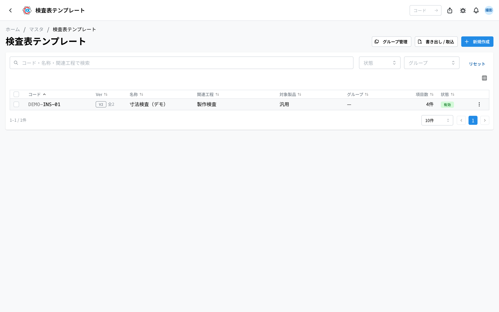

- 一覧は **コード / Ver / 名称 / 関連工程 / 対象製品 / グループ / 項目数 / 状態** の順に並んでいます。対象製品を決めていないひな形は「**汎用**」と表示されます。
- 「**Ver**」の列には、いちばん新しい版の番号が出ます（例 `v2`）。前の版もあるときは「全2」のように、版の数も一緒に出ます。
- 上の「**コード・名称・関連工程で検索**」の欄で、探しているひな形を絞り込めます。「**状態**」と「**グループ**」でも絞り込めます（グループで「**グループなし**」を選ぶと、どのグループにも入っていないひな形だけが出ます）。
- 画面右上には「**グループ管理**」「**書き出し / 取込**」「**新規作成**」のボタンがあります。
- 行の左のチェックを入れると、選んだひな形をまとめて「**選択を書き出し**」「**一括有効化**」「**一括無効化**」「**一括削除**」できます。
- 行をクリックすると、そのひな形の詳しい画面が開きます。

## ひな形をつくる

1. 一覧画面の右上にある「**新規作成**」を押します。
2. 「**コード**」に、このひな形を表す文字を入れます（例 `INSP-DIM-01`）。英数字・ハイフン・アンダースコアが使えます。
3. 「**関連工程**」の欄に工程名を入れて、このひな形をふだん使う検査の工程を選びます（空欄のままでも保存できます）。
4. 特定の製品だけで使うひな形なら、「**対象製品**」で製品を選びます。どの製品にも使うときは空欄のままにします。
5. 分けて並べたいときは「**グループ**」を選びます（空欄でもかまいません）。
6. 「**名称**」の日本語の欄に、検査表の名前を入れます（例 寸法検査）。
7. 「**検査対象**」で、何本を検査するかを選びます（次の説明をご覧ください）。
8. 「**記録方式**」を選びます（次の説明をご覧ください）。
9. 「**印刷レイアウト**」を選びます（次の説明をご覧ください）。
10. 「記録方式」が「実測値（製品ごと）」のときは、「**サンプル呼称**」を選びます（次の説明をご覧ください）。
11. 検査の結果を承認できる人を決めたいときは、「**検査承認の宛先**」を選びます（次の説明をご覧ください）。
12. 「**保存**」を押します。

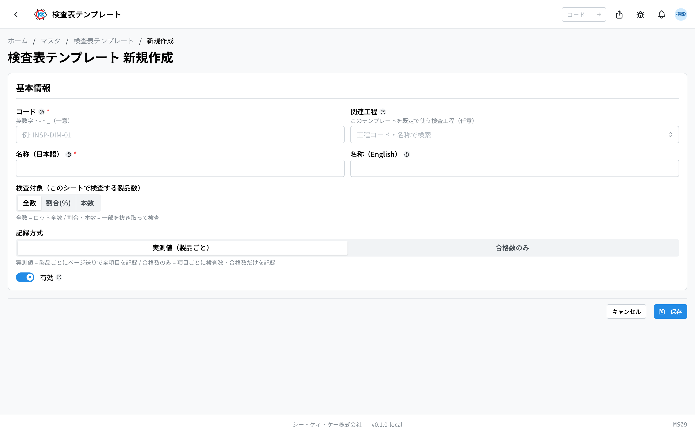

検査項目は、このフォームでは入れません。保存すると詳しい画面が開くので、そこで追加します。

> 💡 「**コード**」は、保存したあとは変えられません。名称や検査項目はあとから直せます。

### 検査対象（何本を検査するか）

- **全数** … 作った本数を全部検査します。
- **割合(%)** … 決めた割合の本数だけを取り出して検査します（例 10 % なら 100 本のうち 10 本）。
- **本数** … 決めた本数だけを取り出して検査します（例 5 本）。

「割合(%)」か「本数」を選ぶと、右に数を入れる欄が出ます。画面にも「**全数 = ロット全数 / 割合・本数 = 一部を抜き取って検査**」と書かれています。

### 記録方式（どう記録するか）

- **実測値（製品ごと）** … 1 本ずつ、すべての項目の値を記録します。実際に測った数値を残したいときはこちらです。
- **合格数のみ** … 項目ごとに「何本検査して、何本合格したか」だけを記録します。数値までは残しません。

### 印刷レイアウト・サンプル呼称（紙の見た目）

- **印刷レイアウト** … 印刷したときの表の形です。「**寸法測定表**」は基本値・目標値・公差を並べた表、「**外観・工程チェック表**」は製造課・品証課の部門ごとのチェックリストになります。
- **サンプル呼称** … 1 本ずつ記録するときの見出しの付け方です。「**製品1, 2, 3…**」か「**初品・中間品・最終品**」を選びます。「初品・中間品・最終品」は、はじめの 3 本の見出しだけが変わり、4 本目からは「製品4…」と同じになります。

### 検査承認の宛先（だれが検収できるか）

現場が記録した検査の結果を、だれが検収できるかを決めます。

- 「**グループ**」を選ぶと、[承認設定](/manual/ja/operations/masters/approval-setting/user)の承認グループから選べます。
- 「**カスタム**」を選ぶと、この検査表だけの承認者を名前で検索して追加できます（何人でも選べます）。
- 何も選ばなければ「**未設定（誰でも検収可）**」になります。

保存すると、そのひな形の詳しい画面が開きます。上のほうに「**コード**」「**バージョン**」「**名称**」「**関連工程**」「**対象製品**」「**グループ**」「**検査対象**」「**記録方式**」「**印刷レイアウト**」「**検査承認の宛先**」「**検査項目数**」「**状態**」がまとめて並ぶので、決めた内容をここで確認できます（記録方式が実測値のときは「**サンプル呼称**」も出ます）。その下に「**テンプレート情報**」「**検査項目**」「**バージョン**」「**履歴**」のタブが出ます。

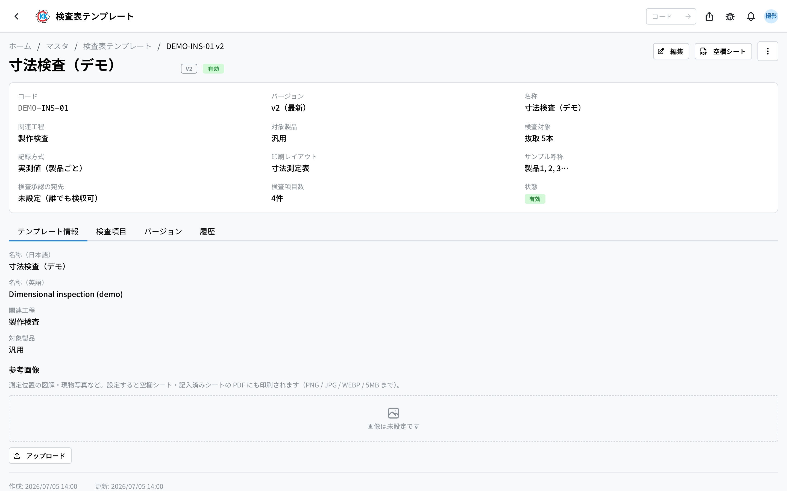

## 参考画像を付ける

「**テンプレート情報**」タブの「**参考画像**」の欄で、測る場所の図や現物の写真を付けられます。付けた画像は、空欄シートと記入済みシートの PDF にも印刷されます。

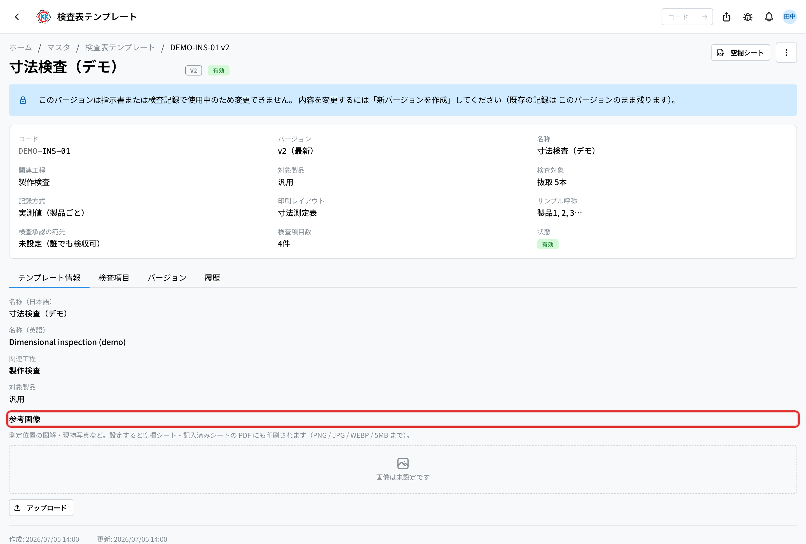

1. 「**テンプレート情報**」タブを開きます。
2. 「**アップロード**」を押します。
3. 画像のファイルを選びます（PNG・JPEG・WebP、5MB まで）。

差し替えるときは「**選び直す**」、外すときは「**削除**」を押します。参考画像は、使用中の版でも付け替えられます。

## 検査項目を追加する

保存すると開く詳しい画面で、「**検査項目**」タブを開きます。

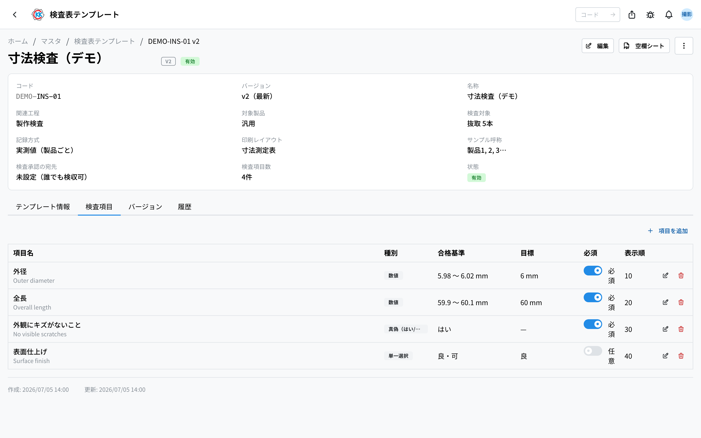

1. 「**項目を追加**」を押します。
2. 「**項目名（日本語）**」に、確認する内容を入れます（例 外径）。
3. 「**入力種別**」で、現場が何を入力するかを選びます。
   - **数値** … 数を入力します（例 6.01）。
   - **真偽（はい/いいえ）** … 「はい」か「いいえ」を選びます。
   - **単一選択** … 用意した選択肢から 1 つ選びます。
   - **複数選択** … 用意した選択肢からいくつでも選べます。
   - **自由記述** … 文字を自由に書きます。合格・不合格はいつも現場が自分で選びます。
4. 選んだ種別に合わせて、合格の基準を入れます（次の説明をご覧ください）。
5. 「**掲載区分**」を選びます。ふつうは「**主表**」のままです。形を確かめる欄など、表とは別の枠に載せたい項目は「**形状欄**」にします。
6. 印刷レイアウトが「外観・工程チェック表」のときは、「**部門**」（製造課管轄 / 品証課管轄）も選べます。
7. 測る道具の記号があれば「**測定機器コード**」に入れます（任意です）。
8. 「**表示順**」を確認します。追加するたびに自動で数字が入るので、ふつうはそのままで大丈夫です。
9. 必ず入力させたい項目は「**必須項目**」を入れたままにします。
10. 「**追加**」を押します。

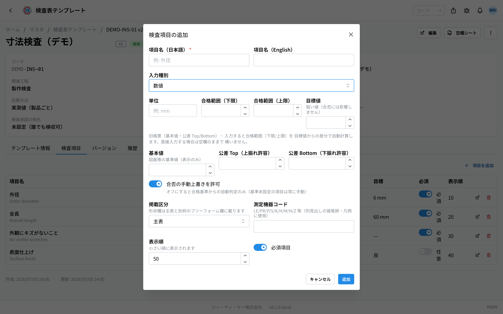

登録した項目は表に並びます。表の列は **項目名 / 種別 / 合格基準 / 目標 / 必須 / 表示順** です。行の右にあるアイコンから、編集や削除ができます。

「**必須**」の列はスイッチになっていて、**行のその場で 必須 / 任意 を切り替えられます**（項目の編集画面を開かなくてかまいません）。必須の項目が 1 つでも空のままだと検査表は保存できないので、ここは「その項目を書かないと検査を終えたことにしない」という意味になります。使用中のバージョンでは切り替えられず、必須 / 任意 の表示だけになります。

### 合格の基準の決めかた

種別ごとに、入れる内容が変わります。

- **数値** … 「**単位**」（例 mm）と、「**合格範囲（下限）**」「**合格範囲（上限）**」を入れます。どちらか片方だけでもかまいません。入力された数値がこの範囲に入っていれば、自動で合格になります。
- **真偽（はい/いいえ）** … 「**合格とする回答**」で、どちらの答えを合格とするかを選びます。
- **単一選択 / 複数選択** … 「**選択肢を追加**」で選択肢を登録してから、「**合格とする選択肢**」を選びます。
- **自由記述** … 合格の基準はありません。

「**目標値**」「**目標回答（任意）**」「**目標（任意）**」は、狙いの値を書いておく欄です。画面にも「**狙い値（合否には影響しません）**」と書かれているとおり、合格・不合格には関係しません。

数値の項目では、図面の書きかたに合わせて「**基本値**」「**公差 Top（上振れ許容）**」「**公差 Bottom（下振れ許容）**」も入れられます。「目標値」と公差 Top・公差 Bottom を入れて保存すると、合格範囲（下限・上限）が目標値から自動で計算されます。合格範囲を直接入れるときは、公差の欄は空欄のままでかまいません。「基本値」は表示のためだけの欄です。

> 💡 合格の基準を決めずに保存すると、その項目は自動で判定されず、現場が自分で合格・不合格を選ぶことになります。「**合否の手動上書きを許可**」を切ると、自動の判定だけになり、一覧に「上書き不可」と表示されます。

合格・不合格の付き方を図にすると、次のとおりです。

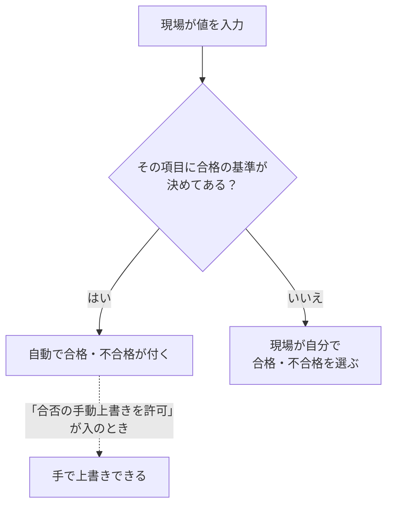

## 内容を変える（新しい版をつくる）

そのひな形が指示書や検査の記録で一度でも使われると、内容は変えられなくなります。すでに検査した記録の中身が、あとから変わってしまわないようにするためです。この状態のひな形では、詳しい画面の「**編集**」ボタンが表示されなくなり、画面の上にそのことを知らせる青い案内が出ます。

内容を変えたいときは、新しい版を作ります。

1. 詳しい画面の右上にある「**…**」（点が 3 つのボタン）を押します。
2. 「**新バージョンを作成**」を選びます。
3. 確認の小窓が出るので、内容を読んで「**新バージョンを作成**」を押します。

「**検査項目**」タブの「**新バージョンを作成して編集**」を押しても、同じことができます。

いまの検査項目をコピーした新しい版（v2、v3 …）ができます。これまでの指示書や検査の記録は、前の版のまま変わりません。

流れを図にすると次のとおりです。

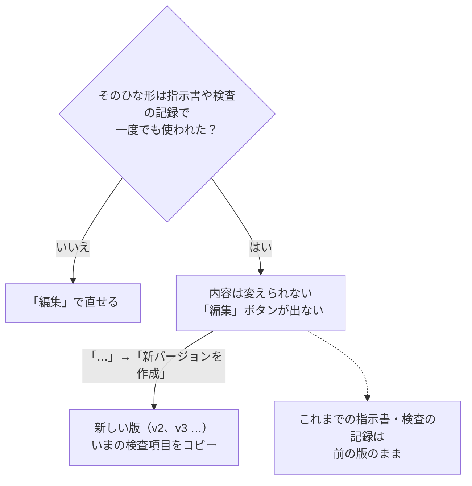

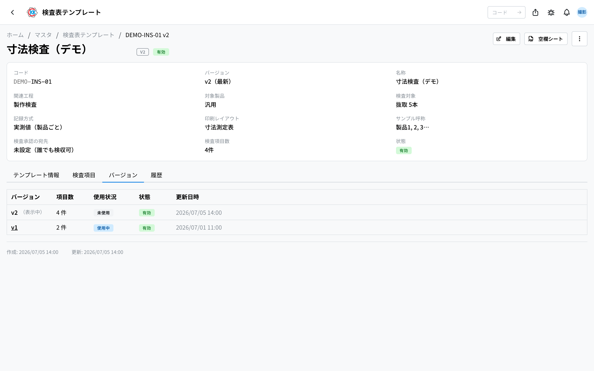

「**バージョン**」タブを開くと、これまでの版が一覧で出ます。いま見ている版には「（表示中）」と付きます。「使用状況」の列で、その版が使われているか（使用中 / 未使用）が分かります。

「検査承認の宛先」は内容とは別扱いで、使用中の版でも変えられます。「**…**」から「**検査承認の宛先を変更**」を選びます。

## 手書き用の検査表を印刷する

詳しい画面の右上にある「**空欄シート**」を押すと、検査項目だけを並べた空欄の PDF が出ます。現場で手書きしたいときに印刷して使えます。参考画像を付けてあれば、それも一緒に印刷されます。

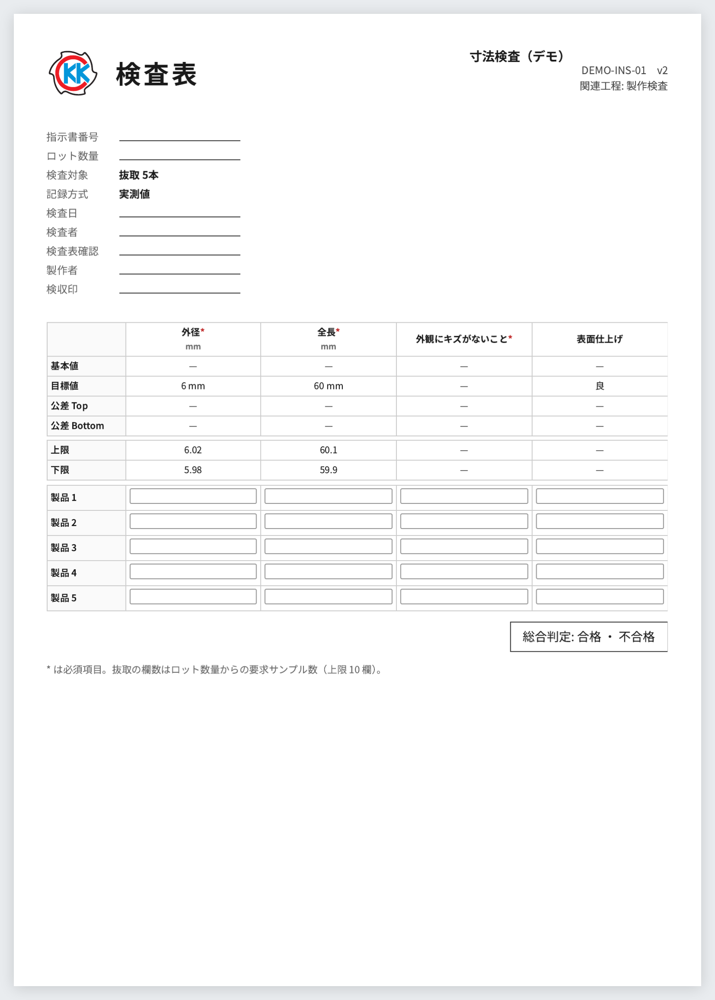

## グループで分ける

ひな形が増えてきたら、**グループ**に分けておくと一覧で探しやすくなります。グループは一覧の絞り込みと見出し分けにだけ使うもので、合格・不合格の判定や PDF には関係しません。

1. 一覧画面の右上にある「**グループ管理**」を押します。
2. 「**新しいグループ**」の欄にグループ名を入れます（例 製品検査記録）。
3. 「**追加**」を押します。
4. 「**閉じる**」を押します。

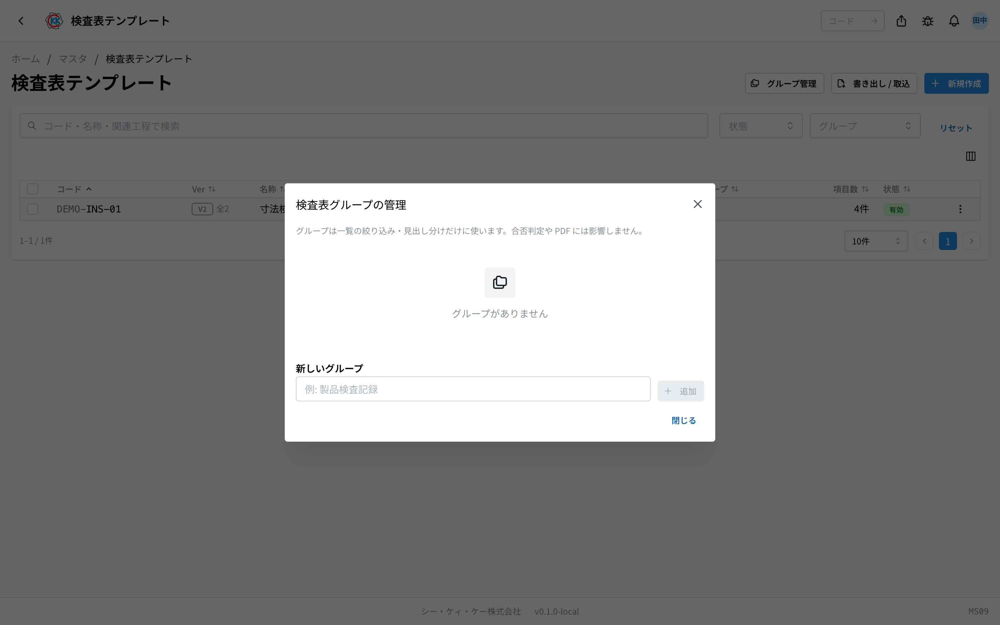

できたグループは、ひな形の新規作成・編集の画面の「**グループ**」で選べます。グループの名前や並び順（「**上へ**」「**下へ**」）、有効・無効も「グループ管理」で直せます。検査表が入っているグループは削除できません。

## 書き出し / 取込

検査表を別の環境へ持っていくときや、Excel で作った検査表を取り込むときに使います。

1. 一覧画面の右上にある「**書き出し / 取込**」を押します。
2. 書き出すときは「**JSON で書き出す**」を押します。有効な検査表がすべて書き出されます（一覧でチェックを入れてから「**選択を書き出し**」を押すと、その分だけになります）。
3. 取り込むときは「**ファイルを選ぶ**」を押して、書き出した JSON か、Excel の雛形に書いたファイルを選びます。Excel の雛形は「**Excel の雛形を落とす**」で手に入ります。

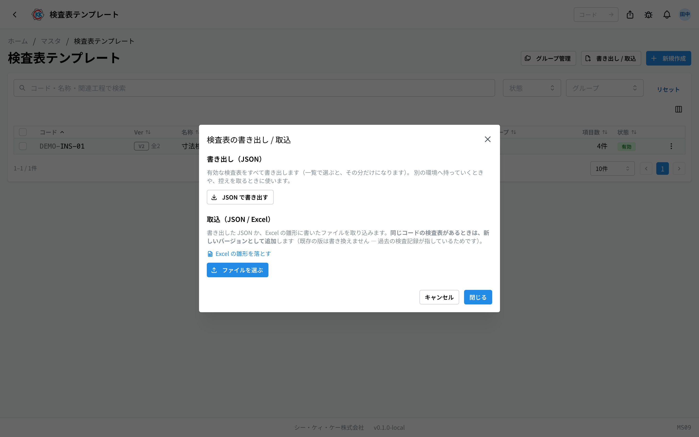

同じコードの検査表がすでにあるときは、新しいバージョンとして追加されます（いまある版は書き換えません）。取り込めなかったものがあるときは、件数と「**読めなかった行**」が表示されます。

## 入力項目

検査表テンプレートの登録画面で入力する項目の一覧です。

| 項目 | 何を入れるか |
|------|-------------|
| [コード / 名称](#field-code) | テンプレートの管理番号と名前です |
| [関連工程](#field-process-step) | どの工程で使う検査表かです |
| [有効](#field-active) | 外すと、指示書の検査工程に紐づける選択肢に出なくなります |

### コード / 名称 [#field-code]

テンプレートの管理番号と名前です。指示書の検査工程に紐づけるときにこの名前で選びます。

### 関連工程 [#field-process-step]

どの工程で使う検査表かです。指示書でその工程を組むと、この検査表がはじめから割り当てられます（「対象製品」を決めたひな形は、その製品の指示書のときだけです）。

### 有効 [#field-active]

外すと、指示書の検査工程に紐づける選択肢に出なくなります。

## よくある質問・困ったとき

**Q. 「編集」ボタンが見当たりません。**
A. その版がすでに指示書や検査の記録で使われているため、変更できない状態です。「**…**」から「**新バージョンを作成**」を選び、新しい版で直してください。

**Q.「このバージョンは指示書または検査記録で使用中のため変更できません。新バージョンを作成してください」と出ます。**
A. 上と同じ理由です。新しい版を作ってから直してください。

**Q.「合格範囲の上限は下限以上にしてください」と出ます。**
A. 上限の数が下限より小さくなっています。たとえば「下限 5.98 / 上限 6.02」のように、上限のほうを大きい数にしてください。

**Q.「選択肢を 1 つ以上登録してください」と出ます。**
A. 「単一選択」「複数選択」の項目では、先に選択肢を登録する必要があります。「**選択肢を追加**」で選択肢を作ってから保存してください。

**Q. 数値を入れたのに、合格・不合格が自動で付きません。**
A. その項目に合格範囲が入っていない可能性があります。項目を編集して「合格範囲（下限）」「合格範囲（上限）」を入れてください。

**Q. 目標値を入れたのに、判定が変わりません。**
A. 正常な動きです。目標値は狙いの値を書いておくだけの欄で、合格・不合格には関係しません。ただし、公差 Top・公差 Bottom も入れたときは、目標値から合格範囲が計算し直されます。

**Q. ひな形を削除できません。**
A. その版を使っている指示書や検査の記録があると削除できません。使わなくなったひな形は、削除ではなく「**無効化**」してください。無効にすると新しい指示書では選べなくなり、これまでの記録はそのまま残ります。

<!-- permissions:start -->
## 必要な権限

この画面を使うには **マスタ管理**（`master`）の権限が要ります。

| したいこと | 必要な権限 |
| --- | --- |
| 画面を開く・一覧や詳細を見る | マスタ管理 の 閲覧 |
| 追加・変更・削除する | マスタ管理 の 作成 / 更新 / 削除 |

見るだけなら「閲覧」で足ります。追加・変更・削除の操作がある画面では、その操作にあたる権限がそれぞれ必要です。

権限は役割（ロール）を通して付きます。足りないときは管理者に相談してください。

権限の全体像は「[権限とロール](../../../permissions)」を参照してください。
<!-- permissions:end -->
