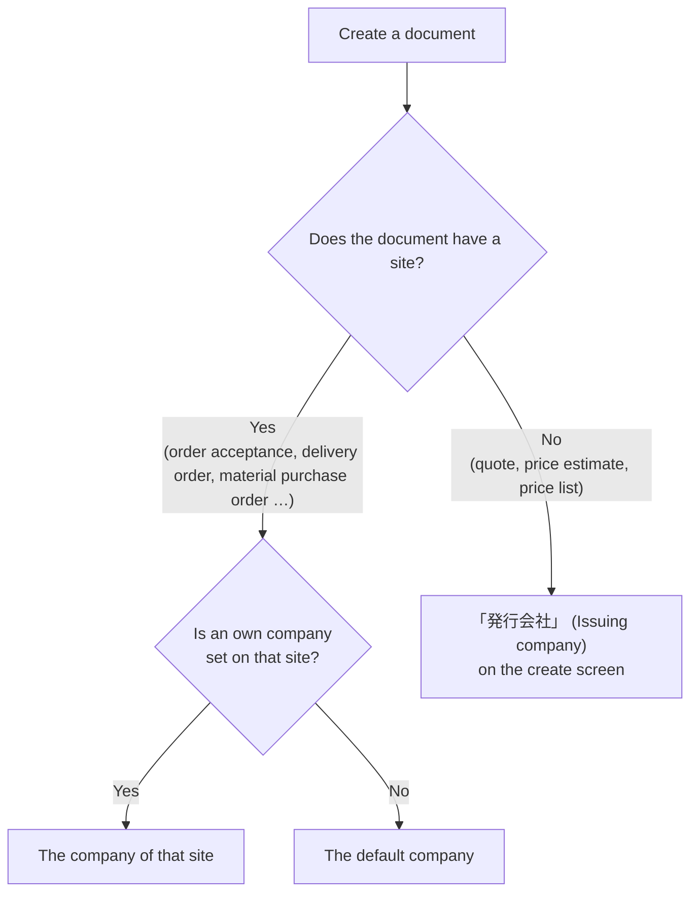
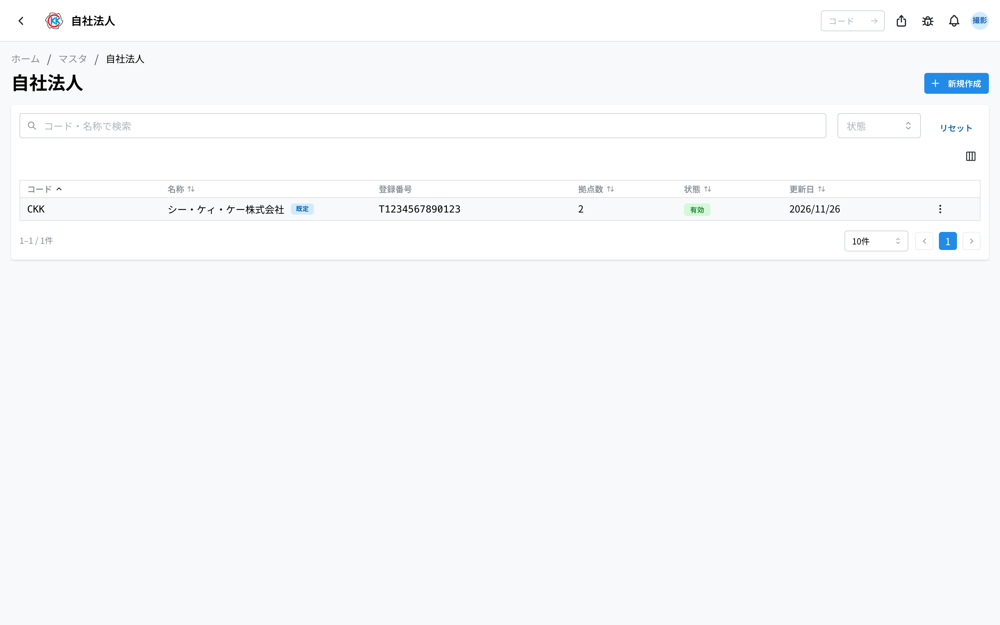
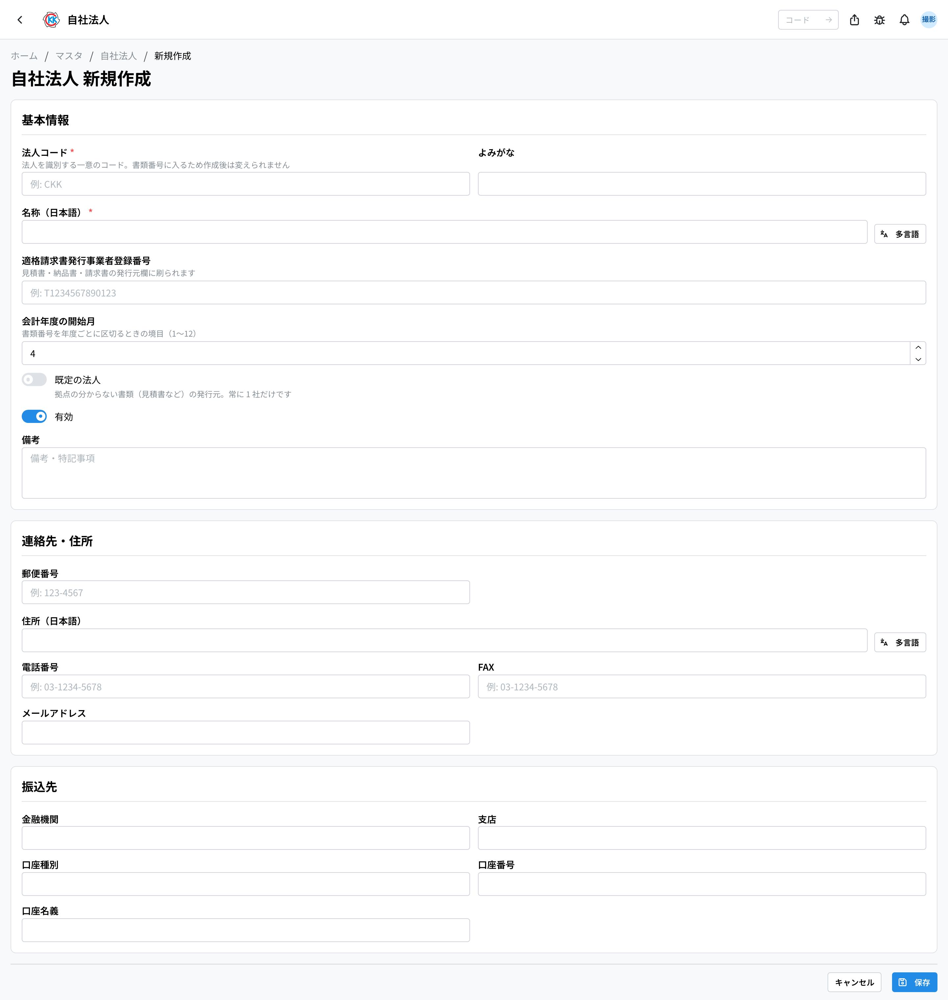
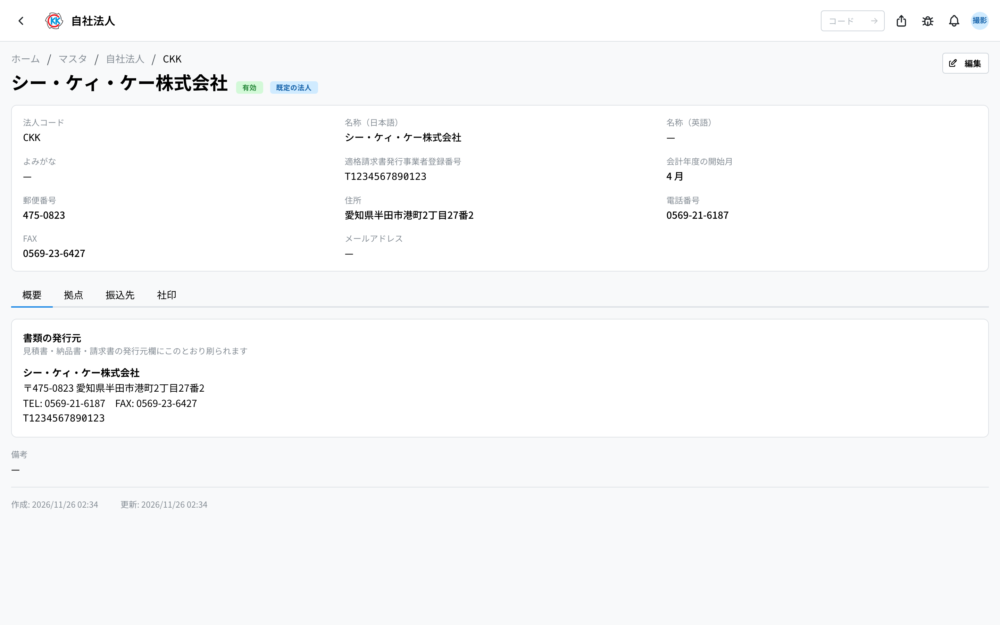
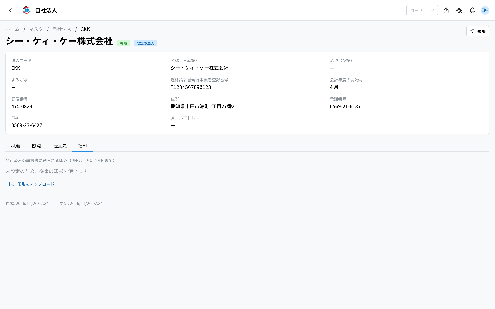

This app is for registering **your own company (legal entity) that issues documents**. The operation code is `MS0I`.

Use it when two or more companies in the same group issue documents (for example CKK and TSP). The **issuer** on quotes, delivery notes and invoices, and **how document numbers are counted**, are decided per company registered here. If you have only one company, the one that is already registered is all you need — there is nothing to do.

## What you can do with this app

- You can register a company's name, address, phone number and invoice registration number. These are printed in the issuer block of documents.
- You can set the **fiscal year start month** that divides document numbers, per company.
- You can register a **company seal** (an image of the seal) to print on invoices.
- You can check which sites belong to the company.

## Words used on this page

- **Own company (自社法人)** … your own company that issues documents. It is a different master from customers and suppliers ([business partners](/manual/en/operations/masters/business-partner/user)).
- **Issuer (発行元)** … the block on a document (PDF) that shows which company issued it.
- **Issuing company (発行会社)** … the name of the field you choose when creating a quote, price estimate or price list. It points to an own company.
- **Default company (既定の法人)** … the company used when the company of a document cannot be decided. There is always exactly one.
- **Company code (法人コード)** … a short text that identifies the company (for example `CKK`). It also appears in screen URLs.
- **Fiscal year (会計年度)** … the four digits in the middle of a document number (`2026` in `QOT-2026-00001`). It is the year in which the fiscal year starts.

## How the company of a document is decided

You almost never choose a company each time you create a document, because **each site belongs to one company, and the company of a document is decided from its site**.

For each kind of document the system looks in the order below, and the first company found wins. If none is found, the **default company** is used.

| Document | How the company is decided |
|---|---|
| Quote, price estimate, price list | 「**発行会社**」 (Issuing company) on the create screen |
| Order acceptance | Assigned site → assigned site of the lines → the source quote |
| Order acceptance (imported) | 「**取込口の自社法人**」 (Own company of the intake channel) in [Order intake](/manual/en/operations/system/order-intake/user#intake-company) (for files uploaded with 「優先取込」 (priority import): the uploader's company, if it resolves to exactly one) |
| Work order | The order acceptance of the allocated order lines |
| Design request | The source quote → the source order acceptance |
| Material purchase order, purchase request | The receiving (requested) site of the lines |
| Delivery order | From site → assigned site of the order lines on it |
| Delivery note | Same as the delivery order |
| Invoice | Same as the delivery order (an accounting document follows its invoice) |
| Stock movement, stocktaking | Site |

- **The company of a site** is set with 「**自社法人**」 (Own company) on the [site](/manual/en/operations/masters/plant/user). A site with nothing set is treated as belonging to the default company.
- The 「**発行会社**」 (Issuing company) field is shown **only to people whose assigned sites span two or more companies**. People who belong to one company do not see it; that company is filled in automatically.
- **The company cannot be changed after the document is created**, because the document number is taken from that company's sequence. If it is wrong, cancel the document and create it again.

> 💡 **One order acceptance is one company.** You can choose an assigned site per line, but you cannot mix sites of different companies. If they are mixed, saving shows 「担当拠点がこの注文請書の自社法人（◯◯）に属していません」 (the assigned site does not belong to this order acceptance's own company).

## What is separate per company

| What | How it is separated |
|---|---|
| **Document numbers** | Counted from `00001` per company and per fiscal year. The same number can exist in another company ([Document number rules](/manual/en/start#doc-number)). |
| **Issuer block** | The company's name, address, phone number and registration number are printed on the quote, delivery note and invoice PDFs. |
| **Company seal** | The company's seal is printed on issued invoices. |
| **Price lists** | Kept separately per company. Prices on a document come only from the price lists of that document's company ([Price list](/manual/en/operations/sales/price-list/user#per-company)). |
| **Invoices** | Even for the same customer, shipments of different companies become separate invoices (one invoice can print only one issuer). |

## Before you start

- You need the **master permission** to use this app.
- After adding a company, open the edit screen of each [site](/manual/en/operations/masters/plant/user) that belongs to it and choose it in 「**自社法人**」 (Own company). Sites are reassigned in the site master, not in this app.

## How to read the screen

When you open the app, a list of the registered companies is shown.

- The list columns are **コード** (code) / **名称** (name) / **登録番号** (registration number) / **拠点数** (number of sites) / **状態** (status) / **更新日** (updated on).
- The default company has a 「**既定**」 (Default) badge next to its name.
- 「**拠点数**」 (number of sites) is the number of sites that have this company chosen as their own company.
- Narrow the list with the 「**コード・名称で検索**」 (search by code or name) box and 「**状態**」 (status).
- Click a row to open the detail screen of that company.

## Register a company

1. Press 「**新規作成**」 (New) at the top right of the list screen.
2. Enter a short text that stands for this company in 「**法人コード**」 (company code), for example `TSP`.
3. Enter the official company name in the Japanese box of 「**名称**」 (name). Names in other languages are entered from 「**多言語**」 (Translations).
4. Enter 「**適格請求書発行事業者登録番号**」 (invoice registration number): `T` followed by 13 digits.
5. Enter 「**会計年度の開始月**」 (fiscal year start month) as 1–12. 4 is filled in at the start.
6. Under 「**連絡先・住所**」 (contact and address), enter 「**郵便番号**」 (postal code), 「**住所**」 (address), 「**電話番号**」 (phone number), 「**FAX**」 and 「**メールアドレス**」 (email address).
7. If needed, enter the bank, branch, account type, account number and account holder under 「**振込先**」 (bank account).
8. Press 「**保存**」 (Save).

> ⚠️ 「**法人コード**」 (company code) cannot be changed after saving, because document URLs and integrations with other systems identify documents by this code. 「/」, 「~」 and spaces cannot be used.

> ⚠️ 「**会計年度の開始月**」 (fiscal year start month) **can no longer be changed once the company has created even one document** (the field turns grey and the reason is shown). Changing it midway would make the year boundary disagree with numbers already issued. After registering a company, check it before you start creating documents.

## Check a registered company

Click a row in the list to open the detail screen of that company.

The top part shows the company code, name, registration number, fiscal year start month, address, phone number and so on. Below are four tabs.

- **概要** (Overview) … shows 「**書類の発行元**」 (Document issuer): exactly what is printed in the issuer block of quotes, delivery notes and invoices. You can check here how the registered details will look on documents.
- **拠点** (Sites) … the sites that belong to this company. Press a site name to open that site.
- **振込先** (Bank account) … the registered bank and account details.
- **社印** (Company seal) … register the seal image printed on invoices (see the next section).

To correct the details, press 「**編集**」 (Edit) at the top right. From the 「**…**」 (three-dot) button next to it you can **disable** or **delete** the company (not shown for the default company).

## Register the company seal

1. Open the 「**社印**」 (Company seal) tab on the company's detail screen.
2. Press 「**印影をアップロード**」 (Upload seal) and choose the seal image.

- The image must be **PNG or JPG**, up to **2MB**.
- The seal is printed only on **issued invoices**. It is not printed on draft invoices.
- When no seal is registered, the default company shows 「**未設定のため、従来の印影を使います**」 (not set, so the previous seal is used) and the same seal as before is printed. Other companies show 「**未設定のため、請求書に印影は刷られません**」 (not set, so no seal is printed on invoices).
- To remove it, press 「**印影を外す**」 (Remove seal).

## Change the default company

The default company can only be changed by **making another company the default**.

1. Open the edit screen of the company you want to make the default.
2. Turn on the 「**既定の法人**」 (Default company) switch and press 「**保存**」 (Save).

The mark is removed automatically from the company that was the default until then. On the edit screen of the default company itself, the switch cannot be turned off (it is greyed out).

## Input fields

Every field on the own company screen.

| Field | Required | What to enter |
|-------|----------|---------------|
| [Company code](#field-code) | Required | A short text that identifies the company |
| [Name / kana](#field-name) | Required | The official company name |
| [Invoice registration number](#field-registration-no) | Optional | The registration number printed in the issuer block |
| [Fiscal year start month](#field-fiscal-year-start-month) | Required | The boundary that divides document numbers by year |
| [Default company](#field-default) | — | Whether it issues documents whose company cannot be decided |
| [Active](#field-active) | — | Whether it appears in pick lists |
| [Postcode / address](#field-address) | Optional | The location printed in the issuer block |
| [Phone / fax / email](#field-contact) | Optional | The contact details printed in the issuer block |
| [Bank account](#field-bank) | Optional | Bank and account |
| [Notes](#field-notes) | Optional | Notes |

### Company code [#field-code]

A short text that identifies the company (for example `CKK`). It appears in document URLs (`/sales/quotes/CKK~QOT-2026-00001`), so **it cannot be changed once created**.

### Name / kana [#field-name]

The official company name, printed in the issuer block of documents. To print a name that matches a customer's document language, enter the name for that language from Translations.

### Invoice registration number [#field-registration-no]

The registration number under the qualified invoice system: `T` followed by 13 digits. It is printed in the issuer block of quotes, delivery notes and invoices. You can save with it empty.

### Fiscal year start month [#field-fiscal-year-start-month]

The month (1–12) that divides document numbers by fiscal year. With 4, documents created from April to the following March get numbers of the same fiscal year. **It cannot be changed after the company has created documents.**

### Default company [#field-default]

The company that issues documents whose company cannot be decided from a site (such as quotes). **There is always exactly one**; turning it on removes the mark from the previous default company.

### Active [#field-active]

Turning it off removes the company from the 「自社法人」 (Own company) pick list on sites and the 「発行会社」 (Issuing company) pick list on create screens. Documents created so far stay as they are. The default company cannot be disabled.

### Postcode / address [#field-address]

The company's location, printed in the issuer block as "〒postcode address".

### Phone / fax / email [#field-contact]

Contact details. The phone and fax numbers are printed in the issuer block as "TEL: … FAX: …".

### Bank account [#field-bank]

Bank, branch, account type, account number and account holder. It is a place to keep each company's account, and can be checked on the 「振込先」 (Bank account) tab of the detail screen.

### Notes [#field-notes]

Notes. Writing down why something was decided, or anything to watch out for, helps whoever reads it later.

## Questions and problems

**Q. I cannot delete a company.**
A. When 「**拠点 ◯ 件・請求書 ◯ 件で使われているため削除できません**」 (it cannot be deleted because it is used by ◯ sites and ◯ invoices) is shown, sites that belong to the company or invoices it issued remain. For a company you no longer use, **disable** it instead of deleting it. The default company can be neither deleted nor disabled.

**Q. The fiscal year start month field is grey and I cannot change it.**
A. The company has already issued document numbers. Changing the start month after that would make the year boundary disagree with numbers already issued, so it is locked.

**Q. The 「発行会社」 (Issuing company) field does not appear on the quote create screen.**
A. Your assigned sites belong to only one company. There is nothing to choose in that case, so the field is not shown and that company is filled in automatically. You can check your assigned sites in [User management](/manual/en/operations/system/user-management/user).

**Q. The issuer on a document is not the company I expected.**
A. The company of a document is decided when it is created and cannot be changed afterwards. Check on the [site](/manual/en/operations/masters/plant/user) whether 「自社法人」 (Own company) is correct. Documents created after you correct it get the right company. For documents already created, cancel them and create them again.

**Q. I opened a document by its number and a screen called 「発行会社を選択」 (Select the issuing company) appeared.**
A. Documents with the same number exist in two or more companies. Choose the company of the document you want to open ([Document number rules](/manual/en/start#doc-number)).

**Q. 「拠点数」 (number of sites) in the list is 0.**
A. No site has this company chosen as its own company. If it is the default company, documents of sites with no company set are also issued by it, so 0 causes no trouble. When you use two or more companies, choose 「自社法人」 (Own company) on each site.

<!-- permissions:start -->
## Permissions required

Using this screen requires the **Master data** (`master`) permission.

| What you want to do | Permission needed |
| --- | --- |
| Open the screen, view lists and details | Master data — View |
| Add, change or delete | Master data — Create / Edit / Delete |

Viewing only needs *View*. Where a screen offers adding, changing or deleting, each of those needs its matching permission.

Permissions come through roles. If something is missing, ask an administrator.

For the whole picture see [Permissions and roles](../../../permissions).
<!-- permissions:end -->
