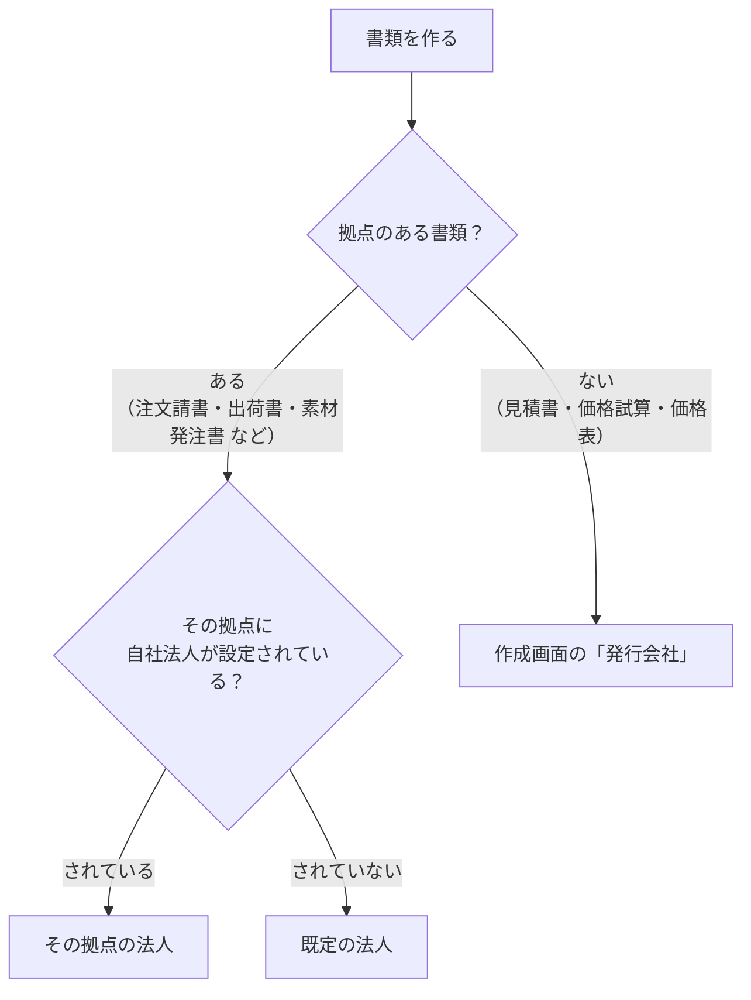
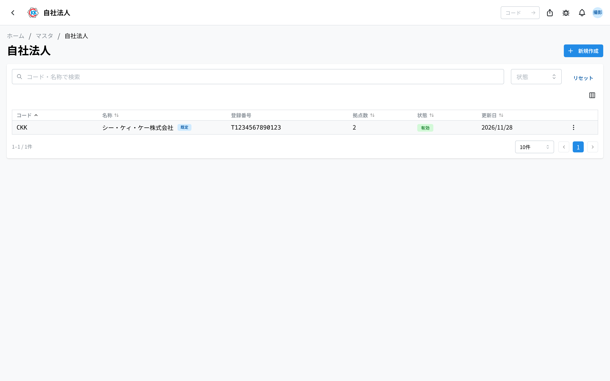
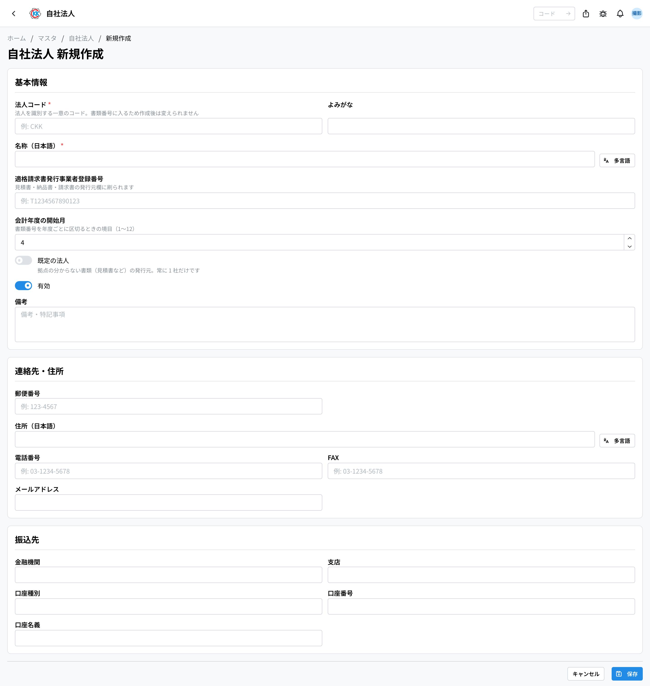
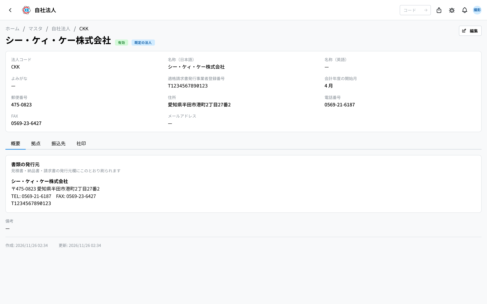
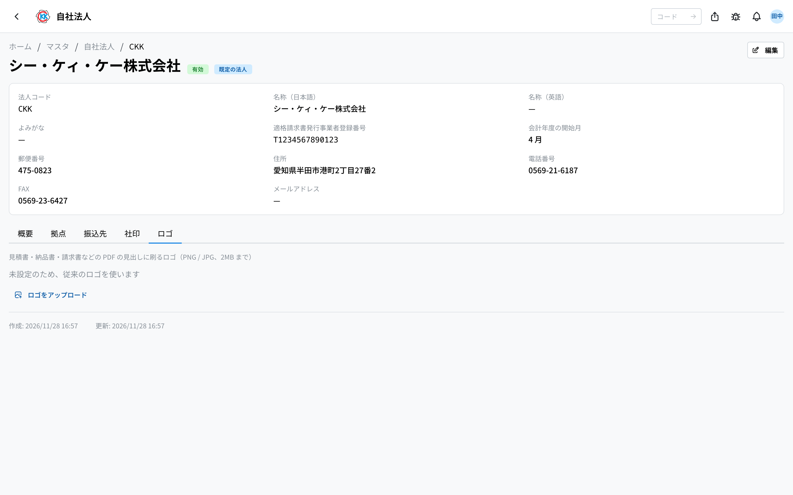

**書類を発行する自分の会社（法人）** を登録しておくアプリです。操作コードは `MS0I` です。

同じグループの中に、書類を出す会社が 2 つ以上あるとき（例: CKK と TSP）に使います。見積書・納品書・請求書の **発行元** と、**書類番号の数え方** は、ここで登録した法人ごとに決まります。会社が 1 つだけなら、はじめから入っている 1 社のままで何もする必要はありません。

## このアプリでできること

- 法人の名称・住所・電話番号・適格請求書発行事業者登録番号を登録できます。これが書類の発行元欄に刷られます。
- 法人ごとに、書類番号を区切る **会計年度の開始月** を決められます。
- 請求書に刷る **社印**（印影の画像）を登録できます。
- 書類（PDF）の見出しに刷る **ロゴ** を登録できます。
- どの拠点がその法人に属しているかを確認できます。

## 用語（このページで出てくる言葉）

- **自社法人（じしゃほうじん）** … 書類を発行する自分の会社のことです。お客様や仕入先（[取引先](/manual/ja/operations/masters/business-partner/user)）とは別のマスタです。
- **発行元** … 書類（PDF）に刷られる「この書類を出した会社」の欄です。
- **発行会社** … 見積書・価格試算・価格表を作るときに選ぶ欄の名前です。指しているものは自社法人です。
- **既定の法人** … どの法人の書類か決められないときに使う法人です。必ず 1 社だけあります。
- **法人コード** … 法人を見分ける短い文字です（例 `CKK`）。画面の URL にも入ります。
- **会計年度** … 書類番号の真ん中の 4 桁です（`QOT-2026-00001` の `2026`）。年度が始まる年で表します。

## 書類の法人はどう決まるか

書類を作るたびに法人を選ぶことは、ほとんどありません。**拠点が 1 つの法人に属していて、書類の法人は拠点から決まる** からです。

書類の種類ごとに、次の順で見て、最初に見つかった法人になります。どれも見つからなければ **既定の法人** です。

| 書類 | 法人の決まり方 |
|---|---|
| 見積書・価格試算・価格表 | 作成画面の「**発行会社**」 |
| 注文請書 | 担当拠点 → 明細の担当拠点 → もとの見積書 |
| 注文請書（取り込んだもの） | [注文書取込](/manual/ja/operations/system/order-intake/user#intake-company)の「**取込口の自社法人**」（「優先取込」でアップロードした分は、アップロードした人の法人が 1 つに決まればその法人） |
| 指示書 | 割り当てた注文明細の注文請書 |
| 設計依頼書 | もとの見積書 → もとの注文請書 |
| 素材発注書・購買依頼 | 明細の入荷先（希望）拠点 |
| 出荷書 | 出荷元拠点 → 明細の注文明細の担当拠点 |
| 納品書 | 出荷書と同じ |
| 請求書 | 出荷書と同じ（会計文書は請求書と同じ） |
| 入出庫伝票・棚卸 | 拠点 |

- **拠点の法人** は、[拠点](/manual/ja/operations/masters/plant/user)の「**自社法人**」で決めます。設定していない拠点は、既定の法人として扱われます。
- 「**発行会社**」の欄は、**所属拠点が 2 つ以上の法人にまたがる人にだけ** 出ます。1 社にしか属していない人には出ず、その法人が自動で入ります。
- **法人は、書類を作ったあとは変えられません。** 書類番号がその法人の連番から付くためです。間違えたときは、書類をキャンセルして作り直します。

> 💡 **注文請書 1 件は、法人 1 つです。** 明細ごとに担当拠点を選べますが、別の法人の拠点を混ぜることはできません。混ざっていると、保存のときに「担当拠点がこの注文請書の自社法人（◯◯）に属していません」と出ます。

## 法人ごとに分かれるもの

| 分かれるもの | どう分かれるか |
|---|---|
| **書類番号** | 法人ごと・会計年度ごとに `00001` から数えます。同じ番号が別の法人にもあり得ます（[書類番号のルール](/manual/ja/start#doc-number)）。 |
| **発行元欄** | 見積書・納品書・請求書の PDF に、その法人の名称・住所・電話番号・登録番号が刷られます。 |
| **社印** | 発行済みの請求書に、その法人の印影が刷られます。 |
| **ロゴ** | 見積書・納品書・請求書などの PDF の見出しに、その法人のロゴが刷られます。 |
| **画面の見分け** | 2 社以上の法人の書類を扱う人には、一覧の書類番号の横と詳細画面の見出しに、法人コードの小さなバッジ（例 `TSP`）が出ます（[発行会社のバッジ](#company-badge)）。 |
| **価格表** | 法人ごとに別々に持ちます。書類の値段は、その書類の法人の価格表だけから入ります（[価格表](/manual/ja/operations/sales/price-list/user#per-company)）。 |
| **請求書** | 同じお客様でも、法人が違う出荷は別の請求書になります（1 通に刷れる発行元は 1 社だけのため）。 |

## はじめる前に

- このアプリを使うには **マスタの権限** が必要です。
- 法人を増やしたら、[拠点](/manual/ja/operations/masters/plant/user)の編集画面で、その法人に属する拠点の「**自社法人**」を選び直してください。拠点の付け替えはこのアプリではなく、拠点マスタで行います。

## 画面の見かた

アプリを開くと、登録済みの法人の一覧が表示されます。

- 一覧は **コード / 名称 / 登録番号 / 拠点数 / 状態 / 更新日** の順に並んでいます。
- 既定の法人には、名称の横に「**既定**」のバッジが付きます。
- 「**拠点数**」は、その法人を「自社法人」に選んでいる拠点の数です。
- 上の「**コード・名称で検索**」の欄と「**状態**」で絞り込めます。
- 行をクリックすると、その法人の詳しい画面が開きます。

## 法人を登録する

1. 一覧画面の右上にある「**新規作成**」を押します。
2. 「**法人コード**」に、この法人を表す短い文字を入れます（例 `TSP`）。
3. 「**名称**」の日本語の欄に、会社の正式な名前を入れます。ほかの言語の名前は「**多言語**」から入れます。
4. 「**適格請求書発行事業者登録番号**」を入れます（`T` + 数字 13 桁）。
5. 「**会計年度の開始月**」を 1〜12 で入れます（はじめは 4 が入っています）。
6. 「**連絡先・住所**」に「**郵便番号**」「**住所**」「**電話番号**」「**FAX**」「**メールアドレス**」を入れます。
7. 必要なら「**振込先**」に金融機関・支店・口座種別・口座番号・口座名義を入れます。
8. 「**保存**」を押します。

> ⚠️ 「**法人コード**」は、保存したあとは変えられません。書類の URL や、ほかのシステムとの連携がこのコードで書類を見分けているためです。「/」「~」と空白は使えません。

> ⚠️ 「**会計年度の開始月**」は、**その法人が書類を 1 件でも作ると変えられなくなります**（欄が灰色になり、理由が表示されます）。途中で変えると、年度の区切りが発行済みの番号と食い違うためです。法人を登録したら、書類を作りはじめる前に確かめてください。

## 登録した法人を確認する

一覧で行をクリックすると、その法人の詳しい画面が開きます。

上のほうに、法人コード・名称・登録番号・会計年度の開始月・住所・電話番号などが表示されます。下には 5 つのタブがあります。

- **概要** … 「**書類の発行元**」として、見積書・納品書・請求書の見出しに刷られるロゴと発行元欄の内容がそのまま出ます。登録した内容が書類でどう見えるかを、ここで確かめられます。ロゴが刷られない法人は「**ロゴなし**」と出ます。
- **拠点** … この法人に属する拠点の一覧です。拠点の名前を押すと、その拠点の画面が開きます。
- **振込先** … 登録した金融機関・口座の情報です。
- **社印** … 請求書に刷る印影の画像を登録します（次の説明をご覧ください）。
- **ロゴ** … 書類の見出しに刷るロゴの画像を登録します（[ロゴを登録する](#logo)）。

内容を直したいときは、右上の「**編集**」を押します。その右の「**…**」（点が 3 つのボタン）からは、**無効化** と **削除** ができます（既定の法人には出ません）。

## 社印を登録する

1. 法人の詳しい画面で「**社印**」タブを開きます。
2. 「**印影をアップロード**」を押し、印影の画像を選びます。

- 使える画像は **PNG か JPG**、大きさは **2MB まで** です。
- 印影は **発行済みの請求書** にだけ刷られます。下書きの請求書には刷られません。
- 登録していないとき、既定の法人は「**未設定のため、従来の印影を使います**」と出て、これまでと同じ印影が刷られます。それ以外の法人は「**未設定のため、請求書に印影は刷られません**」と出ます。
- 外したいときは「**印影を外す**」を押します。

## ロゴを登録する [#logo]

1. 法人の詳しい画面で「**ロゴ**」タブを開きます。
2. 「**ロゴをアップロード**」を押し、ロゴの画像を選びます。

- 使える画像は **PNG か JPG**、大きさは **2MB まで** です。横長の画像がそのまま見出しの左上に収まります。
- ロゴは **見積書・納品書・請求書・設計依頼書・検査表・ポータル案内** の PDF の見出しに刷られます。どの法人のロゴが刷られるかは、その書類の法人で決まります。
- 登録していないとき、既定の法人は「**未設定のため、従来のロゴを使います**」と出て、これまでと同じロゴが刷られます。それ以外の法人は「**未設定のため、書類にロゴは刷られません**」と出て、見出しにロゴは刷られません（ほかの法人の書類に既定の法人のロゴが刷られることはありません）。
- ロゴの画像が読み出せないとき（保存先の不調など）も、PDF は止まらずに出ます。そのときはロゴを登録していないときと同じ見出しになります。
- 外したいときは「**ロゴを外す**」を押します。

> 💡 ロゴを差し替えても、**保存済みの PDF は変わりません**。見積書などの PDF は一度作ると保存して使い回すためです。新しいロゴで刷り直したいときは、書類の「**PDF**」タブの「**再生成**」で作り直してください。

## 発行会社のバッジ [#company-badge]

書類番号は法人ごとに数えるので、`QOT-2026-00001` のような同じ番号が、CKK にも TSP にもあり得ます。番号だけではどちらの書類か分からないため、**2 社以上の法人の書類を扱う人** には、どの書類にも法人コードの小さなバッジ（例 `TSP`）が出ます。

- **一覧** では書類番号の横（スマートフォンでは番号の行）に出ます。価格表と締日処理のように番号の列を持たない一覧では、顧客名の横に出ます。
- **詳細画面** では、見出しの状態バッジの横に出ます。バッジを指すと、法人の名前が出ます。
- 一覧の検索欄に **法人コードを 2 文字以上** 入れると、その法人の書類に絞り込めます（例 `TSP`）。
- **1 社にしか属していない人** には、自分の法人の書類にはバッジが出ません（毎行同じ印が並ぶだけなので）。自分の法人とは別の法人の書類を開いたときだけ出ます。

## 既定の法人を替える

既定の法人は、**別の法人を既定にする** ことでしか替えられません。

1. 新しく既定にしたい法人の編集画面を開きます。
2. 「**既定の法人**」のスイッチを入れて「**保存**」を押します。

それまで既定だった法人からは、自動で印が外れます。既定の法人のスイッチは、その法人の編集画面では切れません（灰色になっています）。

## 入力項目

自社法人の登録画面で入力する項目の一覧です。

| 項目 | 必須 | 何を入れるか |
|------|------|-------------|
| [法人コード](#field-code) | 必須 | 法人を見分ける短い文字 |
| [名称 / よみがな](#field-name) | 必須 | 会社の正式な名前 |
| [適格請求書発行事業者登録番号](#field-registration-no) | 任意 | 発行元欄に刷る登録番号 |
| [会計年度の開始月](#field-fiscal-year-start-month) | 必須 | 書類番号を年度で区切る境目 |
| [既定の法人](#field-default) | — | 法人が決まらない書類の発行元にするか |
| [有効](#field-active) | — | 選択肢に出すかどうか |
| [郵便番号 / 住所](#field-address) | 任意 | 発行元欄に刷る所在地 |
| [電話番号 / FAX / メールアドレス](#field-contact) | 任意 | 発行元欄に刷る連絡先 |
| [振込先](#field-bank) | 任意 | 金融機関と口座 |
| [備考](#field-notes) | 任意 | 補足 |

### 法人コード [#field-code]

法人を見分ける短い文字です（例 `CKK`）。書類の URL（`/sales/quotes/CKK~QOT-2026-00001`）に入るため、**作ったあとは変えられません**。

### 名称 / よみがな [#field-name]

会社の正式な名前です。書類の発行元欄にこの名前が刷られます。お客様の書類の言語に合わせた名前を出したいときは、「多言語」からその言語の名前を入れておきます。

### 適格請求書発行事業者登録番号 [#field-registration-no]

インボイス制度の登録番号です。`T` に続けて数字 13 桁で入れます。見積書・納品書・請求書の発行元欄に刷られます。空のままでも保存できます。

### 会計年度の開始月 [#field-fiscal-year-start-month]

書類番号を年度で区切る境目の月です（1〜12）。4 なら、4 月から翌年 3 月までに作った書類が同じ年度の番号になります。**その法人が書類を作ったあとは変えられません。**

### 既定の法人 [#field-default]

拠点から法人が決まらない書類（見積書など）の発行元にする法人です。**いつも 1 社だけ**で、入れると、それまで既定だった法人からは外れます。

### 有効 [#field-active]

外すと、拠点の「自社法人」や作成画面の「発行会社」の選択肢に出なくなります。これまでに作った書類はそのまま残ります。既定の法人は無効にできません。

### 郵便番号 / 住所 [#field-address]

会社の所在地です。発行元欄に「〒郵便番号 住所」の形で刷られます。

### 電話番号 / FAX / メールアドレス [#field-contact]

連絡先です。電話番号と FAX は、発行元欄に「TEL: … FAX: …」の形で刷られます。

### 振込先 [#field-bank]

金融機関・支店・口座種別・口座番号・口座名義です。法人ごとの口座を控えておくための欄で、詳しい画面の「振込先」タブで確認できます。

### 備考 [#field-notes]

補足です。後から見た人が経緯をたどれるように、決めた理由や注意点を書いておくと役に立ちます。

## よくある質問・困ったとき

**Q. 法人を削除できません。**
A. 「**拠点 ◯ 件・請求書 ◯ 件で使われているため削除できません**」と出るときは、その法人に属する拠点や、その法人が出した請求書が残っています。使わなくなった法人は、削除ではなく「**無効化**」してください。既定の法人は削除も無効化もできません。

**Q. 会計年度の開始月の欄が灰色で、変えられません。**
A. その法人がすでに書類番号を発行しているためです。発行したあとに開始月を変えると、年度の区切りが発行済みの番号と食い違うので、変えられないようにしています。

**Q. 見積書を作る画面に「発行会社」の欄が出ません。**
A. あなたの所属拠点が 1 つの法人にしか属していないためです。その場合は選ぶものが無いので欄が出ず、その法人が自動で入ります。所属拠点は[ユーザー管理](/manual/ja/operations/system/user-management/user)で確認できます。

**Q. 書類の発行元が思っていた会社と違います。**
A. 書類の法人は作成したときに決まり、あとから変えられません。拠点の「自社法人」が正しいか、[拠点](/manual/ja/operations/masters/plant/user)で確かめてください。直したあとに作った書類から、正しい法人になります。すでに作った書類は、キャンセルして作り直します。

**Q. 番号を入れて書類を開いたら「発行会社を選択」という画面が出ました。**
A. 同じ番号の書類が、2 つ以上の法人にあります。開きたい書類の法人を選んでください（[書類番号のルール](/manual/ja/start#doc-number)）。

**Q. 一覧の書類番号の横に `CKK` や `TSP` と小さく出ています。**
A. その書類の法人（発行会社）のコードです。同じ番号が別の法人にもあり得るので、2 社以上の法人の書類を扱う人に出しています（[発行会社のバッジ](#company-badge)）。

**Q. ロゴを登録したのに、見積書の PDF のロゴが前のままです。**
A. 保存済みの PDF は作り直すまで変わりません。書類の「**PDF**」タブの「**再生成**」で作り直してください（[ロゴを登録する](#logo)）。

**Q. 一覧の「拠点数」が 0 です。**
A. その法人を「自社法人」に選んでいる拠点がありません。既定の法人なら、法人を設定していない拠点の書類もこの法人から発行されるので、0 のままでも困りません。法人を 2 つ以上使うときは、拠点ごとに「自社法人」を選んでください。

<!-- permissions:start -->
## 必要な権限

この画面を使うには **マスタ管理**（`master`）の権限が要ります。

| したいこと | 必要な権限 |
| --- | --- |
| 画面を開く・一覧や詳細を見る | マスタ管理 の 閲覧 |
| 追加・変更・削除する | マスタ管理 の 作成 / 更新 / 削除 |

見るだけなら「閲覧」で足ります。追加・変更・削除の操作がある画面では、その操作にあたる権限がそれぞれ必要です。

権限は役割（ロール）を通して付きます。足りないときは管理者に相談してください。

権限の全体像は「[権限とロール](../../../permissions)」を参照してください。
<!-- permissions:end -->
