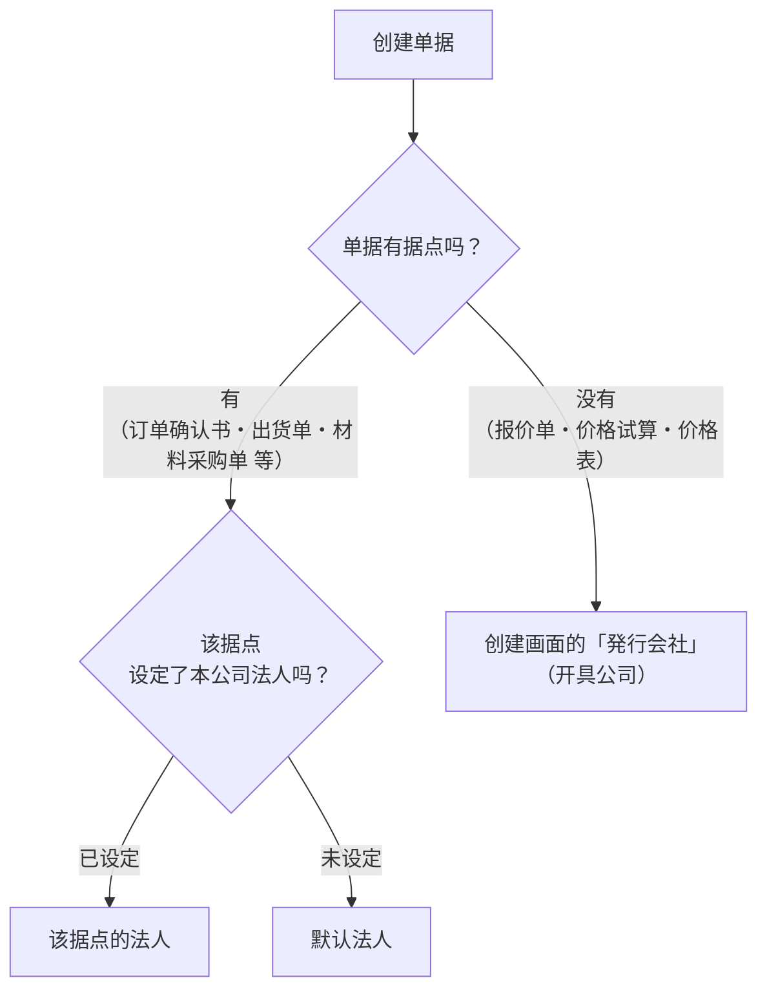
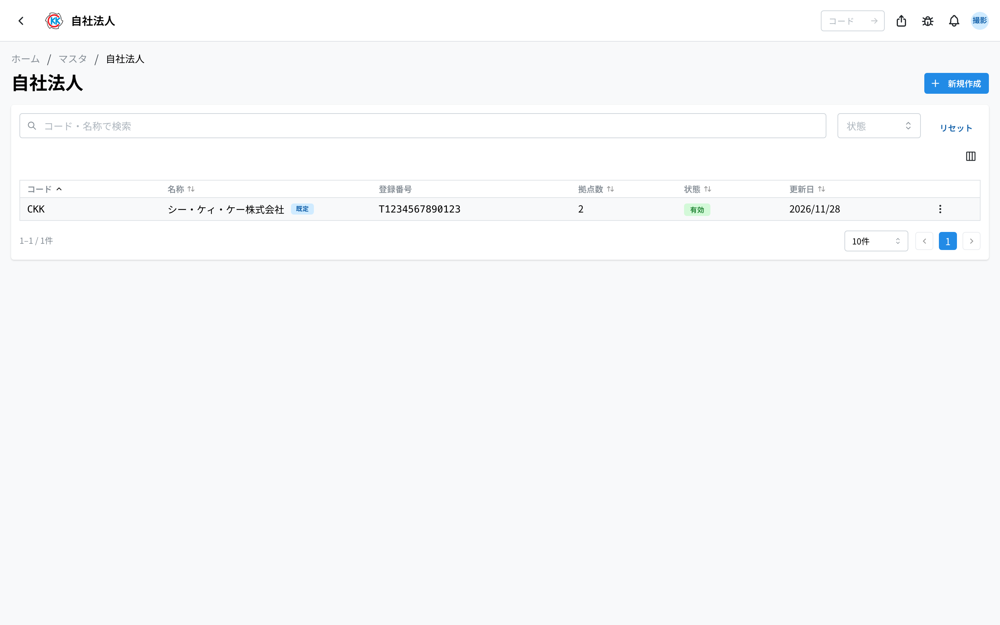
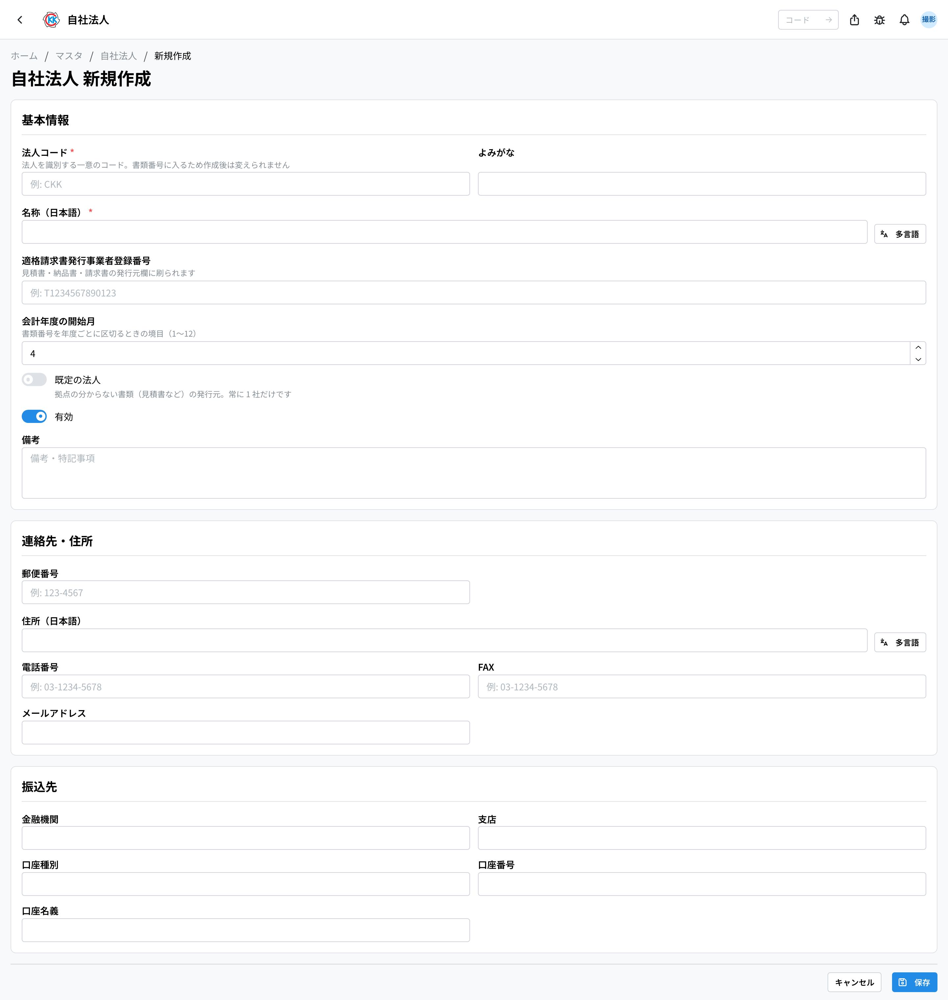
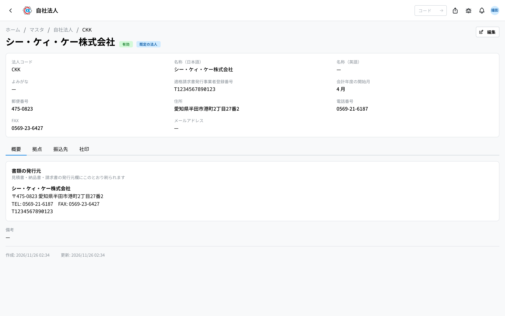
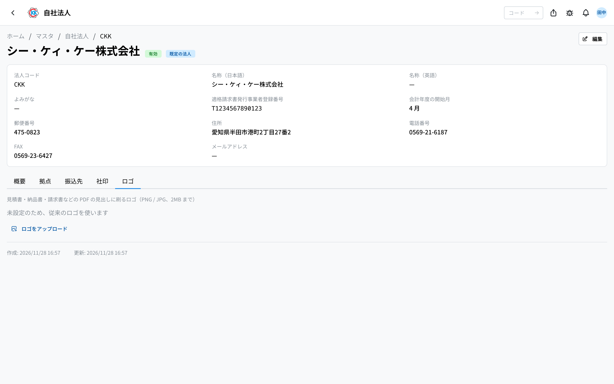

这是用于登记 **开具单据的本公司（法人）** 的应用。操作代码是 `MS0I`。

当同一集团内有 2 家以上的公司开具单据时（例如 CKK 和 TSP）使用。报价单・送货单・请款单的 **开具方**，以及 **单据编号的计数方式**，都按这里登记的法人分别决定。如果只有 1 家公司，保持最初已登记的 1 家即可，不需要做任何操作。

> ⚠️ 本应用仍在准备中，正式环境上可能还看不到。找不到时请咨询公司内的负责人。 在看不到本应用期间，单据由最初已登记的默认法人开具。

## 本应用可以做什么

- 可以登记法人的名称・地址・电话号码・合格请款单发行事业者登记号。这些内容会印在单据的开具方栏中。
- 可以按法人决定划分单据编号的 **会计年度开始月**。
- 可以登记印在请款单上的 **公司印章**（印章图片）。
- 可以登记印在单据（PDF）抬头的 **标志**。
- 可以确认哪些据点属于该法人。

## 术语（本页出现的词语）

- **自社法人（本公司法人）** … 开具单据的本公司。与客户・供应商（[业务伙伴](/manual/zh/operations/masters/business-partner/user)）是不同的主数据。
- **発行元（开具方）** … 单据（PDF）上印的「开具本单据的公司」一栏。
- **発行会社（开具公司）** … 创建报价单・价格试算・价格表时选择的栏位名称。它指的就是本公司法人。
- **既定の法人（默认法人）** … 无法决定单据属于哪个法人时使用的法人。必定只有 1 家。
- **法人コード（法人编号）** … 用来区分法人的短文字（例 `CKK`）。画面的 URL 中也会出现。
- **会計年度（会计年度）** … 单据编号中间的 4 位数（`QOT-2026-00001` 中的 `2026`）。用年度开始的那一年表示。

## 单据的法人如何决定

几乎不需要在每次创建单据时选择法人，因为 **据点属于 1 个法人，单据的法人由据点决定**。

每种单据按以下顺序查找，取最先找到的法人。都找不到时使用 **默认法人**。

| 单据 | 法人的决定方式 |
|---|---|
| 报价单・价格试算・价格表 | 创建画面的「**発行会社**」（开具公司） |
| 订单确认书 | 负责据点 → 明细的负责据点 → 来源报价单 |
| 订单确认书（导入的） | [订单导入](/manual/zh/operations/system/order-intake/user#intake-company)的「**取込口の自社法人**」（导入渠道的本公司法人）（用「優先取込」（优先导入）上传的文件：上传者的法人能确定为 1 家时使用该法人） |
| 工单 | 所分配订单明细的订单确认书 |
| 设计委托单 | 来源报价单 → 来源订单确认书 |
| 材料采购单・采购申请 | 明细的到货（希望）据点 |
| 出货单 | 出货据点 → 明细中订单明细的负责据点 |
| 送货单 | 与出货单相同 |
| 请款单 | 与出货单相同（会计凭证与请款单相同） |
| 出入库单・盘点 | 据点 |

- **据点的法人** 在[据点](/manual/zh/operations/masters/plant/user)的「**自社法人**」（本公司法人）中设定。未设定的据点按默认法人处理。
- 「**発行会社**」（开具公司）栏 **只对所属据点跨 2 个以上法人的人** 显示。只属于 1 家的人看不到该栏，系统会自动填入该法人。
- **单据创建后，法人不能更改。** 因为单据编号取自该法人的流水号。弄错时，请作废单据后重新创建。

> 💡 **1 张订单确认书对应 1 个法人。** 可以按明细选择负责据点，但不能混入其他法人的据点。混入时，保存时会显示「担当拠点がこの注文請書の自社法人（◯◯）に属していません」（负责据点不属于本订单确认书的本公司法人）。

## 按法人分开的内容

| 分开的内容 | 如何分开 |
|---|---|
| **单据编号** | 按法人、按会计年度从 `00001` 开始计数。同一编号也可能存在于其他法人（[单据编号规则](/manual/zh/start#doc-number)）。 |
| **开具方栏** | 报价单・送货单・请款单的 PDF 上印该法人的名称・地址・电话号码・登记号。 |
| **公司印章** | 已发行的请款单上印该法人的印章。 |
| **标志** | 报价单・送货单・请款单等 PDF 的抬头印该法人的标志。 |
| **画面上的区分** | 处理 2 个以上法人单据的人，会在列表的单据编号旁和详细画面的标题旁看到法人编号的小标记（例 `TSP`）（[开具公司标记](#company-badge)）。 |
| **价格表** | 按法人分别保存。单据的价格只取自该单据所属法人的价格表（[价格表](/manual/zh/operations/sales/price-list/user#per-company)）。 |
| **请款单** | 即使是同一客户，不同法人的出货也会分成不同的请款单（1 张只能印 1 家开具方）。 |

## 开始之前

- 使用本应用需要 **主数据的权限**。
- 增加法人后，请在[据点](/manual/zh/operations/masters/plant/user)的编辑画面中，为属于该法人的据点重新选择「**自社法人**」（本公司法人）。据点的归属调整不在本应用中进行，而是在据点主数据中进行。

## 界面说明

打开应用后，会显示已登记法人的列表。

- 列表按 **コード**（代码）/ **名称**（名称）/ **登録番号**（登记号）/ **拠点数**（据点数）/ **状態**（状态）/ **更新日**（更新日）的顺序排列。
- 默认法人的名称旁边有「**既定**」（默认）标记。
- 「**拠点数**」（据点数）是把该法人选为「本公司法人」的据点数量。
- 可以用上方的「**コード・名称で検索**」（按代码・名称搜索）栏和「**状態**」（状态）筛选。
- 点击行，就会打开该法人的详细界面。

## 登记法人

1. 点击列表界面右上角的「**新規作成**」（新建）。
2. 在「**法人コード**」（法人编号）中输入代表该法人的短文字（例 `TSP`）。
3. 在「**名称**」（名称）的日语栏中输入公司的正式名称。其他语言的名称从「**多言語**」（多语言）输入。
4. 输入「**適格請求書発行事業者登録番号**」（合格请款单发行事业者登记号）（`T` + 13 位数字）。
5. 在「**会計年度の開始月**」（会计年度开始月）中输入 1〜12（初始为 4）。
6. 在「**連絡先・住所**」（联系方式・地址）中输入「**郵便番号**」（邮政编码）「**住所**」（地址）「**電話番号**」（电话号码）「**FAX**」「**メールアドレス**」（邮箱地址）。
7. 需要时，在「**振込先**」（银行账户）中输入金融机构・分行・账户类别・账号・账户名。
8. 点击「**保存**」（保存）。

> ⚠️ 「**法人コード**」（法人编号）保存后不能更改。因为单据的 URL 以及与其他系统的对接都用这个代码区分单据。不能使用「/」「~」和空格。

> ⚠️ 「**会計年度の開始月**」（会计年度开始月）**在该法人创建了哪怕 1 张单据之后就不能再更改**（栏位变灰，并显示原因）。中途更改会使年度的划分与已发行的编号不一致。登记法人后，请在开始创建单据之前确认。

## 确认已登记的法人

在列表中点击行，就会打开该法人的详细界面。

上方显示法人编号・名称・登记号・会计年度开始月・地址・电话号码等。下方有 5 个标签页。

- **概要**（概要）… 以「**書類の発行元**」（单据的开具方）原样显示印在报价单・送货单・请款单抬头的标志和开具方栏的内容。可以在这里确认登记的内容在单据上的样子。不印标志的法人显示「**ロゴなし**」（无标志）。
- **拠点**（据点）… 属于该法人的据点列表。点击据点名称，会打开该据点的画面。
- **振込先**（银行账户）… 已登记的金融机构・账户信息。
- **社印**（公司印章）… 登记印在请款单上的印章图片（请看下面的说明）。
- **ロゴ**（标志）… 登记印在单据抬头的标志图片（[登记标志](#logo)）。

想修改内容时，点击右上角的「**編集**」（编辑）。从它右边的「**…**」（三个点的按钮）可以 **停用** 和 **删除**（默认法人不显示）。

## 登记公司印章

1. 在法人的详细界面打开「**社印**」（公司印章）标签页。
2. 点击「**印影をアップロード**」（上传印章），选择印章图片。

- 可用的图片是 **PNG 或 JPG**，大小 **不超过 2MB**。
- 印章只印在 **已发行的请款单** 上。草稿的请款单不印。
- 未登记时，默认法人显示「**未設定のため、従来の印影を使います**」（未设定，使用原来的印章），印的是与以前相同的印章。其他法人显示「**未設定のため、請求書に印影は刷られません**」（未设定，请款单上不印印章）。
- 想去掉时，点击「**印影を外す**」（移除印章）。

## 登记标志 [#logo]

1. 在法人的详细界面打开「**ロゴ**」（标志）标签页。
2. 点击「**ロゴをアップロード**」（上传标志），选择标志图片。

- 可用的图片是 **PNG 或 JPG**，大小 **不超过 2MB**。横长的图片会原样放在抬头的左上方。
- 标志印在 **报价单・送货单・请款单・设计委托单・检查表・门户说明** 的 PDF 抬头。印哪个法人的标志，由该单据的法人决定。
- 未登记时，默认法人显示「**未設定のため、従来のロゴを使います**」（未设定，使用原来的标志），印的是与以前相同的标志。其他法人显示「**未設定のため、書類にロゴは刷られません**」（未设定，单据上不印标志），抬头不印标志（其他法人的单据上不会印默认法人的标志）。
- 无法读取标志图片时（存储故障等），PDF 也照常生成，抬头与未登记标志时相同。
- 想去掉时，点击「**ロゴを外す**」（移除标志）。

> 💡 更换标志后，**已保存的 PDF 不会改变**。报价单等 PDF 生成一次后会保存并重复使用。想用新标志重新打印时，请在单据的「**PDF**」标签页点击「**再生成**」（重新生成）。

## 开具公司标记 [#company-badge]

单据编号按法人计数，所以 `QOT-2026-00001` 这样的相同编号可能同时存在于 CKK 和 TSP。仅凭编号无法分辨是哪家的单据，因此 **处理 2 个以上法人单据的人**，在所有单据上都会看到法人编号的小标记（例 `TSP`）。

- **列表** 中显示在单据编号旁（智能手机上显示在编号那一行）。价格表和结算处理这类没有编号列的列表，显示在客户名称旁。
- **详细画面** 中显示在标题的状态标记旁。指向标记会显示法人名称。
- 在列表的搜索栏输入 **2 个字符以上的法人编号**，可以只显示该法人的单据（例 `TSP`）。
- **只属于 1 个法人的人**，自己法人的单据上不显示标记（每行都是同样的标记，没有意义）。只有打开其他法人的单据时才显示。

## 更换默认法人

默认法人只能通过 **把另一个法人设为默认** 来更换。

1. 打开想设为默认的法人的编辑画面。
2. 打开「**既定の法人**」（默认法人）开关，点击「**保存**」（保存）。

原来的默认法人会自动取消标记。在默认法人自己的编辑画面中，该开关无法关闭（呈灰色）。

## 输入项

本公司法人登记画面的输入项一览。

| 项目 | 必填 | 填什么 |
|------|------|--------|
| [法人编号](#field-code) | 必填 | 区分法人的短文字 |
| [名称 / 假名](#field-name) | 名称必填（假名选填） | 公司的正式名称 |
| [合格请款单发行事业者登记号](#field-registration-no) | 选填 | 印在开具方栏的登记号 |
| [会计年度开始月](#field-fiscal-year-start-month) | 必填 | 按年度划分单据编号的分界 |
| [默认法人](#field-default) | — | 是否作为无法决定法人的单据的开具方 |
| [有效](#field-active) | — | 是否出现在选项中 |
| [邮编 / 地址](#field-address) | 选填 | 印在开具方栏的所在地 |
| [电话 / 传真 / 邮箱](#field-contact) | 选填 | 印在开具方栏的联系方式 |
| [银行账户](#field-bank) | 选填 | 金融机构与账户 |
| [备注](#field-notes) | 选填 | 补充说明 |

### 法人编号 [#field-code]

区分法人的短文字（例 `CKK`）。它会出现在单据的 URL（`/sales/quotes/CKK~QOT-2026-00001`）中，因此 **创建后不能更改**。

### 名称 / 假名 [#field-name]

公司的正式名称。单据的开具方栏印的就是这个名称。想按客户的单据语言显示名称时，从「多语言」输入该语言的名称。

### 合格请款单发行事业者登记号 [#field-registration-no]

发票制度下的登记号。以 `T` 加 13 位数字输入。印在报价单・送货单・请款单的开具方栏中。留空也可以保存。

### 会计年度开始月 [#field-fiscal-year-start-month]

按年度划分单据编号的分界月份（1〜12）。填 4 时，从 4 月到次年 3 月创建的单据使用同一年度的编号。**该法人创建单据之后不能更改。**

### 默认法人 [#field-default]

作为无法由据点决定法人的单据（报价单等）的开具方的法人。**始终只有 1 家**，打开后，原来的默认法人会被取消。

### 有效 [#field-active]

关闭后，不再出现在据点的「本公司法人」和创建画面的「开具公司」选项中。此前创建的单据保持不变。默认法人不能停用。

### 邮编 / 地址 [#field-address]

公司的所在地。以「〒邮编 地址」的形式印在开具方栏中。

### 电话 / 传真 / 邮箱 [#field-contact]

联系方式。电话号码和传真以「TEL: … FAX: …」的形式印在开具方栏中。

### 银行账户 [#field-bank]

金融机构・分行・账户类别・账号・账户名。用于记录各法人的账户，可在详细界面的「银行账户」标签页中确认。

### 备注 [#field-notes]

补充说明。写下决定的理由或注意事项，方便以后查看的人了解经过。

## 常见问题・遇到困难时

**Q. 无法删除法人。**
A. 显示「**拠点 ◯ 件・請求書 ◯ 件で使われているため削除できません**」（被 ◯ 个据点、◯ 张请款单使用，无法删除）时，说明还有属于该法人的据点，或该法人开具的请款单。不再使用的法人请 **停用** 而不是删除。默认法人既不能删除也不能停用。

**Q. 会计年度开始月的栏位是灰色的，无法更改。**
A. 因为该法人已经发行过单据编号。发行之后更改开始月，会使年度的划分与已发行的编号不一致，所以不允许更改。

**Q. 创建报价单的画面上没有「発行会社」（开具公司）栏。**
A. 因为您的所属据点只属于 1 个法人。这种情况下没有可选的内容，所以不显示该栏，系统会自动填入该法人。所属据点可以在[用户管理](/manual/zh/operations/system/user-management/user)中确认。

**Q. 单据的开具方和预想的公司不一样。**
A. 单据的法人在创建时决定，之后不能更改。请在[据点](/manual/zh/operations/masters/plant/user)中确认「自社法人」（本公司法人）是否正确。修改之后创建的单据会使用正确的法人。已经创建的单据，请作废后重新创建。

**Q. 输入编号打开单据时，出现了「発行会社を選択」（选择开具公司）画面。**
A. 相同编号的单据存在于 2 个以上的法人中。请选择要打开的单据的法人（[单据编号规则](/manual/zh/start#doc-number)）。

**Q. 列表的单据编号旁出现了小小的 `CKK` 或 `TSP`。**
A. 这是该单据的法人（开具公司）的编号。同一编号也可能存在于其他法人，所以对处理 2 个以上法人单据的人显示（[开具公司标记](#company-badge)）。

**Q. 已登记标志，但报价单 PDF 上还是以前的标志。**
A. 已保存的 PDF 在重新生成之前不会改变。请在单据的「**PDF**」标签页点击「**再生成**」（重新生成）（[登记标志](#logo)）。

**Q. 列表的「拠点数」（据点数）是 0。**
A. 没有据点把该法人选为「本公司法人」。如果是默认法人，未设定法人的据点的单据也由该法人开具，所以保持 0 也没有问题。使用 2 个以上法人时，请为每个据点选择「自社法人」（本公司法人）。

<!-- permissions:start -->
## 所需权限

使用本画面需要 **主数据管理**（`master`）权限。

| 想做的事 | 所需权限 |
| --- | --- |
| 打开画面、查看列表与明细 | 主数据管理 — 查看 |
| 新增・变更・删除 | 主数据管理 — 创建 / 更新 / 删除 |

仅查看有「查看」即可。画面中若有新增、变更或删除的操作，则分别需要对应的权限。

权限通过角色授予。若不足，请与管理员联系。

权限的整体说明请参见「[权限与角色](../../../permissions)」。
<!-- permissions:end -->
