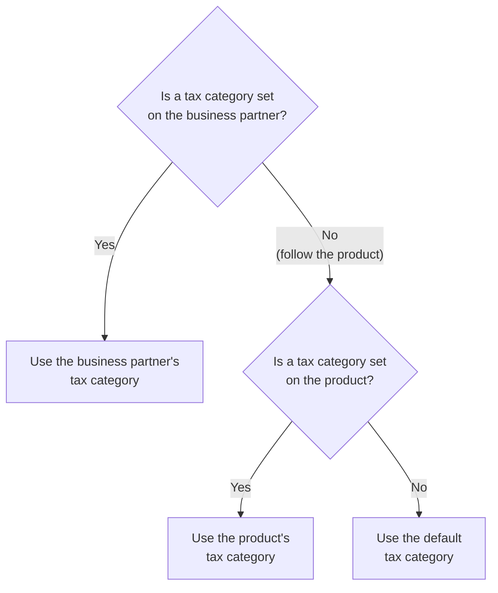

This app holds the consumption tax **categories** and their **rates**. Its operation code is `MS0F`.

[Products](/manual/en/operations/masters/product/user), [business partners](/manual/en/operations/masters/business-partner/user) and [charge items](/manual/en/operations/masters/charge-item/user) point at these categories, and the tax on a [quote](/manual/en/operations/sales/quote/user), a [delivery note](/manual/en/operations/shipping/delivery-note/user) and an [invoice](/manual/en/operations/billing/invoice/user) is decided from them.

Three categories are there from the start — 課税 (taxable, 10%), 軽減税率 (reduced, 8%) and 非課税 (exempt, 0%) — so **you normally leave this alone**. You come here when a rate changes, or when you need a category of your own.

## What you can do here

- Add, edit and delete tax categories.
- Keep a **history of rates** per category, so "what rate, from when" can be entered in advance.
- Choose the **default category** used when neither the product nor the business partner names one.
- Set the **account codes** each category writes into the journal CSV (only when they differ from the defaults in [Accounting export](/manual/en/operations/system/accounting/user)).

## Words on this page

- **税区分 (tax category)** … How consumption tax is treated — taxable, reduced, exempt and so on.
- **税率 (tax rate)** … The percentage for that category. Enter it as a percentage (10 means 10%).
- **適用開始日 (effective from)** … The day the rate starts. **There is no end date** — a rate runs until the day before the next one starts.
- **既定の税区分 (default tax category)** … Used when neither the product nor the business partner sets one. **Only one** can be the default.

## Reading the screen

Each category is shown as one card.

- The top of the card shows the category's name and code.
- 「**既定**」 (Default) marks the default tax category.
- 「**有効**」 / 「**無効**」 (Enabled / Disabled) shows whether the category can be used.
- 「**使用中**」 (In use) means a product, a business partner or an issued document uses the category. Otherwise it shows 「**未使用**」 (Not used).
- 「**現在の税率**」 (current tax rate) shows the rate used today. With no rate at all it shows 「**税率が未設定**」 (no tax rate set).
- 「**税率の履歴**」 (rate history) at the bottom of the card lists the rates, newest first. Each row shows the day it starts and the day it ends. The row in force reads "〜 現在" (to present) and is marked 「**現在の税率**」.
- To edit or delete a category, use the 「⋯」 button at the top right of the card.

## Which category is used

When working out the tax, the system decides in this order:

1. The **business partner's** 「課税区分」 (tax category), if it is set
2. If the partner is left empty (follow the product), the **product's** 「税区分」 (tax category) — for an extra charge, the charge item's
3. If both are empty, the **default** category

As a diagram:

> 💡 The partner comes first because a tax-exempt partner has to be billed at 0% whatever the product says. The flip side is that **a tax-exempt partner gets 0% even on a reduced-rate product**.

## Changing a rate

When the tax law changes, **add a new rate to the category** — do not delete the current row.

1. Press 「**税率を追加**」 (Add tax rate) on the category.
2. Put the day the new rate starts in 「**適用開始日**」 (Effective from).
3. Put the new percentage in 「**税率（%）**」 (Tax rate (%)) — 10 means 10%.
4. Press 「作成」 (Create).

Two rates with the same effective date cannot be registered. A row entered by mistake can be fixed with the pencil button at the right end of the row, or removed with the trash button.

Enter it with a future date and the current rate keeps being used until that day arrives. The row in force is marked 「**現在の税率**」 (current tax rate) in the list.

> ⚠️ **Take care when adding a rate that starts in the past.** Documents that are not yet final (draft quotes, a delivery note PDF you regenerate) change their rate back to that date. The screen warns you. **Issued invoices, quotes and delivery notes do not move** — their rate was written into each line when the document was made.

## Adding a category

When you need a category of your own (for example, to treat certain transactions separately), you can add one.

1. Press 「**税区分を追加**」 (Add tax category).
2. Fill in 「**コード**」 (code — letters, digits, hyphens and underscores) and 「**名称**」 (name).
3. 「**帳票の区分表示**」 (label on documents) can stay empty — left empty it is built from the rate, e.g. "10%".
4. To make this the default, switch on 「**既定の税区分**」 (default tax category). The category that was the default until then stops being the default.
5. Press 「作成」 (Create).
6. After creating it, add **at least one rate**. Without a rate the tax cannot be worked out.

> 💡 When you edit the category that is currently the default, its 「**既定の税区分**」 (default tax category) switch cannot be turned off (the screen shows 「**既定の税区分は外せません。先に別の税区分を既定にしてください。**」 (The default tax category cannot be unset. Make another category the default first.)). To move the default, open the category you want as the new default and switch on 「既定の税区分」. The previous category stops being the default automatically.

## Setting the account codes for accounting export

At the bottom of the add / edit screen for a category is the 「**会計連携**」 (Accounting export) section. It decides which codes this category's lines carry in the journal CSV exported from invoices.

- There are three: 「**消費税コード**」 (tax code), 「**売上高 科目コード**」 (sales account code) and 「**仮受消費税 科目コード**」 (tax suspense account code).
- Use half-width letters and digits, up to 16 characters.
- Left empty, the default codes set in [Accounting export](/manual/en/operations/system/accounting/user) (`SY0J`) are used. Fill them in only when your accounting software treats this category differently.

## When it will not delete

It cannot be deleted in the following cases. The screen tells you why.

- **A category already in use** … Products, business partners or issued documents point at it. To stop using it, switch 「**有効**」 (enabled) off instead. Products and documents already pointing at it keep working.
- **The default category** … Make another category the default first.
- **The last remaining rate** … Without a rate that category cannot be calculated. Add another rate first.

## Questions

**Q. If I fix a rate, do past invoices change?**
A. No. The rate is written into each line when the document is made. Changing the setting afterwards does not move an issued invoice, quote or delivery note.

**Q. Which date's rate is used?**
A. The **order date**. Even for a closing that spans the day a rate changes, the rate at the time the order was taken is used. With no order date it falls back to the shipping date, then to the closing date.

**Q. I have a product on the reduced rate.**
A. Choose 軽減税率 in the [product's](/manual/en/operations/masters/product/user) 「税区分」 (tax category). Also check that the 「課税区分」 (tax category) of each [business partner](/manual/en/operations/masters/business-partner/user) buying it is empty (it shows 「製品に従う」, follow the product). If the partner has 課税 set, the partner wins and the tax is worked out at 10%.

**Q. I have a tax-exempt business partner.**
A. Choose 非課税 in the [business partner's](/manual/en/operations/masters/business-partner/user) tax category. Their documents come out at 0% whatever the product says.

<!-- permissions:start -->
## Permissions required

Using this screen requires the **Master data** (`master`) permission.

| What you want to do | Permission needed |
| --- | --- |
| Open the screen, view lists and details | Master data — View |
| Add, change or delete | Master data — Create / Edit / Delete |

Viewing only needs *View*. Where a screen offers adding, changing or deleting, each of those needs its matching permission.

Permissions come through roles. If something is missing, ask an administrator.

For the whole picture see [Permissions and roles](../../../permissions).
<!-- permissions:end -->
