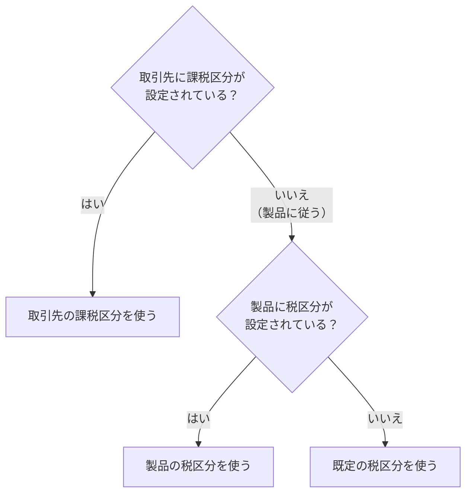

消費税の **区分** と **税率** を登録しておくアプリです。操作コードは `MS0F` です。

ここで決めた区分を[製品](/manual/ja/operations/masters/product/user)・[取引先](/manual/ja/operations/masters/business-partner/user)・[料金マスタ](/manual/ja/operations/masters/charge-item/user)が参照し、[見積書](/manual/ja/operations/sales/quote/user)・[納品書](/manual/ja/operations/shipping/delivery-note/user)・[請求書](/manual/ja/operations/billing/invoice/user)の消費税がここから決まります。

最初から「課税（10%）」「軽減税率（8%）」「非課税（0%）」の 3 つが入っているので、**ふだんは触りません**。税率が変わったときと、独自の区分を足したいときに使います。

## このアプリでできること

- 消費税の区分を追加・編集・削除できます。
- 区分ごとに **税率の履歴** を持てます。「いつから何 % か」を先に登録しておけます。
- どの区分も指定されていないときに使う **既定の区分** を決められます。
- 区分ごとに、仕訳 CSV に出す **科目コード** を決められます（[会計連携](/manual/ja/operations/system/accounting/user)の既定と違うときだけ）。

## 用語（このページで出てくる言葉）

- **税区分（ぜいくぶん）** … 消費税の扱いの分類です。「課税」「軽減税率」「非課税」など。
- **税率** … その区分でかかる消費税の割合です。10% や 8% のように % で入力します。
- **適用開始日（てきようかいしび）** … その税率を使いはじめる日です。**終了日はありません** — 次の税率が始まる前日までが有効です。
- **既定の税区分** … 製品にも取引先にも区分が設定されていないときに使う区分です。**1 つだけ**選べます。

## 画面の見かた

区分ごとに 1 枚のカードが並びます。

- カードの上には、区分の名前とコードが出ます。
- 「**既定**」の印は、既定の税区分です。
- 「**有効**」「**無効**」は、その区分が使える状態かどうかです。
- 「**使用中**」は、製品・取引先・発行済みの書類のどれかがその区分を使っている印です。使われていなければ「**未使用**」です。
- 「**現在の税率**」に、今日使われている率が出ます。率が 1 つも無いときは「**税率が未設定**」と出ます。
- カードの下の「**税率の履歴**」に、率が新しい順に並びます。各行には使いはじめる日と終わる日が出ます。いま使われている行は「〜 現在」となり、「**現在の税率**」の印が付きます。
- 区分の編集と削除は、カード右上の「⋯」ボタンから選びます。

## どの区分が使われるか

税額を計算するとき、システムは次の順番で区分を決めます。

1. **取引先** の「課税区分」が設定されていれば、それ
2. 取引先が「製品に従う」（空欄）なら、**製品**（追加料金なら料金項目）の「税区分」
3. どちらも空欄なら、**既定の税区分**

流れを図にすると次のとおりです。

> 💡 取引先が先なのは、非課税のお取引先には製品の区分に関わらず 0% で出す必要があるためです。裏を返すと、**非課税のお取引先には軽減税率の製品も 0%** になります。

## 税率を変える

税制が変わったときは、**その区分に新しい税率を足します**（今の行は消しません）。

1. 変えたい区分の「**税率を追加**」を押します。
2. 「**適用開始日**」に、新しい税率を使いはじめる日を入れます。
3. 「**税率（%）**」に新しい率を入れます（10 と入れると 10% です）。
4. 「作成」を押します。

同じ適用開始日の税率は 2 つ登録できません。入れ間違えた行は、行の右端の鉛筆のボタンで直せます。ごみ箱のボタンで消すこともできます。

先の日付で登録しておけば、その日が来るまでは今の税率が使われます。一覧では、いま
使われている行に「**現在の税率**」の印が付きます。

> ⚠️ **過去の日付から始まる税率を足すときは注意してください。** まだ確定していない書類（下書きの見積書、作り直す納品書の PDF）の税率が、その日付までさかのぼって変わります。画面にも警告が出ます。**発行済みの請求書・見積書・納品書は動きません** — 税率は書類を作った時点で 1 行ずつ書き込まれているためです。

## 区分を追加する

独自の区分（特定の取引だけ別扱いにしたい、など）が必要なときは追加できます。

1. 「**税区分を追加**」を押します。
2. 「**コード**」（英数字・ハイフン・アンダースコア）と「**名称**」を入れます。
3. 「**帳票の区分表示**」は空欄で構いません（空欄なら税率から「10%」のように組み立てます）。
4. この区分を既定にしたいときは「**既定の税区分**」をオンにします。オンにすると、それまで既定だった区分は既定ではなくなります。
5. 「作成」を押します。
6. 作成したら、その区分に **税率を 1 つ以上** 足してください。税率が無いと計算できません。

## 会計連携の科目コードを決める

区分の追加・編集の画面の下に「**会計連携**」の欄があります。請求書から書き出す仕訳 CSV に、この区分の行をどのコードで出すかを決めます。

- 「**消費税コード**」「**売上高 科目コード**」「**仮受消費税 科目コード**」の 3 つです。
- 半角の英数字で 16 文字までです。
- 空欄なら、[会計連携](/manual/ja/operations/system/accounting/user)（`SY0J`）で決めた既定のコードが使われます。会計ソフトの設定がその区分だけ違うときに入れます。

## 消せないとき

次の場合は削除できません。理由は画面に出ます。

- **すでに使われている区分** … 製品・取引先・発行済みの書類から参照されています。使わなくするだけなら「**有効**」を外してください。すでにその区分を指している製品や書類はそのまま動きます。
- **既定の税区分** … 先に別の区分を既定にしてから消してください。
- **最後の 1 つの税率** … 税率が無くなるとその区分で計算できなくなります。先に別の税率を足してください。

## よくある質問

**Q. 税率を直したら、過去の請求書も変わりますか。**
A. 変わりません。税率は書類を作った時点で 1 行ずつ書き込まれます。あとで設定を変えても、発行済みの請求書・見積書・納品書は動きません。

**Q. どの日付の税率が使われますか。**
A. **注文日**です。税率が変わる日をまたぐ締めでも、注文をいただいた時点の税率で計算されます。注文日が分からないときは出荷日、それも無いときは締日を使います。

**Q. 軽減税率の製品があります。どう設定しますか。**
A. [製品](/manual/ja/operations/masters/product/user)の「税区分」で「軽減税率」を選んでください。あわせて、その製品を買う[取引先](/manual/ja/operations/masters/business-partner/user)の「課税区分」が空欄（「製品に従う」と出ます）になっているか確かめてください。取引先に「課税」が入っていると取引先が優先され、10% で計算されます。

**Q. 非課税のお取引先がいます。**
A. [取引先](/manual/ja/operations/masters/business-partner/user)の「課税区分」で「非課税」を選んでください。その取引先の書類は、製品の区分に関わらず 0% になります。

<!-- permissions:start -->
## 必要な権限

この画面を使うには **マスタ管理**（`master`）の権限が要ります。

| したいこと | 必要な権限 |
| --- | --- |
| 画面を開く・一覧や詳細を見る | マスタ管理 の 閲覧 |
| 追加・変更・削除する | マスタ管理 の 作成 / 更新 / 削除 |

見るだけなら「閲覧」で足ります。追加・変更・削除の操作がある画面では、その操作にあたる権限がそれぞれ必要です。

権限は役割（ロール）を通して付きます。足りないときは管理者に相談してください。

権限の全体像は「[権限とロール](../../../permissions)」を参照してください。
<!-- permissions:end -->
