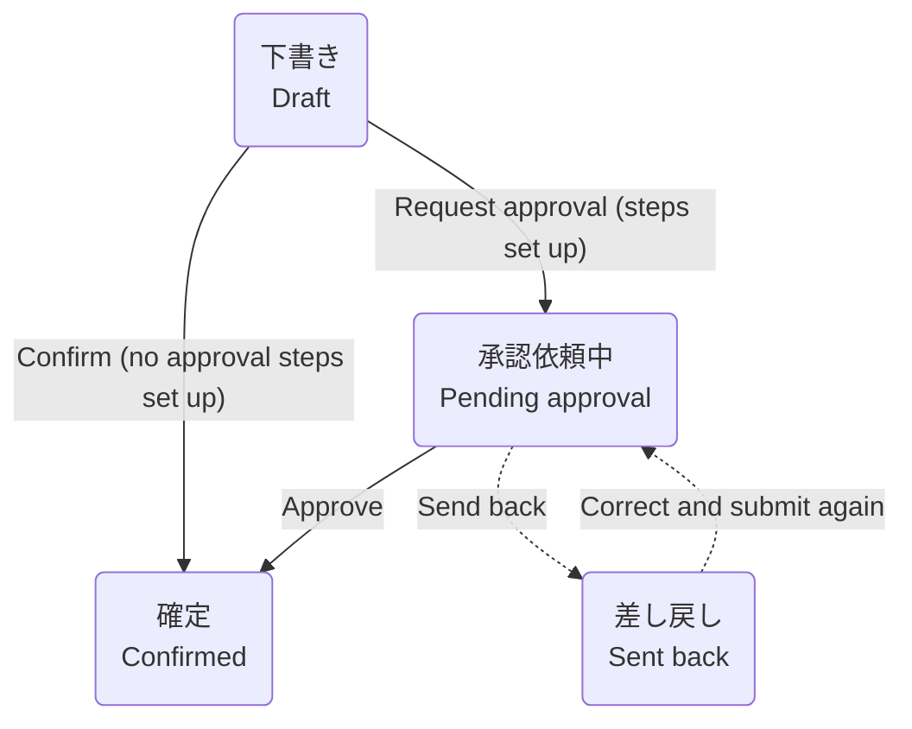
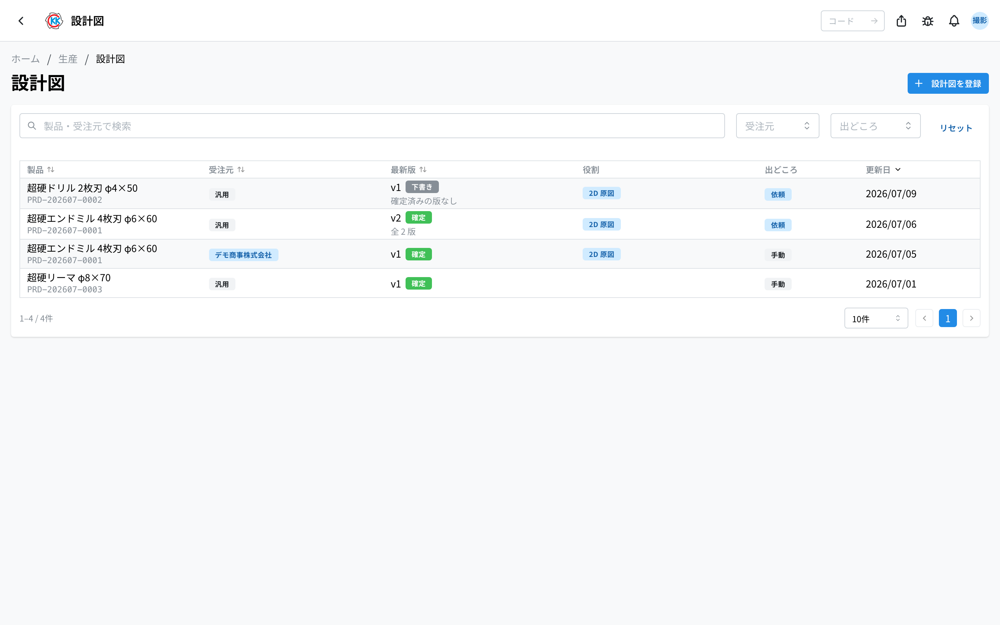
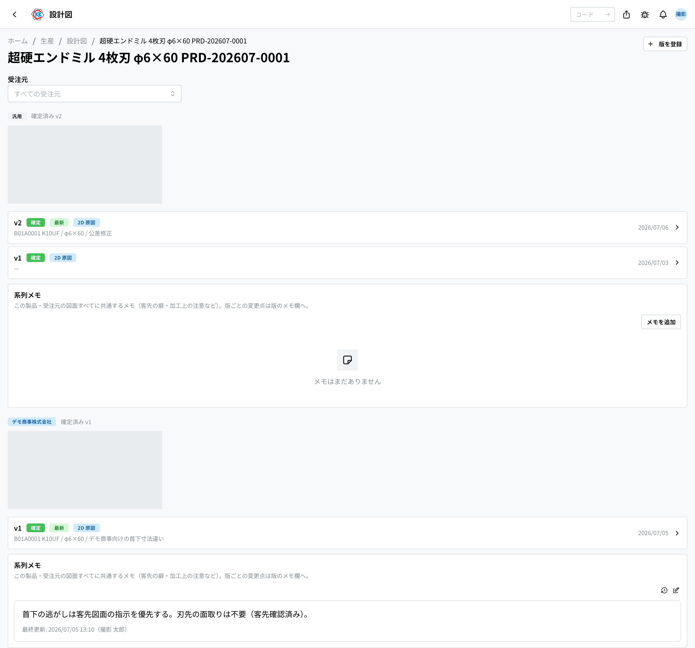
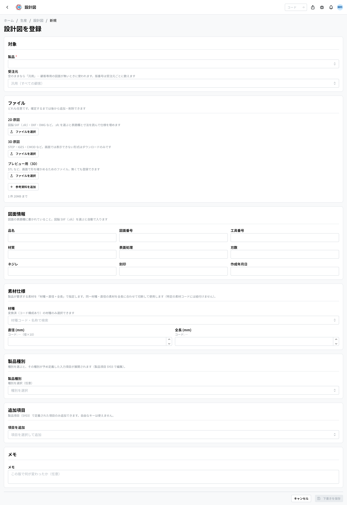
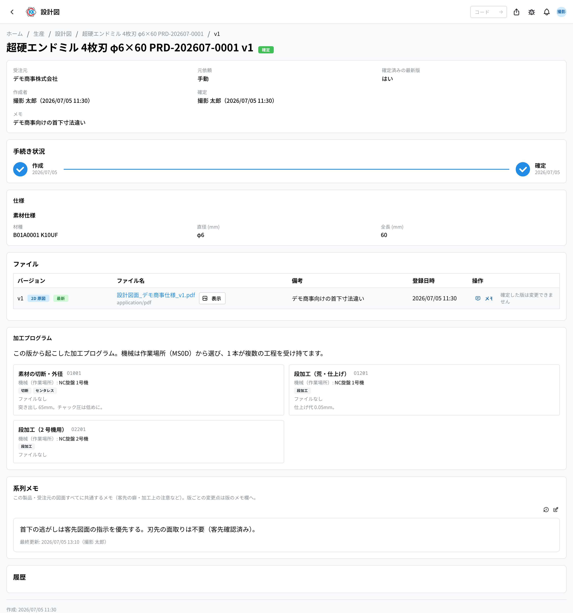

Register product drawings **as versions** and keep them **separate per ordering customer**. The operation code is `PD06`.

> ⚠️ This app is still in trial release. Screens and steps may change.

## What you can do

- Register a product drawing **as a version**. One registration is one version.
- Put a **2D drawing, 3D model, preview (STL and similar) and reference files** on one version. All of them are optional.
- Keep versions **separate per ordering customer**. The same product can grow a different drawing for each customer.
- Hold the product's **specification** (material type, diameter, length, product items) and its **title block** (part name, material, flutes …) on each version.
- Choose a **Zunou RAPID SXF (.sfc)** file and the title block and dimensions are read to fill in the specification automatically.
- A version moves **Draft → (approval) → Confirmed**. Until it is confirmed you can correct it as many times as you like.
- Open a registered version on screen (PDF and images render directly; 3D models such as STL can be rotated).
- Register a version as the deliverable of a [design request](/manual/en/operations/sales/design-request/user), which is what lets that request be completed.

**This is the only app that can register or edit drawings and specifications.** They also appear in the [product master](/manual/en/operations/masters/product/user) and in [design requests](/manual/en/operations/sales/design-request/user), but those are read-only. Without one place to write, version numbering and specifications would drift apart from screen to screen.

## Versions and series (how this app thinks)

### One registration = one version

Even if you upload a 2D drawing, a 3D model, a preview and reference files together, they **all share the same version number**. A version is a revision generation of the drawing, not a serial number per file. You can also create a **specification-only version** with no files at all.

### Versions are counted per product × ordering customer

The same product grows a separate drawing for each customer. This **combination of product and ordering customer** is called a series.

- Customer A's v3 and customer B's v1 live side by side on the same product.
- A series with the ordering customer left blank is the **generic** one. It is used when a customer has no dedicated drawing.
- **Another customer's series is never used.** Customer A's drawing will not appear on customer B's work order (that would mean making the wrong thing without noticing).

A work order picks its drawing in this order: the series whose ordering customer matches, then the generic one. **Only confirmed versions are used.**

### Version status (Draft → approval → Confirmed)

| Status | Meaning | Can it be corrected? |
|------|------|---------|
| **Draft** | A version that was just registered. Work orders and the product master cannot see it yet | Yes |
| **Pending approval** | A version waiting for approval | No |
| **Sent back** | A version the approver sent back. Correct it and submit it again | Yes |
| **Confirmed** | A usable version. Work orders and the product master read this version | No |

**Approval is optional.** It only goes through approval when steps are set up for "**Drawing version**" in [Approval settings](/manual/en/operations/masters/approval-setting/user) (MS0B). With no steps, one **Confirm** button confirms it.

As a diagram, the status moves like this:

**Each series has only one unconfirmed version at a time.** While a draft exists, you cannot create the next version in the same series (otherwise it would be unclear which one is the next version). Confirm it first, or delete the draft.

## Reading the screen

The list shows **one row per series**. Listing every version would repeat the same product many times and bury the series you are looking for.

| Column | Contents |
|----|------|
| Product | The product the drawing is for |
| Ordering customer | The customer. Blank series show as "Generic" |
| Latest version | The newest version number and its status. When it is a draft, the confirmed version is shown too |
| Role | The file types on the latest version |
| Source | "Request" if any version came from a design request, otherwise "Manual" |
| Updated | The date the newest version was updated |

Clicking a row opens that product's drawings **filtered to the row's series**. Use the "**Ordering customer**" dropdown at the top to switch to another series, or clear it to list **all series** by ordering customer. Each series shows a thumbnail of its latest confirmed version and a list of versions (status, spec summary, files). Click a version to open its screen. While filtered by an ordering customer, "**Register a version**" opens the registration screen with that customer already selected.

## Registering a drawing

1. Select **Register a drawing** at the top right of the list.
2. Choose the **Product** (required).
3. Choose the **Ordering customer**. Leave it blank for "Generic".
4. Choose the **File**s (all optional).
5. Check the **Title block** and **Specification** (they are filled in automatically when you choose an SXF file).
6. Select **Save draft**.

Saving creates a draft version and opens its screen. The version number is assigned automatically (the series' latest version plus one). **At this point work orders do not use it yet** — confirm it on the version screen.

### File roles

| Role | What goes in it |
|------|-------------|
| **2D drawing** | The 2D source drawing: Zunou SXF (.sfc), DXF, DWG and so on. The product's "latest drawing" points at this |
| **3D model** | The 3D source data: STEP, IGES, CIM3D and so on |
| **Preview** | A file for checking the shape on screen (STL and similar). Can be rotated |
| **Reference** | Part drawings, dimension tables and so on. Any number, each with its own description |

The source drawings and the preview take one file each; references can be as many as you need.

**The preview and the source drawings are chosen separately** because they are used differently. Even for the same shape, an STL is for looking at and a source drawing is for making from; neither substitutes for the other.

### Reading the specification from a Zunou SXF file

Choose a **.sfc file exported from Zunou RAPID in "SXF format"** as the 2D drawing and the drawing is read on the spot to fill in the following.

- **Title block** … the part name, drawing No., tool No., material, surface treatment, flutes, helix angle, marking and drawn date written in the title block
- **Diameter / length** … among the drawing's dimensions, the thickest φ dimension is read as the diameter and the longest length dimension as the length
- **Product items** … the items in [Product items](/manual/en/operations/system/product-type/settings) (SY03) whose name matches a word in the title block (e.g. 「図番」 ← drawing No.)
- **Ordering customer** … selected only when the title block's customer name (「お得意先名」) resolves to exactly one ordering customer. Otherwise choose it by hand

**Always check the values read before saving.** Items not written on the drawing are left unchanged. The material type cannot be decided from the drawing's "material" (such as ultra-fine-grain carbide), so choose it by hand.

**Fields read from the drawing are read-only** (they show "**Drawing**" above the field). To use a different value, press "**Edit manually**" on that field and overwrite it. **The drawing value stays shown above the field as "Drawing: …"**, so you can see later where it differs from the drawing. "**Revert to drawing value**" makes the field read-only again. The version screen also marks each value as "Drawing" or "Manual".

If you don't want to use the values read, press "**Detach drawing values**" in the blue box at the top; every field becomes editable again (the current values are kept).

> 💡 Only .sfc files exported from Zunou RAPID in "SXF format" can be read. DXF files and images are not read (they can still be attached as files). On drawings whose title-block frame differs from the company's standard spec drawing, some items will not be picked up.

### Supported files

There is no format restriction (20MB per file). However, only PDF, images and some 3D models (STL, OBJ, PLY, GLB, 3MF and so on) **open on screen**. Download SXF, STEP, IGES, DXF, DWG and CIM3D and open them in your own software.

## Correcting and confirming a version

The version screen can be corrected while the version is unconfirmed (Draft or Sent back).

- **Specification** … select **Edit** to correct the title block, material type, diameter, length, product items and memo. **Save** returns you to viewing.
- **Files** … add them with **Add files** (adding an SXF file updates the specification). Remove one with **Delete** on its row.
- **Confirm** … select **Confirm** when there are no approval steps, or **Approval request** when there are.
- **Delete version** … while it is a draft, the whole version can be deleted.

**A confirmed version cannot be corrected.** Changing a drawing means creating a new version; rewriting a past version would make it impossible to trace what something was made from.

## The product's specification is decided here

The product's **material type, diameter, length and product items** belong not to the product master but to **the confirmed drawing version**, because they change together with the drawing across revisions and customers.

The product master, the material candidates on a work order and product search pick one confirmed version in this order.

1. The version pinned by the work order, if it pins a drawing
2. The latest version of the series whose ordering customer matches
3. The latest version of the generic series
4. If none of those exists, the most recently confirmed version

## Registering as a design request deliverable

Selecting **Register as a drawing** on a [design request](/manual/en/operations/sales/design-request/user) detail screen opens the registration form with the **product and ordering customer fixed to that request**. The request decides those two, so they cannot be changed.

Once a version is registered (even as a draft), **Completed** becomes available on the request screen. **A request cannot be completed without at least one deliverable.** The version itself is confirmed on the Drawing side.

## Writing a memo on a file

In the file list on the version screen, selecting **Memo** on a row opens a memo **for that file alone**.

- Text can carry **bold, italic, bullet lists, headings, links** and so on.
- **It can be written even on a confirmed version.** What freezes is the drawing itself, not the notes about it.
- **Memos are internal.** They never appear on a printed document (PDF).

## Series memo (shared by product × ordering customer)

On the product screen, each ordering-customer section has a **Series memo**. Use it for **what applies to every drawing of that product and customer** (customer habits, machining notes and so on).

- **The series memo carries over** when a version is revised. Write what changed in a version in that version's memo.
- The generic series has one too.
- Deleting every version of a series also deletes its series memo.

Besides the product screen, the series memo also appears on the following screens. It is the same single memo wherever you see it.

- **The version screen** … a **Series memo** box below "Machining programs"; you can write it here too. This works even for a confirmed version (confirming freezes only the drawing itself). Someone who opened the version from a work order's drawing link can read the series notes here.
- **The step execution screen** (a work order step opened on the web) and **the step screen of the shared shop-floor device** … read-only. Which series is shown follows the same rule as machining programs — the drawing of the work order's customer series, otherwise the generic one. **Another customer's series memo never appears.** "Open in Drawings" takes you to where it is edited (that series on the product screen).
- If the series has no memo, the step screens show no series memo box.

## Machining programs

The **Machining programs** panel on the version screen holds the programs made from that version.

- **One program can cover several steps** (for example roughing and finishing in one program). Steps are picked from the process step master.
- **A program is assigned to machine models (any number).** Machine models are registered on the **Machine models** tab of [work locations](/manual/en/operations/masters/work-location/user#machine-models), where each machine is given its model. However many machines of the same type you have, one program is enough. Leave it empty for a program that runs on any machine model.
- The program number (such as O0001) and the file are both optional. You can record only the number and keep the program on the machine.
- **Programs can be added and changed even after the drawing is confirmed.** Confirming freezes only the drawing (files and specification).

### Program versions and "used"

A program has **versions (v1, v2 …)**. **When a step of a work order is started, the program versions shown at that moment are recorded, and those versions become "used".** Each card shows **Used (N steps)** or **Not used**.

| Program state | What you can do |
|---------------|-----------------|
| Version not used | **Edit** (change that version in place), **Delete** |
| Version used | **Create new version** (keep this version and make the next one with the changes), **Retire** |

- A used version cannot be edited. After a new version is created, **steps started from then on get the new version.** Steps already started keep seeing the version they were started with.
- Earlier versions can be read under **Earlier versions** on the card (their files can be downloaded too).
- A **retired** program is no longer shown to steps started from then on. Its versions and usage records are kept. A program with a used version cannot be deleted — retire it instead.

### Changes go through approval

Adding, editing, creating a new version, deleting and retiring are all **requests**. If the **Machining program change** flow in [approval settings](/manual/en/operations/masters/approval-setting/user) has steps, the request goes for approval and is applied on the final approval. **With no steps, it is applied at the moment it is requested.**

1. Press **Edit**, **Create new version** or the like on the card (for a new program, **Add program** at the top right).
2. Enter the content, write what you are changing and why in **Request note**, and press **Submit**.
3. While it waits, the card shows **Pending approval** and the request. Approvers get approve / send back buttons there (it is also listed in the [pending list](/manual/en/operations/general/my-tasks/user)).

> ⚠️ A step may start while the request waits, making the version used. Then an **Edit** request is not applied and shows as **Request not applied** with the reason. Request again with **Create new version**.

### On the step execution screen

The **step execution screen** of a work order (on the web and on shared devices) lists the programs that cover that step.

- The drawing version used is the one pinned on the work order; otherwise **the latest confirmed version in the work order's ordering-customer series, then the latest confirmed generic version.** It never falls back to another customer's drawings.
- Each program's **latest version** is shown (retired ones are left out). **A step that has started shows the versions recorded when it started.**
- **Programs for the machine model of the planned or actual machine come first**, marked **For this machine model**. On a shared device, the model of the device's default work location counts the same way.
- The file can be downloaded right there.

## Questions and problems

**Q. The version went back to v1 on the same product**
You are looking at a series with a different ordering customer. Versions are counted per product × ordering customer, so a drawing for a new customer starts at v1.

**Q. The drawing I registered does not appear on the work order**
The version is still a draft (or pending approval). Confirm it on the version screen. If there is no confirmed version, confirming one generic version (ordering customer left blank) makes it available to every customer's work orders.

**Q. I see "This series already has an unconfirmed version" and cannot register**
The same series has a version that is a draft (or pending approval, or sent back). Confirm or delete that version, then register.

**Q. I chose an SXF file but nothing was filled in**
If "Could not read the file as SXF" is shown, the file is not a .sfc exported from Zunou RAPID in "SXF format". Other formats such as AutoCAD (DXF) cannot be read.

**Q. I want to correct the material type or dimensions in the product master**
They cannot be corrected in the product master. Create a new version in Drawing, correct the specification and confirm it.

**Q. I cannot see "Register a drawing"**
You do not have permission to register drawings. Ask an administrator (almost everyone can view them).

<!-- permissions:start -->
## Permissions required

Using this screen requires the **Drawing** (`design_file`) permission.

| What you want to do | Permission needed |
| --- | --- |
| Open the screen, view lists and details | Drawing — View |
| Add, change or delete | Drawing — Create / Edit / Delete |

Viewing only needs *View*. Where a screen offers adding, changing or deleting, each of those needs its matching permission.

Permissions come through roles. If something is missing, ask an administrator.

For the whole picture see [Permissions and roles](../../../permissions).
<!-- permissions:end -->
